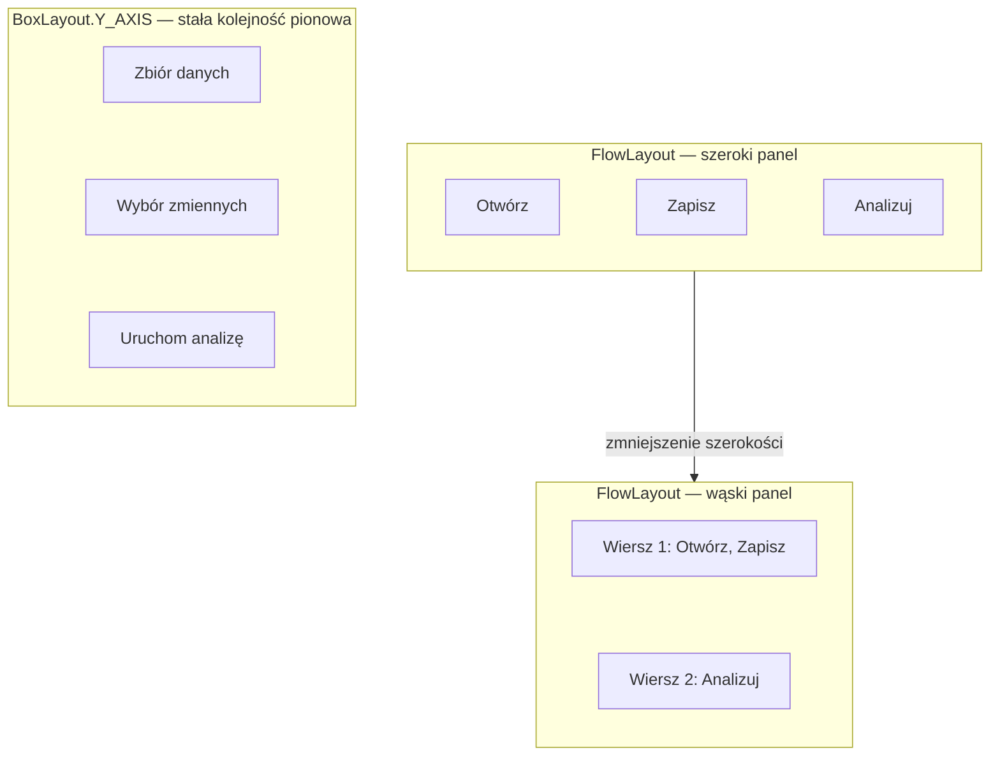
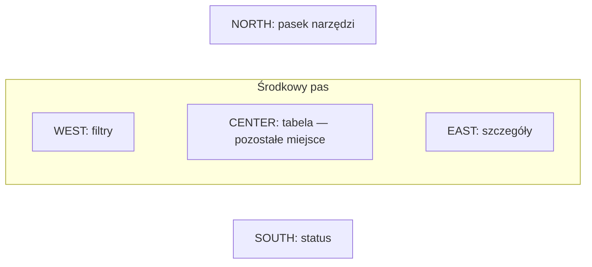
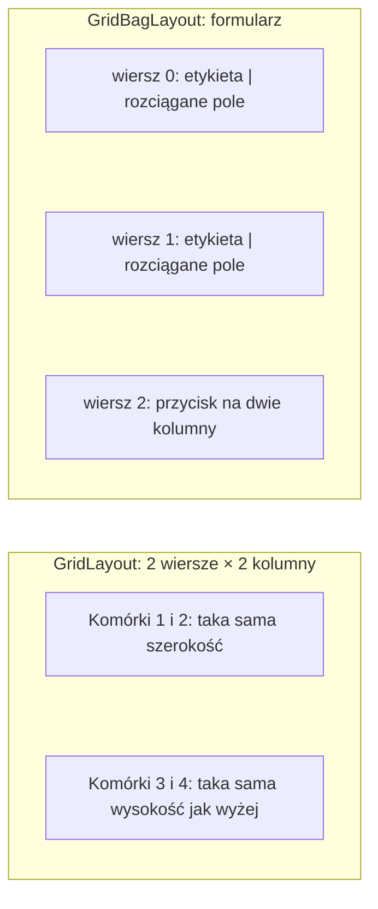
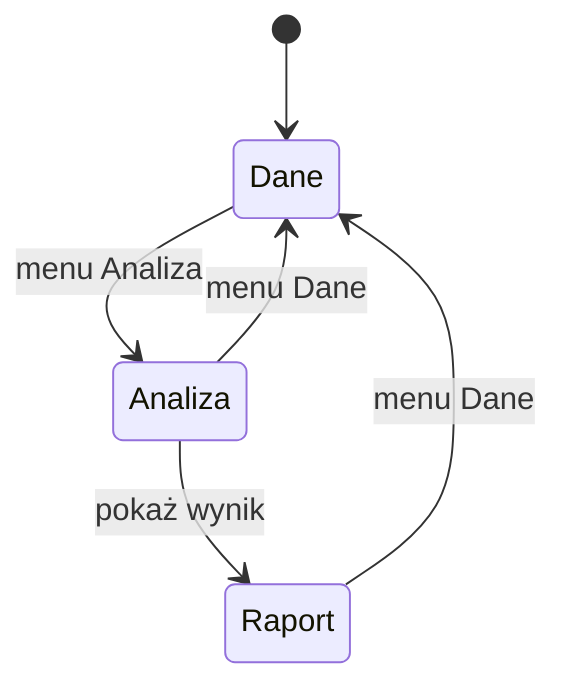
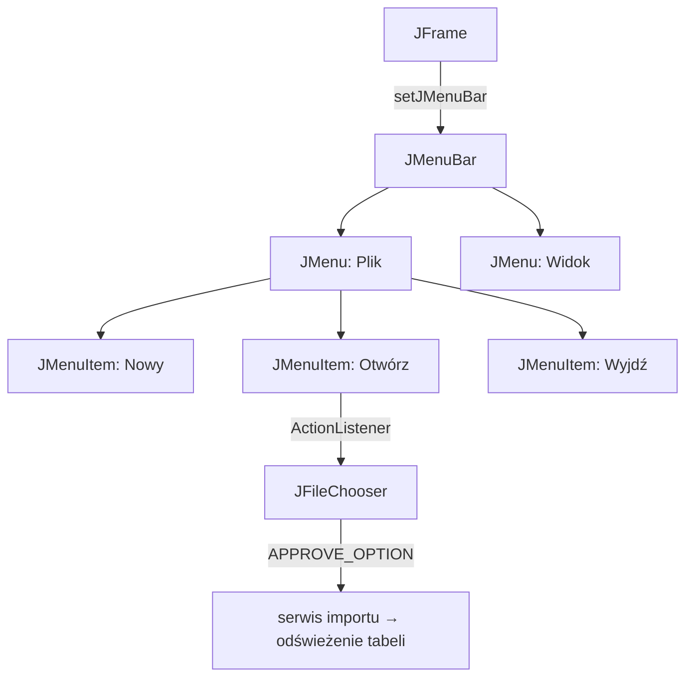
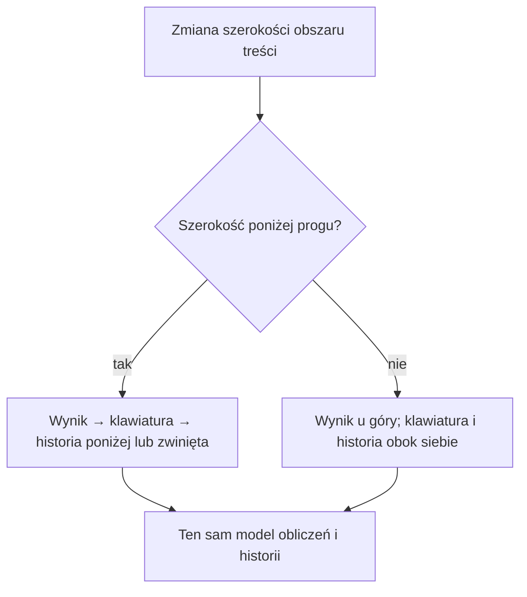

# Lab 1 - Graficzny interfejs użytkownika w Swing

<script type="module">
import mermaid from "https://cdn.jsdelivr.net/npm/mermaid@12/dist/mermaid.esm.min.mjs";
document.querySelectorAll(".language-mermaid").forEach((block) => block.classList.add("mermaid"));
mermaid.initialize({ startOnLoad: true });
</script>

## Zakres: 3 zajęcia

## Przygotowanie i cel

Utwórz projekt `lab1` zgodnie z [instrukcją IntelliJ IDEA](../srodowisko.md). Swing jest w JDK — nie dodawaj osobnej biblioteki. W przykładzie `Main` dopisz pakiet zgodny z projektem.

Swing jest częścią standardowej biblioteki Javy. W laboratorium poznajemy `JFrame`, panele, układy, podstawowe kontrolki i obsługę zdarzeń. Zbudujemy prosty kalkulator oraz przygotujemy miejsce na kolejne widoki.

## Minimalne okno

```java
import javax.swing.*;
import java.awt.*;

public class Main {
    public static void main(String[] args) {
        SwingUtilities.invokeLater(() -> {
            JFrame frame = new JFrame("Lab 1");
            frame.setDefaultCloseOperation(JFrame.EXIT_ON_CLOSE);

            JPanel panel = new JPanel(new BorderLayout(8, 8));
            JLabel label = new JLabel("Witaj w Swing", SwingConstants.CENTER);
            JButton button = new JButton("Kliknij");
            button.addActionListener(event ->
                    label.setText("Przycisk został kliknięty"));

            panel.add(label, BorderLayout.CENTER);
            panel.add(button, BorderLayout.SOUTH);
            frame.setContentPane(panel);
            frame.pack();
            frame.setLocationRelativeTo(null);
            frame.setVisible(true);
        });
    }
}
```

Kod interfejsu uruchamiamy w wątku zdarzeń Swing, czyli przez `SwingUtilities.invokeLater`. Układ (`BorderLayout`, `GridLayout`, `BoxLayout`) powinien odpowiadać strukturze widoku; unikaj ustawiania pozycji każdego komponentu za pomocą `setBounds`.

## Menedżery układu komponentów

Swing jest biblioteką zdarzeniową: program wyświetla widok, nasłuchuje działań użytkownika i reaguje na zdarzenia. Komponenty są umieszczane w kontenerach, takich jak `JFrame` i `JPanel`. Za wyliczenie ich pozycji i rozmiarów odpowiada `LayoutManager`.

Najważniejsze menedżery układu:

| Menedżer | Zastosowanie |
|---|---|
| `FlowLayout` | układa komponenty kolejno w wierszu; jest domyślny dla `JPanel` |
| `BorderLayout` | dzieli obszar na `NORTH`, `SOUTH`, `EAST`, `WEST`, `CENTER`; często używany dla głównego okna |
| `GridLayout` | tworzy regularną siatkę komórek o jednakowym rozmiarze |
| `GridBagLayout` | pozwala budować elastyczne formularze za pomocą `GridBagConstraints` |
| `BoxLayout` | układa komponenty pionowo albo poziomo |
| `CardLayout` | przełącza wiele paneli zajmujących ten sam obszar |

Zamiast tworzyć całe okno jednym layoutem, zwykle buduje się je z zagnieżdżonych paneli:

```java
JPanel main = new JPanel(new BorderLayout(8, 8));
JPanel actions = new JPanel(new FlowLayout(FlowLayout.RIGHT));
JPanel fields = new JPanel(new GridLayout(2, 2, 6, 6));

fields.add(new JLabel("Nazwa"));
fields.add(new JTextField(16));
fields.add(new JLabel("Wartość"));
fields.add(new JTextField(16));
actions.add(new JButton("Zapisz"));

main.add(fields, BorderLayout.CENTER);
main.add(actions, BorderLayout.SOUTH);
```

`setLayout(null)` oraz ręczne `setBounds` mogą być przydatne w bardzo specjalizowanym komponencie, ale utrudniają zmianę rozmiaru okna, różne rozdzielczości i lokalizację interfejsu. W formularzach używaj layout managerów.

## Kontrolki i zdarzenia

Najczęściej używane elementy to `JLabel`, `JButton`, `JTextField`, `JTextArea`, `JCheckBox`, `JComboBox`, `JTable` i `JOptionPane`.

```java
JTextField first = new JTextField(10);
JTextField second = new JTextField(10);
JLabel result = new JLabel("Wynik");
JButton add = new JButton("Dodaj");

add.addActionListener(event -> {
    try {
        double a = Double.parseDouble(first.getText());
        double b = Double.parseDouble(second.getText());
        result.setText(String.valueOf(a + b));
    } catch (NumberFormatException ex) {
        JOptionPane.showMessageDialog(null,
                "Wprowadź poprawne liczby", "Błąd", JOptionPane.ERROR_MESSAGE);
    }
});
```

W większej aplikacji warto oddzielić model danych i logikę obliczeń od kodu budującego widok. Sam listener powinien wywoływać metodę serwisu, a nie zawierać całą logikę biznesową.

## Zadania

1. Utwórz aplikację z menu `Plik` i pozycjami `Nowy`, `Otwórz`, `Zapisz`, `Wyjdź`. Każda pozycja ma wykonać działanie albo wyświetlić komunikat.
2. Zbuduj responsywny kalkulator z przyciskami cyfr, działań, przecinka, `C` i `=`, nieedytowalnym wynikiem oraz historią. Wykonaj ćwiczenie „Responsywny kalkulator, HiDPI i dwa motywy” poniżej.
3. Obsłuż błędny format liczby, dzielenie przez zero i próbę wykonania działania bez obu argumentów.
4. Utwórz `JPanel` rysujący szachownicę przez przesłonięcie `paintComponent(Graphics)`. Użyj `Graphics2D` i `fillRect`.
5. Dodaj formularz rejestracji z polami imię, nazwisko, login, hasło i powtórzenie hasła. Waliduj puste pola oraz zgodność haseł.
6. Wyświetl listę obiektów `Student` w `JTable`. Dodaj przyciski odświeżania, usuwania i filtrowania.
7. Zmień aplikację tak, aby każdy widok był osobnym panelem, a menu przełączało zawartość głównego panelu.

## Pytania kontrolne

1. Dlaczego kod Swing uruchamia się w EDT?
2. Czym różni się `JPanel` od `JFrame`?
3. Jaką rolę pełni layout manager?
4. Gdzie powinna znajdować się walidacja danych i logika obliczeń?

## Plan pracy na trzy spotkania

| Spotkanie | Praca | Punkt kontrolny |
|---|---|---|
| 1 | okno, EDT, porównanie layoutów, menu i kalkulator | zmiana rozmiaru nie ukrywa przycisków, menu reaguje |
| 2 | formularz, walidacja, `CardLayout` | błąd nie kasuje wpisanych danych, menu przełącza widok |
| 3 | tabela, filtrowanie, rysowanie i porządkowanie klas | usuwany jest właściwy rekord po sortowaniu |

Zadania z listy realizuj w tych etapach. Rejestracja i lista studentów ćwiczą kontrolki; we własnym projekcie zastosuj je do obserwacji, zmiennych i zbiorów danych ekonomicznych.

## Jak layout zmienia rozmieszczenie

Mermaid pokazuje zasadę działania, a nie dokładne współrzędne komponentów. Strzałki oznaczają kolejność lub zależność, nie przewody widoczne w oknie.

### FlowLayout i BoxLayout



`FlowLayout` zawija komponenty do kolejnego wiersza. `BoxLayout` nie zawija: rozdziela miejsce wzdłuż wybranej osi, uwzględniając minimalny, preferowany i maksymalny rozmiar. Dla formularza sprawdź również `setAlignmentX` i odstępy `Box.createVerticalStrut(8)`.

### BorderLayout



Do każdego obszaru dodaj jeden komponent — jeżeli ma ich być kilka, dodaj panel. `NORTH` i `SOUTH` wykorzystują preferowaną wysokość, `EAST` i `WEST` preferowaną szerokość, a `CENTER` dostaje resztę. Zmieniaj rozmiar okna i obserwuj przede wszystkim środek.

### GridLayout i GridBagLayout



`GridLayout` wyrównuje rozmiar wszystkich komórek. W `GridBagLayout` pozycję określają `gridx/gridy`, liczbę zajętych kolumn `gridwidth`, udział w dodatkowym miejscu `weightx/weighty`, a wypełnienie komórki `fill`. Samo `fill=HORIZONTAL` nie nadaje kolumnie udziału w wolnej przestrzeni — potrzebne jest też `weightx`.

```java
JPanel form = new JPanel(new GridBagLayout());
GridBagConstraints c = new GridBagConstraints();
c.insets = new Insets(4, 4, 4, 4);
c.gridx = 0; c.gridy = 0;
c.anchor = GridBagConstraints.LINE_END;
form.add(new JLabel("Nazwa zbioru:"), c);
c.gridx = 1;
c.weightx = 1.0;
c.fill = GridBagConstraints.HORIZONTAL;
form.add(new JTextField(20), c);
```

### CardLayout — kilka widoków, jeden obszar



```java
CardLayout cards = new CardLayout();
JPanel views = new JPanel(cards);
views.add(new JPanel(), "dane");
views.add(new JPanel(), "analiza");
// W listenerze menu:
cards.show(views, "analiza");
```

## JMenu — od hierarchii do działającego menu



Fragment wstaw wewnątrz tworzenia okna, gdy zmienna `frame` już istnieje:

```java
JMenuBar menuBar = new JMenuBar();
JMenu fileMenu = new JMenu("Plik");
JMenuItem open = new JMenuItem("Otwórz...");
open.setAccelerator(KeyStroke.getKeyStroke("control O"));
open.addActionListener(event -> {
    JFileChooser chooser = new JFileChooser();
    if (chooser.showOpenDialog(frame) == JFileChooser.APPROVE_OPTION) {
        JOptionPane.showMessageDialog(frame,
                "Wybrano: " + chooser.getSelectedFile().getName());
        // W kolejnym etapie przekazujemy plik do serwisu importu.
    }
});
JMenuItem exit = new JMenuItem("Wyjdź");
exit.addActionListener(event -> frame.dispose());
fileMenu.add(open);
fileMenu.addSeparator();
fileMenu.add(exit);
menuBar.add(fileMenu);
frame.setJMenuBar(menuBar);
```

Efekt: u góry okna jest pasek `Plik`; rozwinięcie pokazuje pozycje menu, a `Otwórz` uruchamia okno wyboru pliku. Anulowanie nie zmienia danych.


Ilustracje są renderami rzeczywistych komponentów Swing wygenerowanymi przez [kod galerii](demo/README.md), bez ramki systemowego okna. To nie makiety narysowane ręcznie. Galerię można uruchomić w IntelliJ, zmieniać rozmiar okna i klikać menu.

## Tabela, rysowanie i responsywność

Model danych tabeli oddziel od widoku, np. przez `AbstractTableModel`. `JTable` umieść w `JScrollPane`. Po sortowaniu numer zaznaczonego wiersza jest indeksem widoku:

```java
int selected = table.getSelectedRow();
if (selected >= 0) {
    int modelRow = table.convertRowIndexToModel(selected);
    // Usuń rekord z modelu pod modelRow, następnie zgłoś zmianę modelu.
}
```

W `paintComponent` najpierw wywołaj `super.paintComponent(g)`. Rysuj według aktualnych `getWidth()` i `getHeight()`. Zmianę obrazu zlecaj przez `repaint()`, nie przez bezpośrednie wywołanie `paintComponent`.

Długie odczyty pliku i zapytania do bazy wykonuj przez `SwingWorker`: `doInBackground()` pracuje w tle, a `done()` aktualizuje GUI w EDT. Nie wywołuj blokującego `get()` w listenerze przed zakończeniem zadania.

## Sprawdzenie i oddanie

Obowiązuje również [macierz testów responsywności, HiDPI i motywów](../jakosc-gui.md).

| Próba | Oczekiwany wynik |
|---|---|
| zmniejszenie i powiększenie okna | komponenty zachowują sensowny układ; tabela ma przewijanie |
| puste pole, `abc`, dzielenie przez zero | czytelny błąd bez zamknięcia aplikacji |
| liczba `2,5` w kalkulatorze | jawna obsługa polskiego separatora, np. zamiana przecinka na kropkę przed parsowaniem |
| sortowanie tabeli i usunięcie wiersza | znika wskazany obiekt, nie obiekt z innego indeksu |
| anulowanie wyboru pliku | dotychczasowy stan pozostaje |

Oddaj projekt Maven, krótki opis zastosowanych layoutów i po jednym zrzucie formularza, tabeli oraz rozwiniętego menu. Dodaj opis dwóch wykrytych błędów i sposobu ich obsługi. Zastąp dane studentów obserwacjami ekonomicznymi i pokaż średnią wybranej kolumny.

## Ćwiczenie: responsywny kalkulator, HiDPI i dwa motywy

Rozwijaj kalkulator ze spotkania 1 podczas spotkań 2–3. Nie jest to drugi projekt: dodajesz adaptacyjny układ, styl i testy do tej samej aplikacji.

1. Wynik umieść na górze, klawiaturę w `GridLayout`, a historię w przewijanym panelu. Przyciski mają wypełniać dostępne komórki.
2. W szerokim oknie historię pokaż obok klawiatury; w wąskim przenieś ją pod klawiaturę albo udostępnij jako rozwijaną sekcję. Wybierz i uzasadnij próg szerokości, początkowo np. 600 jednostek logicznych obszaru treści.
3. Przełączenie układu nie może zerować obliczeń ani tworzyć nowego modelu. Przenoś istniejące panele, nie dodawaj tej samej kontrolki do dwóch kontenerów.
4. Długi wynik wyrównaj do prawej i umożliw jego odczyt/przewijanie. Nie ściskaj czcionki do nieczytelnego rozmiaru. Ustal minimalny rozmiar okna na podstawie czytelności kontrolek.
5. Dodaj menu **Widok → Motyw → Jasny / Ciemny**, zapamiętanie wyboru i obsługę klawiatury: cyfry, Enter oraz Escape. Fokus ma pozostać widoczny w obu motywach.
6. Wykonaj [testy 100%, 150%, 200%](../jakosc-gui.md), także dla rozwiniętego menu i komunikatu dzielenia przez zero. Zachowaj rozpoczęte działanie podczas zmiany motywu.



W `ComponentAdapter.componentResized` porównaj szerokość panelu z progiem. Zmieniaj układ tylko wtedy, gdy zmienia się wariant wąski/szeroki, po czym wywołaj `revalidate()` i `repaint()`. Nie wykonuj `pack()` przy każdym zdarzeniu — użytkownik powinien zachować kontrolę nad rozmiarem okna.

### Motywy Swing przez Look and Feel

W tym ćwiczeniu użyj FlatLaf, który udostępnia jasny i ciemny wygląd oraz obsługę HiDPI. Dodaj do `dependencies` projektu kalkulatora poniższą ustaloną wersję i zsynchronizuj Maven. Podstawowy Swing i wcześniejsza galeria nadal nie wymagają tej biblioteki. [Dokumentacja FlatLaf](https://www.formdev.com/flatlaf/).

```xml
<dependency>
    <groupId>com.formdev</groupId>
    <artifactId>flatlaf</artifactId>
    <version>3.7</version>
</dependency>
```

Przed utworzeniem komponentów w EDT ustaw początkowy motyw przez `FlatLightLaf.setup()` albo `FlatDarkLaf.setup()`, zgodnie z zapisaną preferencją. Poniższą metodę umieść w klasie pomocniczej i wywołuj z listenera menu, czyli również w EDT:

```java
static void setDarkTheme(boolean dark) {
    boolean installed = dark
            ? com.formdev.flatlaf.FlatDarkLaf.setup()
            : com.formdev.flatlaf.FlatLightLaf.setup();
    if (!installed) {
        throw new IllegalStateException("Nie udało się zmienić motywu");
    }
    com.formdev.flatlaf.FlatLaf.updateUI();
    java.util.prefs.Preferences.userRoot()
            .node("pl/uczelnia/lab1/calculator").putBoolean("dark", dark);
}
```

Nie ustawiaj na każdej kontrolce stałego `Color.WHITE` ani `Color.BLACK`. Własne rysowanie odczytuje aktualne kolory z `UIManager`, np. `Panel.background` i `Label.foreground`; nie przechowuj starego koloru na zawsze. Dodatkowe role kolorów definiuj osobno dla obu motywów. [Konfiguracja kolorów FlatLaf](https://www.formdev.com/flatlaf/how-to-customize/).

**Odbiór ćwiczenia:** kalkulator działa w obu układach i motywach, zachowuje stan, ma czytelne przyciski i wynik przy 200%, a historia i błędy są dostępne także w najmniejszym obsługiwanym oknie. Do oddania dołącz macierz testów i cztery zrzuty zgodnie ze wspólną instrukcją.
