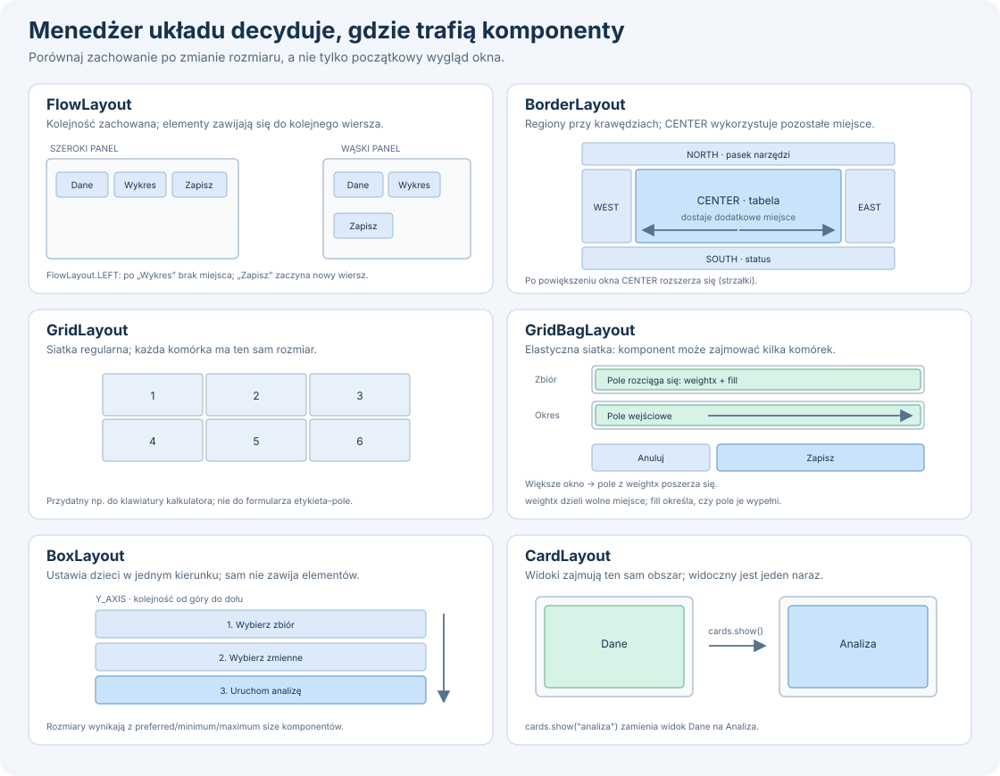
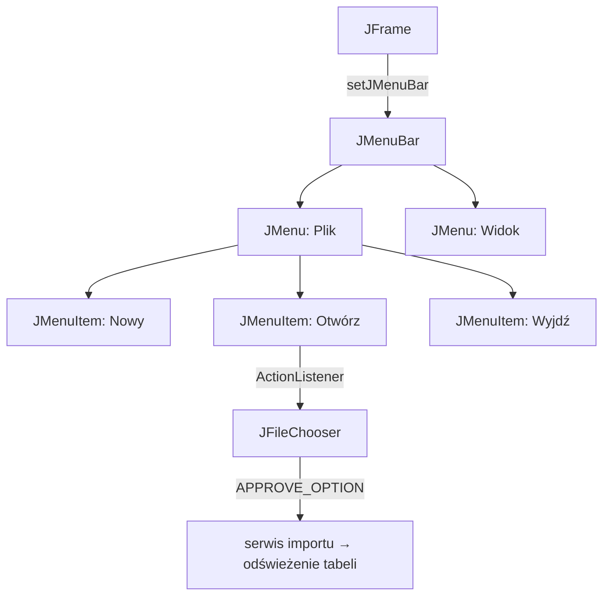
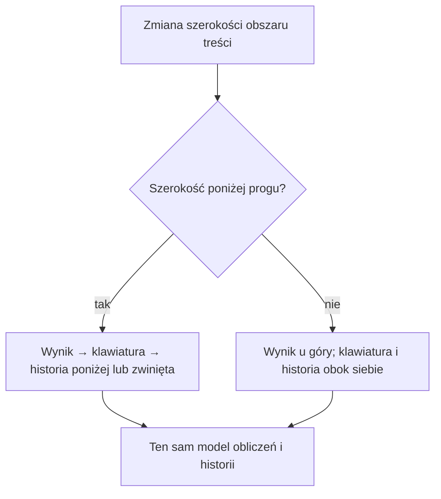

# Lab 1 - Graficzny interfejs użytkownika w Swing

## Przygotowanie i cel

Utwórz projekt `lab1` zgodnie z [instrukcją IntelliJ IDEA](../srodowisko.html). Swing jest w JDK — nie dodawaj osobnej biblioteki. W przykładzie `Main` dopisz pakiet zgodny z projektem.

Swing jest częścią standardowej biblioteki Javy. W laboratorium poznajemy `JFrame`, panele, układy, podstawowe kontrolki i obsługę zdarzeń. Zbudujemy prosty kalkulator oraz przygotujemy miejsce na kolejne widoki.

## Minimalne okno

```java
import javax.swing.*;
import java.awt.*;

public class Main {
    public static void main(String[] args) {
        SwingUtilities.invokeLater(() -> {
            JFrame frame = new JFrame("Lab 1");
            frame.setDefaultCloseOperation(JFrame.EXIT_ON_CLOSE);

            JPanel panel = new JPanel(new BorderLayout(8, 8));
            JLabel label = new JLabel("Witaj w Swing", SwingConstants.CENTER);
            JButton button = new JButton("Kliknij");
            button.addActionListener(event ->
                    label.setText("Przycisk został kliknięty"));

            panel.add(label, BorderLayout.CENTER);
            panel.add(button, BorderLayout.SOUTH);
            frame.setContentPane(panel);
            frame.pack();
            frame.setLocationRelativeTo(null);
            frame.setVisible(true);
        });
    }
}
```

Kod interfejsu uruchamiamy w wątku zdarzeń Swing, czyli przez `SwingUtilities.invokeLater`. Układ (`BorderLayout`, `GridLayout`, `BoxLayout`) powinien odpowiadać strukturze widoku; unikaj ustawiania pozycji każdego komponentu za pomocą `setBounds`.

## Menedżery układu komponentów

Kontener, np. `JPanel`, powierza menedżerowi układu obliczenie pozycji i rozmiarów swoich dzieci. Wybierz go według struktury widoku — nie ustawiaj współrzędnych każdego przycisku ręcznie.



### Układ wierszowy lub jednokierunkowy

**`FlowLayout`** układa elementy kolejno. Domyślnie wyśrodkowuje je w wierszu; w pokazanym przykładzie użyto `FlowLayout.LEFT`, więc nowy wiersz zaczyna się od lewej. Gdy brakuje szerokości, przenosi kolejny komponent do nowego wiersza; nie rozciąga go, by wypełnić wolne miejsce. To domyślny układ `JPanel` i dobry wybór dla krótkiego paska akcji.

#### Zmień szerokość i zobacz zawijanie

<style>
  .po2-flow-demo {
    --flow-ink: #18243a;
    --flow-muted: #697991;
    --flow-shell: #f4f7fc;
    --flow-window: #ffffff;
    --flow-titlebar: #f7f9fc;
    --flow-line: #e2e8f1;
    --flow-action: #ffffff;
    --flow-action-hover: #f1f5fc;
    --flow-accent: #356fe5;
    --flow-accent-soft: #eaf1ff;
    --flow-chart: #557fe4;
    --flow-grid: rgba(78, 105, 151, 0.12);
    --flow-layout-bg: #ebe3f7;
    --flow-layout-edge: #d3c3e5;
    --flow-shadow: 0 18px 48px rgba(39, 58, 91, 0.14);
    box-sizing: border-box;
    margin: 1.25rem 0;
    padding: clamp(1rem, 3vw, 1.5rem);
    overflow: hidden;
    border: 1px solid var(--flow-line);
    border-radius: 1.15rem;
    background: linear-gradient(145deg, var(--flow-shell), var(--flow-window));
    color: var(--flow-ink);
    color-scheme: light dark;
  }

  @media (prefers-color-scheme: dark) {
    .po2-flow-demo {
      --flow-ink: #e7edf7;
      --flow-muted: #9baac0;
      --flow-shell: #161d2b;
      --flow-window: #1c2535;
      --flow-titlebar: #202b3e;
      --flow-line: #344158;
      --flow-action: #273349;
      --flow-action-hover: #33435e;
      --flow-accent: #86aaff;
      --flow-accent-soft: #2a3b5c;
      --flow-chart: #89aaff;
      --flow-grid: rgba(176, 196, 232, 0.12);
      --flow-layout-bg: #332b42;
      --flow-layout-edge: #514267;
      --flow-shadow: 0 18px 48px rgba(0, 0, 0, 0.32);
    }
  }

  .po2-flow-demo *,
  .po2-flow-demo *::before,
  .po2-flow-demo *::after {
    box-sizing: border-box;
  }

  .po2-flow-demo h4 {
    margin: 0 0 0.4rem;
    color: var(--flow-ink);
  }

  .po2-flow-demo__hint {
    display: flex;
    align-items: center;
    gap: 0.55rem;
    margin: 0 0 1rem;
    color: var(--flow-muted);
    font-size: 0.94em;
  }

  .po2-flow-demo__legend {
    display: flex;
    align-items: flex-start;
    gap: 0.65rem;
    margin: 0 0 0.75rem;
    color: var(--flow-muted);
    font-size: 0.9em;
    line-height: 1.5;
  }

  .po2-flow-demo__legend-swatch {
    width: 1rem;
    height: 1rem;
    flex: 0 0 auto;
    margin-top: 0.16rem;
    border: 1px solid var(--flow-layout-edge);
    border-radius: 0.25rem;
    background: var(--flow-layout-bg);
  }

  .po2-flow-demo__explanation {
    margin: 0 0 1rem;
    color: var(--flow-muted);
    font-size: 0.94em;
    line-height: 1.55;
  }

  .po2-flow-demo__hint-icon {
    display: inline-grid;
    width: 1.5rem;
    height: 1.5rem;
    flex: 0 0 auto;
    place-items: center;
    border-radius: 50%;
    background: var(--flow-accent-soft);
    color: var(--flow-accent);
    font-weight: 700;
  }

  .po2-flow-demo__window {
    position: relative;
    width: min(100%, 36rem);
    min-width: 17rem;
    max-width: 100%;
    margin: 0 auto;
    overflow: auto;
    resize: horizontal;
    container-name: flow-window;
    container-type: inline-size;
    border: 1px solid var(--flow-line);
    border-radius: 0.85rem;
    background: var(--flow-window);
    box-shadow: var(--flow-shadow);
    color: var(--flow-ink);
  }

  .po2-flow-demo__titlebar {
    display: flex;
    height: 2.75rem;
    align-items: center;
    justify-content: space-between;
    padding-left: 0.85rem;
    border-bottom: 1px solid var(--flow-line);
    background: var(--flow-titlebar);
  }

  .po2-flow-demo__brand {
    display: flex;
    min-width: 0;
    align-items: center;
    gap: 0.55rem;
    color: var(--flow-muted);
    font-size: 0.82rem;
    font-weight: 600;
  }

  .po2-flow-demo__app-icon {
    display: grid;
    width: 1.45rem;
    height: 1.45rem;
    flex: 0 0 auto;
    place-items: center;
    border-radius: 0.42rem;
    background: linear-gradient(145deg, #5f8df5, #345fc4);
    color: #fff;
  }

  .po2-flow-demo__app-icon svg {
    width: 0.9rem;
    height: 0.9rem;
  }

  .po2-flow-demo__window-title {
    overflow: hidden;
    text-overflow: ellipsis;
    white-space: nowrap;
  }

  .po2-flow-demo__window-controls {
    display: flex;
    height: 100%;
    flex: 0 0 auto;
    align-items: stretch;
  }

  .po2-flow-demo__window-control {
    display: grid;
    width: 2.6rem;
    place-items: center;
    color: var(--flow-muted);
    font-size: 0.8rem;
  }

  .po2-flow-demo__window-control--close {
    width: 2.9rem;
    font-size: 1.1rem;
  }

  .po2-flow-demo__toolbar {
    position: relative;
    height: 3.55rem;
    background: var(--flow-layout-bg);
    transition: height 480ms cubic-bezier(0.2, 0.75, 0.25, 1);
  }

  .po2-flow-demo__action {
    position: absolute;
    top: 0.55rem;
    display: flex;
    height: 2.45rem;
    align-items: center;
    justify-content: center;
    gap: 0.5rem;
    padding: 0 0.65rem;
    border: 1px solid var(--flow-line);
    border-radius: 0.55rem;
    background: var(--flow-action);
    color: var(--flow-ink);
    font: inherit;
    font-size: 0.84rem;
    font-weight: 600;
    white-space: nowrap;
    box-shadow: 0 1px 2px rgba(20, 36, 64, 0.05);
    transition: top 480ms cubic-bezier(0.2, 0.75, 0.25, 1),
      left 480ms cubic-bezier(0.2, 0.75, 0.25, 1),
      background-color 180ms ease,
      box-shadow 180ms ease;
  }

  .po2-flow-demo__action:hover {
    background: var(--flow-action-hover);
    box-shadow: 0 4px 12px rgba(20, 36, 64, 0.1);
  }

  .po2-flow-demo__action--data {
    left: 0.75rem;
    width: 5rem;
  }

  .po2-flow-demo__action--chart {
    left: 6rem;
    width: 5.5rem;
  }

  .po2-flow-demo__action--save {
    left: 11.75rem;
    width: 5.5rem;
    border-color: transparent;
    background: var(--flow-accent-soft);
    color: var(--flow-accent);
  }

  .po2-flow-demo__action svg {
    width: 1rem;
    height: 1rem;
    flex: 0 0 auto;
    fill: none;
    stroke: currentColor;
    stroke-linecap: round;
    stroke-linejoin: round;
    stroke-width: 1.7;
  }

  .po2-flow-demo__content {
    padding: 1rem 1.15rem 0.75rem;
  }

  .po2-flow-demo__report-head {
    display: flex;
    align-items: center;
    justify-content: space-between;
    gap: 0.75rem;
    margin-bottom: 0.85rem;
  }

  .po2-flow-demo__eyebrow {
    margin: 0 0 0.2rem;
    color: var(--flow-muted);
    font-size: 0.66rem;
    font-weight: 700;
    letter-spacing: 0.08em;
    text-transform: uppercase;
  }

  .po2-flow-demo__report-title {
    margin: 0;
    color: var(--flow-ink);
    font-size: 0.96rem;
    font-weight: 700;
  }

  .po2-flow-demo__metric {
    flex: 0 0 auto;
    padding: 0.35rem 0.55rem;
    border: 1px solid var(--flow-line);
    border-radius: 999px;
    background: var(--flow-shell);
    color: var(--flow-accent);
    font-size: 0.75rem;
    font-weight: 700;
  }

  .po2-flow-demo__chart {
    display: flex;
    height: 5.25rem;
    align-items: end;
    justify-content: space-around;
    gap: 0.55rem;
    padding: 0.5rem 0.6rem 0;
    border-bottom: 1px solid var(--flow-line);
    background: repeating-linear-gradient(
      to bottom,
      transparent 0,
      transparent 1.55rem,
      var(--flow-grid) 1.58rem,
      transparent 1.62rem
    );
  }

  .po2-flow-demo__bar {
    width: min(1.25rem, 12%);
    height: var(--bar-height);
    border-radius: 0.3rem 0.3rem 0 0;
    background: linear-gradient(180deg, var(--flow-chart), var(--flow-accent));
    opacity: 0.86;
    transition: height 360ms ease, opacity 180ms ease;
  }

  .po2-flow-demo__bar:hover {
    opacity: 1;
  }

  .po2-flow-demo__bar:nth-child(1) { --bar-height: 42%; }
  .po2-flow-demo__bar:nth-child(2) { --bar-height: 58%; }
  .po2-flow-demo__bar:nth-child(3) { --bar-height: 50%; }
  .po2-flow-demo__bar:nth-child(4) { --bar-height: 72%; }
  .po2-flow-demo__bar:nth-child(5) { --bar-height: 64%; }
  .po2-flow-demo__bar:nth-child(6) { --bar-height: 88%; }

  .po2-flow-demo__axis {
    display: flex;
    justify-content: space-around;
    padding: 0.35rem 0.4rem 0;
    color: var(--flow-muted);
    font-size: 0.65rem;
  }

  .po2-flow-demo__status {
    display: flex;
    min-height: 2.35rem;
    align-items: center;
    justify-content: space-between;
    gap: 0.6rem;
    padding: 0.55rem 0.9rem;
    border-top: 1px solid var(--flow-line);
    color: var(--flow-muted);
    font-size: 0.72rem;
  }

  .po2-flow-demo__status-state {
    display: inline-flex;
    align-items: center;
    gap: 0.4rem;
    transition: opacity 180ms ease, transform 240ms ease;
  }

  .po2-flow-demo__status-dot {
    width: 0.45rem;
    height: 0.45rem;
    border-radius: 50%;
    background: #36a879;
    box-shadow: 0 0 0 3px rgba(54, 168, 121, 0.13);
  }

  .po2-flow-demo__status--narrow {
    display: none;
  }

  .po2-flow-demo__resize-hint {
    position: absolute;
    right: 0.3rem;
    bottom: 0.3rem;
    width: 0.65rem;
    height: 0.65rem;
    background: repeating-linear-gradient(135deg, transparent 0 2px, var(--flow-muted) 2px 3px);
    opacity: 0.55;
    pointer-events: none;
  }

  @container flow-window (max-width: 18rem) {
    .po2-flow-demo__toolbar {
      height: 6.55rem;
    }

    .po2-flow-demo__action--save {
      top: 3.55rem;
      left: 0.75rem;
    }

    .po2-flow-demo__status--wide {
      display: none;
    }

    .po2-flow-demo__status--narrow {
      display: inline-flex;
    }
  }

  @media (max-width: 340px) {
    .po2-flow-demo__window {
      min-width: 0;
      width: 100%;
      resize: none;
    }
  }

  @media (prefers-reduced-motion: reduce) {
    .po2-flow-demo__toolbar,
    .po2-flow-demo__action,
    .po2-flow-demo__bar,
    .po2-flow-demo__status-state {
      transition: none;
    }
  }
</style>

<section class="po2-flow-demo" aria-labelledby="po2-flow-demo-title">
  <h4 id="po2-flow-demo-title"><code>FlowLayout.LEFT</code> · pasek narzędzi</h4>
  <p class="po2-flow-demo__legend"><span class="po2-flow-demo__legend-swatch" aria-hidden="true"></span><span>Fioletowym tłem oznaczono pasek narzędzi — kontener z <code>FlowLayout.LEFT</code>. Przyciski „Dane”, „Wykres” i „Zapisz” są jego elementami.</span></p>
  <p class="po2-flow-demo__explanation">Gdy zwężysz okno i przyciski nie zmieszczą się w jednym wierszu, „Zapisz” przejdzie na początek następnego wiersza, wyrównanego do lewej. Przyciski zachowają swój rozmiar; po poszerzeniu okna wrócą do jednego wiersza.</p>
  <p class="po2-flow-demo__hint"><span class="po2-flow-demo__hint-icon" aria-hidden="true">↔</span>Przeciągnij uchwyt w prawym dolnym rogu okna, aby zmienić jego szerokość.</p>
  <div class="po2-flow-demo__window" role="group" aria-label="Podgląd okna aplikacji Analiza">
    <div class="po2-flow-demo__titlebar">
      <div class="po2-flow-demo__brand">
        <span class="po2-flow-demo__app-icon" aria-hidden="true">
          <svg viewBox="0 0 20 20"><path d="M3 15.5 7.2 10l3 2.5L16.5 5" fill="none" stroke="currentColor" stroke-linecap="round" stroke-linejoin="round" stroke-width="1.8"/><path d="M12.7 5H16.5v3.8" fill="none" stroke="currentColor" stroke-linecap="round" stroke-linejoin="round" stroke-width="1.8"/></svg>
        </span>
        <span class="po2-flow-demo__window-title">Analiza · panel danych</span>
      </div>
      <div class="po2-flow-demo__window-controls" aria-hidden="true">
        <span class="po2-flow-demo__window-control">&#x2013;</span>
        <span class="po2-flow-demo__window-control">&#x25A1;</span>
        <span class="po2-flow-demo__window-control po2-flow-demo__window-control--close">&#xD7;</span>
      </div>
    </div>
    <div class="po2-flow-demo__toolbar" role="group" aria-label="Pasek narzędzi">
      <span class="po2-flow-demo__action po2-flow-demo__action--data">
        <svg viewBox="0 0 20 20" aria-hidden="true"><rect x="3" y="3.5" width="14" height="13" rx="2"/><path d="M3 8h14M8 8v8.5"/></svg>
        Dane
      </span>
      <span class="po2-flow-demo__action po2-flow-demo__action--chart">
        <svg viewBox="0 0 20 20" aria-hidden="true"><path d="M3 16.5V4M3 16.5h14"/><path d="m5.5 13 3-3 2.5 2 4.5-5"/></svg>
        Wykres
      </span>
      <span class="po2-flow-demo__action po2-flow-demo__action--save">
        <svg viewBox="0 0 20 20" aria-hidden="true"><path d="M10 3.5v9m-3.5-3.5L10 12.5l3.5-3.5M4 14v2.5h12V14"/></svg>
        Zapisz
      </span>
    </div>
    <div class="po2-flow-demo__content">
      <div class="po2-flow-demo__report-head">
        <div>
          <p class="po2-flow-demo__eyebrow">Dane miesięczne · 2025</p>
          <p class="po2-flow-demo__report-title">Sprzedaż detaliczna</p>
        </div>
        <span class="po2-flow-demo__metric">+4,8% r/r</span>
      </div>
      <div class="po2-flow-demo__chart" role="img" aria-label="Przykładowy wykres sprzedaży rosnącej w ciągu sześciu miesięcy">
        <span class="po2-flow-demo__bar"></span>
        <span class="po2-flow-demo__bar"></span>
        <span class="po2-flow-demo__bar"></span>
        <span class="po2-flow-demo__bar"></span>
        <span class="po2-flow-demo__bar"></span>
        <span class="po2-flow-demo__bar"></span>
      </div>
      <div class="po2-flow-demo__axis" aria-hidden="true"><span>sty</span><span>mar</span><span>maj</span><span>lip</span><span>wrz</span><span>lis</span></div>
    </div>
    <div class="po2-flow-demo__status" aria-live="polite">
      <span class="po2-flow-demo__status-state po2-flow-demo__status--wide"><span class="po2-flow-demo__status-dot"></span>Wszystkie akcje w jednym wierszu</span>
      <span class="po2-flow-demo__status-state po2-flow-demo__status--narrow"><span class="po2-flow-demo__status-dot"></span>„Zapisz” w nowym wierszu</span>
      <code>FlowLayout.LEFT</code>
    </div>
    <span class="po2-flow-demo__resize-hint" aria-hidden="true"></span>
  </div>
</section>

<style>
  .po2-layout-demo {
    --layout-ink: #18243a;
    --layout-muted: #697991;
    --layout-shell: #f4f7fc;
    --layout-window: #ffffff;
    --layout-titlebar: #f7f9fc;
    --layout-line: #e2e8f1;
    --layout-surface: #ffffff;
    --layout-region: #ebe3f7;
    --layout-region-edge: #d3c3e5;
    --layout-accent: #356fe5;
    --layout-accent-soft: #eaf1ff;
    --layout-shadow: 0 18px 48px rgba(39, 58, 91, 0.14);
    box-sizing: border-box;
    margin: 1.25rem 0;
    padding: clamp(1rem, 3vw, 1.5rem);
    overflow: hidden;
    border: 1px solid var(--layout-line);
    border-radius: 1.15rem;
    background: linear-gradient(145deg, var(--layout-shell), var(--layout-window));
    color: var(--layout-ink);
    color-scheme: light dark;
    font-family: system-ui, -apple-system, "Segoe UI", sans-serif;
  }

  @media (prefers-color-scheme: dark) {
    .po2-layout-demo {
      --layout-ink: #e7edf7;
      --layout-muted: #9baac0;
      --layout-shell: #161d2b;
      --layout-window: #1c2535;
      --layout-titlebar: #202b3e;
      --layout-line: #344158;
      --layout-surface: #273349;
      --layout-region: #332b42;
      --layout-region-edge: #514267;
      --layout-accent: #86aaff;
      --layout-accent-soft: #2a3b5c;
      --layout-shadow: 0 18px 48px rgba(0, 0, 0, 0.32);
    }
  }

  .po2-layout-demo *,
  .po2-layout-demo *::before,
  .po2-layout-demo *::after {
    box-sizing: border-box;
  }

  .po2-layout-demo h4 {
    margin: 0 0 0.4rem;
    color: var(--layout-ink);
  }

  .po2-layout-demo__legend {
    display: flex;
    align-items: flex-start;
    gap: 0.65rem;
    margin: 0 0 0.75rem;
    color: var(--layout-muted);
    font-size: 0.9em;
    line-height: 1.5;
  }

  .po2-layout-demo__swatch {
    width: 1rem;
    height: 1rem;
    flex: 0 0 auto;
    margin-top: 0.16rem;
    border: 1px solid var(--layout-region-edge);
    border-radius: 0.25rem;
    background: var(--layout-region);
  }

  .po2-layout-demo__explanation {
    margin: 0 0 0.65rem;
    color: var(--layout-muted);
    font-size: 0.94em;
    line-height: 1.55;
  }

  .po2-layout-demo__hint {
    display: flex;
    align-items: center;
    gap: 0.55rem;
    margin: 0 0 1rem;
    color: var(--layout-muted);
    font-size: 0.9em;
  }

  .po2-layout-demo__hint-icon {
    display: inline-grid;
    width: 1.5rem;
    height: 1.5rem;
    flex: 0 0 auto;
    place-items: center;
    border-radius: 50%;
    background: var(--layout-accent-soft);
    color: var(--layout-accent);
    font-weight: 700;
  }

  .po2-layout-demo__window {
    position: relative;
    width: min(100%, 38rem);
    min-width: 17rem;
    max-width: 100%;
    margin: 0 auto;
    overflow: auto;
    resize: horizontal;
    border: 1px solid var(--layout-line);
    border-radius: 0.85rem;
    background: var(--layout-window);
    box-shadow: var(--layout-shadow);
    color: var(--layout-ink);
  }

  .po2-layout-demo__window--border {
    container-name: border-window;
    container-type: inline-size;
  }

  .po2-layout-demo__window--grid {
    container-name: grid-window;
    container-type: inline-size;
  }

  .po2-layout-demo__window--gridbag {
    container-name: gridbag-window;
    container-type: inline-size;
  }

  .po2-layout-demo__window--box {
    container-name: box-window;
    container-type: inline-size;
  }

  .po2-layout-demo__window--card {
    container-name: card-window;
    container-type: inline-size;
  }

  .po2-layout-demo__titlebar {
    display: flex;
    height: 2.75rem;
    align-items: center;
    justify-content: space-between;
    padding-left: 0.85rem;
    border-bottom: 1px solid var(--layout-line);
    background: var(--layout-titlebar);
  }

  .po2-layout-demo__brand {
    display: flex;
    min-width: 0;
    align-items: center;
    gap: 0.55rem;
    color: var(--layout-muted);
    font-size: 0.82rem;
    font-weight: 600;
  }

  .po2-layout-demo__app-icon {
    display: grid;
    width: 1.45rem;
    height: 1.45rem;
    flex: 0 0 auto;
    place-items: center;
    border-radius: 0.42rem;
    background: linear-gradient(145deg, #5f8df5, #345fc4);
    color: #ffffff;
    font-size: 0.65rem;
    font-weight: 800;
  }

  .po2-layout-demo__window-title {
    overflow: hidden;
    text-overflow: ellipsis;
    white-space: nowrap;
  }

  .po2-layout-demo__window-controls {
    display: flex;
    height: 100%;
    flex: 0 0 auto;
    align-items: stretch;
  }

  .po2-layout-demo__window-control {
    display: grid;
    width: 2.4rem;
    place-items: center;
    color: var(--layout-muted);
    font-size: 0.85rem;
  }

  .po2-layout-demo__window-control--close {
    width: 2.7rem;
    color: #c74c55;
    font-size: 1.1rem;
  }

  .po2-layout-demo__status {
    display: flex;
    min-height: 2.35rem;
    align-items: center;
    justify-content: space-between;
    gap: 0.6rem;
    padding: 0.55rem 0.9rem;
    border-top: 1px solid var(--layout-line);
    color: var(--layout-muted);
    font-size: 0.72rem;
  }

  .po2-layout-demo__status code {
    flex: 0 0 auto;
  }

  .po2-layout-demo__status--compact {
    display: none;
  }

  .po2-layout-demo__board {
    background: var(--layout-region);
  }

  .po2-layout-demo__area {
    display: flex;
    min-width: 0;
    align-items: center;
    justify-content: center;
    flex-direction: column;
    gap: 0.12rem;
    padding: 0.3rem;
    border-radius: 0.55rem;
    background: var(--layout-surface);
    color: var(--layout-ink);
    text-align: center;
  }

  .po2-layout-demo__area small {
    color: var(--layout-muted);
    font-size: 0.62rem;
  }

  .po2-layout-demo__border-board {
    display: grid;
    width: 100%;
    height: 11rem;
    grid-template-columns: 3.7rem minmax(0, 1fr) 3.7rem;
    grid-template-rows: 2rem minmax(0, 1fr) 1.75rem;
    grid-template-areas: "north north north" "west center east" "south south south";
    gap: 0.4rem;
    padding: 0.65rem;
  }

  .po2-layout-demo__border-north { grid-area: north; }
  .po2-layout-demo__border-west { grid-area: west; }
  .po2-layout-demo__border-center { grid-area: center; }
  .po2-layout-demo__border-east { grid-area: east; }
  .po2-layout-demo__border-south { grid-area: south; }

  .po2-layout-demo__grid-board {
    display: grid;
    width: 100%;
    height: 11rem;
    grid-template-columns: repeat(3, minmax(0, 1fr));
    grid-template-rows: repeat(2, minmax(0, 1fr));
    gap: 0.55rem;
    padding: 0.65rem;
  }

  .po2-layout-demo__grid-cell {
    display: grid;
    min-width: 0;
    align-content: center;
    justify-items: center;
    gap: 0.15rem;
    padding: 0.3rem;
    border-radius: 0.6rem;
    background: var(--layout-surface);
    text-align: center;
    overflow-wrap: anywhere;
  }

  .po2-layout-demo__grid-cell strong {
    font-size: 0.8rem;
  }

  .po2-layout-demo__grid-cell small {
    color: var(--layout-muted);
    font-size: 0.64rem;
  }

  .po2-layout-demo__gridbag-board {
    display: grid;
    min-height: 11rem;
    align-content: center;
    gap: 0.7rem;
    padding: 0.85rem;
  }

  .po2-layout-demo__gridbag-form {
    display: grid;
    grid-template-columns: minmax(5rem, 7rem) minmax(0, 1fr);
    align-items: center;
    gap: 0.6rem 0.7rem;
  }

  .po2-layout-demo__gridbag-label {
    color: var(--layout-ink);
    font-size: 0.74rem;
    text-align: right;
    white-space: nowrap;
  }

  .po2-layout-demo__field {
    display: flex;
    width: 100%;
    min-width: 0;
    min-height: 2rem;
    align-items: center;
    justify-content: space-between;
    gap: 0.5rem;
    padding: 0.35rem 0.55rem;
    border-radius: 0.42rem;
    background: var(--layout-surface);
    color: var(--layout-ink);
    font-size: 0.72rem;
  }

  .po2-layout-demo__field-value {
    overflow: hidden;
    text-overflow: ellipsis;
    white-space: nowrap;
  }

  .po2-layout-demo__field-caret {
    flex: 0 0 auto;
    color: var(--layout-muted);
  }

  .po2-layout-demo__gridbag-submit {
    grid-column: 2;
    justify-self: start;
    padding: 0.42rem 0.7rem;
    border: 0;
    border-radius: 0.45rem;
    background: var(--layout-accent);
    color: #ffffff;
    font: inherit;
    font-size: 0.7rem;
    font-weight: 700;
  }

  .po2-layout-demo__constraint {
    justify-self: end;
    padding: 0.25rem 0.45rem;
    border-radius: 999px;
    background: var(--layout-surface);
    color: var(--layout-muted);
    font-size: 0.65rem;
  }

  .po2-layout-demo__box-viewport {
    margin: 0.65rem;
    border-radius: 0.7rem;
    overflow-x: auto;
    overflow-y: hidden;
    scrollbar-color: var(--layout-muted) transparent;
    scrollbar-width: thin;
  }

  .po2-layout-demo__box-row {
    display: flex;
    width: max-content;
    min-width: 100%;
    min-height: 9rem;
    align-items: stretch;
    gap: 0.6rem;
    padding: 0.7rem;
  }

  .po2-layout-demo__box-item {
    display: grid;
    width: 8rem;
    flex: 0 0 8rem;
    align-content: center;
    gap: 0.35rem;
    padding: 0.75rem;
    border-radius: 0.6rem;
    background: var(--layout-surface);
  }

  .po2-layout-demo__box-item small {
    color: var(--layout-muted);
    font-size: 0.68rem;
  }

  .po2-layout-demo__card-board {
    position: relative;
    min-height: 12rem;
    padding: 0.7rem;
    background: var(--layout-region);
  }

  .po2-layout-demo__card-choice {
    position: absolute;
    width: 1px;
    height: 1px;
    overflow: hidden;
    clip: rect(0, 0, 0, 0);
    clip-path: inset(50%);
    white-space: nowrap;
  }

  .po2-layout-demo__card-tab {
    display: inline-flex;
    min-height: 2rem;
    align-items: center;
    margin-right: 0.3rem;
    padding: 0.4rem 0.7rem;
    border-radius: 0.5rem;
    color: var(--layout-muted);
    cursor: pointer;
    font-size: 0.72rem;
    font-weight: 650;
  }

  .po2-layout-demo__card-choice:checked + .po2-layout-demo__card-tab {
    background: var(--layout-surface);
    color: var(--layout-accent);
  }

  .po2-layout-demo__card-choice:focus-visible + .po2-layout-demo__card-tab {
    outline: 2px solid var(--layout-accent);
    outline-offset: 2px;
  }

  .po2-layout-demo__card-pages {
    margin-top: 0.5rem;
  }

  .po2-layout-demo__card-page {
    display: none;
    min-height: 8rem;
    align-content: center;
    gap: 0.5rem;
    padding: 0.85rem;
    border-radius: 0.6rem;
    background: var(--layout-surface);
  }

  #po2-card-data:checked ~ .po2-layout-demo__card-pages .po2-layout-demo__card-page--data,
  #po2-card-results:checked ~ .po2-layout-demo__card-pages .po2-layout-demo__card-page--results {
    display: grid;
  }

  .po2-layout-demo__card-page p {
    margin: 0;
    color: var(--layout-muted);
    font-size: 0.75rem;
  }

  .po2-layout-demo__card-metrics {
    display: flex;
    flex-wrap: wrap;
    gap: 0.45rem;
  }

  .po2-layout-demo__card-metric {
    padding: 0.35rem 0.55rem;
    border-radius: 0.45rem;
    background: var(--layout-accent-soft);
    color: var(--layout-accent);
    font-size: 0.7rem;
    font-weight: 700;
  }

  .po2-layout-demo__card-status-data,
  .po2-layout-demo__card-status-results {
    display: none;
  }

  .po2-layout-demo__window--card:has(#po2-card-data:checked) .po2-layout-demo__card-status-data,
  .po2-layout-demo__window--card:has(#po2-card-results:checked) .po2-layout-demo__card-status-results {
    display: inline;
  }

  @container border-window (max-width: 26rem) {
    .po2-layout-demo__status--wide { display: none; }
    .po2-layout-demo__status--compact { display: inline; }
  }

  @container grid-window (max-width: 26rem) {
    .po2-layout-demo__status--wide { display: none; }
    .po2-layout-demo__status--compact { display: inline; }
  }

  @container gridbag-window (max-width: 26rem) {
    .po2-layout-demo__status--wide { display: none; }
    .po2-layout-demo__status--compact { display: inline; }
  }

  @container box-window (max-width: 26rem) {
    .po2-layout-demo__status--wide { display: none; }
    .po2-layout-demo__status--compact { display: inline; }
  }

  @media (max-width: 340px) {
    .po2-layout-demo__window {
      width: 100%;
      min-width: 0;
      resize: none;
    }
  }
</style>

**`BoxLayout`** układa elementy wzdłuż jednej osi (`X_AXIS` albo `Y_AXIS`) i nie zawija ich do kolejnego wiersza. Rozmiar każdego dziecka zależy od jego minimalnego, preferowanego i maksymalnego rozmiaru. Użyj go np. dla pionowej listy kroków lub formularza.

#### Zmień szerokość i sprawdź brak zawijania

<section class="po2-layout-demo" aria-labelledby="po2-box-demo-title">
  <h4 id="po2-box-demo-title"><code>BoxLayout.X_AXIS</code> · pasek modułów</h4>
  <p class="po2-layout-demo__legend"><span class="po2-layout-demo__swatch" aria-hidden="true"></span><span>Podświetlony panel jest kontenerem z <code>BoxLayout.X_AXIS</code>. Karty pozostają w jednym poziomym wierszu — ten układ ich nie zawija.</span></p>
  <p class="po2-layout-demo__explanation">Zwęź okno. <code>BoxLayout.X_AXIS</code> nie przenosi elementów do kolejnego wiersza; karty w tym przykładzie zachowują stałą szerokość, a poziomy obszar przewijania pozwala dotrzeć do wszystkich.</p>
  <p class="po2-layout-demo__hint"><span class="po2-layout-demo__hint-icon" aria-hidden="true">↔</span>Przeciągnij uchwyt okna, a przy wąskim widoku przewiń pasek modułów.</p>
  <div class="po2-layout-demo__window po2-layout-demo__window--box" role="group" aria-label="Podgląd BoxLayout w aplikacji Analiza">
    <div class="po2-layout-demo__titlebar">
      <div class="po2-layout-demo__brand"><span class="po2-layout-demo__app-icon" aria-hidden="true">A</span><span class="po2-layout-demo__window-title">Analiza · moduły</span></div>
      <div class="po2-layout-demo__window-controls" aria-hidden="true"><span class="po2-layout-demo__window-control">&#x2013;</span><span class="po2-layout-demo__window-control">&#x25A1;</span><span class="po2-layout-demo__window-control po2-layout-demo__window-control--close">&#xD7;</span></div>
    </div>
    <div class="po2-layout-demo__box-viewport po2-layout-demo__board" role="group" aria-label="Poziomy pasek modułów">
      <div class="po2-layout-demo__box-row">
        <div class="po2-layout-demo__box-item"><strong>Dane</strong><small>Import i podgląd</small></div>
        <div class="po2-layout-demo__box-item"><strong>Model</strong><small>Dobór zmiennych</small></div>
        <div class="po2-layout-demo__box-item"><strong>Wyniki</strong><small>Estymacja i testy</small></div>
      </div>
    </div>
    <div class="po2-layout-demo__status"><span class="po2-layout-demo__status--wide">Elementy pozostają w jednym wierszu</span><span class="po2-layout-demo__status--compact">Wąski widok · przewiń poziomo</span><code>BoxLayout.X_AXIS</code></div>
  </div>
</section>

### Podział na obszary

**`BorderLayout`** dzieli kontener na `NORTH`, `SOUTH`, `EAST`, `WEST` i `CENTER`. Pasy przy krawędziach korzystają z rozmiaru preferowanego, a `CENTER` otrzymuje pozostałe miejsce. Do każdego obszaru dodaj jeden komponent; kilka kontrolek zgrupuj najpierw w osobnym `JPanel`.

#### Zmień szerokość i obserwuj obszar `CENTER`

<section class="po2-layout-demo" aria-labelledby="po2-border-demo-title">
  <h4 id="po2-border-demo-title"><code>BorderLayout</code> · panel analizy</h4>
  <p class="po2-layout-demo__legend"><span class="po2-layout-demo__swatch" aria-hidden="true"></span><span>Podświetlone tło oznacza panel zarządzany przez <code>BorderLayout</code>; jego pięć elementów zajmuje obszary <code>NORTH</code>, <code>SOUTH</code>, <code>EAST</code>, <code>WEST</code> i <code>CENTER</code>.</span></p>
  <p class="po2-layout-demo__explanation">Przy zmianie szerokości pasy boczne zachowują swoje rozmiary preferowane, a główny <code>CENTER</code> dostaje pozostałe miejsce. Zwęź okno i zobacz, jak kurczy się przede wszystkim środkowy obszar — elementy nie zmieniają regionu.</p>
  <p class="po2-layout-demo__hint"><span class="po2-layout-demo__hint-icon" aria-hidden="true">↔</span>Przeciągnij uchwyt w prawym dolnym rogu okna.</p>
  <div class="po2-layout-demo__window po2-layout-demo__window--border" role="group" aria-label="Podgląd BorderLayout w aplikacji Analiza">
    <div class="po2-layout-demo__titlebar">
      <div class="po2-layout-demo__brand"><span class="po2-layout-demo__app-icon" aria-hidden="true">A</span><span class="po2-layout-demo__window-title">Analiza · obszary widoku</span></div>
      <div class="po2-layout-demo__window-controls" aria-hidden="true"><span class="po2-layout-demo__window-control">&#x2013;</span><span class="po2-layout-demo__window-control">&#x25A1;</span><span class="po2-layout-demo__window-control po2-layout-demo__window-control--close">&#xD7;</span></div>
    </div>
    <div class="po2-layout-demo__border-board po2-layout-demo__board" role="group" aria-label="Pięć obszarów BorderLayout">
      <div class="po2-layout-demo__area po2-layout-demo__border-north"><strong>NORTH</strong><small>filtry</small></div>
      <div class="po2-layout-demo__area po2-layout-demo__border-west"><strong>WEST</strong><small>menu</small></div>
      <div class="po2-layout-demo__area po2-layout-demo__border-center"><strong>CENTER</strong><small>tabela danych</small></div>
      <div class="po2-layout-demo__area po2-layout-demo__border-east"><strong>EAST</strong><small>opcje</small></div>
      <div class="po2-layout-demo__area po2-layout-demo__border-south"><strong>SOUTH</strong><small>status</small></div>
    </div>
    <div class="po2-layout-demo__status"><span class="po2-layout-demo__status--wide">CENTER wypełnia przestrzeń pozostałą po pasach</span><span class="po2-layout-demo__status--compact">CENTER zwęża się między pasami</span><code>BorderLayout</code></div>
  </div>
</section>

### Siatka i formularz

**`GridLayout`** tworzy regularną siatkę równych komórek — nadaje się np. na klawiaturę kalkulatora. Ponieważ wszystkie pola są równe, zwykle nie jest dobrym wyborem do par etykieta–pole.

#### Zmień szerokość i porównaj komórki

<section class="po2-layout-demo" aria-labelledby="po2-grid-demo-title">
  <h4 id="po2-grid-demo-title"><code>GridLayout(2, 3)</code> · statystyki opisowe</h4>
  <p class="po2-layout-demo__legend"><span class="po2-layout-demo__swatch" aria-hidden="true"></span><span>Podświetlone tło oznacza kontener z <code>GridLayout</code>. Sześć kart wypełnia siatkę o trzech kolumnach i dwóch wierszach.</span></p>
  <p class="po2-layout-demo__explanation">Zwężaj i poszerzaj okno. Wszystkie komórki zmieniają szerokość jednakowo i pozostają równe; <code>GridLayout</code> nie wyróżnia pola, które powinno dostać więcej miejsca.</p>
  <p class="po2-layout-demo__hint"><span class="po2-layout-demo__hint-icon" aria-hidden="true">↔</span>Przeciągnij uchwyt okna i obserwuj sześć równych pól.</p>
  <div class="po2-layout-demo__window po2-layout-demo__window--grid" role="group" aria-label="Podgląd GridLayout w panelu statystyk">
    <div class="po2-layout-demo__titlebar">
      <div class="po2-layout-demo__brand"><span class="po2-layout-demo__app-icon" aria-hidden="true">A</span><span class="po2-layout-demo__window-title">Analiza · statystyki</span></div>
      <div class="po2-layout-demo__window-controls" aria-hidden="true"><span class="po2-layout-demo__window-control">&#x2013;</span><span class="po2-layout-demo__window-control">&#x25A1;</span><span class="po2-layout-demo__window-control po2-layout-demo__window-control--close">&#xD7;</span></div>
    </div>
    <div class="po2-layout-demo__grid-board po2-layout-demo__board" role="group" aria-label="Siatka trzech kolumn i dwóch wierszy">
      <div class="po2-layout-demo__grid-cell"><small>Średnia</small><strong>4,2</strong></div>
      <div class="po2-layout-demo__grid-cell"><small>Mediana</small><strong>3,9</strong></div>
      <div class="po2-layout-demo__grid-cell"><small>Odch. std.</small><strong>1,1</strong></div>
      <div class="po2-layout-demo__grid-cell"><small>Obserwacje</small><strong>120</strong></div>
      <div class="po2-layout-demo__grid-cell"><small>R²</small><strong>0,82</strong></div>
      <div class="po2-layout-demo__grid-cell"><small>MAE</small><strong>0,14</strong></div>
    </div>
    <div class="po2-layout-demo__status"><span class="po2-layout-demo__status--wide">Każdy wiersz i kolumna ma równe komórki</span><span class="po2-layout-demo__status--compact">Wszystkie sześć komórek nadal jest równych</span><code>GridLayout</code></div>
  </div>
</section>

**`GridBagLayout`** pozwala tworzyć nierówne wiersze i kolumny. `gridx`/`gridy` wskazują pozycję, `gridwidth`/`gridheight` określają liczbę zajętych komórek, `weightx`/`weighty` dzielą dodatkowe miejsce, a `fill` mówi, czy komponent ma je wypełnić. Samo `fill=HORIZONTAL` nie sprawi, że kolumna dostanie dodatkową szerokość — ustaw też `weightx`.

```java
JPanel form = new JPanel(new GridBagLayout());
GridBagConstraints c = new GridBagConstraints();
c.insets = new Insets(4, 4, 4, 4);
c.gridx = 0; c.gridy = 0;
c.anchor = GridBagConstraints.LINE_END;
form.add(new JLabel("Zbiór danych:"), c);
c.gridx = 1;
c.weightx = 1.0;
c.fill = GridBagConstraints.HORIZONTAL;
form.add(new JTextField(20), c);
```

#### Zmień szerokość i obserwuj pole formularza

<section class="po2-layout-demo" aria-labelledby="po2-gridbag-demo-title">
  <h4 id="po2-gridbag-demo-title"><code>GridBagLayout</code> · parametry modelu</h4>
  <p class="po2-layout-demo__legend"><span class="po2-layout-demo__swatch" aria-hidden="true"></span><span>Podświetlone tło oznacza kontener z <code>GridBagLayout</code>. Etykiety i pola mogą mieć różne rozmiary, a pole zmiennej zajmuje dodatkową szerokość.</span></p>
  <p class="po2-layout-demo__explanation">Zmień szerokość okna: pole formularza rośnie i kurczy się wraz z dostępnym miejscem. W przykładzie odpowiadają za to ograniczenia pola: <code>weightx = 1</code> oraz <code>fill = HORIZONTAL</code>.</p>
  <p class="po2-layout-demo__hint"><span class="po2-layout-demo__hint-icon" aria-hidden="true">↔</span>Przeciągnij uchwyt okna, aby zmienić miejsce dostępne dla pól.</p>
  <div class="po2-layout-demo__window po2-layout-demo__window--gridbag" role="group" aria-label="Podgląd formularza GridBagLayout">
    <div class="po2-layout-demo__titlebar">
      <div class="po2-layout-demo__brand"><span class="po2-layout-demo__app-icon" aria-hidden="true">A</span><span class="po2-layout-demo__window-title">Analiza · parametry modelu</span></div>
      <div class="po2-layout-demo__window-controls" aria-hidden="true"><span class="po2-layout-demo__window-control">&#x2013;</span><span class="po2-layout-demo__window-control">&#x25A1;</span><span class="po2-layout-demo__window-control po2-layout-demo__window-control--close">&#xD7;</span></div>
    </div>
    <div class="po2-layout-demo__gridbag-board po2-layout-demo__board" role="group" aria-label="Formularz z etykietami i rozszerzanymi polami">
      <div class="po2-layout-demo__gridbag-form">
        <span class="po2-layout-demo__gridbag-label">Zmienna:</span>
        <span class="po2-layout-demo__field"><span class="po2-layout-demo__field-value">Sprzedaż detaliczna</span><span class="po2-layout-demo__field-caret" aria-hidden="true">⌄</span></span>
        <span class="po2-layout-demo__gridbag-label">Okres:</span>
        <span class="po2-layout-demo__field"><span class="po2-layout-demo__field-value">2015–2025</span><span class="po2-layout-demo__field-caret" aria-hidden="true">⌄</span></span>
        <span class="po2-layout-demo__gridbag-label">Opóźnienie:</span>
        <span class="po2-layout-demo__field"><span class="po2-layout-demo__field-value">1 okres</span><span class="po2-layout-demo__field-caret" aria-hidden="true">⌄</span></span>
        <span></span><span class="po2-layout-demo__gridbag-submit">Uruchom analizę</span>
      </div>
      <code class="po2-layout-demo__constraint">pole: weightx = 1 · fill = HORIZONTAL</code>
    </div>
    <div class="po2-layout-demo__status"><span class="po2-layout-demo__status--wide">Pole otrzymuje dodatkowe miejsce</span><span class="po2-layout-demo__status--compact">Pola kurczą się, etykiety zostają obok</span><code>GridBagLayout</code></div>
  </div>
</section>

### Przełączanie widoków

**`CardLayout`** przechowuje kilka paneli w tym samym obszarze i pokazuje jeden z nich. Przydaje się do przełączania np. widoku danych i analizy bez tworzenia kolejnych okien.

```java
CardLayout cards = new CardLayout();
JPanel views = new JPanel(cards);
views.add(new JPanel(), "dane");
views.add(new JPanel(), "analiza");
// W listenerze menu:
cards.show(views, "analiza");
```

#### Przełącz kartę i zobacz zmianę widoku

<section class="po2-layout-demo" aria-labelledby="po2-card-demo-title">
  <h4 id="po2-card-demo-title"><code>CardLayout</code> · widoki jednej aplikacji</h4>
  <p class="po2-layout-demo__legend"><span class="po2-layout-demo__swatch" aria-hidden="true"></span><span>Podświetlony obszar jest kontenerem <code>CardLayout</code>. Umieszczone w nim widoki zajmują to samo miejsce, ale jednocześnie widoczna jest tylko jedna karta.</span></p>
  <p class="po2-layout-demo__explanation">Kliknij zakładkę „Dane” albo „Wyniki”. Zmienia się zawartość tego samego obszaru — nie powstaje nowe okno. Zmień też szerokość, aby sprawdzić zachowanie wybranego widoku.</p>
  <p class="po2-layout-demo__hint"><span class="po2-layout-demo__hint-icon" aria-hidden="true">↔</span>Przeciągnij uchwyt okna lub kliknij jedną z zakładek w podglądzie.</p>
  <div class="po2-layout-demo__window po2-layout-demo__window--card" role="group" aria-label="Interaktywny podgląd CardLayout">
    <div class="po2-layout-demo__titlebar">
      <div class="po2-layout-demo__brand"><span class="po2-layout-demo__app-icon" aria-hidden="true">A</span><span class="po2-layout-demo__window-title">Analiza · widok roboczy</span></div>
      <div class="po2-layout-demo__window-controls" aria-hidden="true"><span class="po2-layout-demo__window-control">&#x2013;</span><span class="po2-layout-demo__window-control">&#x25A1;</span><span class="po2-layout-demo__window-control po2-layout-demo__window-control--close">&#xD7;</span></div>
    </div>
    <div class="po2-layout-demo__card-board" role="group" aria-label="Wybierz widok aplikacji">
      <input class="po2-layout-demo__card-choice" type="radio" id="po2-card-data" name="po2-card-view" value="data" checked>
      <label class="po2-layout-demo__card-tab" for="po2-card-data">Dane</label>
      <input class="po2-layout-demo__card-choice" type="radio" id="po2-card-results" name="po2-card-view" value="results">
      <label class="po2-layout-demo__card-tab" for="po2-card-results">Wyniki</label>
      <div class="po2-layout-demo__card-pages">
        <div class="po2-layout-demo__card-page po2-layout-demo__card-page--data">
          <strong>Dane kwartalne · 2022–2025</strong>
          <p>Sprzedaż detaliczna · 16 obserwacji · częstotliwość kwartalna</p>
          <div class="po2-layout-demo__card-metrics"><span class="po2-layout-demo__card-metric">Podgląd tabeli</span><span class="po2-layout-demo__card-metric">Braki: 0</span></div>
        </div>
        <div class="po2-layout-demo__card-page po2-layout-demo__card-page--results">
          <strong>Wyniki estymacji · model liniowy</strong>
          <p>Sprzedaż = 12,4 + 0,83 × dochód</p>
          <div class="po2-layout-demo__card-metrics"><span class="po2-layout-demo__card-metric">R² = 0,82</span><span class="po2-layout-demo__card-metric">p &lt; 0,01</span></div>
        </div>
      </div>
    </div>
    <div class="po2-layout-demo__status"><span><span class="po2-layout-demo__card-status-data">Aktywna karta: Dane</span><span class="po2-layout-demo__card-status-results">Aktywna karta: Wyniki</span></span><code>CardLayout</code></div>
  </div>
</section>

W praktycznym oknie łącz kilka menedżerów, zagnieżdżając panele — np. `BorderLayout` dla głównego widoku, `GridLayout` dla klawiatury i `FlowLayout` dla przycisków akcji. Otwórz [galerię Swing](demo/README.html), zmieniaj rozmiar okna i sprawdź, który element się zawija, rozciąga lub zachowuje swój rozmiar.

Unikaj `setLayout(null)` i ręcznego `setBounds`: takie okno źle reaguje na zmianę rozmiaru, skalowanie HiDPI i dłuższe napisy.

## Kontrolki i zdarzenia

Najczęściej używane elementy to `JLabel`, `JButton`, `JTextField`, `JTextArea`, `JCheckBox`, `JComboBox`, `JTable` i `JOptionPane`.

```java
JTextField first = new JTextField(10);
JTextField second = new JTextField(10);
JLabel result = new JLabel("Wynik");
JButton add = new JButton("Dodaj");

add.addActionListener(event -> {
    try {
        double a = Double.parseDouble(first.getText());
        double b = Double.parseDouble(second.getText());
        result.setText(String.valueOf(a + b));
    } catch (NumberFormatException ex) {
        JOptionPane.showMessageDialog(null,
                "Wprowadź poprawne liczby", "Błąd", JOptionPane.ERROR_MESSAGE);
    }
});
```

W większej aplikacji warto oddzielić model danych i logikę obliczeń od kodu budującego widok. Sam listener powinien wywoływać metodę serwisu, a nie zawierać całą logikę biznesową.

## Zadania

1. Utwórz aplikację z menu `Plik` i pozycjami `Nowy`, `Otwórz`, `Zapisz`, `Wyjdź`. Każda pozycja ma wykonać działanie albo wyświetlić komunikat.
2. Zbuduj responsywny kalkulator z przyciskami cyfr, działań, przecinka, `C` i `=`, nieedytowalnym wynikiem oraz historią. Wykonaj ćwiczenie „Responsywny kalkulator, HiDPI i dwa motywy” poniżej.
3. Obsłuż błędny format liczby, dzielenie przez zero i próbę wykonania działania bez obu argumentów.
4. Utwórz `JPanel` rysujący szachownicę przez przesłonięcie `paintComponent(Graphics)`. Użyj `Graphics2D` i `fillRect`.
5. Dodaj formularz rejestracji z polami imię, nazwisko, login, hasło i powtórzenie hasła. Waliduj puste pola oraz zgodność haseł.
6. Wyświetl listę obiektów `Student` w `JTable`. Dodaj przyciski odświeżania, usuwania i filtrowania.
7. Zmień aplikację tak, aby każdy widok był osobnym panelem, a menu przełączało zawartość głównego panelu.

## Pytania kontrolne

1. Dlaczego kod Swing uruchamia się w EDT?
2. Czym różni się `JPanel` od `JFrame`?
3. Jaką rolę pełni layout manager?
4. Gdzie powinna znajdować się walidacja danych i logika obliczeń?

## Kolejność realizacji

| Etap | Praca | Punkt kontrolny |
|---|---|---|
| Podstawy GUI | okno, EDT, porównanie layoutów, menu i kalkulator | zmiana rozmiaru nie ukrywa przycisków, menu reaguje |
| Formularz | walidacja i `CardLayout` | błąd nie kasuje wpisanych danych, menu przełącza widok |
| Dane i komponenty | tabela, filtrowanie, rysowanie i porządkowanie klas | usuwany jest właściwy rekord po sortowaniu |

Zadania z listy realizuj w tej kolejności. Rejestracja i lista studentów ćwiczą kontrolki; we własnym projekcie zastosuj je do obserwacji, zmiennych i zbiorów danych ekonomicznych.

## JMenu — od hierarchii do działającego menu



Fragment wstaw wewnątrz tworzenia okna, gdy zmienna `frame` już istnieje:

```java
JMenuBar menuBar = new JMenuBar();
JMenu fileMenu = new JMenu("Plik");
JMenuItem open = new JMenuItem("Otwórz...");
open.setAccelerator(KeyStroke.getKeyStroke("control O"));
open.addActionListener(event -> {
    JFileChooser chooser = new JFileChooser();
    if (chooser.showOpenDialog(frame) == JFileChooser.APPROVE_OPTION) {
        JOptionPane.showMessageDialog(frame,
                "Wybrano: " + chooser.getSelectedFile().getName());
        // W kolejnym etapie przekazujemy plik do serwisu importu.
    }
});
JMenuItem exit = new JMenuItem("Wyjdź");
exit.addActionListener(event -> frame.dispose());
fileMenu.add(open);
fileMenu.addSeparator();
fileMenu.add(exit);
menuBar.add(fileMenu);
frame.setJMenuBar(menuBar);
```

Efekt: u góry okna jest pasek `Plik`; rozwinięcie pokazuje pozycje menu, a `Otwórz` uruchamia okno wyboru pliku. Anulowanie nie zmienia danych.


Ilustracje są renderami rzeczywistych komponentów Swing wygenerowanymi przez [kod galerii](demo/README.html), bez ramki systemowego okna. To nie makiety narysowane ręcznie. Galerię można uruchomić w IntelliJ, zmieniać rozmiar okna i klikać menu.

## Tabela, rysowanie i responsywność

Model danych tabeli oddziel od widoku, np. przez `AbstractTableModel`. `JTable` umieść w `JScrollPane`. Po sortowaniu numer zaznaczonego wiersza jest indeksem widoku:

```java
int selected = table.getSelectedRow();
if (selected >= 0) {
    int modelRow = table.convertRowIndexToModel(selected);
    // Usuń rekord z modelu pod modelRow, następnie zgłoś zmianę modelu.
}
```

W `paintComponent` najpierw wywołaj `super.paintComponent(g)`. Rysuj według aktualnych `getWidth()` i `getHeight()`. Zmianę obrazu zlecaj przez `repaint()`, nie przez bezpośrednie wywołanie `paintComponent`.

Długie odczyty pliku i zapytania do bazy wykonuj przez `SwingWorker`: `doInBackground()` pracuje w tle, a `done()` aktualizuje GUI w EDT. Nie wywołuj blokującego `get()` w listenerze przed zakończeniem zadania.

## Sprawdzenie i oddanie

Obowiązuje również [macierz testów responsywności, HiDPI i motywów](../jakosc-gui.html).

| Próba | Oczekiwany wynik |
|---|---|
| zmniejszenie i powiększenie okna | komponenty zachowują sensowny układ; tabela ma przewijanie |
| puste pole, `abc`, dzielenie przez zero | czytelny błąd bez zamknięcia aplikacji |
| liczba `2,5` w kalkulatorze | jawna obsługa polskiego separatora, np. zamiana przecinka na kropkę przed parsowaniem |
| sortowanie tabeli i usunięcie wiersza | znika wskazany obiekt, nie obiekt z innego indeksu |
| anulowanie wyboru pliku | dotychczasowy stan pozostaje |

Oddaj projekt Maven, krótki opis zastosowanych layoutów i po jednym zrzucie formularza, tabeli oraz rozwiniętego menu. Dodaj opis dwóch wykrytych błędów i sposobu ich obsługi. Zastąp dane studentów obserwacjami ekonomicznymi i pokaż średnią wybranej kolumny.

## Ćwiczenie: responsywny kalkulator, HiDPI i dwa motywy

Rozwijaj kalkulator w kolejnych etapach. Nie jest to drugi projekt: dodajesz adaptacyjny układ, styl i testy do tej samej aplikacji.

1. Wynik umieść na górze, klawiaturę w `GridLayout`, a historię w przewijanym panelu. Przyciski mają wypełniać dostępne komórki.
2. W szerokim oknie historię pokaż obok klawiatury; w wąskim przenieś ją pod klawiaturę albo udostępnij jako rozwijaną sekcję. Wybierz i uzasadnij próg szerokości, początkowo np. 600 jednostek logicznych obszaru treści.
3. Przełączenie układu nie może zerować obliczeń ani tworzyć nowego modelu. Przenoś istniejące panele, nie dodawaj tej samej kontrolki do dwóch kontenerów.
4. Długi wynik wyrównaj do prawej i umożliw jego odczyt/przewijanie. Nie ściskaj czcionki do nieczytelnego rozmiaru. Ustal minimalny rozmiar okna na podstawie czytelności kontrolek.
5. Dodaj menu **Widok → Motyw → Jasny / Ciemny**, zapamiętanie wyboru i obsługę klawiatury: cyfry, Enter oraz Escape. Fokus ma pozostać widoczny w obu motywach.
6. Wykonaj [testy 100%, 150%, 200%](../jakosc-gui.html), także dla rozwiniętego menu i komunikatu dzielenia przez zero. Zachowaj rozpoczęte działanie podczas zmiany motywu.



W `ComponentAdapter.componentResized` porównaj szerokość panelu z progiem. Zmieniaj układ tylko wtedy, gdy zmienia się wariant wąski/szeroki, po czym wywołaj `revalidate()` i `repaint()`. Nie wykonuj `pack()` przy każdym zdarzeniu — użytkownik powinien zachować kontrolę nad rozmiarem okna.

### Motywy Swing przez Look and Feel

W tym ćwiczeniu użyj FlatLaf, który udostępnia jasny i ciemny wygląd oraz obsługę HiDPI. Dodaj do `dependencies` projektu kalkulatora poniższą ustaloną wersję i zsynchronizuj Maven. Podstawowy Swing i wcześniejsza galeria nadal nie wymagają tej biblioteki. [Dokumentacja FlatLaf](https://www.formdev.com/flatlaf/).

```xml
<dependency>
    <groupId>com.formdev</groupId>
    <artifactId>flatlaf</artifactId>
    <version>3.7</version>
</dependency>
```

Przed utworzeniem komponentów w EDT ustaw początkowy motyw przez `FlatLightLaf.setup()` albo `FlatDarkLaf.setup()`, zgodnie z zapisaną preferencją. Poniższą metodę umieść w klasie pomocniczej i wywołuj z listenera menu, czyli również w EDT:

```java
static void setDarkTheme(boolean dark) {
    boolean installed = dark
            ? com.formdev.flatlaf.FlatDarkLaf.setup()
            : com.formdev.flatlaf.FlatLightLaf.setup();
    if (!installed) {
        throw new IllegalStateException("Nie udało się zmienić motywu");
    }
    com.formdev.flatlaf.FlatLaf.updateUI();
    java.util.prefs.Preferences.userRoot()
            .node("pl/uczelnia/lab1/calculator").putBoolean("dark", dark);
}
```

Nie ustawiaj na każdej kontrolce stałego `Color.WHITE` ani `Color.BLACK`. Własne rysowanie odczytuje aktualne kolory z `UIManager`, np. `Panel.background` i `Label.foreground`; nie przechowuj starego koloru na zawsze. Dodatkowe role kolorów definiuj osobno dla obu motywów. [Konfiguracja kolorów FlatLaf](https://www.formdev.com/flatlaf/how-to-customize/).

**Odbiór ćwiczenia:** kalkulator działa w obu układach i motywach, zachowuje stan, ma czytelne przyciski i wynik przy 200%, a historia i błędy są dostępne także w najmniejszym obsługiwanym oknie. Do oddania dołącz macierz testów i cztery zrzuty zgodnie ze wspólną instrukcją.
