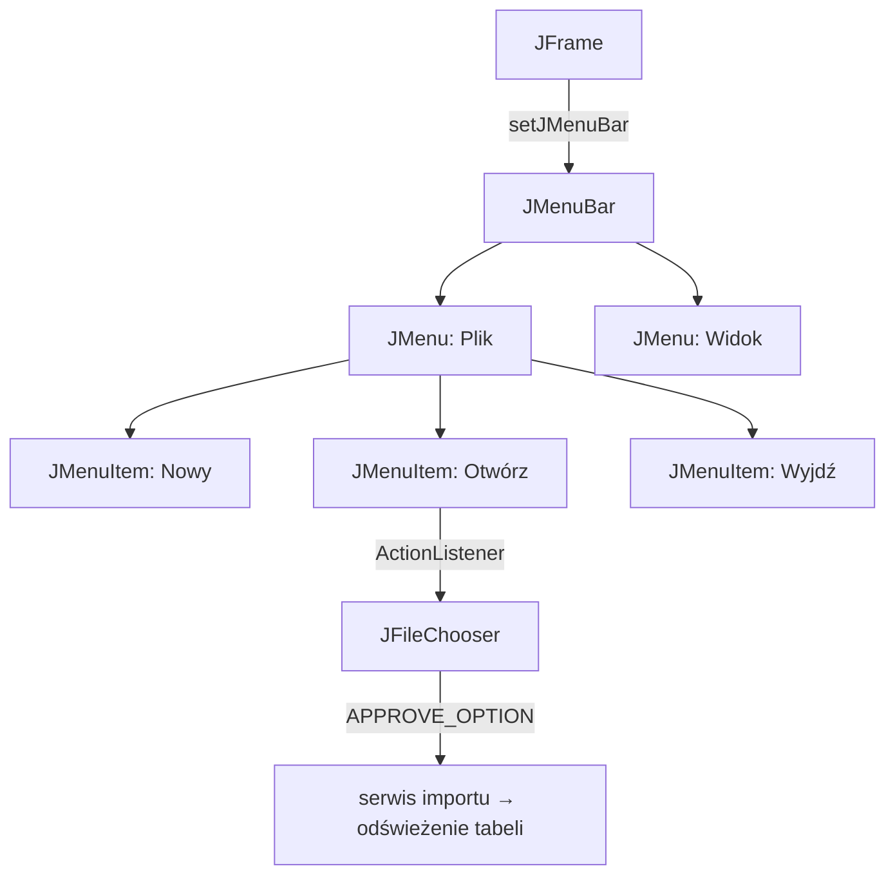
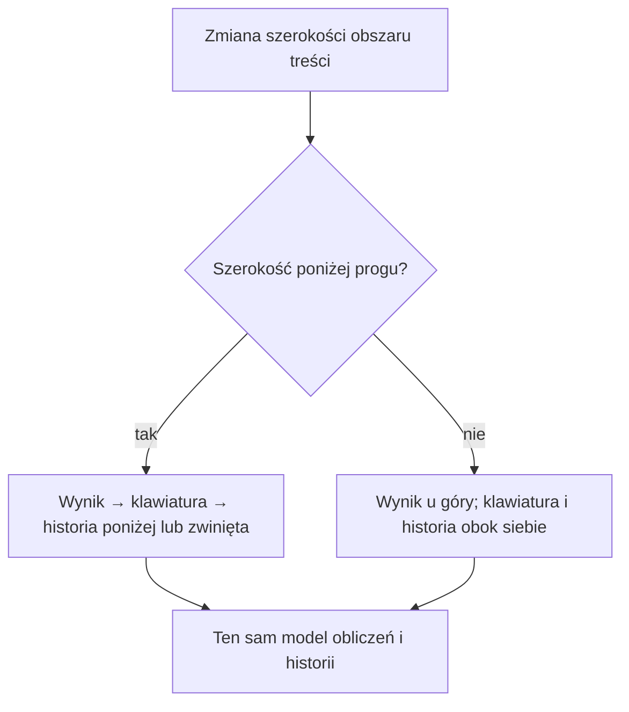

# Lab 1 - Graficzny interfejs użytkownika w Swing

## Przygotowanie i cel

Utwórz projekt `lab1` zgodnie z [instrukcją IntelliJ IDEA](../srodowisko.html). Swing jest w JDK — nie dodawaj osobnej biblioteki. W przykładzie `Main` dopisz pakiet zgodny z projektem.

Swing jest częścią standardowej biblioteki Javy. W laboratorium poznajemy `JFrame`, panele, układy, podstawowe kontrolki i obsługę zdarzeń. Zbudujemy prosty kalkulator oraz przygotujemy miejsce na kolejne widoki.

## Minimalne okno

```java
import javax.swing.*;
import java.awt.*;

public class Main {
    public static void main(String[] args) {
        SwingUtilities.invokeLater(() -> {
            JFrame frame = new JFrame("Lab 1");
            frame.setDefaultCloseOperation(JFrame.EXIT_ON_CLOSE);

            JPanel panel = new JPanel(new BorderLayout(8, 8));
            JLabel label = new JLabel("Witaj w Swing", SwingConstants.CENTER);
            JButton button = new JButton("Kliknij");
            button.addActionListener(event ->
                    label.setText("Przycisk został kliknięty"));

            panel.add(label, BorderLayout.CENTER);
            panel.add(button, BorderLayout.SOUTH);
            frame.setContentPane(panel);
            frame.pack();
            frame.setLocationRelativeTo(null);
            frame.setVisible(true);
        });
    }
}
```

Kod interfejsu uruchamiamy w wątku zdarzeń Swing, czyli przez `SwingUtilities.invokeLater`. Układ (`BorderLayout`, `GridLayout`, `BoxLayout`) powinien odpowiadać strukturze widoku; unikaj ustawiania pozycji każdego komponentu za pomocą `setBounds`.

## Menedżery układu komponentów

Kontener, np. `JPanel`, powierza menedżerowi układu obliczenie pozycji i rozmiarów swoich dzieci. Wybierz go według struktury widoku — nie ustawiaj współrzędnych każdego przycisku ręcznie.


### Układ wierszowy lub jednokierunkowy

**`FlowLayout`** układa elementy kolejno. Domyślnie wyśrodkowuje je w wierszu; w pokazanym przykładzie użyto `FlowLayout.LEFT`, więc nowy wiersz zaczyna się od lewej. Gdy brakuje szerokości, przenosi kolejny komponent do nowego wiersza; nie rozciąga go, by wypełnić wolne miejsce. To domyślny układ `JPanel` i dobry wybór dla krótkiego paska akcji.

#### Zmień szerokość i zobacz zawijanie

Zmień szerokość panelu. W wąskim układzie przycisk „Zapisz” płynnie przechodzi pod „Wykres”, gdy brakuje miejsca na wspólny wiersz.

<style>
  .po2-flow-demo {
    box-sizing: border-box;
    margin: 1rem 0;
    padding: 1rem;
    border: 1px solid rgba(127, 127, 127, 0.4);
    border-radius: 0.75rem;
    color: inherit;
  }

  .po2-flow-demo *,
  .po2-flow-demo *::before,
  .po2-flow-demo *::after {
    box-sizing: border-box;
  }

  .po2-flow-demo h4 {
    margin: 0 0 0.35rem;
  }

  .po2-flow-demo__hint,
  .po2-flow-demo__status {
    margin: 0.25rem 0 0.75rem;
    font-size: 0.92em;
  }

  .po2-flow-demo fieldset {
    min-width: 0;
    margin: 0;
    padding: 0;
    border: 0;
  }

  .po2-flow-demo legend {
    margin-bottom: 0.4rem;
    font-weight: 600;
  }

  .po2-flow-demo__state {
    position: absolute;
    width: 1px;
    height: 1px;
    overflow: hidden;
    clip: rect(0, 0, 0, 0);
    white-space: nowrap;
    clip-path: inset(50%);
  }

  .po2-flow-demo__choice {
    display: inline-block;
    margin: 0 0.35rem 0.6rem 0;
    padding: 0.35rem 0.7rem;
    border: 1px solid rgba(127, 127, 127, 0.5);
    border-radius: 999px;
    cursor: pointer;
  }

  .po2-flow-demo__state:checked + .po2-flow-demo__choice {
    border-color: #bd742f;
    box-shadow: inset 0 0 0 1px #bd742f;
  }

  .po2-flow-demo__state:focus-visible + .po2-flow-demo__choice {
    outline: 2px solid #bd742f;
    outline-offset: 2px;
  }

  .po2-flow-demo__stage {
    display: flex;
    justify-content: center;
    padding: 0.25rem 0 0.5rem;
  }

  .po2-flow-demo__panel {
    width: min(320px, 100%);
    min-width: 0;
    border: 1px solid rgba(127, 127, 127, 0.55);
    border-radius: 0.4rem;
    background: rgba(127, 127, 127, 0.06);
    transition: width 520ms cubic-bezier(0.22, 0.61, 0.36, 1);
  }

  .po2-flow-demo__narrow:checked ~ .po2-flow-demo__stage .po2-flow-demo__panel {
    width: min(205px, 100%);
  }

  .po2-flow-demo__actions {
    position: relative;
    height: 3.2rem;
    transition: height 520ms cubic-bezier(0.22, 0.61, 0.36, 1);
  }

  .po2-flow-demo__button {
    position: absolute;
    top: 0.6rem;
    display: flex;
    width: 4.3rem;
    height: 2rem;
    align-items: center;
    justify-content: center;
    border: 1px solid rgba(127, 127, 127, 0.5);
    border-radius: 0.35rem;
    background: rgba(127, 127, 127, 0.1);
    white-space: nowrap;
    transition: left 520ms cubic-bezier(0.22, 0.61, 0.36, 1),
      top 520ms cubic-bezier(0.22, 0.61, 0.36, 1);
  }

  .po2-flow-demo__button:nth-child(1) {
    left: 0.6rem;
  }

  .po2-flow-demo__button:nth-child(2) {
    left: 5.15rem;
  }

  .po2-flow-demo__button:nth-child(3) {
    left: 9.7rem;
  }

  .po2-flow-demo__narrow:checked ~ .po2-flow-demo__stage .po2-flow-demo__actions {
    height: 5.8rem;
  }

  .po2-flow-demo__narrow:checked ~ .po2-flow-demo__stage .po2-flow-demo__button:nth-child(3) {
    top: 3.15rem;
    left: 0.6rem;
  }

  @media (prefers-reduced-motion: reduce) {
    .po2-flow-demo__panel,
    .po2-flow-demo__actions,
    .po2-flow-demo__button {
      transition: none;
    }
  }

  .po2-flow-demo__status {
    min-height: 1.4em;
    margin-bottom: 0;
  }

  .po2-flow-demo__status--narrow {
    display: none;
  }

  .po2-flow-demo__narrow:checked ~ .po2-flow-demo__status--wide {
    display: none;
  }

  .po2-flow-demo__narrow:checked ~ .po2-flow-demo__status--narrow {
    display: block;
  }
</style>

<section class="po2-flow-demo" aria-labelledby="po2-flow-demo-title">
  <h4 id="po2-flow-demo-title">Podgląd zachowania <code>FlowLayout.LEFT</code></h4>
  <p class="po2-flow-demo__hint">Przełącz szerokość panelu i obserwuj, jak zmienia się położenie przycisku „Zapisz”.</p>
  <fieldset>
    <legend>Szerokość panelu</legend>
    <input class="po2-flow-demo__state" type="radio" name="po2-flow-width" id="po2-flow-wide" checked>
    <label class="po2-flow-demo__choice" for="po2-flow-wide">Szeroki</label>
    <input class="po2-flow-demo__state po2-flow-demo__narrow" type="radio" name="po2-flow-width" id="po2-flow-narrow">
    <label class="po2-flow-demo__choice" for="po2-flow-narrow">Wąski</label>
    <div class="po2-flow-demo__stage">
      <div class="po2-flow-demo__panel">
        <div class="po2-flow-demo__actions" aria-label="Przykładowy pasek przycisków">
          <span class="po2-flow-demo__button">Dane</span>
          <span class="po2-flow-demo__button">Wykres</span>
          <span class="po2-flow-demo__button">Zapisz</span>
        </div>
      </div>
    </div>
    <p class="po2-flow-demo__status po2-flow-demo__status--wide">Wszystkie elementy mieszczą się w jednym wierszu.</p>
    <p class="po2-flow-demo__status po2-flow-demo__status--narrow">Brak miejsca po „Wykres” — „Zapisz” zaczyna nowy wiersz.</p>
  </fieldset>
</section>

**`BoxLayout`** układa elementy wzdłuż jednej osi (`X_AXIS` albo `Y_AXIS`) i nie zawija ich do kolejnego wiersza. Rozmiar każdego dziecka zależy od jego minimalnego, preferowanego i maksymalnego rozmiaru. Użyj go np. dla pionowej listy kroków lub formularza.

### Podział na obszary

**`BorderLayout`** dzieli kontener na `NORTH`, `SOUTH`, `EAST`, `WEST` i `CENTER`. Pasy przy krawędziach korzystają z rozmiaru preferowanego, a `CENTER` otrzymuje pozostałe miejsce. Do każdego obszaru dodaj jeden komponent; kilka kontrolek zgrupuj najpierw w osobnym `JPanel`.

### Siatka i formularz

**`GridLayout`** tworzy regularną siatkę równych komórek — nadaje się np. na klawiaturę kalkulatora. Ponieważ wszystkie pola są równe, zwykle nie jest dobrym wyborem do par etykieta–pole.

**`GridBagLayout`** pozwala tworzyć nierówne wiersze i kolumny. `gridx`/`gridy` wskazują pozycję, `gridwidth`/`gridheight` określają liczbę zajętych komórek, `weightx`/`weighty` dzielą dodatkowe miejsce, a `fill` mówi, czy komponent ma je wypełnić. Samo `fill=HORIZONTAL` nie sprawi, że kolumna dostanie dodatkową szerokość — ustaw też `weightx`.

```java
JPanel form = new JPanel(new GridBagLayout());
GridBagConstraints c = new GridBagConstraints();
c.insets = new Insets(4, 4, 4, 4);
c.gridx = 0; c.gridy = 0;
c.anchor = GridBagConstraints.LINE_END;
form.add(new JLabel("Zbiór danych:"), c);
c.gridx = 1;
c.weightx = 1.0;
c.fill = GridBagConstraints.HORIZONTAL;
form.add(new JTextField(20), c);
```

### Przełączanie widoków

**`CardLayout`** przechowuje kilka paneli w tym samym obszarze i pokazuje jeden z nich. Przydaje się do przełączania np. widoku danych i analizy bez tworzenia kolejnych okien.

```java
CardLayout cards = new CardLayout();
JPanel views = new JPanel(cards);
views.add(new JPanel(), "dane");
views.add(new JPanel(), "analiza");
// W listenerze menu:
cards.show(views, "analiza");
```

W praktycznym oknie łącz kilka menedżerów, zagnieżdżając panele — np. `BorderLayout` dla głównego widoku, `GridLayout` dla klawiatury i `FlowLayout` dla przycisków akcji. Otwórz [galerię Swing](demo/README.html), zmieniaj rozmiar okna i sprawdź, który element się zawija, rozciąga lub zachowuje swój rozmiar.

Unikaj `setLayout(null)` i ręcznego `setBounds`: takie okno źle reaguje na zmianę rozmiaru, skalowanie HiDPI i dłuższe napisy.

## Kontrolki i zdarzenia

Najczęściej używane elementy to `JLabel`, `JButton`, `JTextField`, `JTextArea`, `JCheckBox`, `JComboBox`, `JTable` i `JOptionPane`.

```java
JTextField first = new JTextField(10);
JTextField second = new JTextField(10);
JLabel result = new JLabel("Wynik");
JButton add = new JButton("Dodaj");

add.addActionListener(event -> {
    try {
        double a = Double.parseDouble(first.getText());
        double b = Double.parseDouble(second.getText());
        result.setText(String.valueOf(a + b));
    } catch (NumberFormatException ex) {
        JOptionPane.showMessageDialog(null,
                "Wprowadź poprawne liczby", "Błąd", JOptionPane.ERROR_MESSAGE);
    }
});
```

W większej aplikacji warto oddzielić model danych i logikę obliczeń od kodu budującego widok. Sam listener powinien wywoływać metodę serwisu, a nie zawierać całą logikę biznesową.

## Zadania

1. Utwórz aplikację z menu `Plik` i pozycjami `Nowy`, `Otwórz`, `Zapisz`, `Wyjdź`. Każda pozycja ma wykonać działanie albo wyświetlić komunikat.
2. Zbuduj responsywny kalkulator z przyciskami cyfr, działań, przecinka, `C` i `=`, nieedytowalnym wynikiem oraz historią. Wykonaj ćwiczenie „Responsywny kalkulator, HiDPI i dwa motywy” poniżej.
3. Obsłuż błędny format liczby, dzielenie przez zero i próbę wykonania działania bez obu argumentów.
4. Utwórz `JPanel` rysujący szachownicę przez przesłonięcie `paintComponent(Graphics)`. Użyj `Graphics2D` i `fillRect`.
5. Dodaj formularz rejestracji z polami imię, nazwisko, login, hasło i powtórzenie hasła. Waliduj puste pola oraz zgodność haseł.
6. Wyświetl listę obiektów `Student` w `JTable`. Dodaj przyciski odświeżania, usuwania i filtrowania.
7. Zmień aplikację tak, aby każdy widok był osobnym panelem, a menu przełączało zawartość głównego panelu.

## Pytania kontrolne

1. Dlaczego kod Swing uruchamia się w EDT?
2. Czym różni się `JPanel` od `JFrame`?
3. Jaką rolę pełni layout manager?
4. Gdzie powinna znajdować się walidacja danych i logika obliczeń?

## Kolejność realizacji

| Etap | Praca | Punkt kontrolny |
|---|---|---|
| Podstawy GUI | okno, EDT, porównanie layoutów, menu i kalkulator | zmiana rozmiaru nie ukrywa przycisków, menu reaguje |
| Formularz | walidacja i `CardLayout` | błąd nie kasuje wpisanych danych, menu przełącza widok |
| Dane i komponenty | tabela, filtrowanie, rysowanie i porządkowanie klas | usuwany jest właściwy rekord po sortowaniu |

Zadania z listy realizuj w tej kolejności. Rejestracja i lista studentów ćwiczą kontrolki; we własnym projekcie zastosuj je do obserwacji, zmiennych i zbiorów danych ekonomicznych.

## JMenu — od hierarchii do działającego menu



Fragment wstaw wewnątrz tworzenia okna, gdy zmienna `frame` już istnieje:

```java
JMenuBar menuBar = new JMenuBar();
JMenu fileMenu = new JMenu("Plik");
JMenuItem open = new JMenuItem("Otwórz...");
open.setAccelerator(KeyStroke.getKeyStroke("control O"));
open.addActionListener(event -> {
    JFileChooser chooser = new JFileChooser();
    if (chooser.showOpenDialog(frame) == JFileChooser.APPROVE_OPTION) {
        JOptionPane.showMessageDialog(frame,
                "Wybrano: " + chooser.getSelectedFile().getName());
        // W kolejnym etapie przekazujemy plik do serwisu importu.
    }
});
JMenuItem exit = new JMenuItem("Wyjdź");
exit.addActionListener(event -> frame.dispose());
fileMenu.add(open);
fileMenu.addSeparator();
fileMenu.add(exit);
menuBar.add(fileMenu);
frame.setJMenuBar(menuBar);
```

Efekt: u góry okna jest pasek `Plik`; rozwinięcie pokazuje pozycje menu, a `Otwórz` uruchamia okno wyboru pliku. Anulowanie nie zmienia danych.


Ilustracje są renderami rzeczywistych komponentów Swing wygenerowanymi przez [kod galerii](demo/README.html), bez ramki systemowego okna. To nie makiety narysowane ręcznie. Galerię można uruchomić w IntelliJ, zmieniać rozmiar okna i klikać menu.

## Tabela, rysowanie i responsywność

Model danych tabeli oddziel od widoku, np. przez `AbstractTableModel`. `JTable` umieść w `JScrollPane`. Po sortowaniu numer zaznaczonego wiersza jest indeksem widoku:

```java
int selected = table.getSelectedRow();
if (selected >= 0) {
    int modelRow = table.convertRowIndexToModel(selected);
    // Usuń rekord z modelu pod modelRow, następnie zgłoś zmianę modelu.
}
```

W `paintComponent` najpierw wywołaj `super.paintComponent(g)`. Rysuj według aktualnych `getWidth()` i `getHeight()`. Zmianę obrazu zlecaj przez `repaint()`, nie przez bezpośrednie wywołanie `paintComponent`.

Długie odczyty pliku i zapytania do bazy wykonuj przez `SwingWorker`: `doInBackground()` pracuje w tle, a `done()` aktualizuje GUI w EDT. Nie wywołuj blokującego `get()` w listenerze przed zakończeniem zadania.

## Sprawdzenie i oddanie

Obowiązuje również [macierz testów responsywności, HiDPI i motywów](../jakosc-gui.html).

| Próba | Oczekiwany wynik |
|---|---|
| zmniejszenie i powiększenie okna | komponenty zachowują sensowny układ; tabela ma przewijanie |
| puste pole, `abc`, dzielenie przez zero | czytelny błąd bez zamknięcia aplikacji |
| liczba `2,5` w kalkulatorze | jawna obsługa polskiego separatora, np. zamiana przecinka na kropkę przed parsowaniem |
| sortowanie tabeli i usunięcie wiersza | znika wskazany obiekt, nie obiekt z innego indeksu |
| anulowanie wyboru pliku | dotychczasowy stan pozostaje |

Oddaj projekt Maven, krótki opis zastosowanych layoutów i po jednym zrzucie formularza, tabeli oraz rozwiniętego menu. Dodaj opis dwóch wykrytych błędów i sposobu ich obsługi. Zastąp dane studentów obserwacjami ekonomicznymi i pokaż średnią wybranej kolumny.

## Ćwiczenie: responsywny kalkulator, HiDPI i dwa motywy

Rozwijaj kalkulator w kolejnych etapach. Nie jest to drugi projekt: dodajesz adaptacyjny układ, styl i testy do tej samej aplikacji.

1. Wynik umieść na górze, klawiaturę w `GridLayout`, a historię w przewijanym panelu. Przyciski mają wypełniać dostępne komórki.
2. W szerokim oknie historię pokaż obok klawiatury; w wąskim przenieś ją pod klawiaturę albo udostępnij jako rozwijaną sekcję. Wybierz i uzasadnij próg szerokości, początkowo np. 600 jednostek logicznych obszaru treści.
3. Przełączenie układu nie może zerować obliczeń ani tworzyć nowego modelu. Przenoś istniejące panele, nie dodawaj tej samej kontrolki do dwóch kontenerów.
4. Długi wynik wyrównaj do prawej i umożliw jego odczyt/przewijanie. Nie ściskaj czcionki do nieczytelnego rozmiaru. Ustal minimalny rozmiar okna na podstawie czytelności kontrolek.
5. Dodaj menu **Widok → Motyw → Jasny / Ciemny**, zapamiętanie wyboru i obsługę klawiatury: cyfry, Enter oraz Escape. Fokus ma pozostać widoczny w obu motywach.
6. Wykonaj [testy 100%, 150%, 200%](../jakosc-gui.html), także dla rozwiniętego menu i komunikatu dzielenia przez zero. Zachowaj rozpoczęte działanie podczas zmiany motywu.



W `ComponentAdapter.componentResized` porównaj szerokość panelu z progiem. Zmieniaj układ tylko wtedy, gdy zmienia się wariant wąski/szeroki, po czym wywołaj `revalidate()` i `repaint()`. Nie wykonuj `pack()` przy każdym zdarzeniu — użytkownik powinien zachować kontrolę nad rozmiarem okna.

### Motywy Swing przez Look and Feel

W tym ćwiczeniu użyj FlatLaf, który udostępnia jasny i ciemny wygląd oraz obsługę HiDPI. Dodaj do `dependencies` projektu kalkulatora poniższą ustaloną wersję i zsynchronizuj Maven. Podstawowy Swing i wcześniejsza galeria nadal nie wymagają tej biblioteki. [Dokumentacja FlatLaf](https://www.formdev.com/flatlaf/).

```xml
<dependency>
    <groupId>com.formdev</groupId>
    <artifactId>flatlaf</artifactId>
    <version>3.7</version>
</dependency>
```

Przed utworzeniem komponentów w EDT ustaw początkowy motyw przez `FlatLightLaf.setup()` albo `FlatDarkLaf.setup()`, zgodnie z zapisaną preferencją. Poniższą metodę umieść w klasie pomocniczej i wywołuj z listenera menu, czyli również w EDT:

```java
static void setDarkTheme(boolean dark) {
    boolean installed = dark
            ? com.formdev.flatlaf.FlatDarkLaf.setup()
            : com.formdev.flatlaf.FlatLightLaf.setup();
    if (!installed) {
        throw new IllegalStateException("Nie udało się zmienić motywu");
    }
    com.formdev.flatlaf.FlatLaf.updateUI();
    java.util.prefs.Preferences.userRoot()
            .node("pl/uczelnia/lab1/calculator").putBoolean("dark", dark);
}
```

Nie ustawiaj na każdej kontrolce stałego `Color.WHITE` ani `Color.BLACK`. Własne rysowanie odczytuje aktualne kolory z `UIManager`, np. `Panel.background` i `Label.foreground`; nie przechowuj starego koloru na zawsze. Dodatkowe role kolorów definiuj osobno dla obu motywów. [Konfiguracja kolorów FlatLaf](https://www.formdev.com/flatlaf/how-to-customize/).

**Odbiór ćwiczenia:** kalkulator działa w obu układach i motywach, zachowuje stan, ma czytelne przyciski i wynik przy 200%, a historia i błędy są dostępne także w najmniejszym obsługiwanym oknie. Do oddania dołącz macierz testów i cztery zrzuty zgodnie ze wspólną instrukcją.
