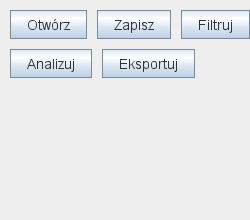

# Galeria Swing — IntelliJ IDEA

Otwórz [pom.xml](pom.xml) jako projekt Maven, wybierz JDK 27 GA i uruchom `LayoutGallery.main` z [kodu źródłowego](src/main/java/pl/uczelnia/lab1/LayoutGallery.java). Program nie wymaga zewnętrznych bibliotek.

Pierwsza zakładka pokazuje sześć menedżerów układu. Zmieniaj rozmiar okna, porównuj rozmiary komórek i przełączaj karty `dane` / `analiza`. Druga zakładka zawiera menu `Plik`, sortowalną tabelę i status. `Otwórz` wybiera plik, `Nowy` i `Zapisz` demonstrują zdarzenia — nie wykonują importu ani zapisu. Dane ekonomiczne są syntetyczne.

To pokaz mechaniki layoutów, nie wzorzec ukończonej aplikacji. Używa stałej
palety i demonstracyjnych rozmiarów. Responsywny kalkulator,
przełączanie motywów oraz [testy HiDPI](../../jakosc-gui.html) wykonaj zgodnie
z główną instrukcją Lab 1; renderów galerii nie traktuj jako dowodu tych testów.

## Jak wygenerowano ilustracje

W konfiguracji uruchomienia IntelliJ ustaw **Program arguments** na `--render ../assets`, a **Working directory** na katalog `demo`. Program wyrenderuje komponenty Swing do czterech plików PNG przez `printAll`, bez otwierania okna i fotografowania pulpitu. Menu jest składane z renderu panelu i rzeczywistego `JPopupMenu`. Są to ilustracje komponentów, nie zrzuty całego systemowego okna.

Alternatywnie użyj terminala z JDK w katalogu `demo`:

```powershell
javac -encoding UTF-8 --release 27 -d target/classes src/main/java/pl/uczelnia/lab1/LayoutGallery.java
java '-Djava.awt.headless=true' -cp target/classes pl.uczelnia.lab1.LayoutGallery --render ../assets
```


Ten sam panel `FlowLayout` przy dwóch szerokościach:




## Ćwiczenie

Zmień `GridLayout(2, 3)` na `GridLayout(3, 2)`, zmień `weightx` pól `GridBagLayout` na zero oraz oś `BoxLayout` na poziomą. Przed każdym uruchomieniem przewidź rezultat. Dodaj kartę „Raport” i przełączający ją przycisk. W oddawanym projekcie wykonaj własne zrzuty działającego GUI.
