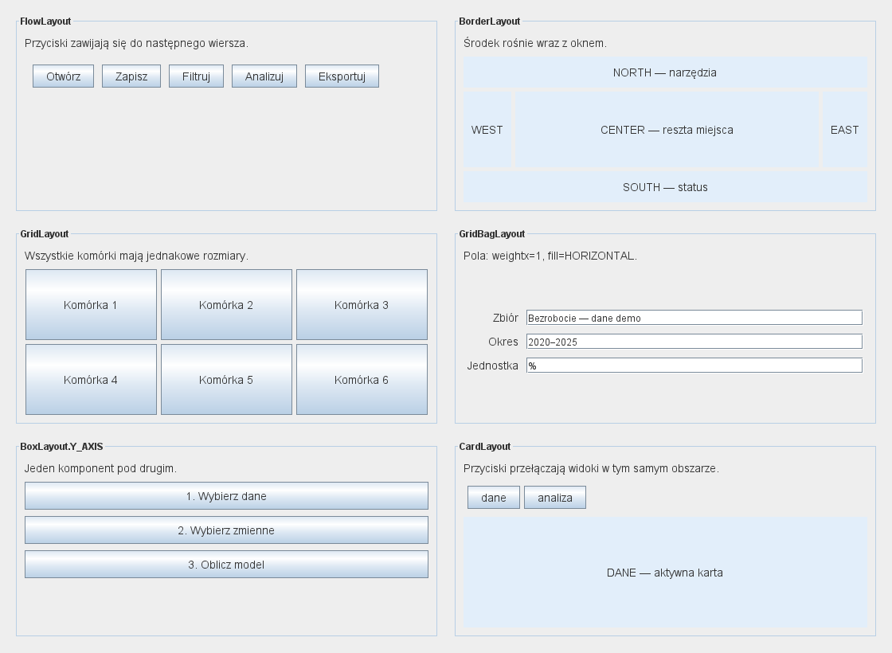
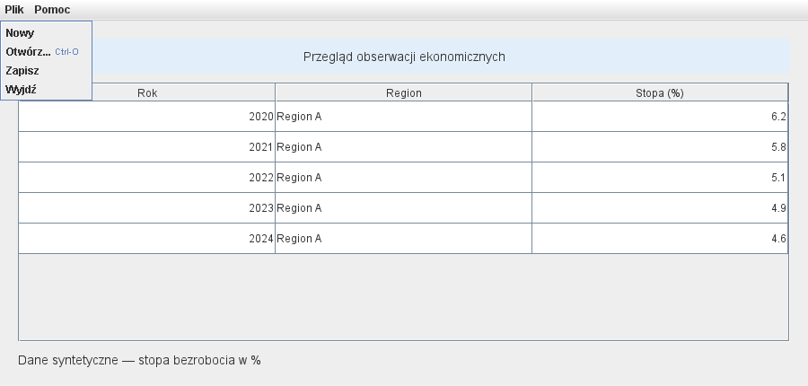

# Galeria Swing — IntelliJ IDEA

Gotowy projekt Maven można [pobrać jako ZIP](galeria-swing.zip), rozpakować
i otworzyć w IntelliJ IDEA jako projekt zawierający `pom.xml`. Źródła są
przeznaczone do uruchamiania i modyfikowania.

Plik [pom.xml](pom.xml) należy otworzyć jako projekt Maven, wybrać JDK 27 GA
i uruchomić `LayoutGallery.main` z [kodu źródłowego](src/main/java/pl/uczelnia/lab1/LayoutGallery.java).
Program nie wymaga zewnętrznych bibliotek.

Pierwsza zakładka pokazuje sześć menedżerów układu. Zmiana rozmiaru okna
pozwala porównać rozmiary komórek i przełączać karty `dane` / `analiza`.
Druga zakładka zawiera menu `Plik`, sortowalną tabelę i status. `Otwórz` wybiera
plik, a `Nowy` i `Zapisz` demonstrują zdarzenia — nie wykonują importu ani zapisu.
Dane ekonomiczne są syntetyczne.

Galeria służy do obserwowania menedżerów układu i obsługi zdarzeń. Własny
kalkulator należy zaprojektować i przetestować osobno: dopasować go do szerokości
okna, dodać tryb systemowy reagujący na motyw systemu oraz ręczne warianty jasny
i ciemny, a następnie wykonać [testy HiDPI](../../../jakosc-gui.html).

## Demonstracje układów i menu

Ten sam panel `FlowLayout` przedstawiono przy dwóch szerokościach:

## Modyfikacja galerii Swing

Należy zamienić `GridLayout(2, 3)` na `GridLayout(3, 2)`, ustawić `weightx`
pól `GridBagLayout` na zero i zmienić oś `BoxLayout` na poziomą. Przed każdym
uruchomieniem trzeba przewidzieć rezultat. Następnie należy dodać kartę „Raport”
i przycisk ją wyświetlający. W projekcie do oddania trzeba umieścić własne zrzuty
działającego GUI.
