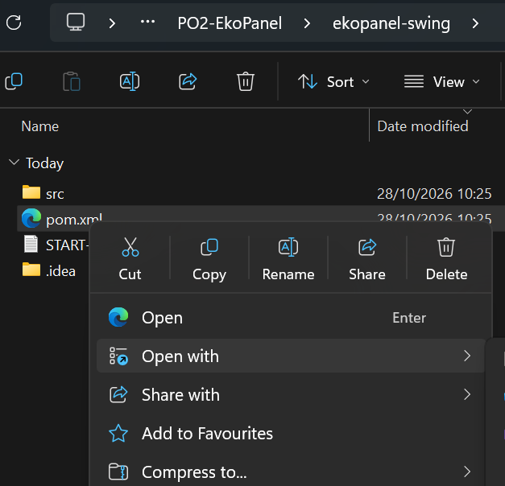
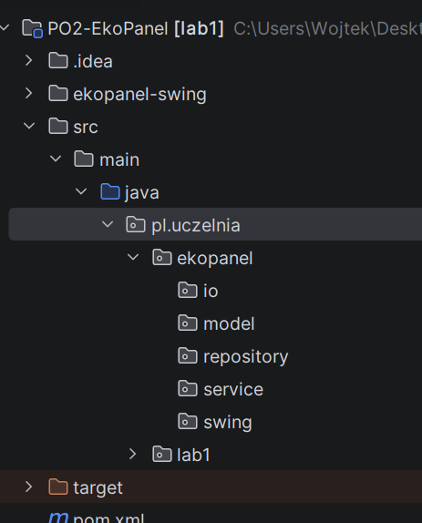
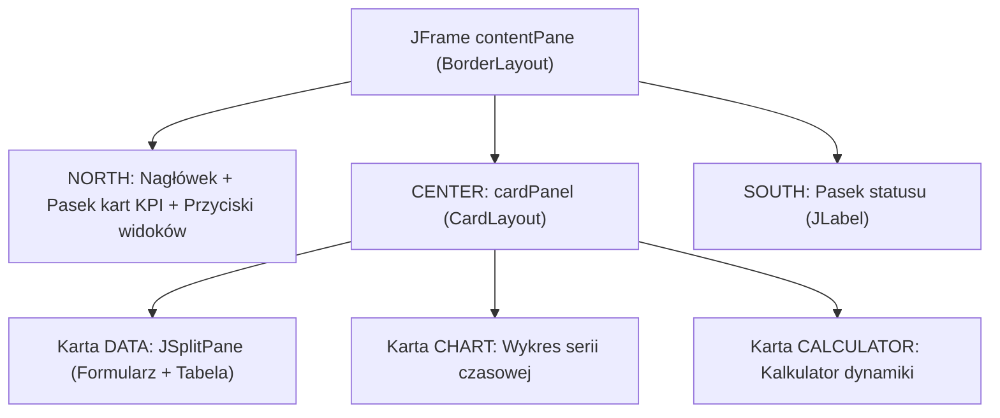
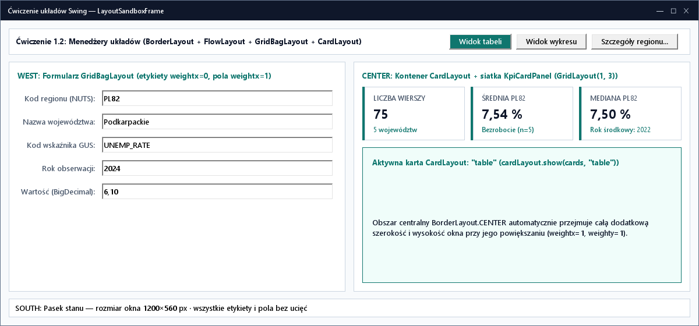
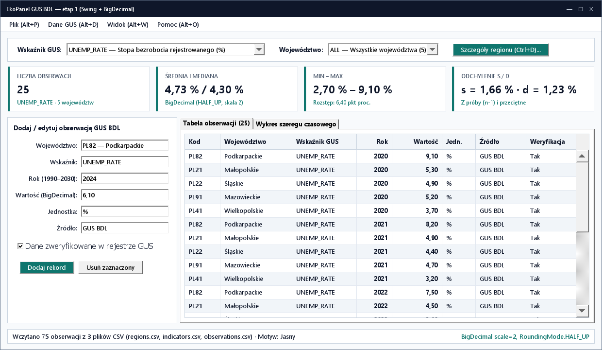
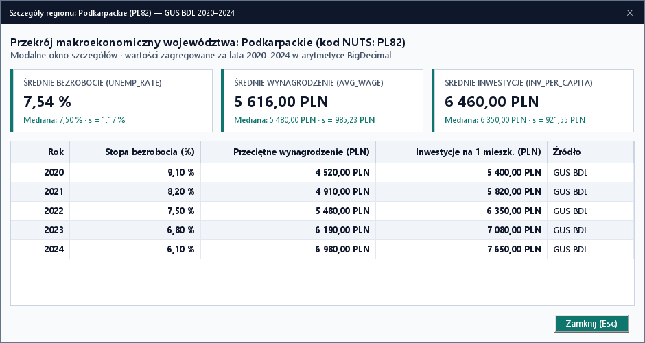
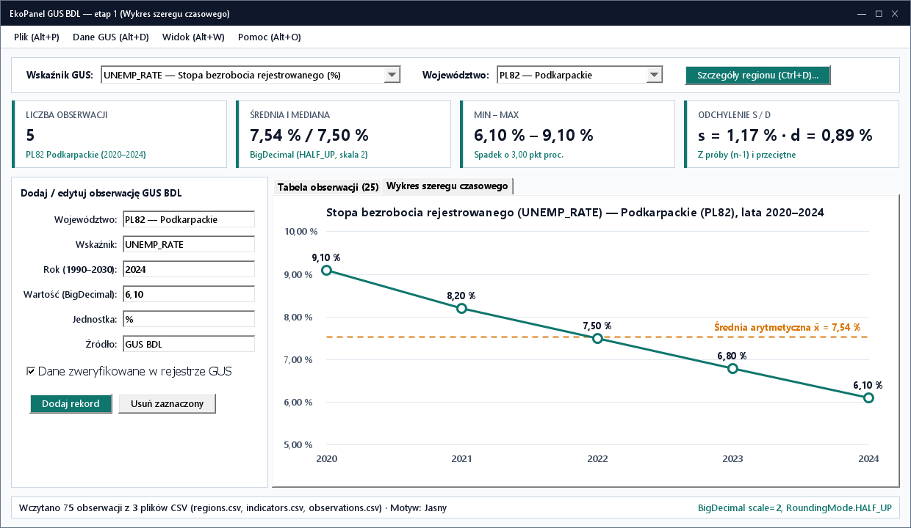

# Lab 1. Zbudowanie panelu danych GUS BDL w Swing

<script id="MathJax-script" async src="https://cdn.jsdelivr.net/npm/mathjax@3/es5/tex-mml-chtml.js"></script>

[Wyjaśnienia Swing (v1)](../v1/README.html) · [Interaktywny poradnik animowany](poradnik.html) · [Pakiet danych GUS BDL](../../dane/gus-bdl-dane.zip) · [Etap 2: JavaFX i FXML](../../lab2/v2/README.html)

Należy wykonywać zadania w podanej kolejności. Wszystkie zadania są wymagane. W ramach ćwiczenia powstaje desktopowa aplikacja **EkoPanel — GUS BDL** operująca na trzech powiązanych encjach Banku Danych Lokalnych GUS: województwach (`Region`), słowniku wskaźników makroekonomicznych (`Indicator`) oraz obserwacjach rocznych (`Observation`).

## Zadanie 1.1. Utworzenie projektu i pobranie pakietu danych GUS BDL

1. Utworzyć katalog roboczy `PO2-EkoPanel` i rozpakować [projekt startowy Swing](../v1/projekt-startowy.zip) do `PO2-EkoPanel/ekopanel-swing`.
2. Otworzyć `pom.xml` w IntelliJ IDEA i ustawić **JDK 27 GA** (poziom języka 27 bez preview) według [konfiguracji środowiska](../../srodowisko.html).

   <figure class="image-example" markdown="1">
     
     <figcaption>Plik pom.xml i jego menu kontekstowe w katalogu ekopanel-swing.</figcaption>
   </figure>

3. Uruchomić `pl.uczelnia.lab1.Main.main()`, kliknąć `Przywitaj` i sprawdzić zmianę etykiety na `Interfejs reaguje na zdarzenie`.
4. W `pom.xml` zmienić `artifactId` na `ekopanel-swing`. Do sekcji `dependencies` dodać bibliotekę [FlatLaf 3.7](https://www.formdev.com/flatlaf/) (pozostawiając istniejącą zależność `jSystemThemeDetector` 3.9):

   <figure class="code-example" markdown="1">
   <figcaption>ekopanel-swing/pom.xml</figcaption>

   ```xml
   <dependency>
       <groupId>com.formdev</groupId>
       <artifactId>flatlaf</artifactId>
       <version>3.7</version>
   </dependency>
   ```

   </figure>

5. Wykonać **Reload All Maven Projects**. Utworzyć pakiety: `pl.uczelnia.ekopanel.model`, `.repository`, `.service`, `.io`, `.swing`.

   **Wynik:** w panelu **Project** widoczne są pakiety `io`, `model`, `repository`, `service` i `swing` wewnątrz `pl.uczelnia.ekopanel`, jak na poniższym zrzucie. Pakiety należy utworzyć w katalogu `src/main/java` projektu `ekopanel-swing`.

   <figure class="image-example" markdown="1">
     
     <figcaption>Oczekiwana struktura pakietów w panelu Project IntelliJ IDEA.</figcaption>
   </figure>

6. Pobrać [gus-bdl-dane.zip](../../dane/gus-bdl-dane.zip) (lub pojedyncze pliki: [regions.csv](../../dane/regions.csv), [indicators.csv](../../dane/indicators.csv), [observations.csv](../../dane/observations.csv), [observations-bledne.csv](../../dane/observations-bledne.csv), [observations-duplikat.csv](../../dane/observations-duplikat.csv), [observations-brak-klucza.csv](../../dane/observations-brak-klucza.csv)) i rozpakować do katalogu `PO2-EkoPanel/ekopanel-swing/data/`.

**Wynik:** projekt kompiluje się w JDK 27 GA, a katalog `data/` zawiera 3 pliki słownikowo-faktowe GUS BDL (5 województw, 3 wskaźniki, 75 obserwacji z lat 2020–2024) oraz 3 pliki testowe z błędami w wierszu 77.

## Zadanie 1.2. Dokładność dziesiętna (`BigDecimal`) i trójencjowy model danych GUS BDL

📚 [Javadoc `java.math.BigDecimal`](https://docs.oracle.com/en/java/javase/27/docs/api/java.base/java/math/BigDecimal.html) · [Javadoc `RoundingMode`](https://docs.oracle.com/en/java/javase/27/docs/api/java.base/java/math/RoundingMode.html) · [Javadoc `java.lang.Record`](https://docs.oracle.com/en/java/javase/27/docs/api/java.base/java/lang/Record.html)

<details>
<summary><strong>Dlaczego ceny, płace i wskaźniki przechowujemy w BigDecimal, a nie w double?</strong></summary>

Typ `double` zapisuje liczby w systemie dwójkowym (IEEE 754), przez co ułamki dziesiętne takie jak `0.1` czy `0.2` nie mają dokładnej reprezentacji binarnej (`0.1 + 0.2` daje `0.30000000000000004`). Przy sumowaniu wielu kwot w `PLN` lub stóp procentowych błędy zaokrągleń kumulują się.

W obliczeniach ekonomicznych i finansowych stosuje się `java.math.BigDecimal` według trzech żelaznych reguł:
1. **Tworzenie wyłącznie z łańcucha znaków (`new BigDecimal("4520.00")`) lub `BigDecimal.valueOf(...)`** — nigdy konstruktorem `new BigDecimal(0.1)`, który przenosi niedokładność `double`!
2. **Dzielenie zawsze z jawną skalą i trybem zaokrąglenia:** `suma.divide(BigDecimal.valueOf(n), 2, RoundingMode.HALF_UP)`.
3. **Porównywanie wartości przez `a.compareTo(b)` zamiast `a.equals(b)`:** metoda `equals` zwraca `false` dla `new BigDecimal("5.5")` i `new BigDecimal("5.50")` (różna skala), natomiast `compareTo` zwraca `0`.
</details>

**Czym jest rekord w Javie?** Rekord (`record`) jest specjalnym rodzajem klasy służącym do przechowywania danych. W nawiasach po nazwie podaje się jego składniki, czyli typy i nazwy przechowywanych wartości. Na przykład `Region(String code, String name, String macroregion)` opisuje województwo za pomocą trzech tekstów.

Na podstawie tej deklaracji Java automatycznie tworzy konstruktor, metody odczytu `code()`, `name()` i `macroregion()` oraz metody `equals()`, `hashCode()` i `toString()`. Obiekt tworzy się przez `new Region("PL82", "Podkarpackie", "Makroregion wschodni")`, a nazwę odczytuje przez `region.name()`, bez przedrostka `get`. Składniki rekordu są przechowywane w polach `private final`: po utworzeniu obiektu nie można przypisać im innych wartości i nie ma automatycznych setterów. Aby zmienić dane, należy utworzyć nowy rekord. Rekord nie zapewnia jednak niezmienności wnętrza obiektów, które przechowuje, np. zawartości listy.

**Nazwa typu i nazwa pliku:** publiczna klasa lub publiczny rekord zadeklarowane bezpośrednio w pliku muszą mieć nazwę zgodną z nazwą pliku, z uwzględnieniem wielkości liter. Deklarację `public record Region(...)` należy zapisać w `Region.java`, a `public class Numbers` w `Numbers.java`. Każdy z poniższych rekordów należy umieścić w osobnym pliku.

1. W pakiecie `pl.uczelnia.ekopanel.model` utworzyć trzy rekordy, używając `BigDecimal` dla wartości obserwacji:

   - W panelu **Project** rozwinąć `src/main/java` i kliknąć prawym przyciskiem pakiet `pl.uczelnia.ekopanel.model`.
   - Wybrać **New → Java Class**, wpisać `Region` (bez rozszerzenia `.java`), zaznaczyć rodzaj **Record** i nacisnąć **Enter**. IntelliJ utworzy plik `Region.java` z deklaracją pakietu i pustym rekordem.
   - Zastąpić zawartość pliku `Region.java` pierwszym blokiem kodu poniżej.
   - W tym samym pakiecie powtórzyć **New → Java Class → Record** dla nazw `Indicator` i `Observation`. Do plików `Indicator.java` oraz `Observation.java` wkleić odpowiadające im bloki kodu.
   - Przy tworzeniu zwykłej klasy w dalszych zadaniach, np. `Numbers`, w tym samym oknie wybrać rodzaj **Class**.

   [Dokumentacja IntelliJ IDEA: tworzenie plików i klas](https://www.jetbrains.com/help/idea/add-items-to-project.html).

   <figure class="code-example" markdown="1">
   <figcaption>src/main/java/pl/uczelnia/ekopanel/model/Region.java</figcaption>

   ```java
   package pl.uczelnia.ekopanel.model;

   public record Region(String code, String name, String macroregion) {
       @Override public String toString() { return code + " — " + name; }
   }
   ```

   </figure>

   <figure class="code-example" markdown="1">
   <figcaption>src/main/java/pl/uczelnia/ekopanel/model/Indicator.java</figcaption>

   ```java
   package pl.uczelnia.ekopanel.model;

   public record Indicator(String code, String name, String unit, String category) {
       @Override public String toString() { return code + " (" + unit + ") — " + name; }
   }
   ```

   </figure>

   <figure class="code-example" markdown="1">
   <figcaption>src/main/java/pl/uczelnia/ekopanel/model/Observation.java</figcaption>

   ```java
   package pl.uczelnia.ekopanel.model;

   import java.math.BigDecimal;

   public record Observation(Long id, int year, String regionCode,
                             String indicatorCode, BigDecimal value, boolean included) {}
   ```

   </figure>

   **Wynik:** pakiet `pl.uczelnia.ekopanel.model` zawiera trzy osobne pliki: `Region.java`, `Indicator.java` i `Observation.java`. Nazwa publicznego rekordu w każdym pliku jest zgodna z nazwą pliku.

2. Utworzyć `service/Numbers.java` z metodą `public static BigDecimal parseDecimal(String text)`:
   - Oczyścić tekst przez `text.strip().replace(" ", "").replace(',', '.')`, utworzyć `new BigDecimal(cleaned)` i ustawić dwie cyfry po przecinku przez `.setScale(2, RoundingMode.HALF_UP)`.
   - `NumberFormatException` lub `NullPointerException` zamienić na `IllegalArgumentException("Wartość musi być poprawną liczbą dziesiętną.")`.
3. Utworzyć `service/ObservationValidator.java` z metodą `public static void validate(int year, String regionCode, String indicatorCode, BigDecimal value, Indicator indicator)`. Porównania zakresu wykonywać przez `compareTo`:

   | Warunek | Zgłaszany `IllegalArgumentException` |
   |---|---|
   | `year < 1990 \|\| year > 2035` | `Rok musi być z zakresu 1990–2035.` |
   | `regionCode == null \|\| !regionCode.strip().matches("PL\\d{2}")` | `Kod regionu musi mieć format PL i dwie cyfry (np. PL82).` |
   | `indicatorCode == null \|\| !indicatorCode.strip().matches("[A-Z][A-Z0-9_]{1,29}")` | `Kod wskaźnika musi składać się z wielkich liter, cyfr i podkreśleń.` |
   | `value == null` | `Wartość nie może być pusta.` |
   | `indicator != null && "%".equals(indicator.unit()) && (value.compareTo(BigDecimal.ZERO) < 0 \|\| value.compareTo(new BigDecimal("100")) > 0)` | `Stopa procentowa musi być z zakresu 0–100.` |
   | `indicator != null && "PLN".equals(indicator.unit()) && value.compareTo(BigDecimal.ZERO) < 0` | `Wartość kwotowa w PLN nie może być ujemna.` |

**Wynik:** kwoty w `PLN` i stopy w `%` są przechowywane dokładnie z dwoma miejscami po przecinku jako `BigDecimal` bez błędów binarnych `double`.

## Zadanie 1.3. Zbudowanie repozytorium pamięciowego i serwisu dla 3 encji

Interfejs repozytorium oddziela logikę aplikacji od sposobu składowania danych. W kolejnych laboratoriach ten sam interfejs zostanie zaimplementowany w JDBC (SQLite) oraz Hibernate (H2).

1. W pakiecie `repository` utworzyć `ObservationRepository.java`:

   <figure class="code-example" markdown="1">
   <figcaption>src/main/java/pl/uczelnia/ekopanel/repository/ObservationRepository.java</figcaption>

   ```java
   package pl.uczelnia.ekopanel.repository;

   import java.util.List;
   import pl.uczelnia.ekopanel.model.*;

   public interface ObservationRepository {
       List<Region> findAllRegions();
       List<Indicator> findAllIndicators();
       List<Observation> findAllObservations();
       Observation save(Observation observation);
       void delete(long id);
       void replaceDataset(List<Region> regions, List<Indicator> indicators, List<Observation> observations);
   }
   ```

   </figure>

2. Utworzyć `repository/MemoryObservationRepository implements ObservationRepository`. Przechowywać prywatne listy `regions`, `indicators`, `observations` oraz licznik `long nextId = 1`.
3. W konstruktorze `MemoryObservationRepository` załadować domyślne 5 województw (`PL82`, `PL21`, `PL22`, `PL91`, `PL41`) i 3 wskaźniki (`UNEMP_RATE`, `AVG_WAGE`, `INV_PER_CAPITA`), aby formularz miał słowniki natychmiast po uruchomieniu okna.
4. W `findAllRegions()`, `findAllIndicators()` i `findAllObservations()` zwracać niemodyfikowalne kopie przez `List.copyOf(...)`.
5. W `save()` dla `id == null` nadać `nextId++`, zapisać rekord i go zwrócić; dla istniejącego `id` podmienić rekord na jego indeksie (brak identyfikatora zgłasza `IllegalArgumentException("Nie znaleziono obserwacji.")`).
6. W `delete(long id)` usunąć rekord przez `removeIf`; gdy nic nie usunięto, zgłosić `IllegalArgumentException("Nie znaleziono obserwacji.")`.
7. W `replaceDataset(...)` przygotować nowe listy słowników oraz nową listę obserwacji z nadanymi od `1` identyfikatorami; przypisać je dopiero po przygotowaniu całości.
8. Utworzyć `service/ObservationService` przyjmujący `ObservationRepository` w konstruktorze. Przed `save()` sprawdzić istnienie `regionCode` w słowniku regionów (`Nieznany kod regionu: ...`), istnienie `indicatorCode` w słowniku wskaźników (`Nieznany kod wskaźnika: ...`), wywołać `ObservationValidator.validate(...)` oraz sprawdzić unikalność trójki `(year, regionCode, indicatorCode)` (z pominięciem własnego `id` przy edycji; duplikat zgłasza `Obserwacja dla tego roku, regionu i wskaźnika już istnieje.`).
9. W `service.replaceDataset(...)` najpierw sprawdzić unikalność kodów w `regions` i `indicators`, a następnie dla każdej obserwacji sprawdzić obecność klucza obcego w przekazanych słownikach, wywołać walidator i wykryć duplikaty klucza `year + "|" + regionCode + "|" + indicatorCode` za pomocą `HashSet<String>`.

**Wynik:** warstwa serwisowa pilnuje integralności referencyjnej między `Observation`, `Region` i `Indicator` tak samo jak relacyjna baza danych.

## Zadanie 1.4. Ćwiczenie pośrednie z menedżerami układu i szkielet okna (`BorderLayout`, `CardLayout`)

🎬 **[Otwórz animowaną miniinstrukcję: Porównanie FlowLayout, GridLayout, BoxLayout oraz CardLayout](poradnik.html#layouts)** · 📚 [Javadoc `BorderLayout`](https://docs.oracle.com/en/java/javase/27/docs/api/java.desktop/java/awt/BorderLayout.html) · [Javadoc `CardLayout`](https://docs.oracle.com/en/java/javase/27/docs/api/java.desktop/java/awt/CardLayout.html)

<details>
<summary><strong>Jak współpracują menedżery układu w oknie Swing?</strong></summary>

Kontener `JPanel` deleguje rozmieszczanie dzieci do obiektu `LayoutManager`:
- `FlowLayout` ustawia kontrolki w wierszu z ich naturalnym rozmiarem (`getPreferredSize()`) i zawija je do kolejnego wiersza, gdy brakuje szerokości.
- `GridLayout(r, c, hgap, vgap)` dzieli kontener na identyczne prostokąty — wszystkie przyciski otrzymują ten sam rozmiar.
- `BoxLayout(panel, BoxLayout.Y_AXIS)` układa elementy w jednej osi (pionowej lub poziomej) bez zawijania wierszy.
- `BorderLayout` dzieli okno na 5 stref (`NORTH`, `SOUTH`, `WEST`, `EAST`, `CENTER`), przy czym `CENTER` przejmuje całą pozostałą szerokość i wysokość.
- `CardLayout` nakłada wiele paneli w tym samym obszarze i wyświetla tylko jeden z nich po wywołaniu `cards.show(container, "NAZWA")`.


</details>

1. Utworzyć `swing/MainFrame extends JFrame` z konstruktorem `public MainFrame(ObservationService service)`.
2. W `Main.main()` uruchomić interfejs w wątku EDT ([Javadoc `SwingUtilities.invokeLater`](https://docs.oracle.com/en/java/javase/27/docs/api/java.desktop/javax/swing/SwingUtilities.html#invokeLater(java.lang.Runnable))): najpierw `FlatLightLaf.setup()`, potem utworzenie serwisu i `new MainFrame(service).setVisible(true)`.
3. W `MainFrame` ustawić tytuł `EkoPanel — GUS BDL`, zamykanie `EXIT_ON_CLOSE`, rozmiar `1080 × 720`, minimum `480 × 360` i wyśrodkowanie `setLocationRelativeTo(null)`.
4. Jako główny panel ustawić `JPanel(new BorderLayout(12, 12))` z marginesem `BorderFactory.createEmptyBorder(16, 16, 16, 16)`.
5. **Ćwiczenie pośrednie z menedżerami układu:** w `NORTH` utworzyć pasek z 3 przyciskami nawigacji (`Dane`, `Wykres`, `Kalkulator`) oraz przyciskiem `Szczegóły regionu…`:
   - Najpierw ustawić dla paska `new FlowLayout(FlowLayout.LEFT, 8, 8)`, uruchomić okno i zwęzić je do `480 px` — zaobserwować zachowanie stałej szerokości przycisków i zawinięcie wiersza.
   - Następnie zmienić układ tego samego paska na `new BoxLayout(navPanel, BoxLayout.Y_AXIS)` i uruchomić — zaobserwować ułożenie pionowe.
   - Na koniec ustawić docelowy `new GridLayout(1, 4, 8, 8)` i sprawdzić, że wszystkie 4 przyciski równomiernie dzielą dostępną szerokość.
6. W `CENTER` umieścić `cardPanel` z `CardLayout` i zarejestrować trzy widoki pod kluczami `"DATA"`, `"CHART"`, `"CALCULATOR"`. Przyciski `Dane`, `Wykres`, `Kalkulator` mają wywoływać `cardLayout.show(cardPanel, klucz)`.
7. W `SOUTH` dodać pasek statusu `statusLabel` z tekstem `Gotowe.` i pomocniczą metodę `showStatus(String message)`.

**Wynik:** przyciski przełączają 3 widoki w obrębie jednego okna bez tworzenia nowych ramek `JFrame`.

<figure class="image-example" markdown="1">
  
  <figcaption>Rozmieszczenie kontrolek za pomocą czterech menedżerów układu Swing.</figcaption>
</figure>

## Zadanie 1.5. Zbudowanie reużywalnego komponentu `KpiCardPanel` i implementacja wzorów statystycznych na `BigDecimal`

🎬 **[Otwórz animowaną miniinstrukcję: Reużywalny komponent KpiCardPanel](poradnik.html#kpicard)** · 📚 [Javadoc `JPanel`](https://docs.oracle.com/en/java/javase/27/docs/api/java.desktop/javax/swing/JPanel.html) · [Javadoc `MathContext`](https://docs.oracle.com/en/java/javase/27/docs/api/java.base/java/math/MathContext.html)

<details>
<summary><strong>Jak groźnie wyglądające wzory z symbolem sumy Σ zamieniają się w prostą pętlę for na BigDecimal?</strong></summary>

W zapisie matematycznym znak $\sum_{i=1}^{n}$ oznacza po prostu: **„zainicjuj zmienną `sum = BigDecimal.ZERO`, przejdź pętlą `for` po wszystkich $n$ elementach i w każdym kroku dodaj kolejny składnik przez `sum = sum.add(...)`”**.

Dla $n$ obserwacji $x_1, x_2, \dots, x_n$ obliczamy:
1. **Średnią arytmetyczną $\bar{x}$:**
   $$\bar{x} = \frac{1}{n} \sum_{i=1}^{n} x_i$$
2. **Medianę $Me$** (po posortowaniu rosnąco $x_{(1)} \le x_{(2)} \le \dots \le x_{(n)}$):
   $$Me = \begin{cases} x_{\left(\frac{n+1}{2}\right)} & \text{gdy } n \text{ jest nieparzyste,} \\[6pt] \dfrac{x_{\left(\frac{n}{2}\right)} + x_{\left(\frac{n}{2}+1\right)}}{2} & \text{gdy } n \text{ jest parzyste.} \end{cases}$$
3. **Przeciętne odchylenie bezwzględne $d$ oraz odchylenie standardowe z próby $s$:**
   $$d = \frac{1}{n} \sum_{i=1}^{n} \left|x_i - \bar{x}\right|, \qquad s = \sqrt{\frac{1}{n - 1} \sum_{i=1}^{n} \left(x_i - \bar{x}\right)^2}$$

Każdy ze znaków sumy $\sum_{i=1}^{n}$ należy zaimplementować samodzielnie jako pętlę `for` akumulującą obiekt `BigDecimal` (`sum = sum.add(...)`), używając metod `subtract`, `abs`, `multiply`, `divide(..., RoundingMode.HALF_UP)` oraz `sqrt(MathContext.DECIMAL64)`.
</details>

1. Utworzyć własny reużywalny komponent `swing/KpiCardPanel extends JPanel`:
   - W konstruktorze `public KpiCardPanel(String title)` skonfigurować pionowy układ `BoxLayout(this, BoxLayout.Y_AXIS)`, obramowanie z marginesem wewnętrznym `10 × 12 px` oraz trzy wewnętrzne etykiety `JLabel`: tytuł karty (`12 pt`), pogrubioną wartość główną (`18 pt`, początkowo `"—"`) i podtytuł (`11 pt`).
   - Dodać publiczną metodę `public void setMetric(String formattedValue, String subtitle)` aktualizującą wartość oraz podtytuł karty.
2. W górnej części okna (`NORTH`, pod tytułem aplikacji i przyciskami nawigacji) umieścić kontener `JPanel(new GridLayout(1, 4, 8, 8))` i dodać do niego **cztery instancje** klasy `KpiCardPanel`:
   - `countCard = new KpiCardPanel("Liczba obserwacji")`
   - `meanCard = new KpiCardPanel("Średnia (x̄)")`
   - `medianCard = new KpiCardPanel("Mediana (Me)")`
   - `sdCard = new KpiCardPanel("Odchylenie (s / d)")`
3. Utworzyć rekord `model/Statistics(int count, BigDecimal min, BigDecimal max, BigDecimal mean, BigDecimal median, BigDecimal sampleSd, BigDecimal meanAbsDeviation)` oraz klasę `service/StatisticsService` z metodą `public Statistics calculate(List<Observation> rows)`:
   - Odfiltrować wyłącznie obserwacje z `included() == true` i `value() != null`.
   - Samodzielnie zaimplementować pętle obliczające $\bar{x}$, $Me$, $d$ oraz $s$ zgodnie ze wzorami powyżej (średnią roboczą przed obliczeniem odchyleń wyznaczyć ze skalą `4`, a wyniki końcowe zaokrąglić do skali `2` z `RoundingMode.HALF_UP`).
4. **Weryfikacja i testy warunków brzegowych (`service/StatisticsCheck.java`):** utworzyć klasę z metodą `main()`, wywołać `StatisticsService.calculate(...)` dla poniższych przypadków brzegowych i porównać wyniki przez `BigDecimal.compareTo`:

   | Przypadek testowy (wejście) | Oczekiwany wynik `Statistics` |
   |---|---|
   | Pusta lista `List.of()` | `count = 0`, `min = null`, `max = null`, `mean = null`, `median = null`, `sampleSd = null`, `meanAbsDeviation = null` |
   | Lista z 1 rekordem mająca `included = false` | `count = 0` i wszystkie miary równe `null` (rekord wykluczony z analizy) |
   | Pojedyncza obserwacja (`value = 5.50`, `included = true`) | `count = 1`, `min = 5.50`, `max = 5.50`, `mean = 5.50`, `median = 5.50`, **`sampleSd = null`** (dzielnik $n - 1 = 0$), `meanAbsDeviation = 0.00` |
   | Dwie obserwacje (`2.00` oraz `4.00`) | `count = 2`, `mean = 3.00`, `median = 3.00`, `sampleSd = 1.41` ($\sqrt{2}$), `meanAbsDeviation = 1.00` |
   | Trzy identyczne wartości (`7.25`, `7.25`, `7.25`) | `count = 3`, `mean = 7.25`, `median = 7.25`, `sampleSd = 0.00`, `meanAbsDeviation = 0.00` |
   | 5 lat `PL82` dla `UNEMP_RATE` (`9.10, 8.20, 7.50, 6.80, 6.10`) | `count = 5`, `min = 6.10`, `max = 9.10`, `mean = 7.54`, `median = 7.50`, `sampleSd = 1.17`, `meanAbsDeviation = 0.89` |

5. Dodać w `MainFrame` metodę `refreshKpiCards()`, która wywołuje przetestowany `StatisticsService` i aktualizuje 4 instancje `KpiCardPanel`.

**Wynik:** cztery karty KPI korzystają z jednej klasy komponentu i prezentują wyniki dokładnych obliczeń `BigDecimal`.

## Zadanie 1.6. Formularz `GridBagLayout` i tabela `JTable` z trzema encjami

🎬 **[Otwórz animowaną miniinstrukcję: GridBagLayout i indeksy JTable](poradnik.html#gridbag)** · 📚 [Javadoc `GridBagLayout`](https://docs.oracle.com/en/java/javase/27/docs/api/java.desktop/java/awt/GridBagLayout.html) · [Javadoc `JTable`](https://docs.oracle.com/en/java/javase/27/docs/api/java.desktop/javax/swing/JTable.html)

<details>
<summary><strong>Dlaczego w GridBagLayout ustawiamy weightx oraz fill?</strong></summary>

W `GridBagLayout` sama obecność pola w kolumnie 1 nie powoduje jego rozciągania. Dopiero kombinacja `gbc.weightx = 1.0` (przydział dodatkowej szerokości kolumnie) oraz `gbc.fill = GridBagConstraints.HORIZONTAL` (rozciągnięcie komponentu wewnątrz komórki) sprawia, że pola formularza rosną wraz z oknem, podczas gdy etykiety w kolumnie 0 (`weightx = 0`, `fill = NONE`) zachowują stałą szerokość.
</details>

1. W karcie `DATA` ustawić `BorderLayout(12, 12)`.
2. Utworzyć formularz `JPanel(new GridBagLayout())` zawierający:
   - Wiersz 0: `JLabel("Rok:")` oraz `yearField = new JTextField("2025")`
   - Wiersz 1: `JLabel("Województwo:")` oraz `regionCombo = new JComboBox<Region>()` (wypełnione z `service.findAllRegions()`, domyślnie `PL82 — Podkarpackie`)
   - Wiersz 2: `JLabel("Wskaźnik GUS:")` oraz `indicatorCombo = new JComboBox<Indicator>()` (wypełnione z `service.findAllIndicators()`, domyślnie `UNEMP_RATE`)
   - Wiersz 3: `JLabel("Wartość:")` oraz `valueField = new JTextField("5,80")`
   - Wiersz 4: `includedBox = new JCheckBox("Uwzględnij w analizie", true)`
3. **Ćwiczenie pośrednie z `GridBagConstraints`:** najpierw ustawić dla kolumny 1 `weightx = 0` i `fill = NONE`, uruchomić program i poszerzyć okno — zaobserwować wąskie pola. Następnie zmienić dla kolumny 1 na `weightx = 1.0` i `fill = GridBagConstraints.HORIZONTAL`.
4. Pod polami dodać panel przycisków `Nowa`, `Zapisz`, `Usuń` w `GridLayout(1, 3, 8, 8)`. Cały formularz umieścić w `JScrollPane` (bez poziomego paska przewijania).
5. Utworzyć `swing/ObservationTableModel extends AbstractTableModel` przechowujący listę `Observation` oraz mapy nazw regionów i jednostek wskaźników. Zdefiniować 6 kolumn:

   | Indeks | Nagłówek | Zawartość | `getColumnClass()` |
   |---:|---|---|---|
   | 0 | `Rok` | `row.year()` | `Integer.class` |
   | 1 | `Kod reg.` | `row.regionCode()` | `String.class` |
   | 2 | `Województwo` | nazwa regionu ze słownika (np. `Podkarpackie`) | `String.class` |
   | 3 | `Wskaźnik` | kod wskaźnika (np. `UNEMP_RATE`) | `String.class` |
   | 4 | `Wartość` | `row.value()` | `BigDecimal.class` |
   | 5 | `Jedn.` | jednostka ze słownika (`%` lub `PLN`) | `String.class` |
   | 6 | `Analiza` | `row.included()` | `Boolean.class` |

6. Utworzyć `JTable`, włączyć `TableRowSorter<ObservationTableModel>`, ustawić renderer kolumny `Wartość` z `NumberFormat` (`pl-PL`, 2 miejsca po przecinku) i umieścić tabelę w `JScrollPane`.
7. Nad tabelą umieścić pasek filtrów: `filterIndicatorCombo` (`Wszystkie wskaźniki` + 3 wskaźniki GUS, domyślnie wybrany `UNEMP_RATE — Stopa bezrobocia rejestrowanego`), pole tekstowe `filterField` (`Szukaj województwa lub kodu`) oraz przycisk `Importuj pakiet CSV`.
8. Połączyć formularz i panel tabeli w `JSplitPane(JSplitPane.HORIZONTAL_SPLIT)` z `resizeWeight = 0.32`.

**Wynik:** tabela prezentuje złączone dane obserwacji, województw i jednostek wskaźników GUS, a formularz korzysta z list rozwijanych słowników.

<figure class="image-example" markdown="1">
  
  <figcaption>Główne okno EkoPanel z formularzem, kartami wskaźników i tabelą danych.</figcaption>
</figure>

## Zadanie 1.7. Operacje CRUD, filtrowanie wielokryterialne i konwersja indeksów

🎬 **[Otwórz animowaną miniinstrukcję: Konwersja indeksu wiersza JTable przy sortowaniu i filtrze](poradnik.html#edt)**

1. Dodać w `MainFrame` pole `private Long editedId = null;`.
2. Przycisk `Zapisz` odczytuje rok (`Integer.parseInt`), wybrany `Region` z `regionCombo`, wybrany `Indicator` z `indicatorCombo`, wartość (`Numbers.parseDecimal`) oraz `includedBox.isSelected()`, wywołuje `service.save(...)`, odświeża model tabeli i karty KPI oraz ustawia status `Zapisano obserwację.`. Błędy walidacji wyświetlać w `statusLabel` oraz `JOptionPane.showMessageDialog(..., JOptionPane.ERROR_MESSAGE)`.
3. W listenerze zaznaczenia tabeli (`table.getSelectionModel().addListSelectionListener`) pominąć `e.getValueIsAdjusting()`. Przeliczyć indeks widoku na indeks modelu przez `int modelRow = table.convertRowIndexToModel(viewRow)`, pobrać rekord `tableModel.getRow(modelRow)`, zapisać jego `id()` w `editedId` i wypełnić pola formularza.
4. Przycisk `Usuń` ma być nieaktywny przy braku zaznaczenia. Po kliknięciu wyświetlić `JOptionPane.showConfirmDialog` z pytaniem `Usunąć obserwację 2025 / PL82 / UNEMP_RATE?` (z rzeczywistymi polami rekordu). Po `YES_OPTION` wywołać `service.delete(editedId)`.
5. Skonfigurować `RowFilter` na `TableRowSorter`: wiersz przechodzi filtr, gdy zgadza się wybrany wskaźnik w `filterIndicatorCombo` (lub wybrano `Wszystkie wskaźniki`) oraz nazwa/kod województwa zawiera tekst z `filterField` (porównanie `toLowerCase(Locale.ROOT)`).
6. Dodać rekord `2025 / PL82 / UNEMP_RATE / 5,80`, zmienić jego wartość na `5,60`, posortować tabelę po wartości, przefiltrować po `pod` i usunąć rekord.

**Wynik:** edycja i usuwanie modyfikują właściwy rekord niezależnie od sortowania i aktywnego filtra.

## Zadanie 1.8. Własne modalne okno dialogowe `RegionDetailsDialog` (`JDialog`)

🎬 **[Otwórz animowaną miniinstrukcję: Modalne okno JDialog](poradnik.html#kpicard)** · 📚 [Javadoc `JDialog`](https://docs.oracle.com/en/java/javase/27/docs/api/java.desktop/javax/swing/JDialog.html)

1. Utworzyć klasę `swing/RegionDetailsDialog extends JDialog`:
   - Konstruktor `public RegionDetailsDialog(Frame owner, Region region, List<Indicator> indicators, List<Observation> regionObservations)` wywołuje `super(owner, "Szczegóły regionu: " + region.name(), true)` (`modal = true`).
   - W `NORTH` wyświetla kod TERYT/NTS (`region.code()`), nazwę województwa i makroregion (`region.macroregion()`).
   - W `CENTER` umieszcza tabelę podsumowującą wszystkie 3 wskaźniki GUS dla tego województwa: `Kod wskaźnika`, `Nazwa`, `Jednostka`, `Liczba lat`, `Średnia`, `Min`, `Max`, `Ostatnia wartość (2024)`.
   - W `SOUTH` umieszcza przycisk `Zamknij`, który wywołuje `dispose()`. Podpiąć również klawisz `Escape` przez `getRootPane().registerKeyboardAction(...)` do `dispose()`.
2. Podpiąć przycisk `Szczegóły regionu…` (oraz dwukrotne kliknięcie wiersza tabeli) do otwarcia `RegionDetailsDialog` dla regionu aktualnie zaznaczonego w tabeli lub wybranego w `regionCombo`. Rozmiar dialogu ustawić na `640 × 340` i wywołać `setLocationRelativeTo(this)`.

**Wynik:** użytkownik może otworzyć modalne okno przekrojowe wybranego województwa i zamknąć je przyciskiem lub klawiszem `Escape`.

<figure class="image-example" markdown="1">
  
  <figcaption>Okno szczegółów regionu z kartami KPI i danymi za lata 2020–2024.</figcaption>
</figure>

## Zadanie 1.9. Rozbudowane menu (`JMenuBar`, skróty klawiszowe, mnemoniki i `JPopupMenu`)

📚 [Javadoc `JMenuBar`](https://docs.oracle.com/en/java/javase/27/docs/api/java.desktop/javax/swing/JMenuBar.html) · [Javadoc `JPopupMenu`](https://docs.oracle.com/en/java/javase/27/docs/api/java.desktop/javax/swing/JPopupMenu.html) · [Javadoc `KeyStroke`](https://docs.oracle.com/en/java/javase/27/docs/api/java.desktop/javax/swing/KeyStroke.html)

1. Utworzyć w `MainFrame` pasek `JMenuBar` z czterema menu posiadającymi mnemoniki (`setMnemonic`):
   - **Plik (`Alt+P`):**
     - `Importuj pakiet GUS CSV…` — akcelerator `Ctrl+O` (`KeyStroke.getKeyStroke(KeyEvent.VK_O, InputEvent.CTRL_DOWN_MASK)`)
     - `Nowa obserwacja` — akcelerator `Ctrl+N`
     - `Zapisz obserwację` — akcelerator `Ctrl+S`
     - separator oraz `Zakończ` — akcelerator `Ctrl+Q`
   - **Widok (`Alt+W`):**
     - `Dane i tabela` (`Ctrl+1`), `Wykres serii czasowej` (`Ctrl+2`), `Kalkulator dynamiki` (`Ctrl+3`)
     - separator oraz `Szczegóły wybranego regionu…` (`Ctrl+I`)
   - **Motyw (`Alt+M`):**
     - trzy `JRadioButtonMenuItem` w `ButtonGroup`: `Systemowy`, `Jasny`, `Ciemny`
   - **Pomoc (`Alt+O`):**
     - `O programie EkoPanel` — otwiera okno informacyjne z opisem zbioru GUS BDL i wersji JDK.
2. Utworzyć menu kontekstowe `JPopupMenu` dla `JTable` z pozycjami: `Edytuj w formularzu`, `Pokaż szczegóły regionu…`, `Pokaż ten region i wskaźnik na wykresie` oraz `Usuń obserwację`. Przypisać je przez `table.setComponentPopupMenu(popupMenu)`.

**Wynik:** wszystkie główne operacje są dostępne z paska menu, skrótów klawiszowych oraz menu kontekstowego prawego przycisku myszy na tabeli.

## Zadanie 1.10. Wieloplikowy import pakietu GUS BDL w `SwingWorker`

🎬 **[Otwórz animowaną miniinstrukcję: Wątek EDT i SwingWorker](poradnik.html#edt)** · 📚 [Javadoc `SwingWorker`](https://docs.oracle.com/en/java/javase/27/docs/api/java.desktop/javax/swing/SwingWorker.html)

1. Utworzyć `io/GusCsvPackageReader` z metodami:
   - `List<Region> readRegions(Path path)` — sprawdza nagłówek `code;name;macroregion`, czyta UTF-8 i zwraca listę `Region`.
   - `List<Indicator> readIndicators(Path path)` — sprawdza nagłówek `code;name;unit;category` i zwraca listę `Indicator`.
   - `List<Observation> readObservations(Path path, Map<String, Region> regionsByCode, Map<String, Indicator> indicatorsByCode)` — sprawdza nagłówek `year;region_code;indicator_code;value;included`, weryfikuje obecność kodów słownikowych, wywołuje `ObservationValidator` i sprawdza duplikaty. Każdy błąd w wierszu `lineNumber` (licząc nagłówek jako 1) opakowuje w `IOException("Wiersz " + lineNumber + ": " + przyczyna)`.
2. Akcja `Importuj pakiet GUS CSV…` pozwala wybrać plik obserwacji (`JFileChooser`, domyślnie katalog `data/`). Jeśli w tym samym katalogu znajdują się `regions.csv` i `indicators.csv`, czytnik wczytuje również słowniki; w przeciwnym razie używa bieżących słowników z serwisu.
3. Wykonać odczyt w `SwingWorker`: na czas pracy zablokować przyciski zapisu/importu i ustawić status `Wczytywanie pakietu GUS…`. W `done()` wywołać `service.replaceDataset(...)`, odświeżyć słowniki, tabelę, karty KPI i wykres oraz pokazać `Wczytano 75 obserwacji (5 regionów, 3 wskaźniki).`.
4. Przetestować kolejno import plików:
   - `data/observations.csv` -> sukces, **75 obserwacji**:
     - dla filtra `UNEMP_RATE` (`%`): widoczne 25 obserwacji, `N = 25`, średnia $\bar{x} = 4{,}73\text{ \%}$, mediana $Me = 4{,}30\text{ \%}$, odchylenie $s = 1{,}66\text{ p.p.}$ ($d = 1{,}23\text{ p.p.}$);
     - po przełączeniu filtra na `AVG_WAGE` (`PLN`): `N = 25`, średnia $\bar{x} = 6\,562{,}80\text{ PLN}$, mediana $Me = 6\,490{,}00\text{ PLN}$, odchylenie $s = 1\,298{,}97\text{ PLN}$ ($d = 1\,046{,}91\text{ PLN}$).
   - `data/observations-bledne.csv` -> błąd w **wierszu 77** (`Wartość musi być poprawną liczbą dziesiętną.`), w tabeli pozostaje 75 obserwacji.
   - `data/observations-duplikat.csv` -> błąd w **wierszu 77** (duplikat `2020 / PL82 / UNEMP_RATE`), pozostaje 75 obserwacji.
   - `data/observations-brak-klucza.csv` -> błąd w **wierszu 77** (`Nieznany kod regionu: PL99.`), pozostaje 75 obserwacji.

**Wynik:** import 3 powiązanych plików GUS działa poza wątkiem EDT i odrzuca błędne pliki bez utraty dotychczasowych danych.

## Zadanie 1.11. Własny komponent wykresu `RateChartPanel` oraz kalkulator przyrostów i indeksów na `BigDecimal`

1. W karcie `CHART` umieścić pasek wyboru `chartRegionCombo` (domyślnie `PL82 — Podkarpackie`) i `chartIndicatorCombo` (domyślnie `UNEMP_RATE`) oraz komponent `swing/RateChartPanel extends JPanel`.
2. W `RateChartPanel.paintComponent(Graphics g)` wywołać `super.paintComponent(g)`, pracować na kopii `Graphics2D g2 = (Graphics2D) g.create()` zamykanej w `finally { g2.dispose(); }`, włączyć antyaliasing, narysować osie, tytuł wybranego wskaźnika z jednostką (`%` lub `PLN`) oraz łamaną łączącą punkty z lat 2020–2024 kolorem `#0F766E` (w motywie ciemnym `#5EEAD4`), pobierając współrzędną Y przez `row.value().doubleValue()`.
3. W karcie `CALCULATOR` utworzyć `service/ChangeCalculator` operujący na `BigDecimal` i implementujący trzy wzory dynamiki dla wartości początkowej $x_0$ i końcowej $x_1$:
   $$\Delta x = x_1 - x_0, \qquad r = \frac{x_1 - x_0}{x_0} \cdot 100\%, \qquad i_{1/0} = \frac{x_1}{x_0} \cdot 100\%$$
   - `BigDecimal difference(BigDecimal start, BigDecimal end)` zwraca `end.subtract(start).setScale(2, RoundingMode.HALF_UP)`.
   - `BigDecimal relativeChange(BigDecimal start, BigDecimal end)` sprawdza `start.compareTo(BigDecimal.ZERO) == 0` (zgłasza `IllegalArgumentException("Nie można obliczyć zmiany względnej dla zera.")`) i zwraca `end.subtract(start).multiply(new BigDecimal("100")).divide(start, 2, RoundingMode.HALF_UP)`.
   - `BigDecimal dynamicsIndex(BigDecimal start, BigDecimal end)` zwraca `end.multiply(new BigDecimal("100")).divide(start, 2, RoundingMode.HALF_UP)`.
4. Dla wartości startowych `4520,00` i `6980,00` (płaca w Podkarpackiem 2020 vs 2024) sprawdzić wynik: `Przyrost: +2460,00; tempo zmian: +54,42 %; indeks dynamiki: 154,42 %`. Dla `9,10` i `6,10` sprawdzić wynik: `Przyrost: -3,00; tempo zmian: -32,97 %; indeks dynamiki: 67,03 %`.

**Wynik:** wykres prezentuje przebieg dowolnego z 3 wskaźników GUS dla wybranego województwa.

<figure class="image-example" markdown="1">
  
  <figcaption>Szereg czasowy z zaznaczoną linią średniej arytmetycznej.</figcaption>
</figure>

## Zadanie 1.12. Responsywny podział okna, motywy (`SYSTEM`, `LIGHT`, `DARK`) i weryfikacja

1. Dodać nasłuchiwanie rozmiaru `MainFrame`: poniżej `760 px` szerokości obszaru treści przełączać `JSplitPane` na `VERTICAL_SPLIT` (dzielnik `0.45`), a od `760 px` na `HORIZONTAL_SPLIT` (dzielnik `0.32`). Przyciskom kart KPI poniżej `680 px` zmieniać układ z `GridLayout(1, 4, 8, 8)` na `GridLayout(2, 2, 8, 8)`.
2. Utworzyć `swing/ThemeMode` (`SYSTEM`, `LIGHT`, `DARK`) oraz `swing/ThemeManager` korzystający z `OsThemeDetector.getDetector()`, `FlatLightLaf.setup()`, `FlatDarkLaf.setup()`, `SwingUtilities.updateComponentTreeUI` (dla wszystkich otwartych okien, w tym `JDialog`) oraz `Preferences.userRoot().node("pl/uczelnia/ekopanel/swing")`.
3. Wykonać [macierz 12 prób DPI i motywów](../../jakosc-gui.html) (480 × 360 i 1080 × 720 przy 100%, 150%, 200%) oraz zapisać wyniki w `docs/lab1.md`.

**Do oddania:** projekt `ekopanel-swing`, katalog `data/` z plikami GUS BDL, `docs/lab1.md` oraz zrzuty ekranu obu układów, okna `RegionDetailsDialog` i obu motywów.
