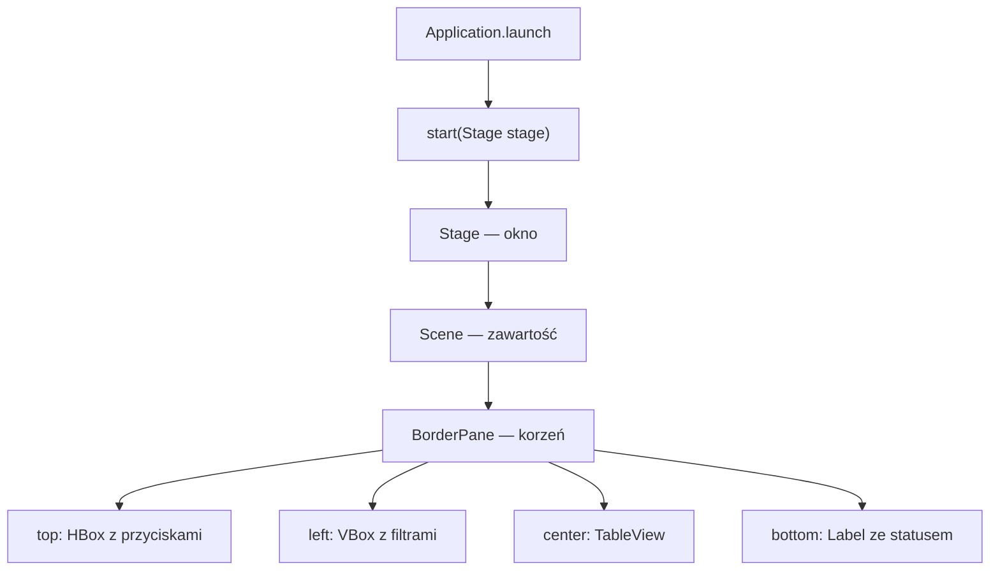
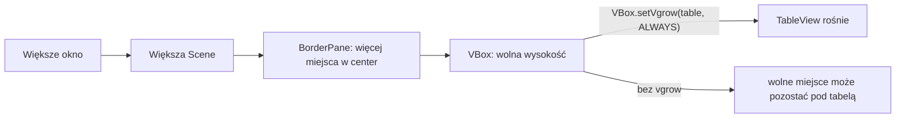
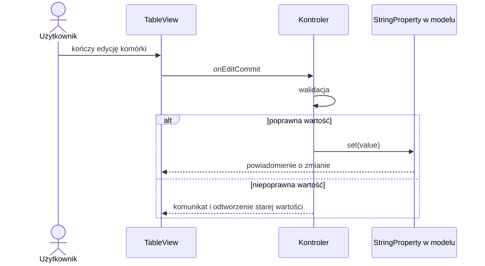

# Lab 2 - Graficzny interfejs użytkownika w JavaFX

## Zakres: 4 zajęcia

## Cel zajęć

Przygotuj `lab2` według [instrukcji IntelliJ IDEA](../srodowisko.md). Stosujemy projekt bez `module-info.java`. Do bazowego POM dodaj zależności i plugin poniżej; zachowaj plugin kompilatora. Uruchamiaj przez **Maven → Plugins → javafx → javafx:run**. W przykładzie klasy `Main` dodaj `package pl.uczelnia.lab2;`.

JavaFX umożliwia tworzenie nowocześniejszych interfejsów, korzysta z wiązania danych, scen, kontrolek, CSS i opcjonalnie plików FXML. Wykonamy formularz, tabelę, wykres i przejście między widokami.

## Projekt Maven

JavaFX nie jest częścią JDK. W projekcie Maven dodaj zależności zgodne z używaną wersją JDK. Poniższy przykład dotyczy JDK 17 i JavaFX 21:

```xml
<properties>
    <maven.compiler.release>17</maven.compiler.release>
    <javafx.version>21.0.2</javafx.version>
</properties>

<dependencies>
    <dependency>
        <groupId>org.openjfx</groupId>
        <artifactId>javafx-controls</artifactId>
        <version>${javafx.version}</version>
    </dependency>
    <dependency>
        <groupId>org.openjfx</groupId>
        <artifactId>javafx-fxml</artifactId>
        <version>${javafx.version}</version>
    </dependency>
</dependencies>

<build>
    <plugins>
        <plugin>
            <groupId>org.openjfx</groupId>
            <artifactId>javafx-maven-plugin</artifactId>
            <version>0.0.8</version>
            <configuration>
                <mainClass>pl.uczelnia.lab2.Main</mainClass>
            </configuration>
        </plugin>
    </plugins>
</build>
```

Jeżeli prowadzący podał inną wersję JDK lub JavaFX, wszystkie moduły projektu muszą używać jednej, zgodnej pary wersji.

## Aplikacja i scena

```java
import javafx.application.Application;
import javafx.geometry.Insets;
import javafx.scene.Scene;
import javafx.scene.control.*;
import javafx.scene.layout.VBox;
import javafx.stage.Stage;

public class Main extends Application {
    @Override
    public void start(Stage stage) {
        TextField name = new TextField();
        name.setPromptText("Imię");
        Label message = new Label();
        Button button = new Button("Zapisz");

        button.setOnAction(event -> {
            if (name.getText().isBlank()) {
                message.setText("Imię jest wymagane");
            } else {
                message.setText("Witaj, " + name.getText().trim());
            }
        });

        VBox root = new VBox(10, name, button, message);
        root.setPadding(new Insets(16));
        stage.setScene(new Scene(root, 360, 180));
        stage.setTitle("Lab 2");
        stage.show();
    }

    public static void main(String[] args) {
        launch(args);
    }
}
```

## Stage, Scene, Node i układy JavaFX

Cykl życia aplikacji JavaFX zaczyna się od `launch`, po czym framework wywołuje metodę `start`. `Stage` jest najwyższym oknem, `Scene` przechowuje zawartość okna, a elementy interfejsu są obiektami typu `Node` umieszczonymi w kontenerach.

Najczęściej używane kontenery to `HBox`, `VBox`, `BorderPane`, `GridPane`, `StackPane` i `AnchorPane`. Ich role są podobne do menedżerów układu Swing, ale są częścią hierarchii sceny:

```java
BorderPane root = new BorderPane();
HBox toolbar = new HBox(8, new Button("Otwórz"), new Button("Zapisz"));
VBox content = new VBox(10, new Label("Dane"), new TextField());

root.setTop(toolbar);
root.setCenter(content);
Scene scene = new Scene(root, 640, 400);
stage.setScene(scene);
```

Zdarzenia można obsługiwać przez klasę `EventHandler`, klasę anonimową albo lambdę. W prostych przypadkach lambda jest czytelna, natomiast wspólną obsługę wielu kontrolek można wydzielić do osobnej metody.

```java
saveButton.setOnAction(event -> saveData());
```

## Wykład a praktyka

JavaFX oddziela strukturę sceny od danych. `ObservableList` i właściwości JavaFX pozwalają odświeżać widok po zmianie modelu. Przy większym widoku FXML przejmuje opis układu, a kontroler obsługuje zdarzenia i wywołuje serwisy.

## Tabela i model

`TableView<T>` współpracuje z `ObservableList<T>`. Model tabeli powinien udostępniać właściwości JavaFX albo wartości odczytywane przez `PropertyValueFactory`.

```java
ObservableList<Student> data = FXCollections.observableArrayList(
        new Student("Anna", "Nowak", 10001),
        new Student("Jan", "Kowalski", 10002));

TableView<Student> table = new TableView<>(data);
TableColumn<Student, String> nameColumn = new TableColumn<>("Imię");
nameColumn.setCellValueFactory(new PropertyValueFactory<>("firstName"));
table.getColumns().add(nameColumn);
```

W praktycznej aplikacji lepiej używać właściwości, np. `StringProperty`, i jawnie zdefiniowanych fabryk komórek. Dzięki temu edycja tabeli może aktualizować model.

## FXML i MVC

FXML opisuje strukturę widoku, a kontroler reaguje na zdarzenia. W Scene Builderze można zbudować plik widoku, a w kodzie pozostawić logikę. Przy większej aplikacji rozdziel:

- model - dane i reguły domenowe,
- widok - FXML/CSS i kontrolki,
- kontroler - reakcje na zdarzenia i wywołania serwisów.

## Zadania

1. Utwórz formularz pracownika z polami: imię, nazwisko, zawód (`ComboBox`), data urodzenia (`DatePicker`) i staż pracy.
2. Zastosuj walidację: imię i nazwisko tylko litery, staż jako nieujemna liczba całkowita.
3. Utwórz `TableView` z co najmniej 30 pracownikami. Dodaj edycję imienia i nazwiska w komórce.
4. Dodaj kolumny z `ComboBox`, `DatePicker`, `CheckBox` oraz przyciskiem usuwania.
5. Dodaj `FileChooser` i zapis/odczyt danych w CSV albo XML.
6. Utwórz wykres `BarChart`, `PieChart` albo `LineChart` na podstawie danych odczytanych z pliku.
7. Zbuduj dwie sceny w Scene Builderze i dodaj przejście w obie strony.
8. Przenieś widok formularza do FXML, utwórz kontroler i opisz, które elementy należą do modelu, widoku i kontrolera.

## Pytania kontrolne

1. Czym różnią się `ObservableList` i `List`?
2. Do czego służą FXML i Scene Builder?
3. Jakie zadania powinien wykonywać kontroler?
4. Dlaczego JavaFX wymaga dodatkowych zależności Maven?

## Plan pracy na cztery spotkania

| Spotkanie | Zakres | Gotowy rezultat |
|---|---|---|
| 1 | konfiguracja, scena, kontenery, formularz | okno uruchamiane przez Maven i poprawna walidacja |
| 2 | właściwości, tabela, edycja i filtrowanie | zmiana obiektu widoczna w tabeli |
| 3 | import/eksport, wykres, praca w tle | dane z lokalnego pliku i wykres z jednostkami |
| 4 | FXML, kontroler, przełączanie widoków | podział odpowiedzialności i demonstracja całości |

## Jak powstaje scena



W większości widoków wystarcza jedno `Stage` i zmiana zawartości sceny. Dwie sceny w zadaniu służą przećwiczeniu API; każda zakładka aplikacji nie musi być osobnym oknem.

| Kontener | Zachowanie przy zmianie rozmiaru | Zastosowanie |
|---|---|---|
| `HBox` / `VBox` | jeden wiersz / kolumna; dodatkowe miejsce rozdzielasz przez `hgrow` / `vgrow` | pasek akcji, panel filtrów |
| `BorderPane` | środek otrzymuje miejsce pozostałe po bokach | główny widok |
| `GridPane` | siatka z indywidualnymi ograniczeniami kolumn i wierszy | formularz |
| `StackPane` | elementy nakładają się warstwami | wykres i nakładka „Ładowanie” |
| `AnchorPane` | odległości od wybranych krawędzi | element rozciągany między kotwicami |



Ćwiczenie: umieść tabelę i pasek przycisków w `VBox`, ustaw `VBox.setVgrow(table, Priority.ALWAYS)` i porównaj zachowanie przed i po zmianie. Nie ustawiaj stałych współrzędnych wszystkich kontrolek.

## Właściwości i edycja — brakujący model tabeli

Poniższy minimalny model zastępuje niezdefiniowany wcześniej `Student`. Umieść go w pliku `Student.java` z pakietem `pl.uczelnia.lab2`:

```java
package pl.uczelnia.lab2;

import javafx.beans.property.SimpleStringProperty;
import javafx.beans.property.StringProperty;

public class Student {
    private final StringProperty firstName;
    private final StringProperty lastName;
    private final int index;

    public Student(String firstName, String lastName, int index) {
        this.firstName = new SimpleStringProperty(firstName);
        this.lastName = new SimpleStringProperty(lastName);
        this.index = index;
    }

    public StringProperty firstNameProperty() { return firstName; }
    public StringProperty lastNameProperty() { return lastName; }
    public String getFirstName() { return firstName.get(); }
    public int getIndex() { return index; }
}
```

Zamiast refleksyjnego `PropertyValueFactory` z wcześniejszego przykładu zastosuj jawne powiązanie:

```java
nameColumn.setCellValueFactory(cell -> cell.getValue().firstNameProperty());
nameColumn.setCellFactory(javafx.scene.control.cell.TextFieldTableCell.forTableColumn());
table.setEditable(true);
nameColumn.setOnEditCommit(event -> {
    String value = event.getNewValue().trim();
    if (!value.isBlank()) {
        event.getRowValue().firstNameProperty().set(value);
    }
    table.refresh(); // Odtwarza również poprzednią wartość po odrzuceniu edycji.
});
```

`ObservableList` zgłasza dodanie i usunięcie elementu; nie obserwuje automatycznie dowolnych pól zwykłego obiektu. Właściwość zwrócona przez fabrykę wartości komórki pozwala tabeli obserwować zmianę tej wartości. Implementując własne komórki `DatePicker` i przyciski usuwania, uwzględnij ponowne używanie komórek i czyszczenie ich zawartości w `updateItem`.



## FXML krok po kroku w IntelliJ

Utwórz `src/main/resources/pl/uczelnia/lab2/form.fxml`. Scene Builder jest opcjonalnym edytorem — poniższy plik można napisać w IntelliJ:

```xml
<?xml version="1.0" encoding="UTF-8"?>
<?import javafx.scene.layout.VBox?>
<?import javafx.scene.control.*?>
<VBox xmlns:fx="http://javafx.com/fxml/1" spacing="10"
      fx:controller="pl.uczelnia.lab2.FormController">
    <TextField fx:id="nameField" promptText="Nazwa zbioru"/>
    <Button text="Zatwierdź" onAction="#save"/>
    <Label fx:id="statusLabel"/>
</VBox>
```

W `src/main/java/pl/uczelnia/lab2/FormController.java`:

```java
package pl.uczelnia.lab2;

import javafx.fxml.FXML;
import javafx.scene.control.Label;
import javafx.scene.control.TextField;

public class FormController {
    @FXML private TextField nameField;
    @FXML private Label statusLabel;

    @FXML private void save() {
        String name = nameField.getText().trim();
        statusLabel.setText(name.isEmpty() ? "Podaj nazwę zbioru" : "Wybrano: " + name);
    }
}
```

W `Main.start` zastąp dotychczasowe tworzenie sceny:

```java
var resource = java.util.Objects.requireNonNull(
        Main.class.getResource("/pl/uczelnia/lab2/form.fxml"), "Brak form.fxml");
var root = new javafx.fxml.FXMLLoader(resource).<javafx.scene.Parent>load();
stage.setScene(new Scene(root, 480, 240));
stage.show();
```

Metoda `start` musi teraz deklarować `throws Exception`. Pola `@FXML` są dostępne po wstrzyknięciu, np. w metodzie `initialize`, a nie w konstruktorze kontrolera. Nie twórz drugiego kontrolera przez `new` do obsługi już załadowanego widoku.

## Import i wykres w kontekście ekonomicznym

Przygotuj lokalny plik UTF-8 o formacie `rok;region;stopa_bezrobocia` z co najmniej 12 obserwacjami. Zdefiniuj separator dziesiętny i jednostkę `%`. Jeżeli stosujesz prosty `split(";", -1)`, jawnie ogranicz format: pola nie mogą zawierać separatora ani cytowanych wielowierszowych wartości. Pełny CSV wymaga parsera obsługującego te przypadki.

Import wykonaj do tymczasowej kolekcji, zgłoś błędy z numerami wierszy i dopiero po walidacji podmień dane w GUI. Na `LineChart` sortuj lata i twórz osobną serię dla regionu. Różnica między 5% a 6% to 1 punkt procentowy, a względny wzrost to 20% — nie myl opisów.

Długą operację umieść w `Task<List<Observation>>`: `call()` czyta plik w tle, `setOnSucceeded` aktualizuje `ObservableList`, a `setOnFailed` pokazuje błąd. Nie modyfikuj kontrolek w `call()`. Uruchom zadanie przez wątek lub executor, który zostanie zamknięty przy końcu aplikacji.

## Sprawdzenie i oddanie

Obowiązuje również [macierz testów responsywności, HiDPI i motywów](../jakosc-gui.md) oraz ćwiczenie poniżej.

- Imię z polskimi znakami i nazwisko dwuczłonowe przechodzą walidację; puste dane i ujemny staż są odrzucane. Nie ograniczaj imion do ASCII `[A-Za-z]`.
- Edycja tabeli zmienia obiekt, zapis i ponowny odczyt zachowują tę zmianę.
- Anulowany import nie usuwa danych, błędny wiersz ma numer w komunikacie.
- Wykres ma tytuł, jednostki i poprawną kolejność lat; pusta lista ma komunikat zamiast mylącego wykresu.
- Widok ładuje się z FXML po `clean` i ponownym budowaniu, a zmiana rozmiaru okna nie zakrywa akcji.

Oddaj projekt Maven, plik przykładowych danych, FXML i zrzuty formularza, tabeli oraz wykresu. Opisz jedną właściwość, jedno zdarzenie i przepływ importu. Dodaj własne komórki, filtrowanie przez `FilteredList` i sortowanie przez `SortedList` z powiązanym komparatorem tabeli.

## Ćwiczenie: adaptacyjny panel danych i motywy CSS

Ćwiczenie realizuj w istniejącej aplikacji ze spotkań 3–4. W szerokim widoku filtry znajdują się po lewej, a tabela i wykres w części głównej. W wąskim przenieś filtry nad treść lub do zwijanego `TitledPane`, a tabelę i wykres pokaż w zakładkach. Zmiana widoku zachowuje filtr, zaznaczenie i dane.

Obserwuj szerokość kontenera, np. `root.widthProperty()`. Zmieniaj wariant tylko po przekroczeniu wybranego progu. Przed przeniesieniem węzła usuń go z poprzedniego rodzica. `GridPane` wymaga odpowiednich `ColumnConstraints`, `hgrow` i maksymalnych rozmiarów kontrolek; samo umieszczenie w siatce nie gwarantuje ich rozciągania.

### Dwa arkusze i wspólne reguły

Utwórz `src/main/resources/css/base.css`, `light.css` oraz `dark.css`. Style semantyczne wykorzystują kolory zależne od motywu. Poniższe fragmenty są punktem startowym; sprawdź również popupy, tabelę, osie, legendę i wszystkie stany kontrolek.

`base.css`:

```css
.root { -fx-font-size: 1em; }
.content { -fx-padding: 1em; -fx-spacing: 0.75em; }
.status-error { -fx-text-fill: app-error; }
.chart-plot-background { -fx-background-color: -fx-control-inner-background; }
.axis { -fx-tick-label-fill: -fx-text-background-color; }
```

`light.css`:

```css
.root {
    -fx-base: #f3f4f6;
    -fx-background: #ffffff;
    -fx-control-inner-background: #ffffff;
    -fx-text-background-color: #202124;
    -fx-accent: #175cd3;
    -fx-focus-color: #175cd3;
    app-error: #b42318;
}
```

`dark.css`:

```css
.root {
    -fx-base: #292d35;
    -fx-background: #20242b;
    -fx-control-inner-background: #292d35;
    -fx-text-background-color: #f0f2f5;
    -fx-accent: #86b7ff;
    -fx-focus-color: #86b7ff;
    app-error: #ffb4ab;
}
```

W JavaFX są to *looked-up colors*, a nie przeglądarkowe zmienne `var(--color)`. Odstępy w `em` odnoszą się do wielkości czcionki. Nie stosuj `scaleX/scaleY` na całej scenie jako sposobu obsługi HiDPI. [Referencja CSS JavaFX](https://openjfx.io/javadoc/21/javafx.graphics/javafx/scene/doc-files/cssref.html).

Metoda pomocnicza do klasy `Main` (wywołuj w JavaFX Application Thread):

```java
static void applyTheme(javafx.scene.Scene scene, boolean dark) {
    String base = java.util.Objects.requireNonNull(
            Main.class.getResource("/css/base.css")).toExternalForm();
    String theme = java.util.Objects.requireNonNull(
            Main.class.getResource(dark ? "/css/dark.css" : "/css/light.css"))
            .toExternalForm();
    scene.getStylesheets().setAll(base, theme);
}
```

Ten przykład zakłada dwa arkusze sceny. Jeżeli masz dodatkowe arkusze funkcjonalne, zachowaj je przy zmianie motywu. `DialogPane` okna `Alert` może wymagać osobnego przekazania arkuszy; sprawdź wygląd okien pomocniczych i wszystkich scen. Natywny `FileChooser` może mieć wygląd kontrolowany przez system, co opisz w raporcie.

### Zadania i kryteria

1. Dodaj przełącznik jasny/ciemny i zapisz preferencję. Zmień motyw przy otwartym formularzu bez utraty danych.
2. Oznacz komunikat błędu klasą `status-error`; komunikat musi mieć również treść, nie tylko kolor.
3. Dopasuj wykres: osie i legenda mają być czytelne w obu motywach, serie rozróżnialne także symbolem lub stylem linii. Zachowaj znaczenie kolorów przy przełączaniu.
4. Sprawdź tabelę: zaznaczenie, edycję, fokus klawiatury, puste dane i długą nazwę kolumny. Nie ustawiaj zbyt małej stałej wysokości komórki.
5. Wykonaj pełną [macierz testów](../jakosc-gui.md). Dołącz zrzuty obu układów i motywów oraz próbę zwiększenia czcionki o 25%.

Warunkiem wykonania jest działający adaptacyjny układ i kompletny wygląd obu motywów — samo dodanie plików CSS nie wystarcza.
