# Lab 2 - Graficzny interfejs użytkownika w JavaFX

## Cel i plan pracy — 4 zajęcia

W kolejnych zadaniach rozwijasz jedną aplikację: od pierwszego okna przez
formularz i tabelę pracowników do importu wskaźników rynku pracy, wykresu
oraz widoków FXML z adaptacyjnym układem i motywami. Każde zadanie zawiera
wyjaśnienie, przykład i sposób sprawdzenia rezultatu. Wykonuj je w podanej kolejności.

| Spotkanie | Zadania | Rezultat na koniec |
|---|---|---|
| 1 | 1–4: Maven, pierwsze okno, kontenery, formularz i zdarzenia | działający formularz z walidacją |
| 2 | 5: model, właściwości, tabela, edycja i filtrowanie | formularz i tabela korzystają ze wspólnych danych |
| 3 | 6: zapis/odczyt, import wskaźników i wykres | lokalne pliki, wykres i praca w tle |
| 4 | 7–8: FXML, kontrolery, adaptacja, CSS i HiDPI | kompletna aplikacja i raport sprawdzenia |

Pracujemy w IntelliJ IDEA z **JDK 27 GA i JavaFX 27**. Konfigurację i diagnostykę
opisuje [środowisko](../srodowisko.md). [Layout Explorer](demo/README.md) jest
osobnym pokazem pomocniczym do zadań 3–4; nie zastępuje własnej aplikacji.

Pierwszy przykład klasy `Main` jest kompletny. Następne krótkie bloki to fragmenty
do odpowiednich klas lub metod, zgodnie z opisem. Rozwijaj kod etapami i uruchamiaj
go po każdym zadaniu; nie sklejaj wszystkich przykładów w jednej metodzie.

## 1. Przygotuj projekt w IntelliJ IDEA

JavaFX nie jest częścią JDK. Używamy **JDK 27 GA i JavaFX 27**, stabilnych wydań wskazanych w [konfiguracji środowiska](../srodowisko.md). Utwórz projekt Maven `lab2` według [instrukcji środowiska](../srodowisko.md).
Nie twórz `module-info.java`. Poniżej kompletny `pom.xml` tego laboratorium:

```xml
<project xmlns="http://maven.apache.org/POM/4.0.0"
         xmlns:xsi="http://www.w3.org/2001/XMLSchema-instance"
         xsi:schemaLocation="http://maven.apache.org/POM/4.0.0 https://maven.apache.org/xsd/maven-4.0.0.xsd">
<modelVersion>4.0.0</modelVersion>
<groupId>pl.uczelnia</groupId>
<artifactId>lab2</artifactId>
<version>1.0-SNAPSHOT</version>
<properties>
    <maven.compiler.release>27</maven.compiler.release>
    <project.build.sourceEncoding>UTF-8</project.build.sourceEncoding>
    <javafx.version>27</javafx.version>
</properties>

<dependencies>
    <dependency>
        <groupId>org.openjfx</groupId>
        <artifactId>javafx-controls</artifactId>
        <version>${javafx.version}</version>
    </dependency>
    <dependency>
        <groupId>org.openjfx</groupId>
        <artifactId>javafx-fxml</artifactId>
        <version>${javafx.version}</version>
    </dependency>
</dependencies>

<build>
    <plugins>
        <plugin>
            <groupId>org.apache.maven.plugins</groupId>
            <artifactId>maven-compiler-plugin</artifactId>
            <version>3.13.0</version>
        </plugin>
        <plugin>
            <groupId>org.openjfx</groupId>
            <artifactId>javafx-maven-plugin</artifactId>
            <version>0.0.8</version>
            <configuration>
                <mainClass>pl.uczelnia.lab2.Main</mainClass>
                <options><option>--enable-native-access=javafx.graphics</option></options>
            </configuration>
        </plugin>
    </plugins>
</build>
</project>
```

Zależności `javafx-controls` i `javafx-fxml` korzystają ze wspólnej wartości `javafx.version=27`. Project SDK i Maven Runner ustaw na JDK 27. Nie wybieraj wersji EA/RC ani nie włączaj `--enable-preview`.

**Wykonaj:** zsynchronizuj Maven, ustaw JDK 27 jako Project SDK i Maven Runner,
a następnie przejdź do utworzenia klasy `Main` w zadaniu 2.
**Sprawdź:** zależności `javafx-controls` i `javafx-fxml` są widoczne w External Libraries.

## 2. Zbuduj pierwsze okno i obsłuż przycisk

Zbudujemy okno z polem imienia, przyciskiem i komunikatem. Po wpisaniu imienia
i kliknięciu przycisku program wyświetli powitanie. Jeśli pole jest puste,
pokaże komunikat walidacji. Ten przykład nie zapisuje danych do pliku ani bazy.

### Z czego składa się okno

| Element | Odpowiedzialność w przykładzie |
|---|---|
| `Application` | klasa bazowa aplikacji; JavaFX zarządza jej uruchomieniem i cyklem życia |
| `Stage` | okno systemowe: tytuł, rozmiar, możliwość pokazania i zamknięcia |
| `Scene` | zawartość okna; przechowuje korzeń grafu sceny |
| `VBox` | kontener układający dzieci w pionie; tutaj korzeń sceny |
| `TextField` | edytowalne pole, z którego odczytujemy imię |
| `Button` | kontrolka wywołująca akcję użytkownika |
| `Label` | tekst wyniku albo błędu; użytkownik nie edytuje go bezpośrednio |

`Stage` i `Scene` nie są tym samym: okno jest zewnętrzną obudową, a scena
organizuje jego zawartość. Kontrolki i kontenery dziedziczą po `Node` i tworzą
drzewo nazywane grafem sceny. `Stage` oraz `Scene` same nie są węzłami tego drzewa.

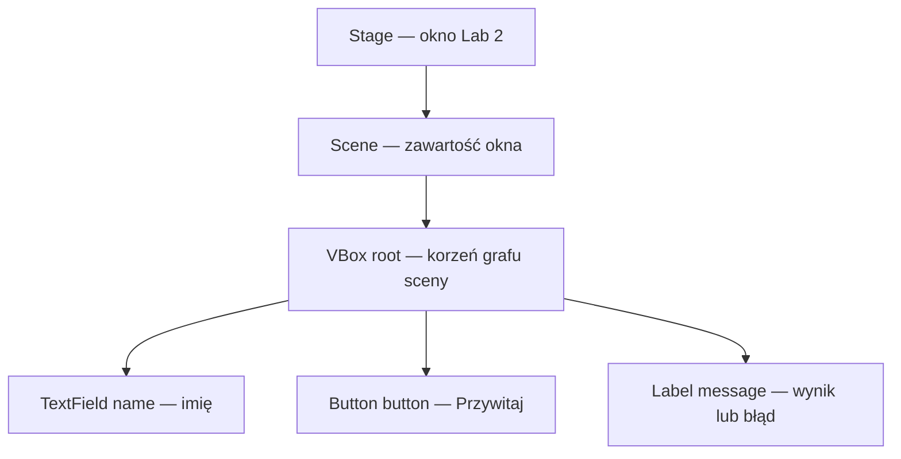

### Kod do uruchomienia

W IntelliJ utwórz `src/main/java/pl/uczelnia/lab2/Main.java` i wstaw cały kod:

```java
package pl.uczelnia.lab2;

import javafx.application.Application;
import javafx.geometry.Insets;
import javafx.scene.Scene;
import javafx.scene.control.*;
import javafx.scene.layout.VBox;
import javafx.stage.Stage;

public class Main extends Application {
    @Override
    public void start(Stage stage) {
        TextField name = new TextField();
        name.setPromptText("Imię");
        Label message = new Label();
        Button button = new Button("Przywitaj");

        button.setOnAction(event -> {
            if (name.getText().isBlank()) {
                message.setText("Imię jest wymagane");
            } else {
                message.setText("Witaj, " + name.getText().trim());
            }
        });

        VBox root = new VBox(10, name, button, message);
        root.setPadding(new Insets(16));
        Scene scene = new Scene(root, 360, 180);
        stage.setScene(scene);
        stage.setTitle("Lab 2");
        stage.show();
    }

    public static void main(String[] args) {
        launch(args);
    }
}
```

### Krok 1. Uruchomienie i metoda start

`Main extends Application` oznacza, że nasza klasa dziedziczy mechanizm aplikacji
JavaFX. `main` wywołuje `launch(args)`, które uruchamia środowisko JavaFX.
Framework tworzy instancję aplikacji i wywołuje `start`, przekazując jej główne okno
`Stage`. Nie wywołujemy `start` ręcznie ani nie tworzymy `new Main()` w celu pokazania GUI.

`@Override` informuje kompilator, że nadpisujemy metodę klasy bazowej.
Kod `start` działa w **JavaFX Application Thread** — w tym wątku budujemy
i aktualizujemy widok. Po zakończeniu `start` okno nadal działa: środowisko
oczekuje na zdarzenia użytkownika. Nie piszemy własnej pętli oczekującej na kliknięcie.

`launch` uruchamia mechanizm aplikacji, `init()` służy do inicjalizacji,
`start(Stage)` tworzy widok, a `stop()` pozwala zwolnić zasoby. `init()` nie działa
w JavaFX Application Thread — nie twórz w nim sceny ani okna. W `stop()` zamknij
executor lub inne zasoby własnej aplikacji. Długie zadania wykonuj w tle.

### Krok 2. Utworzenie kontrolek

`new TextField()` tworzy puste pole. `setPromptText("Imię")` dodaje podpowiedź,
a nie wartość pola: dopóki użytkownik nic nie wpisze, `getText()` zwraca pusty tekst.
`new Label()` tworzy początkowo pusty komunikat, a napis przekazany do
`new Button("Przywitaj")` staje się etykietą przycisku.

Samo utworzenie obiektów nie pokazuje ich na ekranie. Muszą trafić do drzewa
zawartości sceny, a scena do wyświetlonego okna.

### Krok 3. Rejestracja reakcji na przycisk

`button.setOnAction(...)` rejestruje obsługę akcji. Lambda `event -> { ... }`
jest kodem do wykonania **później**, gdy użytkownik aktywuje przycisk myszą
lub klawiaturą. Przy budowaniu okna powitanie nie jest jeszcze obliczane.
Parametr `event` opisuje zdarzenie; w tym przykładzie nie potrzebujemy jego pól.

Wewnątrz lambdy:

1. `name.getText()` odczytuje aktualną zawartość pola w momencie akcji.
2. `isBlank()` rozpoznaje pusty napis lub napis złożony z białych znaków.
3. Dla błędnego wejścia `message.setText(...)` ustawia komunikat walidacji.
4. Dla poprawnego wejścia `trim()` usuwa początkowe i końcowe spacje, a tekst
   powitania trafia do tej samej etykiety.

Zmienia się istniejący obiekt `Label`; nie tworzymy nowego okna ani nowej sceny.
JavaFX odświeża widok po zmianie właściwości kontrolki. Obsługa tej akcji również
działa w JavaFX Application Thread, dlatego nie umieszczamy tu długiego importu
pliku lub zapytania do bazy.

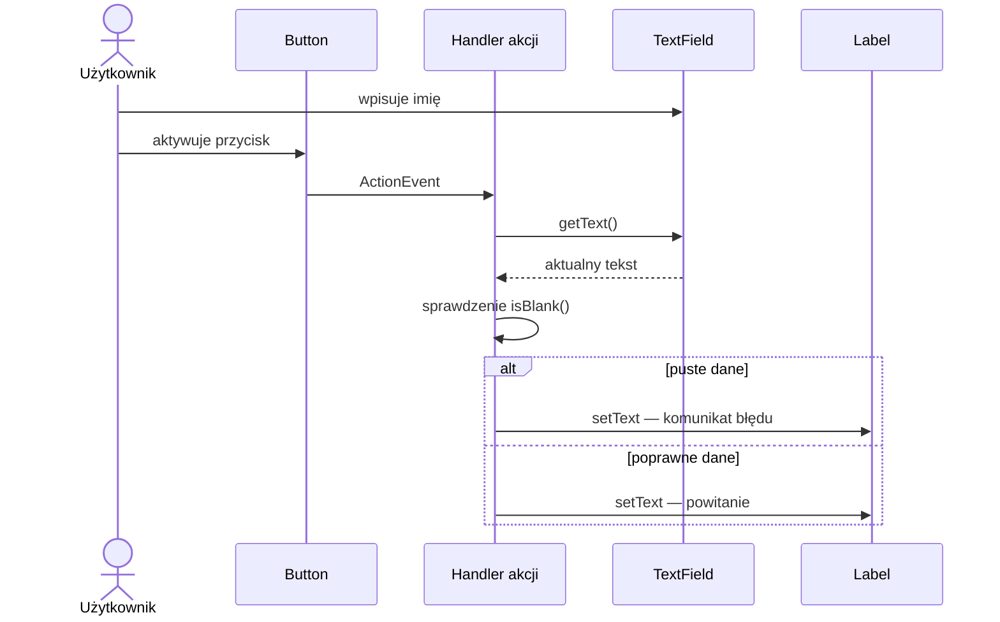

### Krok 4. Zbudowanie układu i sceny

`new VBox(10, name, button, message)` dodaje trzy kontrolki w podanej kolejności:
pole na górze, pod nim przycisk, następnie komunikat. Liczba `10` oznacza odstęp
między kolejnymi dziećmi. `new Insets(16)` ustawia wewnętrzny odstęp od każdej
krawędzi kontenera. Są to jednostki logiczne interfejsu, nie sztywna liczba
fizycznych pikseli niezależna od skalowania systemowego.

`new Scene(root, 360, 180)` tworzy scenę z kontenerem `root` jako korzeniem.
Wartości `360` i `180` określają początkowy rozmiar zawartości. Nie obejmują
systemowej ramki okna i nie blokują późniejszej zmiany rozmiaru.

### Krok 5. Pokazanie okna

`stage.setScene(scene)` przypisuje zawartość do okna, `setTitle("Lab 2")`
ustawia tytuł, a `show()` pokazuje okno. Bez `show()` samo zbudowanie sceny
nie wyświetli aplikacji. W tym przykładzie zamknięcie ostatniego okna
kończy działanie aplikacji przy domyślnym ustawieniu JavaFX.

Uruchom **Maven → Plugins → javafx → javafx:run**. Powinno pojawić się
okno „Lab 2” z podpowiedzią „Imię” i przyciskiem „Przywitaj”. Początkowo
etykieta komunikatu jest pusta — to zamierzony stan, a nie błąd.

### Sprawdź i zmodyfikuj przykład

| Działanie | Oczekiwany wynik |
|---|---|
| kliknij bez wpisywania danych | komunikat „Imię jest wymagane” |
| wpisz wyłącznie spacje i kliknij | ten sam komunikat walidacji |
| wpisz ` Anna ` i kliknij | „Witaj, Anna”, bez dodatkowych spacji |
| zmień imię i kliknij ponownie | aktualizacja tej samej etykiety |
| zmień rozmiar okna | kontrolki nadal są ułożone pionowo przez VBox |

1. Zmień odstęp między kontrolkami z 10 na 20, a padding z 16 na 24.
   Wskaż osobno obszary, na które wpłynęła każda zmiana.
2. Dodaj przycisk „Wyczyść”. W jego handlerze wywołaj `name.clear()`,
   `message.setText("")` i `name.requestFocus()`; wyjaśnij rezultat każdej metody.
3. Dodaj `System.out.println("Rejestracja handlera")` przed `setOnAction`,
   a `System.out.println("Wykonanie handlera")` wewnątrz lambdy. Uruchom program
   przez `javafx:run` i kliknij przycisk trzy razy. Wyjaśnij, dlaczego pierwszy
   komunikat pojawia się raz, a drugi trzy razy.

Odpowiedz: dlaczego podpowiedź nie jest wartością pola, dlaczego lambda
nie wykonuje się podczas tworzenia okna i jaki obiekt zmienia się po kliknięciu?

## 3. Dobierz układ do formularza

Uruchom [Layout Explorer](demo/README.md) jako osobny projekt demonstracyjny.
Wykonaj doświadczenia „Sprawdź” przy kolejnych kontenerach, a potem wykorzystaj
poznane układy we własnym `lab2`. Przykładów nie wklejaj wszystkich naraz do `start`.

W Swing menedżer układu jest obiektem przypisanym do kontenera. W JavaFX
`HBox`, `VBox` czy `GridPane` są węzłami grafu sceny, które same układają swoje dzieci.
`ScrollPane`, `TitledPane` i `Accordion` to kontrolki zarządzające zawartością,
a nie klasy z pakietu `javafx.scene.layout`. Wszystkie pomagają zorganizować widok,
ale mają różne odpowiedzialności.

### Rozmiar: minimum, preferowany i maksimum

Rodzic przydziela miejsce, uwzględniając ograniczenia dziecka. `prefWidth` nie jest
bezwzględną szerokością, a `Priority.ALWAYS` nie znosi `maxWidth`.
Kontrolki mogą zachowywać się inaczej: przycisk zwykle ogranicza wzrost do
preferowanego rozmiaru, pole tekstowe może wykorzystać dodatkową szerokość.

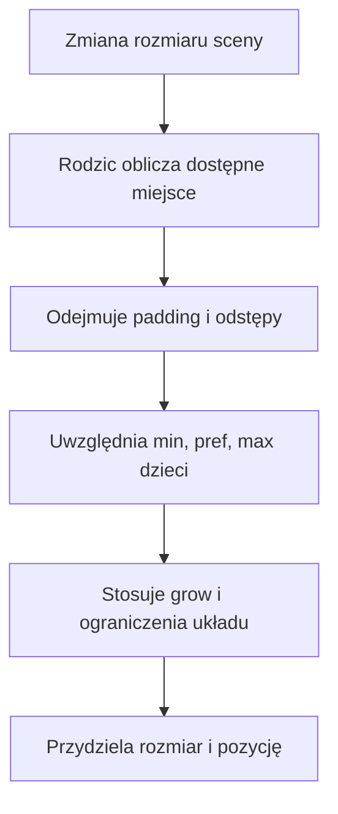

`padding` to odstęp od krawędzi kontenera, `spacing` w `HBox/VBox` to odstęp
między dziećmi, a `hgap/vgap` określają odstępy w siatce lub przepływie.
Margines jest ograniczeniem konkretnego dziecka, np. `HBox.setMargin(button, new Insets(8))`.
Nie zastępuj marginesów wstawianiem spacji w tekst etykiety.

W aplikacji wybierz `HBox`, zmień szerokość, wyłącz wzrost i zmień wyrównanie.
Następnie zwiększ `padding`. Wyjaśnij, dlaczego powierzchnia dostępna dla pól maleje,
mimo że zewnętrzna szerokość kontenera się nie zmieniła.

### HBox i VBox — jedna oś, bez zawijania

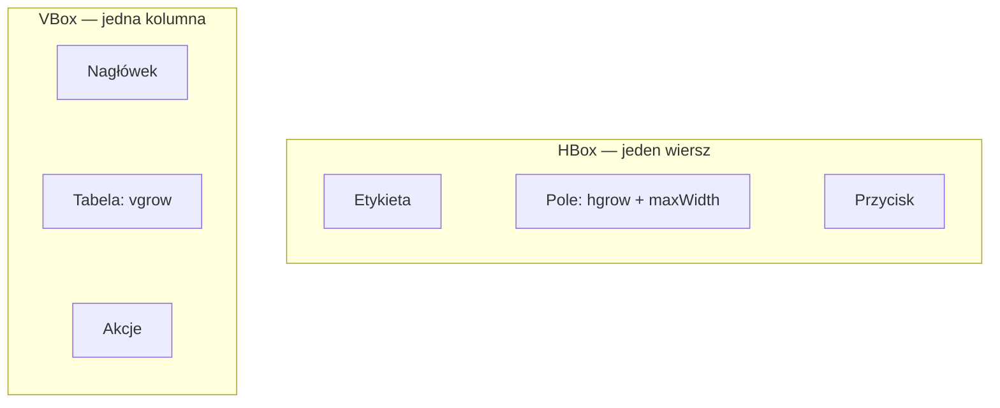

`HBox` nie przenosi przycisku do następnego wiersza po zmniejszeniu okna.
`VBox` nie tworzy automatycznie drugiej kolumny. `alignment` określa położenie
grupy w wolnym obszarze; jeżeli dzieci zajęły cały obszar, zmiana wyrównania
może nie dać widocznego efektu.

```java
TextField query = new TextField();
query.setMaxWidth(Double.MAX_VALUE);
HBox.setHgrow(query, Priority.ALWAYS);
HBox toolbar = new HBox(8, new Label("Szukaj:"), query, new Button("Filtruj"));
toolbar.setAlignment(javafx.geometry.Pos.CENTER_LEFT);
toolbar.setPadding(new Insets(12));
```

`ALWAYS` dostaje dodatkowe miejsce przed `SOMETIMES`; `NEVER` nie zgłasza
zapotrzebowania na ten wzrost. Kilkoro dzieci z tym samym priorytetem dzieli
wolne miejsce z uwzględnieniem swoich ograniczeń. Nie oznacza to automatycznie
jednakowych końcowych szerokości.

**Sprawdź:** w pokazie `VBox` włącz i wyłącz wzrost `TextArea`. W `HBox` porównaj
`TOP_LEFT`, `CENTER`, `BOTTOM_RIGHT` przy wyłączonym wzroście. Opisz różnicę między
przydzieleniem miejsca przez rodzica a limitem rozmiaru kontrolki.

### FlowPane i TilePane — zawijanie

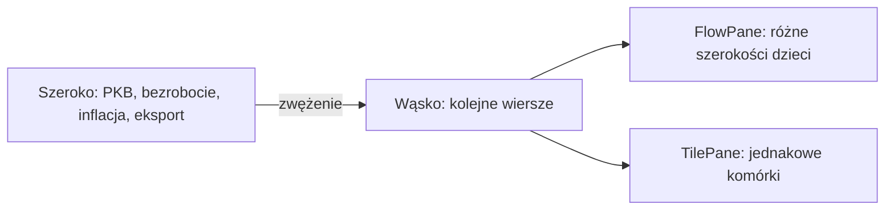

Poziomy `FlowPane` umieszcza dzieci kolejno i zawija do nowego wiersza,
gdy zabraknie szerokości. `prefWrapLength` wpływa na obliczanie preferowanego
rozmiaru; nie jest sztywnym progiem układu niezależnym od rzeczywistej szerokości.
`TilePane` również zawija, ale organizuje elementy w jednakowych polach.
Aby przyciski wypełniały pola, pozwól im rosnąć przez `setMaxSize`.

```java
FlowPane tags = new FlowPane(8, 8);
tags.getChildren().addAll(new Button("PKB"), new Button("Stopa bezrobocia"),
        new Button("Inflacja"), new Button("Eksport"));
```

**Sprawdź:** zmieniaj szerokość od 900 do 360 w `FlowPane`, potem w `TilePane`.
Dodaj przycisk z dużo dłuższym napisem. Porównaj, czy zmienia się tylko jego
szerokość, czy rozmiar wszystkich pól. Wyjaśnij zastosowanie do filtrów i kafelków wskaźników.

### BorderPane — pięć obszarów

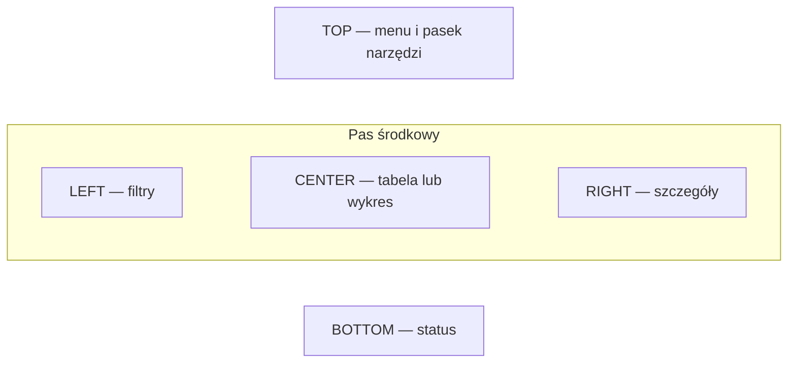

`top` i `bottom` korzystają z preferowanej wysokości i dostępnej szerokości.
Boki zajmują preferowaną szerokość w środkowym pasie; środek otrzymuje resztę.
W każdym obszarze jest jeden węzeł, więc menu i przyciski grupujemy np. w `VBox`.
Ostateczne rozciągnięcie kontrolki zależy też od jej `maxWidth/maxHeight`.

```java
BorderPane dashboard = new BorderPane();
dashboard.setTop(new HBox(8, new Button("Import"), new Button("Analiza")));
dashboard.setLeft(new VBox(8, new Label("Region"), new ComboBox<String>()));
dashboard.setCenter(new TableView<>());
dashboard.setBottom(new Label("Gotowe"));
```

**Sprawdź:** porównaj ten sam `BorderPane` przy szerokości 360 i 900. Następnie
zastąp środek przyciskiem i ustaw mu `setMaxSize(Double.MAX_VALUE, Double.MAX_VALUE)`.
Wyjaśnij, dlaczego `BorderPane` sam nie przeniesie filtrów nad tabelę.

### GridPane — formularz i ograniczenia kolumn

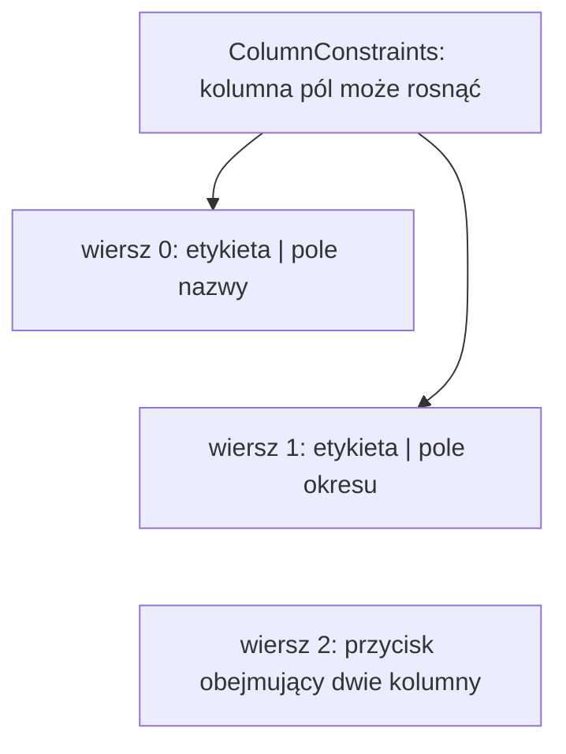

Indeksy kolumn i wierszy zaczynają się od zera. `add(node, column, row, colspan, rowspan)`
pozwala zajmować kilka komórek. W przeciwieństwie do Swing `GridLayout`,
`GridPane` nie wymusza jednakowych rozmiarów wszystkich komórek.

```java
GridPane form = new GridPane();
form.setHgap(10); form.setVgap(8);
ColumnConstraints labelColumn = new ColumnConstraints();
ColumnConstraints inputColumn = new ColumnConstraints();
inputColumn.setHgrow(Priority.ALWAYS);
form.getColumnConstraints().addAll(labelColumn, inputColumn);
TextField dataset = new TextField();
dataset.setMaxWidth(Double.MAX_VALUE);
form.addRow(0, new Label("Zbiór"), dataset);
Button save = new Button("Zatwierdź");
form.add(save, 0, 1, 2, 1);
```

**Sprawdź:** w pokazie `GridPane` wyłącz wzrost pól, a następnie zmień szerokość.
Kolumna może nadal otrzymywać wolne miejsce, mimo że pole go nie wypełnia.
Dodaj trzecią kolumnę z jednostką i porównaj ograniczenia procentowe
`setPercentWidth` ze wzrostem przez `hgrow`.

### StackPane i AnchorPane — warstwy oraz kotwice

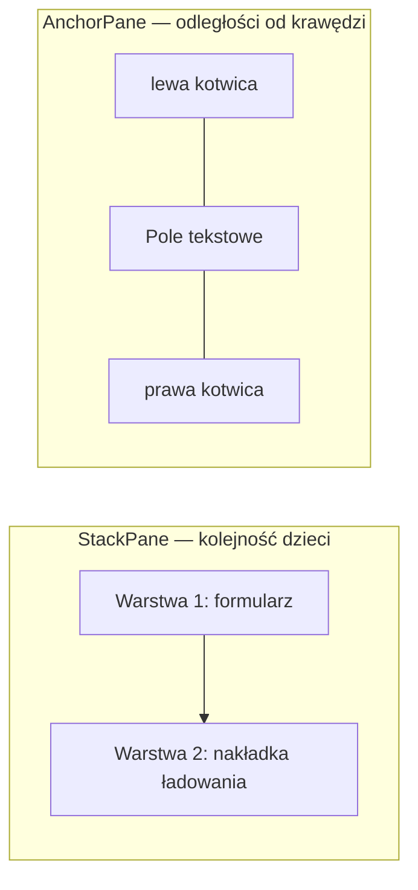

W `StackPane` ostatnie dziecko jest domyślnie na wierzchu. Węzeł z `visible=false`
może nadal brać udział w obliczaniu układu; `managed=false` wyłącza go z tych obliczeń.
Przezroczystość `opacity=0` nie oznacza automatycznie przepuszczania kliknięć.
Jeśli nakładka ma przepuszczać zdarzenia myszy, rozważ `mouseTransparent`;
jeśli blokuje operację, zablokuj też akcje dostępne z klawiatury.

`AnchorPane` utrzymuje odległości od wskazanych krawędzi. Dwie przeciwległe
kotwice mogą rozciągać resizowalny węzeł z uwzględnieniem jego minimum.
Nie tworzą automatycznie układu mobilnego i nie zapobiegają kolizjom przy zbyt małym oknie.

```java
TextField name = new TextField();
AnchorPane anchored = new AnchorPane(name);
AnchorPane.setLeftAnchor(name, 12.0);
AnchorPane.setRightAnchor(name, 12.0);
AnchorPane.setTopAnchor(name, 12.0);
```

**Sprawdź:** w `StackPane` włącz/wyłącz nakładkę i spróbuj edytować pole.
W `AnchorPane` porównaj zachowanie pola z dwiema kotwicami oraz przycisku
zakotwiczonego tylko do prawej i dolnej krawędzi.

### ScrollPane, TitledPane i Accordion

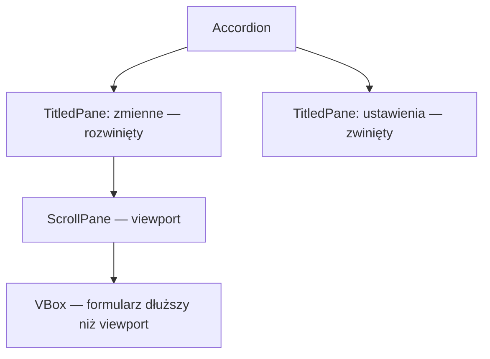

`ScrollPane` udostępnia przewijane okno na zawartość. `fitToWidth=true` dopasowuje
szerokość resizowalnej zawartości do viewportu, z uwzględnieniem jej ograniczeń.
Samo umieszczenie kontrolki w `ScrollPane` tego nie włącza. `TitledPane` ma tytuł
i zwijaną zawartość. Kilka niezależnych paneli może być rozwiniętych naraz;
w `Accordion` rozwinięty jest najwyżej jeden.

```java
VBox fields = new VBox(8);
for (int i = 1; i <= 16; i++) fields.getChildren().add(new TextField("Zmienna " + i));
ScrollPane scroll = new ScrollPane(fields);
scroll.setFitToWidth(true);
TitledPane variables = new TitledPane("Zmienne", scroll);
TitledPane options = new TitledPane("Ustawienia", new CheckBox("Pokaż legendę"));
Accordion sections = new Accordion(variables, options);
sections.setExpandedPane(variables);
```

**Sprawdź:** przewiń formularz do ostatniego pola i zmień sekcję. Wyłącz
`fitToWidth` w kodzie i porównaj szerokość pól. Zwiększ czcionkę, aby sprawdzić,
czy przewijanie nadal udostępnia wszystkie pola i nagłówki.

### Zagnieżdżanie i graf sceny

`Node` może mieć jednego rodzica. Aby przenieść panel filtrów między `left`
i `top`, usuń go najpierw z poprzedniego miejsca; nie odtwarzaj modelu danych.
`Group` grupuje węzły, lecz nie jest zamiennikiem resizowalnego kontenera głównego
formularza. W praktyce korzeniem okna często zostaje `BorderPane` albo `VBox`.

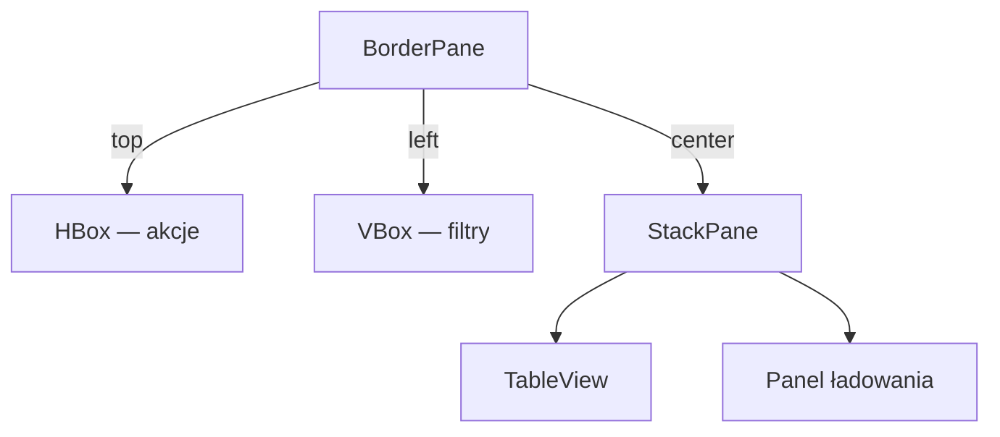

Wszystkie powyższe fragmenty umieszczaj wewnątrz tworzenia widoku. Importy
kontenerów pochodzą z `javafx.scene.layout`, kontrolek z `javafx.scene.control`,
a `Insets` i `Pos` z `javafx.geometry`. Pełny przykład z importami jest w aplikacji demo.

### Wykonaj i sprawdź

Zbuduj szkielet okna: `BorderPane`, pasek akcji u góry, formularz w `GridPane`
oraz miejsce na tabelę pośrodku. Panel filtrów umieść w `VBox`; szczegóły mogą
być zwijane przez `TitledPane`. Sprawdź dwie szerokości okna i tekst większy o 25%.
Zapisz obserwacje z galerii: ustawienie, przewidywany efekt i rzeczywisty efekt.
Formularz otrzyma dane i walidację w następnym zadaniu.

## 4. Dodaj formularz pracownika i walidację

Rozwijaj szkielet z zadania 3. Od tego miejsca głównym modelem jest pracownik
`Employee`; pierwsze okno z powitaniem było ćwiczeniem uruchomieniowym.

### Kontrolki i reguły danych

| Pole | Kontrolka | Co sprawdzić przed zatwierdzeniem |
|---|---|---|
| imię, nazwisko | `TextField` | wymagane; litery Unicode, spacje, łączniki i apostrofy w nazwach |
| zawód | `ComboBox<String>` | wybór z ustalonej listy |
| data urodzenia | `DatePicker` | wymagana, nie może być z przyszłości |
| staż pracy | `TextField` | nieujemna liczba całkowita; obsłuż błąd parsowania i przekroczenie zakresu |
| aktywny zawodowo | `CheckBox` | wartość logiczna |

`DatePicker.getValue()` zwraca `LocalDate` albo `null`, a `ComboBox.getValue()`
może być puste przed wyborem. Podpowiedź pola nie zastępuje walidacji.
Walidację wydziel do metod używanych później także podczas edycji tabeli i importu.
Komunikat powinien wskazywać pole i przyczynę, a błędne dane pozostać w formularzu.

### Obsługa zdarzeń w formularzu

Listener przycisku można zapisać jako klasę implementującą `EventHandler<ActionEvent>`,
klasę anonimową albo lambdę. To trzy formy realizacji tego samego interfejsu.
Przypisz handler do właściwej kontrolki; ponowne `setOnAction` na tym samym
przycisku zastępuje poprzednią wartość. `addEventHandler` pozwala dodać obsługę
bez zastępowania tej właściwości.

```java
Button calculate = new Button("Oblicz");
calculate.setOnAction(event -> System.out.println("Wywołano analizę"));
```

Zdarzenie ma typ, źródło i cel. Filtry uczestniczą w przejściu do celu,
a handlery w powrocie do rodziców. Wywołanie `consume()` zatrzymuje dalszą
propagację; nie stosuj go bez uzasadnienia do wszystkich zdarzeń.

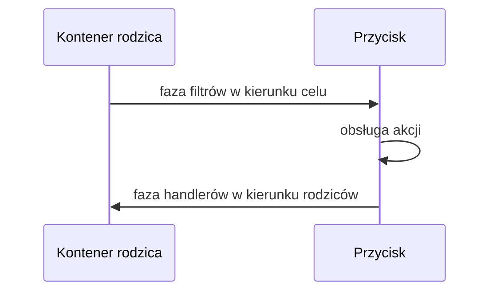

W pokazie **Zdarzenia** odczytaj dziennik kliknięcia, a potem zaznacz zatrzymanie
w filtrze i porównaj wynik. Następnie dopisz dwa przyciski i osobny handler
dla każdego. Zmiana obsługi jednego nie powinna wyłączać drugiego.

### Wykonaj

1. Utwórz wskazane pola oraz przyciski „Dodaj” i „Wyczyść”.
2. W handlerze „Dodaj” odczytaj wartości, zweryfikuj je i pokaż podsumowanie.
   W zadaniu 5 ten sam handler będzie dodawał obiekt do wspólnej listy.
3. „Wyczyść” zeruje pola i komunikaty oraz ustawia fokus na imieniu.
4. Sprawdź poprawne dane, puste pola, `Łukasz`, nazwisko `Nowak-Kowalska`,
   staż `abc`, `-1` i datę z przyszłości. Dane błędne nie przechodzą dalej.

**Punkt kontrolny:** walidacja działa przed utworzeniem rekordu; wyczyszczenie
formularza nie usuwa innych danych aplikacji. Potrafisz wyjaśnić różnicę
między rejestracją handlera a jego wykonaniem.

## 5. Połącz model, formularz i edytowalną tabelę

### Model przed widokiem

`TableView<Employee>` wyświetla obiekty, a `ObservableList<Employee>` informuje
widok o zmianach listy. Właściwości, np. `StringProperty`, umożliwiają obserwowanie
zmian pól. Najpierw utwórz `Employee.java` — poniższy szkielet obejmuje imię,
nazwisko i identyfikator. Następnie dodaj właściwości pozostałych pól z zadania 4:

```java
package pl.uczelnia.lab2;

import javafx.beans.property.SimpleStringProperty;
import javafx.beans.property.StringProperty;

public class Employee {
    private final StringProperty firstName;
    private final StringProperty lastName;
    private final int id;

    public Employee(String firstName, String lastName, int id) {
        this.firstName = new SimpleStringProperty(firstName);
        this.lastName = new SimpleStringProperty(lastName);
        this.id = id;
    }

    public StringProperty firstNameProperty() { return firstName; }
    public StringProperty lastNameProperty() { return lastName; }
    public String getFirstName() { return firstName.get(); }
    public String getLastName() { return lastName.get(); }
    public int getId() { return id; }
}
```

### Utworzenie tabeli

W metodzie budującej widok utwórz jedną kolekcję i przekaż ją do tabeli.
Docelowo przechowuj ją w modelu aplikacji; nie twórz nowej przy każdej zmianie widoku.
Do pliku dodaj importy `javafx.collections.FXCollections`, `javafx.collections.ObservableList`
oraz kontrolek z `javafx.scene.control`.

```java
ObservableList<Employee> data = FXCollections.observableArrayList(employee ->
        new javafx.beans.Observable[]{employee.firstNameProperty(), employee.lastNameProperty()});
data.addAll(new Employee("Anna", "Nowak", 1), new Employee("Jan", "Kowalski", 2));
TableView<Employee> table = new TableView<>(data);
TableColumn<Employee, String> nameColumn = new TableColumn<>("Imię");
table.getColumns().add(nameColumn);
```

Extractor w liście zgłasza aktualizację przy zmianie wymienionych właściwości.
Będzie to potrzebne, żeby filtrowanie zareagowało także na edycję imienia lub nazwiska.
Dla pozostałych pól dodaj właściwości do extractora, jeżeli będą używane w filtrze.

### Edycja komórki

Fabryka wartości wskazuje obserwowaną właściwość, a fabryka komórek określa edytor:

Poniższy fragment pokazuje mechanizm zatwierdzania i odrzucania edycji dla pustej
wartości. W wykonywanym zadaniu zastąp ten prosty warunek wspólną walidacją
imienia z formularza i pokaż komunikat błędu — reguły w obu miejscach mają być takie same.

```java
nameColumn.setCellValueFactory(cell -> cell.getValue().firstNameProperty());
nameColumn.setCellFactory(javafx.scene.control.cell.TextFieldTableCell.forTableColumn());
table.setEditable(true);
nameColumn.setOnEditCommit(event -> {
    String value = event.getNewValue().trim();
    if (!value.isBlank()) {
        event.getRowValue().firstNameProperty().set(value);
    }
    table.refresh(); // Odtwarza również poprzednią wartość po odrzuceniu edycji.
});
```

Zwykła `ObservableList` zgłasza dodanie i usunięcie elementu; nie obserwuje automatycznie dowolnych pól obiektu. Powyżej podaliśmy extractor dla wybranych właściwości. Właściwość zwrócona przez fabrykę wartości komórki pozwala tabeli obserwować zmianę tej wartości. Implementując własne komórki `DatePicker` i przyciski usuwania, uwzględnij ponowne używanie komórek i czyszczenie ich zawartości w `updateItem`.

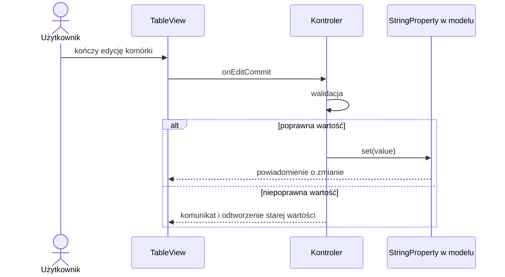

### Filtrowanie, sortowanie i rozmiar

Po utworzeniu `data` i `table` dodaj pole filtra do widoku i podmień źródło tabeli:

```java
TextField filter = new TextField();
filter.setPromptText("Filtruj po imieniu");
var filtered = new javafx.collections.transformation.FilteredList<>(data, employee -> true);
var sorted = new javafx.collections.transformation.SortedList<>(filtered);
sorted.comparatorProperty().bind(table.comparatorProperty());
table.setItems(sorted);
filter.textProperty().addListener((observable, before, after) -> {
    String fragment = after.strip().toLowerCase(java.util.Locale.ROOT);
    filtered.setPredicate(employee -> employee.getFirstName()
            .toLowerCase(java.util.Locale.ROOT).contains(fragment));
});
VBox content = new VBox(8, filter, table);
VBox.setVgrow(table, Priority.ALWAYS);
```

Dodawaj i usuwaj obiekty w źródłowej `data`, nie w `SortedList`. Przy usuwaniu
pobierz wybrany obiekt przez `table.getSelectionModel().getSelectedItem()`;
indeks w posortowanym widoku nie jest indeksem listy źródłowej.

### Wykonaj i sprawdź

1. Rozwiń model o zawód, datę urodzenia, staż i aktywność zawodową.
   Dodaj co najmniej 30 syntetycznych pracowników z unikalnymi identyfikatorami.
2. Po poprawnej walidacji formularza dodawaj `Employee` do `data`.
3. Zastosuj edycję imienia i nazwiska, wspólną walidację z zadania 4 oraz
   kolumny z `ComboBox`, `DatePicker`, `CheckBox` i przyciskiem usuwania.
   Własne komórki czyść w `updateItem`, gdy `empty=true`; nie zachowuj
   indeksu wiersza z chwili utworzenia przycisku.
4. Sprawdź edycję przy aktywnym filtrze, sortowanie i usunięcie wybranego obiektu.
   Zmiany muszą trafić do modelu, nie tylko do tekstu komórki.
5. Porównaj wysokość tabeli z `VBox.setVgrow(table, Priority.ALWAYS)` i bez niego.

**Punkt kontrolny:** po dodaniu lub edycji tabeli nie trzeba tworzyć od nowa,
sortowanie nie zmienia tożsamości rekordów, a filtr reaguje na zmiany obserwowanych pól.

## 6. Zapisz dane, wczytaj wskaźniki i zbuduj wykres

### Dwa zbiory danych i ich przeznaczenie

Lista pracowników z poprzedniego zadania służy do ćwiczenia edycji i zapisu
formularzy. Do wykresu wczytamy drugi zbiór: regionalne wskaźniki rynku pracy.
Na tym etapie umieść te widoki np. w zakładkach „Pracownicy” i „Wskaźniki”.
W zadaniu 7 przeniesiesz je do FXML i przećwiczysz przełączanie scen ze wspólnym
modelem. Rekord pracownika i obserwacja stopy bezrobocia mają osobne modele i formaty plików.

Najpierw dodaj `FileChooser` i zapis/odczyt pracowników do `employees.csv`
w UTF-8, zachowując wszystkie pola modelu oraz identyfikatory. Opisz kolejność
kolumn, reprezentację daty, wartości logicznej i braków danych. Anulowanie
wyboru pliku (`null`) nie może czyścić listy.

### Wskaźniki i walidacja importu

Przygotuj lokalny plik UTF-8 o formacie `rok;region;stopa_bezrobocia` z co najmniej 12 obserwacjami. Zdefiniuj separator dziesiętny i jednostkę `%`. Jeżeli stosujesz prosty `split(";", -1)`, jawnie ogranicz format: pola nie mogą zawierać separatora ani cytowanych wielowierszowych wartości. Pełny CSV wymaga parsera obsługującego te przypadki.

Import wykonaj do tymczasowej kolekcji, zgłoś błędy z numerami wierszy i dopiero po walidacji podmień dane w GUI. Na `LineChart` sortuj lata i twórz osobną serię dla regionu. Różnica między 5% a 6% to 1 punkt procentowy, a względny wzrost to 20% — nie myl opisów.

### Obliczenia i odczyt w tle

Utwórz `Observation.java` w pakiecie `pl.uczelnia.lab2`: `public record Observation(int year, String region, double unemploymentRate) {}`.
Klasa reprezentuje jeden wiersz drugiego zbioru; model `Employee` pozostaje osobny.

Długą operację umieść w `Task<List<Observation>>`: `call()` czyta plik w tle, `setOnSucceeded` aktualizuje `ObservableList`, a `setOnFailed` pokazuje błąd. Nie modyfikuj kontrolek w `call()`. Uruchom zadanie przez wątek lub executor, który zostanie zamknięty przy końcu aplikacji.

### Wykonaj i sprawdź

1. Zapisz pracowników, wyczyść widok i wczytaj zapisany plik. Porównaj wszystkie pola.
2. Dla wskaźników sprawdzaj rok, niepusty region, skończoną wartość stopy w zakresie
   0–100 i duplikat klucza `(rok, region)`. Błąd ma podawać numer wiersza.
3. Dodaj tabelę obserwacji i `LineChart` z osobną serią dla regionu.
   Uporządkuj lata rosnąco; podpisz oś czasu, oś stopy w `%` i legendę.
4. Filtr regionu/lat ma zmieniać ten sam podzbiór w tabeli i na wykresie.
5. Sprawdź plik poprawny, błędny, pusty i anulowanie wyboru. Przy błędzie
   zachowaj dotychczasowe dane; podczas importu GUI reaguje i nie pozwala
   wystartować drugiego importu równolegle.

**Punkt kontrolny:** zapis/odczyt pracowników zachowuje edycję, a import wskaźników
prowadzi do czytelnego wykresu bez blokowania okna. Oba formaty pliku są opisane.

## 7. Wydziel widoki FXML i kontrolery

### Dlaczego rozdzielamy widok i kontroler

Masz już działające widoki tworzone w Javie. Teraz przenieś ich strukturę do FXML:
model przechowuje dane i reguły, widok opisuje kontrolki, a kontroler obsługuje
zdarzenia i wywołuje serwisy. Scene Builder pomaga edytować FXML; kod zdarzeń
pozostaje w klasach Javy.

### Mały przykład powiązania

Poniższe pliki pokazują mechanizm `fx:id`, `fx:controller` i `onAction` na krótkim
formularzu nazwy zbioru. Sprawdź go osobno, a potem zastosuj mechanizm do już
zbudowanego formularza pracownika. Nie zastępuj nim gotowych funkcji aplikacji.

Utwórz `src/main/resources/pl/uczelnia/lab2/form.fxml`. Ten krótki przykład wpisz
w IntelliJ, aby poznać składnię; właściwe dwa widoki przygotujesz następnie w Scene Builderze:

```xml
<?xml version="1.0" encoding="UTF-8"?>
<?import javafx.scene.layout.VBox?>
<?import javafx.scene.control.*?>
<VBox xmlns:fx="http://javafx.com/fxml/1" spacing="10"
      fx:controller="pl.uczelnia.lab2.FormController">
    <TextField fx:id="nameField" promptText="Nazwa zbioru"/>
    <Button text="Zatwierdź" onAction="#save"/>
    <Label fx:id="statusLabel"/>
</VBox>
```

W `src/main/java/pl/uczelnia/lab2/FormController.java`:

```java
package pl.uczelnia.lab2;

import javafx.fxml.FXML;
import javafx.scene.control.Label;
import javafx.scene.control.TextField;

public class FormController {
    @FXML private TextField nameField;
    @FXML private Label statusLabel;

    @FXML private void save() {
        String name = nameField.getText().trim();
        statusLabel.setText(name.isEmpty() ? "Podaj nazwę zbioru" : "Wybrano: " + name);
    }
}
```

Aby sprawdzić ten mały formularz, w `Main.start` tymczasowo zastąp tworzenie sceny:

```java
var resource = java.util.Objects.requireNonNull(
        Main.class.getResource("/pl/uczelnia/lab2/form.fxml"), "Brak form.fxml");
var root = new javafx.fxml.FXMLLoader(resource).<javafx.scene.Parent>load();
stage.setScene(new Scene(root, 480, 240));
stage.show();
```

Metoda `start` musi teraz deklarować `throws Exception`. Pola `@FXML` są dostępne po wstrzyknięciu, np. w metodzie `initialize`, a nie w konstruktorze kontrolera. Nie twórz drugiego kontrolera przez `new` do obsługi już załadowanego widoku.

### Wykonaj i sprawdź

1. Przenieś właściwy formularz pracownika do FXML i utwórz jego kontroler.
   `fx:id` ma odpowiadać polu z `@FXML`, a `onAction` nazwie metody kontrolera.
2. W Scene Builderze przygotuj dwa widoki FXML: pracowników i wskaźników.
   Załaduj je do dwóch scen w jednym `Stage`; dodaj przejście w obie strony.
3. Trzymaj kolekcje danych w jednym modelu aplikacji. Kontrolery pozyskaj
   przez `loader.getController()` po `load()` i przekaż im ten sam model
   metodą inicjalizującą. Nie twórz drugiej instancji kontrolera przez `new`.
4. Zachowaj sceny/kontrolery do ponownego użycia lub jawnie odtwórz z modelu
   filtr i zaznaczenie. Przejście tam i z powrotem nie może usuwać danych.
5. Wykonaj `clean`, ponownie zbuduj i uruchom aplikację. Pliki FXML mają być
   ładowane z classpath, bez zależności od ścieżki na komputerze autora.

W większej aplikacji często wystarcza jedna scena i zmiana jej zawartości.
Dwie sceny tutaj służą poznaniu API; nie oznacza to wymogu tworzenia osobnego
okna dla każdej funkcji.

**Punkt kontrolny:** obydwa widoki działają z FXML, zachowują dane i korzystają
z tego samego modelu. Kontroler obsługuje zdarzenia, ale nie zastępuje serwisu importu.

## 8. Dopracuj adaptacyjny układ, motywy i HiDPI

Rozwijaj istniejące widoki pracowników i wskaźników po przeniesieniu do FXML. W szerokim widoku filtry znajdują się po lewej, a tabela i wykres w części głównej. W wąskim przenieś filtry nad treść lub do zwijanego `TitledPane`, a tabelę i wykres pokaż w zakładkach. Zmiana widoku zachowuje filtr, zaznaczenie i dane.

Obserwuj szerokość kontenera, np. `root.widthProperty()`. Zmieniaj wariant tylko po przekroczeniu wybranego progu. Przed przeniesieniem węzła usuń go z poprzedniego rodzica. `GridPane` wymaga odpowiednich `ColumnConstraints`, `hgrow` i maksymalnych rozmiarów kontrolek; samo umieszczenie w siatce nie gwarantuje ich rozciągania.

### Co kontroluje CSS

CSS ma kilka poziomów: arkusz bazowy JavaFX, arkusze sceny/rodzica i styl inline.
`getStyleClass().add("warning")` odwołuje się do `.warning`, a `setId("summary")`
do `#summary`. Własne role opisuj klasami, a motywy trzymaj w plikach CSS.
`Application.setUserAgentStylesheet` zmienia warstwę bazową; do ćwiczenia jasnego
i ciemnego motywu stosujemy arkusze sceny nad domyślnym stylem kontrolek.
Stały kolor w `setStyle` może wygrać z arkuszem i zepsuć przełączanie motywu.

### Dwa arkusze i wspólne reguły

Utwórz `src/main/resources/css/base.css`, `light.css` oraz `dark.css`. Style semantyczne wykorzystują kolory zależne od motywu. Poniższe fragmenty są punktem startowym; sprawdź również popupy, tabelę, osie, legendę i wszystkie stany kontrolek.

`base.css`:

```css
.root { -fx-font-size: 1em; }
.content { -fx-padding: 1em; -fx-spacing: 0.75em; }
.status-error { -fx-text-fill: app-error; }
.chart-plot-background { -fx-background-color: -fx-control-inner-background; }
.axis { -fx-tick-label-fill: -fx-text-background-color; }
```

`light.css`:

```css
.root {
    -fx-base: #f3f4f6;
    -fx-background: #ffffff;
    -fx-control-inner-background: #ffffff;
    -fx-text-background-color: #202124;
    -fx-accent: #175cd3;
    -fx-focus-color: #175cd3;
    app-error: #b42318;
}
```

`dark.css`:

```css
.root {
    -fx-base: #292d35;
    -fx-background: #20242b;
    -fx-control-inner-background: #292d35;
    -fx-text-background-color: #f0f2f5;
    -fx-accent: #86b7ff;
    -fx-focus-color: #86b7ff;
    app-error: #ffb4ab;
}
```

W JavaFX są to *looked-up colors*, a nie przeglądarkowe zmienne `var(--color)`. Odstępy w `em` odnoszą się do wielkości czcionki. Nie stosuj `scaleX/scaleY` na całej scenie jako sposobu obsługi HiDPI. [Referencja CSS JavaFX 27](https://openjfx.io/javadoc/27/javafx.graphics/javafx/scene/doc-files/cssref.html).

Metoda pomocnicza do klasy `Main` (wywołuj w JavaFX Application Thread):

```java
static void applyTheme(javafx.scene.Scene scene, boolean dark) {
    String base = java.util.Objects.requireNonNull(
            Main.class.getResource("/css/base.css")).toExternalForm();
    String theme = java.util.Objects.requireNonNull(
            Main.class.getResource(dark ? "/css/dark.css" : "/css/light.css"))
            .toExternalForm();
    scene.getStylesheets().setAll(base, theme);
}
```

Ten przykład zakłada dwa arkusze sceny. Jeżeli masz dodatkowe arkusze funkcjonalne, zachowaj je przy zmianie motywu. `DialogPane` okna `Alert` może wymagać osobnego przekazania arkuszy; sprawdź wygląd okien pomocniczych i wszystkich scen. Natywny `FileChooser` może mieć wygląd kontrolowany przez system, co opisz w raporcie.

### Wykonaj i sprawdź

1. Dodaj przełącznik jasny/ciemny i zapisz preferencję. Zastosuj wybór do obu scen
   z zadania 7, również po przejściu między nimi. Zmień motyw przy otwartym formularzu bez utraty danych.
2. Oznacz komunikat błędu klasą `status-error`; komunikat musi mieć również treść, nie tylko kolor.
3. Dopasuj wykres: osie i legenda mają być czytelne w obu motywach, serie rozróżnialne także symbolem lub stylem linii. Zachowaj znaczenie kolorów przy przełączaniu.
4. Sprawdź tabelę: zaznaczenie, edycję, fokus klawiatury, puste dane i długą nazwę kolumny. Nie ustawiaj zbyt małej stałej wysokości komórki.
5. Wykonaj pełną [macierz testów](../jakosc-gui.md). Dołącz zrzuty obu układów i motywów oraz próbę zwiększenia czcionki o 25%.

Warunkiem wykonania jest działający adaptacyjny układ i kompletny wygląd obu motywów — samo dodanie plików CSS nie wystarcza.

## Sprawdzenie całości i oddanie

Przejdź scenariusz od początku: uruchom aplikację, dodaj i popraw pracownika,
przefiltruj i posortuj tabelę, zapisz i odczytaj plik, zaimportuj wskaźniki,
wyświetl wykres, przełącz scenę i motyw, zmień szerokość okna.

| Sprawdzenie | Oczekiwany rezultat |
|---|---|
| dane poprawne i błędne w formularzu / edycji | te same reguły walidacji; brak utraty wpisanych danych |
| sortowanie, filtrowanie i usuwanie | operacja dotyczy wskazanego obiektu |
| zapis i ponowny odczyt pracowników | wszystkie pola oraz identyfikatory zachowane |
| anulowany lub błędny import | poprzedni zbiór pozostaje; błąd wskazuje wiersz |
| filtrowanie wskaźników | tabela i wykres pokazują ten sam zakres, lata są uporządkowane |
| przejście między scenami FXML | dane i stan widoków pozostają |
| zmiana motywu i szerokości | akcje dostępne, formularz i wykres czytelne |
| skale 100%, 150%, 200% | wyniki zapisane w [macierzy jakości GUI](../jakosc-gui.md) |

Oddaj projekt Maven z kodem, FXML i CSS, pliki danych demonstracyjnych dla obu
zbiorów z opisem formatów, tabelę obserwacji kontenerów, opis propagacji zdarzeń
oraz raport testów GUI ze zrzutami rzeczywistej aplikacji. Zrzuty powinny także
pokazać formularz, edytowaną tabelę i wykres. Nie dołączaj obrazów z wykładu.

## Pytania kontrolne

1. Czym różnią się `Application`, `Stage`, `Scene` i `Node`?
2. Kiedy wykonywana jest lambda z `setOnAction` i w jakim wątku?
3. Jak współdziałają `min/pref/max`, `grow`, padding i odstępy?
4. Czym różnią się `FlowPane`, `TilePane` i `GridPane`?
5. Co zgłasza `ObservableList`, a co właściwość obiektu? Po co extractor?
6. Dlaczego nie usuwamy danych przez indeks posortowanej tabeli?
7. Jak rozdzielasz pracę `Task.call()` i aktualizację GUI?
8. Jak FXML jest powiązany z kontrolerem i wspólnym modelem?
9. Jak zachowujesz dane i motyw podczas zmiany sceny?
10. Dlaczego test rozmiaru okna nie zastępuje testu DPI?
