# Lab 2 - Graficzny interfejs użytkownika w JavaFX

## Budowa aplikacji JavaFX

W jednym projekcie należy rozwijać działający pulpit do przeglądania regionalnych
danych o bezrobociu. Aplikacja wykorzystuje widoki FXML, formularz, tabelę, import
CSV oraz lokalny zapis SQLite z operacjami CRUD. Zadania wykonuje się kolejno,
modyfikując istniejący kod.
Projekt należy skonfigurować w IntelliJ IDEA z **JDK 27 GA i JavaFX 27** według
[instrukcji środowiska](../../srodowisko.html). Należy pobrać
[projekt startowy JavaFX](projekt-startowy.zip), rozpakować go i otworzyć w IntelliJ
IDEA folder zawierający `pom.xml`.
[Layout Explorer](demo/README.html) można [pobrać jako osobny projekt](demo/layout-explorer.zip);
aplikacja służy do badania zachowania kontenerów i ich parametrów;
nie zastępuje własnej aplikacji.

Projekt startowy zawiera uruchamialną aplikację z danymi demonstracyjnymi.
`Main` buduje widok, `ObservationModel` przechowuje wspólną kolekcję,
`Observation` opisuje rekord, a `MetricCard` jest własnym komponentem.
`ObservationValidation` zawiera wspólne reguły pól i unikalności obserwacji.
Fragmenty kodu należy umieszczać we wskazanych klasach lub
metodach, rozwijając tę aplikację. Po każdej zmianie należy ją uruchomić i sprawdzić.

## 1. Konfiguracja projektu (IntelliJ IDEA / Maven)

JavaFX nie jest częścią JDK. Należy używać stabilnych wydań **JDK 27 GA
i JavaFX 27**, wskazanych w [konfiguracji środowiska](../../srodowisko.html).
Projekt startowy zawiera kompletny `pom.xml`; poniższa konfiguracja pokazuje jego
zależności i wersje. Pliku `module-info.java` nie należy tworzyć.

```xml
<project xmlns="http://maven.apache.org/POM/4.0.0"
         xmlns:xsi="http://www.w3.org/2001/XMLSchema-instance"
         xsi:schemaLocation="http://maven.apache.org/POM/4.0.0 https://maven.apache.org/xsd/maven-4.0.0.xsd">
<modelVersion>4.0.0</modelVersion>
<groupId>pl.uczelnia</groupId>
<artifactId>lab2</artifactId>
<version>1.0-SNAPSHOT</version>
<properties>
    <maven.compiler.release>27</maven.compiler.release>
    <project.build.sourceEncoding>UTF-8</project.build.sourceEncoding>
    <javafx.version>27</javafx.version>
</properties>

<dependencies>
    <dependency>
        <groupId>org.openjfx</groupId>
        <artifactId>javafx-controls</artifactId>
        <version>${javafx.version}</version>
    </dependency>
    <dependency>
        <groupId>org.openjfx</groupId>
        <artifactId>javafx-fxml</artifactId>
        <version>${javafx.version}</version>
    </dependency>
</dependencies>

<build>
    <plugins>
        <plugin>
            <groupId>org.apache.maven.plugins</groupId>
            <artifactId>maven-compiler-plugin</artifactId>
            <version>3.13.0</version>
        </plugin>
        <plugin>
            <groupId>org.openjfx</groupId>
            <artifactId>javafx-maven-plugin</artifactId>
            <version>0.0.8</version>
            <configuration>
                <mainClass>pl.uczelnia.lab2.Main</mainClass>
                <options><option>--enable-native-access=javafx.graphics</option></options>
            </configuration>
        </plugin>
    </plugins>
</build>
</project>
```

Zależności `javafx-controls` i `javafx-fxml` korzystają ze wspólnej wartości
`javafx.version=27`. Project SDK i Maven Runner należy ustawić na JDK 27.
Nie należy wybierać wersji EA/RC ani włączać `--enable-preview`.

**Wykonanie:** należy zsynchronizować Maven, ustawić JDK 27 jako Project SDK
i Maven Runner oraz uruchomić `javafx:run`.
**Punkt kontrolny:** zależności `javafx-controls` i `javafx-fxml` są widoczne
w External Libraries, a po uruchomieniu pojawia się pulpit z zakładkami „Dane” i „Wykres”.

## 2. Uruchomienie aplikacji, graf sceny i obsługa zdarzeń (JavaFX)

Projekt startowy zawiera gotowy pulpit regionalnych wskaźników rynku pracy.
Najpierw należy uruchomić aplikację i wskazać w kodzie elementy okna, sceny,
menu, zakładek, tabeli oraz wykresu. Krótkie przykłady z polem tekstowym poniżej
izolują podstawowe mechanizmy JavaFX; nie zastępują ani nie nadpisują pulpitu w `Main`.

### Elementy okna i graf sceny

| Element | Odpowiedzialność w aplikacji |
|---|---|
| `Application` | klasa bazowa aplikacji; JavaFX zarządza jej uruchomieniem i cyklem życia |
| `Stage` | okno systemowe: tytuł, rozmiar, możliwość pokazania i zamknięcia |
| `Scene` | zawartość okna; przechowuje korzeń grafu sceny |
| `BorderPane` | główny podział okna na menu/nagłówek, treść i pasek stanu |
| `TabPane` | przełączanie widoków „Dane” i „Wykres” w tej samej scenie |
| `TableView` | prezentacja obserwacji regionalnych w wierszach i kolumnach |
| `MetricCard` | własny komponent podsumowujący jedną miarę |
| `LineChart` | porównanie zmian wskaźnika w czasie dla regionów |

Oficjalne opisy cyklu życia i kontenerów zawierają dokumentacje JavaFX 27 dla
[`Application`](https://openjfx.io/javadoc/27/javafx.graphics/javafx/application/Application.html),
[`Stage`](https://openjfx.io/javadoc/27/javafx.graphics/javafx/stage/Stage.html)
i [`Scene`](https://openjfx.io/javadoc/27/javafx.graphics/javafx/scene/Scene.html).

`Stage` i `Scene` nie są tym samym: okno jest zewnętrzną obudową, a scena
organizuje jego zawartość. Kontrolki i kontenery dziedziczą po `Node` i tworzą
drzewo nazywane grafem sceny. `Stage` oraz `Scene` same nie są węzłami tego drzewa.
W Swingu zawartość umieszcza się w `JFrame` przez `contentPane`; JavaFX ma
dodatkową warstwę `Scene` pomiędzy oknem `Stage` a korzeniem grafu.

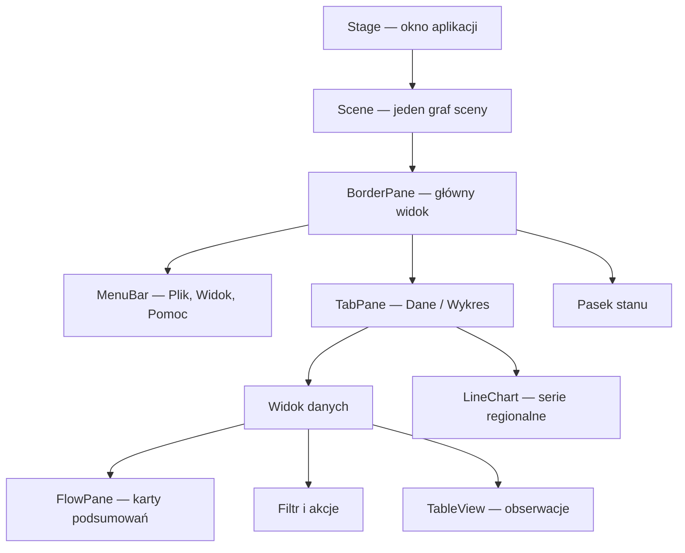

### Klasa aplikacji i punkt wejścia

Klasa `Main` w projekcie startowym dziedziczy po `Application` i zawiera gotowy
interfejs. Należy odszukać w niej utworzenie sceny, zastosowanie motywu,
przypisanie sceny do okna i jego pokazanie. `main` uruchamia cykl życia JavaFX:

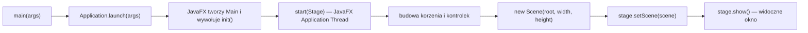

`Stage` jest oknem, a nie kontenerem na przyciski i panele. Najpierw buduje się
korzeń widoku (np. `BorderPane`) i umieszcza w nim pozostałe węzły, następnie
opakowuje się ten korzeń w `Scene`, przypisuje scenę do `Stage` i pokazuje okno.
Zawartości kart i pozostałych widoków należy umieszczać pod tym samym korzeniem;
do ich przełączania nie należy tworzyć nowego `Stage` ani osobnej `Scene`.

```java
@Override
public void start(Stage stage) {
    BorderPane root = new BorderPane();
    root.getStyleClass().add("app-root");
    root.setTop(new VBox(createMenuBar(stage), createHeader()));
    root.setCenter(createViews());
    status = new Label("Gotowe · dane demonstracyjne");
    root.setBottom(status);

    scene = new Scene(root, 1080, 720);
    themeMode = ThemeMode.valueOf(preferences.get("themeMode", "SYSTEM"));
    var systemScheme = javafx.application.Platform.getPreferences()
            .colorSchemeProperty();
    applyTheme(scene, themeMode == ThemeMode.DARK
            || (themeMode == ThemeMode.SYSTEM
            && systemScheme.get() == javafx.application.ColorScheme.DARK));
    systemScheme.addListener((observable, previous, current) -> {
        if (themeMode == ThemeMode.SYSTEM) {
            applyTheme(scene, current == javafx.application.ColorScheme.DARK);
        }
    });
    stage.setTitle("Analiza regionalnych wskaźników rynku pracy");
    stage.setScene(scene);
    stage.show();
}

public static void main(String[] args) {
    launch(args);
}
```

### Krok 1. Uruchomienie i metoda start

`Main extends Application` oznacza, że klasa dziedziczy mechanizm aplikacji
JavaFX. `main` wywołuje `launch(args)`, które uruchamia środowisko JavaFX.
Framework tworzy instancję aplikacji i wywołuje `start`, przekazując jej główne okno
`Stage`. Nie należy ręcznie wywoływać `start` ani tworzyć `new Main()` w celu pokazania GUI.
Poniższy przykład zakłada typ `ThemeMode` z wartościami `SYSTEM`, `LIGHT` i
`DARK` oraz pole `themeMode`; obsługa menu aktualizuje to pole i zapisuje wybór
w preferencjach aplikacji.

`@Override` informuje kompilator o nadpisaniu metody klasy bazowej.
Kod `start` działa w **JavaFX Application Thread** — w tym wątku należy budować
i aktualizować widok. Po zakończeniu `start` okno nadal działa, ponieważ
środowisko oczekuje na zdarzenia użytkownika. Własnej pętli oczekującej
na kliknięcie nie należy tworzyć.

`launch` uruchamia mechanizm aplikacji, `init()` służy do inicjalizacji,
`start(Stage)` tworzy widok, a `stop()` pozwala zwolnić zasoby. `init()` nie działa
w JavaFX Application Thread, dlatego nie należy w nim tworzyć sceny ani okna.
W `stop()` trzeba zamknąć executor lub inne zasoby aplikacji. Długie zadania
powinny być wykonywane w tle.

### Krok 2. Kontrolki istniejącego pulpitu

W `Main.createDataView()` należy wskazać pole filtra, przyciski, karty miar
i tabelę. W `createChartView()` znajduje się wykres, a w `createMenuBar()` —
menu aplikacji. Kontrolki stają się widoczne dopiero po dodaniu ich do kontenera,
który należy do grafu sceny. Samo utworzenie `new Button(...)` nie wyświetla
przycisku.

### Krok 3. Rejestracja zdarzeń i nasłuchiwanie właściwości

`setOnAction(...)` rejestruje obsługę kliknięcia. Lambda `event -> { ... }` jest
wykonywana później, gdy użytkownik aktywuje przycisk myszą lub klawiaturą.
W projekcie startowym `clearFilter.setOnAction(...)` czyści pole, a przycisk usuwania
pobiera zaznaczony obiekt z tabeli i usuwa go ze wspólnego modelu.

Wpisywanie filtra korzysta z nasłuchiwacza właściwości tekstu:

```java
filter.textProperty().addListener((observable, before, after) -> {
    String query = after.strip().toLowerCase(java.util.Locale.ROOT);
    filtered.setPredicate(observation -> observation.getRegion()
            .toLowerCase(java.util.Locale.ROOT).contains(query));
});
```

Zmienia się istniejąca lista przekształcona, a JavaFX aktualizuje powiązaną tabelę.
Obsługa zdarzeń działa w JavaFX Application Thread, dlatego nie należy wykonywać
w niej długiego importu pliku ani zapytania do bazy.

### Właściwości widoku, zmiana stanu i odświeżanie

Większość kontrolek udostępnia właściwości, np. `textProperty()`,
`visibleProperty()`, `disableProperty()` i `valueProperty()`. Zmiana przez setter
ustawia wartość właściwości, a powiązanie `bind(...)` przekazuje zmianę do widoku.
W `MetricCard` etykieta wartości jest związana z `valueProperty()`; wywołanie
`card.setValue("12")` zmienia tekst istniejącej etykiety.

```java
import javafx.beans.property.SimpleStringProperty;
import javafx.beans.property.StringProperty;
import javafx.scene.control.Label;

StringProperty message = new SimpleStringProperty("Gotowe");
Label statusLabel = new Label();
statusLabel.textProperty().bind(message);
message.set("Przefiltrowano obserwacje");
```

`bind` jest jednostronne; do zmiany wartości źródła używa się jego settera,
a nie `setText` na związanej etykiecie. Etykietę stanu należy wiązać z filtrem
tylko wtedy, gdy ma zawsze pokazywać tekst pola.

JavaFX wykonuje puls układu i rysowania po zmianie obserwowanych właściwości.
Zwykłej kontrolki nie trzeba ręcznie „odświeżać”. W projekcie należy preferować
zmianę `ObservableList` i właściwości modelu. `TableView.refresh()` wymusza
ponowne utworzenie widocznych komórek, ale nie wczytuje danych, nie przelicza
modelu ani nie zastępuje właściwości obserwowalnych; używa się go wyjątkowo,
np. po odrzuceniu edycji lub przy niestandardowym renderowaniu bez powiadomień.
`requestLayout()` oznacza własny układ do ponownego obliczenia — zwykle potrzebują
go niestandardowe kontenery, nie formularze zbudowane z gotowych kontrolek.
Metod Swing `repaint()` i `revalidate()` w JavaFX się nie używa.

Zdarzenia użytkownika są obsługiwane w JavaFX Application Thread. Wynik obliczeń
wykonanych w tle trzeba przekazać do GUI przez callback `Task` albo
`Platform.runLater(...)`; nie wolno z wątku roboczego zmieniać kontrolki.

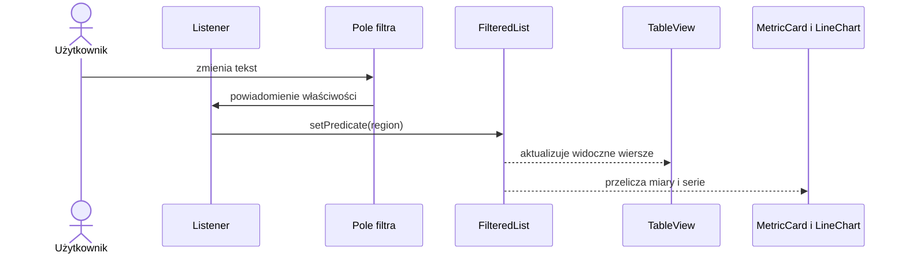

### Krok 4. Zagnieżdżenie widoków w grafie sceny

W istniejącym `Main` korzeniem jest `BorderPane`. `MenuBar` i nagłówek są
umieszczone u góry, `TabPane` zajmuje środek, a etykieta stanu dół. W zakładce
„Dane” karty i akcje znajdują się w `FlowPane`, a `TableView` w obszarze centralnym.
W zakładce „Wykres” `LineChart` wypełnia dostępny obszar. Taki podział pozwala
zmieniać rozmiar okna bez ręcznego ustawiania współrzędnych.

`new Scene(root, 1080, 720)` ustawia początkowy rozmiar zawartości w jednostkach
logicznych; wartości nie obejmują systemowej ramki okna ani nie blokują późniejszej
zmiany rozmiaru.

### Krok 5. Pokazanie okna

`stage.setScene(scene)` przypisuje zawartość do okna, `setTitle(...)` ustawia tytuł,
a `show()` pokazuje okno. Bez `show()` samo zbudowanie sceny nie wyświetli aplikacji.
W projekcie zamknięcie ostatniego okna
kończy działanie aplikacji przy domyślnym ustawieniu JavaFX.

Należy uruchomić **Maven → Plugins → javafx → javafx:run**. Powinno pojawić się
okno pulpitu z menu, zakładkami, tabelą, kartami podsumowań i wykresem.

### Testowanie zdarzeń i modyfikacja przykładu

| Działanie | Oczekiwany wynik |
|---|---|
| Wybranie zakładki „Wykres” i powrót do „Dane” | ten sam widok i stan danych pozostają w jednym oknie |
| Wpisanie fragmentu nazwy regionu w filtrze | tabela, karty i wykres odzwierciedlają ten sam podzbiór |
| Edycja stopy bezrobocia w tabeli | zmienia się obiekt modelu, średnia i wykres |
| Zmiana motywu systemowego w trybie „Systemowy” | kolory aktualizują się bez restartu, odtwarzania sceny ani utraty danych |
| Ręczny wybór „Jasny” lub „Ciemny” | wybór systemowy zostaje nadpisany do czasu powrotu do trybu „Systemowy” |
| Zmiana szerokości okna | widok pozostaje użyteczny; część tabeli może przewijać się poziomo |

1. Zmienić tytuł okna i nagłówek aplikacji, wskazując różnicę między tekstem `Stage`
   a kontrolką `Label` w grafie sceny.
2. W `MetricCard` zmienić tytuł i wartość przez settery. Następnie wskazać
   `textProperty().bind(...)` i opisać, dlaczego tekst etykiety aktualizuje się bez
   tworzenia jej ponownie.
3. Dodać pozycję menu wyświetlającą `Alert`. Rejestrację handlera umieścić poza
   lambdą, a wypisanie komunikatu — wewnątrz; sprawdzić, ile razy wykonuje się
   każda instrukcja po trzech aktywacjach.
4. Dla dłuższej operacji nie blokować handlera; po jej dodaniu użyć `Task` zgodnie
   z sekcją importu CSV.

### Budowa menu i przełączanie widoków

`MenuBar` grupuje polecenia w obiektach `Menu`, a `MenuItem` uruchamia przypisany
handler. Menu „Plik” może zawierać import, eksport, przywrócenie próbki i zamknięcie;
ustawienie `setOnAction` rejestruje działanie, które wykona się po wybraniu pozycji.
`TabPane` umieszcza widoki „Dane” i „Wykres” w jednym obszarze tej samej sceny.
W projekcie startowym należy odszukać `createMenuBar()` i `createViews()` w `Main`.

```java
MenuItem importCsv = new MenuItem("Importuj CSV…");
importCsv.setOnAction(event -> chooseAndImportFile());
MenuItem exit = new MenuItem("Zakończ");
exit.setOnAction(event -> stage.close());
Menu file = new Menu("Plik");
file.getItems().addAll(importCsv, new SeparatorMenuItem(), exit);
MenuBar menuBar = new MenuBar(file);

Tab dataTab = new Tab("Dane", dataView);
dataTab.setClosable(false);
Tab chartTab = new Tab("Wykres", chartView);
chartTab.setClosable(false);
TabPane tabs = new TabPane(dataTab, chartTab);
```

Handler menu nie powinien zawierać całego importu ani obliczeń. Powinien wywołać
metodę kontrolera lub serwisu, a po zakończeniu zaktualizować model i status.

## 3. Dobór kontenerów układu i budowa adaptacyjnego panelu (JavaFX)

[Layout Explorer](demo/README.html) należy pobrać jako [projekt IntelliJ](demo/layout-explorer.zip)
i uruchomić osobno. Przy każdym kontenerze należy wykonać opisane doświadczenia,
a następnie zastosować poznane układy w pulpicie startowym. Fragmentów nie należy
wklejać jednocześnie do metody `start`.

W Swing menedżer układu jest obiektem przypisanym do kontenera. W JavaFX
`HBox`, `VBox` czy `GridPane` są węzłami grafu sceny, które same układają swoje dzieci.
`ScrollPane`, `TitledPane` i `Accordion` to kontrolki zarządzające zawartością,
a nie klasy z pakietu `javafx.scene.layout`. Wszystkie pomagają zorganizować widok,
ale mają różne odpowiedzialności.

### Interaktywne wizualizacje kontenerów

Zaznaczone tło oznacza kontener, którego zachowanie ilustruje przykład. Uchwyt
w rogu pozwala zmieniać szerokość okna. Przy przejściu do wąskiego wariantu
przeorganizowane panele pojawiają się z krótką animacją, a elementy `FlowPane`
zawijają się do kolejnego wiersza. Karty reagują subtelną animacją po najechaniu.
Po doświadczeniu należy porównać wynik z odpowiadającą mu kontrolką w Layout Explorerze.

<style>
  .po2-fx-demo {
    --fx-ink: #17243a;
    --fx-muted: #53647c;
    --fx-shell: #f1f5fb;
    --fx-window: #ffffff;
    --fx-titlebar: #f7f9fd;
    --fx-line: #d7e0ec;
    --fx-surface: #ffffff;
    --fx-region: #e9e0f4;
    --fx-accent: #315fc0;
    --fx-accent-soft: #e8efff;
    box-sizing: border-box;
    margin: 1.25rem 0;
    padding: clamp(1rem, 3vw, 1.5rem);
    overflow: hidden;
    border-radius: 1rem;
    background: linear-gradient(145deg, var(--fx-shell), var(--fx-window));
    color: var(--fx-ink);
    font-family: system-ui, -apple-system, "Segoe UI", sans-serif;
  }

  @media (prefers-color-scheme: dark) {
    .po2-fx-demo {
      --fx-ink: #edf2fa;
      --fx-muted: #b0bfd2;
      --fx-shell: #161e2b;
      --fx-window: #1d2736;
      --fx-titlebar: #232f40;
      --fx-line: #3b4a60;
      --fx-surface: #273448;
      --fx-region: #372d47;
      --fx-accent: #91b4ff;
      --fx-accent-soft: #2c3c5a;
    }
  }

  .po2-fx-demo *, .po2-fx-demo *::before, .po2-fx-demo *::after { box-sizing: border-box; }
  .po2-fx-demo h4 { margin: 0 0 .45rem; color: var(--fx-ink); }
  .po2-fx-demo p { color: var(--fx-muted); line-height: 1.55; }
  .po2-fx-demo__legend { display: flex; align-items: flex-start; gap: .6rem; margin: .35rem 0 .85rem; }
  .po2-fx-demo__swatch { flex: 0 0 1rem; height: 1rem; margin-top: .2rem; border-radius: .25rem; background: var(--fx-region); }
  .po2-fx-demo__window {
    width: min(100%, 58rem);
    min-width: 20rem;
    max-width: 100%;
    margin: 0 auto;
    overflow: auto;
    resize: horizontal;
    container-name: fx-window;
    container-type: inline-size;
    border: 1px solid var(--fx-line);
    border-radius: .85rem;
    background: var(--fx-window);
    color: var(--fx-ink);
    box-shadow: 0 16px 38px rgb(29 46 76 / 16%);
  }
  .po2-fx-demo__titlebar { display: flex; min-height: 2.7rem; align-items: center; justify-content: space-between; gap: .75rem; padding: .55rem .85rem; border-bottom: 1px solid var(--fx-line); background: var(--fx-titlebar); color: var(--fx-muted); font-weight: 650; }
  .po2-fx-demo__dots { letter-spacing: .35rem; white-space: nowrap; }
  .po2-fx-demo__surface { background: var(--fx-region); border-radius: .65rem; }
  .po2-fx-demo__button, .po2-fx-demo__field, .po2-fx-demo__metric, .po2-fx-demo__panel { border: 1px solid var(--fx-line); border-radius: .55rem; background: var(--fx-surface); }
  .po2-fx-demo__button { padding: .55rem .75rem; color: var(--fx-ink); font: inherit; white-space: nowrap; }
  .po2-fx-demo__toolbar { display: flex; flex-wrap: wrap; align-items: center; gap: .5rem; padding: .75rem; transition: gap 260ms ease; }
  .po2-fx-demo__toolbar .po2-fx-demo__field { flex: 1 1 12rem; min-width: 9rem; padding: .58rem .7rem; color: var(--fx-muted); }
  .po2-fx-demo__shell { display: grid; grid-template-columns: minmax(9rem, 13rem) minmax(0, 1fr); grid-template-areas: "top top" "side main" "foot foot"; gap: .65rem; padding: .75rem; transition: grid-template-columns 360ms ease, gap 260ms ease; }
  .po2-fx-demo__top { grid-area: top; padding: .75rem; }
  .po2-fx-demo__side { grid-area: side; padding: .75rem; }
  .po2-fx-demo__main { grid-area: main; min-width: 0; padding: .75rem; }
  .po2-fx-demo__foot { grid-area: foot; padding: .55rem .75rem; color: var(--fx-muted); }
  .po2-fx-demo__mini-cards { display: grid; grid-template-columns: repeat(3, minmax(0, 1fr)); gap: .55rem; margin: .65rem 0; }
  .po2-fx-demo__mini-card { min-width: 0; padding: .65rem; border-radius: .5rem; background: var(--fx-surface); }
  .po2-fx-demo__mini-card small, .po2-fx-demo__mini-card strong { display: block; }
  .po2-fx-demo__mini-card small { color: var(--fx-muted); }
  .po2-fx-demo__fake-table { display: grid; grid-template-columns: .6fr 1.4fr 1fr; gap: .35rem; font-size: .88rem; }
  .po2-fx-demo__fake-table span { overflow: hidden; padding: .42rem; border-bottom: 1px solid var(--fx-line); text-overflow: ellipsis; white-space: nowrap; }
  .po2-fx-demo__form { display: grid; grid-template-columns: max-content minmax(8rem, 1fr); align-items: center; gap: .55rem .8rem; padding: .9rem; transition: grid-template-columns 300ms ease, gap 260ms ease; }
  .po2-fx-demo__form label { color: var(--fx-muted); }
  .po2-fx-demo__field { min-width: 0; padding: .58rem .7rem; color: var(--fx-ink); }
  .po2-fx-demo__form .po2-fx-demo__button { grid-column: 1 / -1; justify-self: start; }
  .po2-fx-demo__tiles { display: grid; grid-template-columns: repeat(auto-fit, minmax(8.5rem, 1fr)); gap: .55rem; padding: .75rem; transition: grid-template-columns 320ms ease; }
  .po2-fx-demo__metric { min-height: 5rem; padding: .7rem; transition: transform 240ms ease, box-shadow 240ms ease; }
  .po2-fx-demo__metric:hover { transform: translateY(-2px); box-shadow: 0 8px 18px rgb(29 46 76 / 14%); }
  .po2-fx-demo__tabs { display: flex; flex-wrap: wrap; gap: .35rem; padding: .7rem .7rem 0; }
  .po2-fx-demo__tab-input { position: absolute; width: 1px; height: 1px; opacity: 0; }
  .po2-fx-demo__tab-label { padding: .55rem .8rem; border-radius: .5rem .5rem 0 0; background: var(--fx-titlebar); color: var(--fx-muted); cursor: pointer; }
  .po2-fx-demo__tab-input:focus-visible + .po2-fx-demo__tab-label { outline: 3px solid var(--fx-accent); outline-offset: 2px; }
  .po2-fx-demo__tab-input:checked + .po2-fx-demo__tab-label { background: var(--fx-region); color: var(--fx-ink); font-weight: 700; }
  .po2-fx-demo__pages { min-height: 8rem; margin: 0 .7rem .7rem; padding: .9rem; border-radius: 0 .55rem .55rem; background: var(--fx-region); }
  .po2-fx-demo__page { display: none; }
  .po2-fx-demo__page--data { display: block; }
  #po2-fx-chart:checked ~ .po2-fx-demo__pages .po2-fx-demo__page--data { display: none; }
  #po2-fx-chart:checked ~ .po2-fx-demo__pages .po2-fx-demo__page--chart { display: block; }
  .po2-fx-demo__bars { display: flex; height: 6rem; align-items: end; gap: .65rem; padding: .4rem .2rem 0; border-bottom: 1px solid var(--fx-line); }
  .po2-fx-demo__bars i { flex: 1; min-width: .55rem; border-radius: .35rem .35rem 0 0; background: var(--fx-accent); animation: po2-fx-rise 650ms ease both; transform-origin: bottom; }
  .po2-fx-demo__bars i:nth-child(1) { height: 42%; }
  .po2-fx-demo__bars i:nth-child(2) { height: 58%; animation-delay: 60ms; }
  .po2-fx-demo__bars i:nth-child(3) { height: 51%; animation-delay: 120ms; }
  .po2-fx-demo__bars i:nth-child(4) { height: 75%; animation-delay: 180ms; }
  .po2-fx-demo__bars i:nth-child(5) { height: 88%; animation-delay: 240ms; }
  @keyframes po2-fx-rise { from { transform: scaleY(.25); opacity: .35; } to { transform: scaleY(1); opacity: 1; } }
  @keyframes po2-fx-reflow { from { transform: translateY(-.35rem); opacity: .55; } to { transform: translateY(0); opacity: 1; } }
  @container fx-window (max-width: 700px) {
    .po2-fx-demo__shell { grid-template-columns: minmax(0, 1fr); grid-template-areas: "top" "side" "main" "foot"; gap: .45rem; }
    .po2-fx-demo__side { display: flex; flex-wrap: wrap; gap: .45rem; animation: po2-fx-reflow 320ms ease both; }
    .po2-fx-demo__side > * { flex: 1 1 8rem; }
    .po2-fx-demo__toolbar > * { animation: po2-fx-reflow 320ms ease both; }
    .po2-fx-demo__mini-cards { grid-template-columns: repeat(auto-fit, minmax(7rem, 1fr)); }
  }
  @container fx-window (max-width: 420px) {
    .po2-fx-demo__form { grid-template-columns: minmax(0, 1fr); gap: .35rem; }
    .po2-fx-demo__form .po2-fx-demo__button { grid-column: 1; }
    .po2-fx-demo__form > * { animation: po2-fx-reflow 320ms ease both; }
  }
  @media (prefers-reduced-motion: reduce) {
    .po2-fx-demo *, .po2-fx-demo *::before, .po2-fx-demo *::after { animation-duration: .01ms !important; transition-duration: .01ms !important; }
  }
</style>

#### Widok aplikacji oparty na `BorderPane`

<section class="po2-fx-demo" aria-labelledby="po2-fx-border-title">
  <h4 id="po2-fx-border-title">Pulpit danych regionalnych (`BorderPane`)</h4>
  <p class="po2-fx-demo__legend"><span class="po2-fx-demo__swatch" aria-hidden="true"></span><span>Fioletowe pola to regiony przypisane do obszarów kontenera. Wąski widok przenosi filtry nad tabelę zamiast ściskać środek.</span></p>
  <p>Zmiana szerokości zmienia rozkład panelu. Górny pasek i status zachowują pełną szerokość, a środek wykorzystuje pozostałe miejsce.</p>
  <div class="po2-fx-demo__window" role="group" aria-label="Responsywny pulpit analizy danych">
    <div class="po2-fx-demo__titlebar"><span>Analiza · rynek pracy</span><span class="po2-fx-demo__dots" aria-hidden="true">— □ ×</span></div>
    <div class="po2-fx-demo__shell">
      <div class="po2-fx-demo__top po2-fx-demo__surface"><strong>Wskaźniki regionalne</strong><div class="po2-fx-demo__toolbar"><span class="po2-fx-demo__button">Importuj</span><span class="po2-fx-demo__button">Zapisz</span></div></div>
      <div class="po2-fx-demo__side po2-fx-demo__surface"><span class="po2-fx-demo__field">Region: wszystkie</span><span class="po2-fx-demo__field">Lata: 2021–2025</span></div>
      <div class="po2-fx-demo__main po2-fx-demo__surface"><strong>Stopa bezrobocia</strong><div class="po2-fx-demo__mini-cards"><div class="po2-fx-demo__mini-card"><small>Obserwacje</small><strong>10</strong></div><div class="po2-fx-demo__mini-card"><small>Średnia</small><strong>5,7%</strong></div><div class="po2-fx-demo__mini-card"><small>Regiony</small><strong>2</strong></div></div><div class="po2-fx-demo__fake-table"><span>Rok</span><span>Region</span><span>Stopa (%)</span><span>2025</span><span>Podkarpackie</span><span>5,7</span></div></div>
      <div class="po2-fx-demo__foot po2-fx-demo__surface">Gotowe · dane demonstracyjne</div>
    </div>
  </div>
</section>

#### Zawijanie paska narzędzi (`HBox`, `FlowPane`)

<section class="po2-fx-demo" aria-labelledby="po2-fx-flow-title">
  <h4 id="po2-fx-flow-title">Filtry i akcje tabeli (`HBox` a `FlowPane`)</h4>
  <p class="po2-fx-demo__legend"><span class="po2-fx-demo__swatch" aria-hidden="true"></span><span>Podświetlony kontener zawiera pole wyszukiwania i akcje. Przy układzie przepływowym przyciski, które nie mieszczą się w wierszu, przechodzą na początek kolejnego.</span></p>
  <p>`HBox` utrzymuje jeden wiersz i może wymagać przewijania albo ograniczenia szerokości; `FlowPane` zawija elementy. W Layout Explorerze należy porównać oba kontenery przy tej samej próbce.</p>
  <div class="po2-fx-demo__window" role="group" aria-label="Pasek filtrów z elementami zawijanymi przy zmianie szerokości">
    <div class="po2-fx-demo__titlebar"><span>Analiza · obserwacje</span><span class="po2-fx-demo__dots" aria-hidden="true">— □ ×</span></div>
    <div class="po2-fx-demo__toolbar po2-fx-demo__surface"><span class="po2-fx-demo__field">Filtruj region…</span><span class="po2-fx-demo__button">Rok</span><span class="po2-fx-demo__button">Odśwież</span><span class="po2-fx-demo__button">Usuń</span><span class="po2-fx-demo__button">Eksportuj</span></div>
  </div>
</section>

#### Formularz i karty statystyczne (`GridPane`, `TilePane`)

<section class="po2-fx-demo" aria-labelledby="po2-fx-grid-title">
  <h4 id="po2-fx-grid-title">Wprowadzanie obserwacji i miary podsumowujące</h4>
  <p class="po2-fx-demo__legend"><span class="po2-fx-demo__swatch" aria-hidden="true"></span><span>Fioletowy obszar formularza odpowiada `GridPane`: kolumna pól otrzymuje wolną szerokość. Karty niżej zachowują czytelny rozmiar i układają się w kolejne kolumny.</span></p>
  <p>Przy wąskim widoku etykiety formularza przechodzą nad pola. Kafelki miar zmieniają liczbę kolumn; nie należy wymuszać jednakowej wysokości całego okna.</p>
  <div class="po2-fx-demo__window" role="group" aria-label="Formularz danych i responsywne karty miar">
    <div class="po2-fx-demo__titlebar"><span>Analiza · nowa obserwacja</span><span class="po2-fx-demo__dots" aria-hidden="true">— □ ×</span></div>
    <div class="po2-fx-demo__form po2-fx-demo__surface"><label>Region</label><span class="po2-fx-demo__field">Podkarpackie</span><label>Rok</label><span class="po2-fx-demo__field">2025</span><label>Wartość (%)</label><span class="po2-fx-demo__field">5,7</span><span class="po2-fx-demo__button">Dodaj obserwację</span></div>
    <div class="po2-fx-demo__tiles"><div class="po2-fx-demo__metric"><small>Średnia</small><br><strong>5,7%</strong></div><div class="po2-fx-demo__metric"><small>Mediana</small><br><strong>5,4%</strong></div><div class="po2-fx-demo__metric"><small>Odchylenie</small><br><strong>1,2 p.p.</strong></div></div>
  </div>
</section>

#### Przełączanie tabeli i wykresu (`TabPane`)

<section class="po2-fx-demo" aria-labelledby="po2-fx-tabs-title">
  <h4 id="po2-fx-tabs-title">Dwa widoki w jednym obszarze roboczym (`TabPane`)</h4>
  <p class="po2-fx-demo__legend"><span class="po2-fx-demo__swatch" aria-hidden="true"></span><span>Zakładki przełączają zawartość tego samego obszaru. W aplikacji obie zakładki korzystają z tego samego modelu obserwacji.</span></p>
  <div class="po2-fx-demo__window" role="group" aria-label="Interaktywny podgląd zakładek z tabelą i wykresem">
    <div class="po2-fx-demo__titlebar"><span>Analiza · widok roboczy</span><span class="po2-fx-demo__dots" aria-hidden="true">— □ ×</span></div>
    <div class="po2-fx-demo__tabs">
      <input class="po2-fx-demo__tab-input" type="radio" id="po2-fx-data" name="po2-fx-tab" checked><label class="po2-fx-demo__tab-label" for="po2-fx-data">Dane</label>
      <input class="po2-fx-demo__tab-input" type="radio" id="po2-fx-chart" name="po2-fx-tab"><label class="po2-fx-demo__tab-label" for="po2-fx-chart">Wykres</label>
      <div class="po2-fx-demo__pages"><div class="po2-fx-demo__page po2-fx-demo__page--data"><strong>Obserwacje · 2021–2025</strong><p>Podkarpackie · 5,7% · Małopolskie · 4,2%</p><div class="po2-fx-demo__fake-table"><span>Rok</span><span>Region</span><span>Wartość</span><span>2025</span><span>Podkarpackie</span><span>5,7%</span></div></div><div class="po2-fx-demo__page po2-fx-demo__page--chart"><strong>Zmiana wskaźnika w czasie</strong><div class="po2-fx-demo__bars" role="img" aria-label="Przykładowy wykres pięciu obserwacji rocznych"><i></i><i></i><i></i><i></i><i></i></div></div></div>
    </div>
  </div>
</section>

### Ustalanie rozmiaru węzłów (minimum, preferowany, maksimum)

Rodzic przydziela miejsce, uwzględniając ograniczenia dziecka. `prefWidth` nie jest
bezwzględną szerokością, a `Priority.ALWAYS` nie znosi `maxWidth`.
Kontrolki mogą zachowywać się inaczej: przycisk zwykle ogranicza wzrost do
preferowanego rozmiaru, pole tekstowe może wykorzystać dodatkową szerokość.

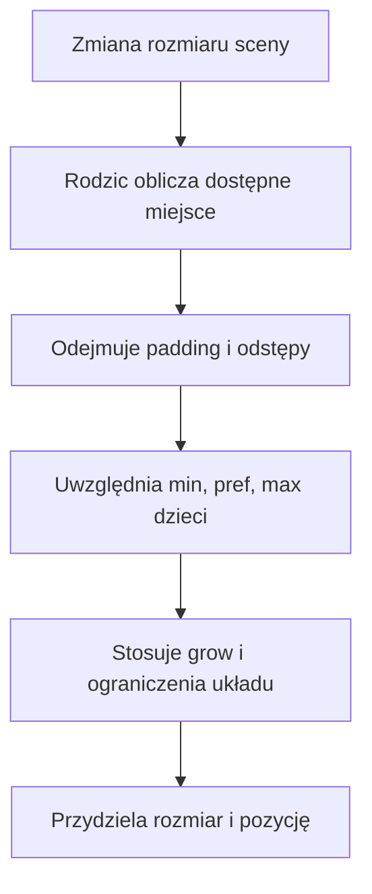

`padding` to odstęp od krawędzi kontenera, `spacing` w `HBox/VBox` to odstęp
między dziećmi, a `hgap/vgap` określają odstępy w siatce lub przepływie.
Margines jest ograniczeniem konkretnego dziecka, np. `HBox.setMargin(button, new Insets(8))`.
Marginesów nie należy zastępować spacjami wstawianymi do tekstu etykiety.

W aplikacji należy wybrać `HBox`, zmienić szerokość, wyłączyć wzrost i zmienić
wyrównanie. Następnie trzeba zwiększyć `padding` i wyjaśnić, dlaczego powierzchnia
dostępna dla pól maleje mimo niezmienionej zewnętrznej szerokości kontenera.

### Układ elementów w jednej osi (HBox, VBox)

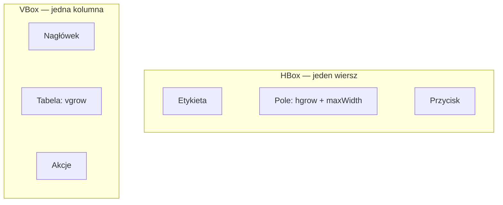

`HBox` nie przenosi przycisku do następnego wiersza po zmniejszeniu okna.
`VBox` nie tworzy automatycznie drugiej kolumny. `alignment` określa położenie
grupy w wolnym obszarze; jeżeli dzieci zajęły cały obszar, zmiana wyrównania
może nie dać widocznego efektu.

```java
TextField query = new TextField();
query.setMaxWidth(Double.MAX_VALUE);
HBox.setHgrow(query, Priority.ALWAYS);
HBox toolbar = new HBox(8, new Label("Szukaj:"), query, new Button("Filtruj"));
toolbar.setAlignment(javafx.geometry.Pos.CENTER_LEFT);
toolbar.setPadding(new Insets(12));
```

`ALWAYS` dostaje dodatkowe miejsce przed `SOMETIMES`; `NEVER` nie zgłasza
zapotrzebowania na ten wzrost. Kilkoro dzieci z tym samym priorytetem dzieli
wolne miejsce z uwzględnieniem swoich ograniczeń. Nie oznacza to automatycznie
jednakowych końcowych szerokości.

**Doświadczenie:** w pokazie `VBox` należy włączyć i wyłączyć wzrost `TextArea`.
W `HBox` trzeba porównać `TOP_LEFT`, `CENTER` i `BOTTOM_RIGHT` przy wyłączonym
wzroście oraz opisać różnicę między przydzieleniem miejsca przez rodzica
a limitem rozmiaru kontrolki.

### Zawijanie elementów przy zmianie szerokości (FlowPane, TilePane)

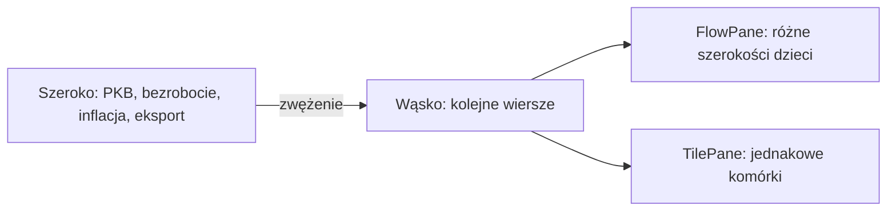

Poziomy `FlowPane` umieszcza dzieci kolejno i zawija do nowego wiersza,
gdy zabraknie szerokości. `prefWrapLength` wpływa na obliczanie preferowanego
rozmiaru; nie jest sztywnym progiem układu niezależnym od rzeczywistej szerokości.
`TilePane` również zawija, ale organizuje elementy w jednakowych polach.
Aby przyciski wypełniały pola, pozwól im rosnąć przez `setMaxSize`.

```java
FlowPane tags = new FlowPane(8, 8);
tags.getChildren().addAll(new Button("PKB"), new Button("Stopa bezrobocia"),
        new Button("Inflacja"), new Button("Eksport"));
```

**Doświadczenie:** należy zmieniać szerokość od 900 do 360 w `FlowPane`, a następnie
w `TilePane`. Trzeba dodać przycisk z dłuższym napisem i porównać, czy zmienia się
tylko jego szerokość, czy rozmiar wszystkich pól. Należy wyjaśnić zastosowanie
tych układów do filtrów i kafelków wskaźników.

### Rozmieszczenie treści w pięciu obszarach (BorderPane)

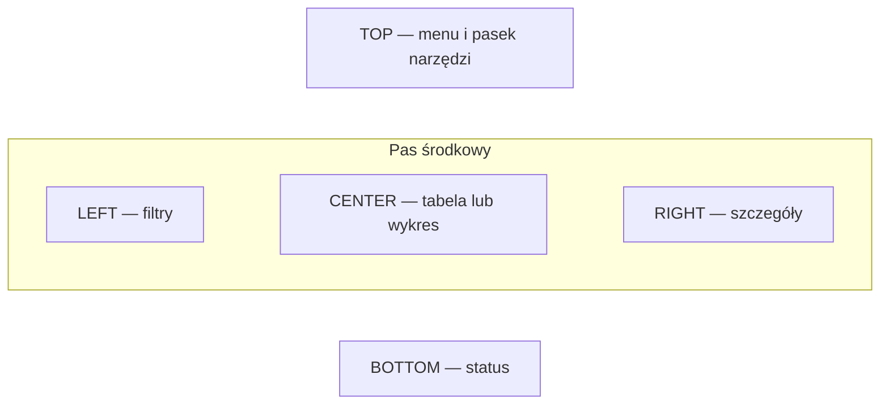

`top` i `bottom` korzystają z preferowanej wysokości i dostępnej szerokości.
Boki zajmują preferowaną szerokość w środkowym pasie; środek otrzymuje resztę.
W każdym obszarze jest jeden węzeł, więc menu i przyciski grupujemy np. w `VBox`.
Ostateczne rozciągnięcie kontrolki zależy też od jej `maxWidth/maxHeight`.

```java
BorderPane dashboard = new BorderPane();
dashboard.setTop(new HBox(8, new Button("Import"), new Button("Analiza")));
dashboard.setLeft(new VBox(8, new Label("Region"), new ComboBox<String>()));
dashboard.setCenter(new TableView<>());
dashboard.setBottom(new Label("Gotowe"));
```

**Doświadczenie:** należy porównać ten sam `BorderPane` przy szerokości 360 i 900.
Następnie środek trzeba zastąpić przyciskiem i ustawić mu
`setMaxSize(Double.MAX_VALUE, Double.MAX_VALUE)`. Należy wyjaśnić, dlaczego
`BorderPane` sam nie przenosi filtrów nad tabelę.

### Układ formularza i ograniczenia kolumn (GridPane)

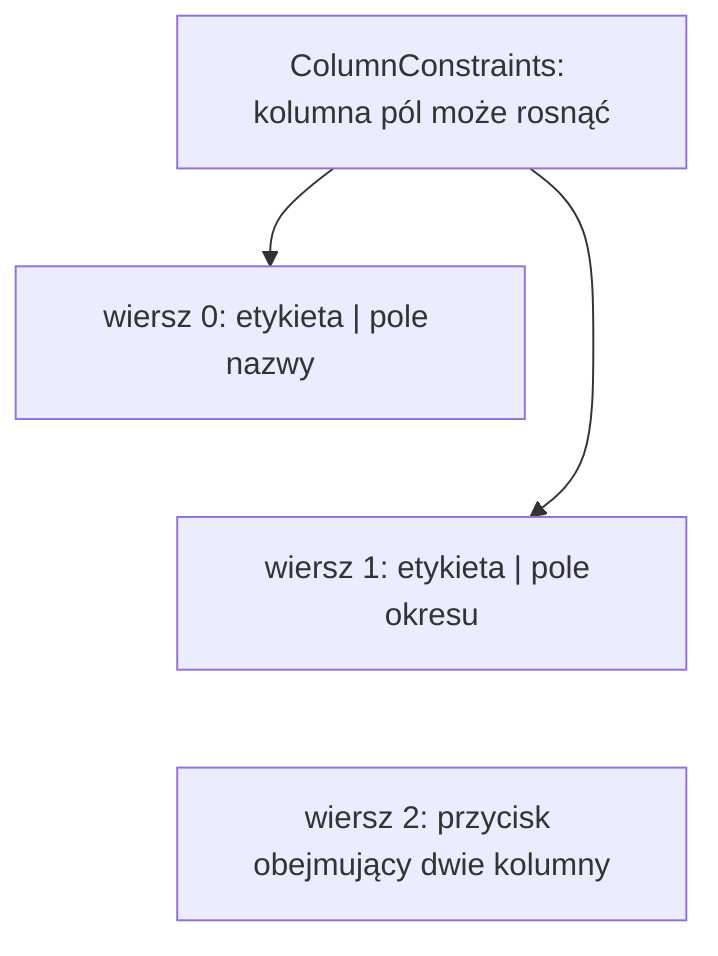

Indeksy kolumn i wierszy zaczynają się od zera. `add(node, column, row, colspan, rowspan)`
pozwala zajmować kilka komórek. W przeciwieństwie do Swing `GridLayout`,
`GridPane` nie wymusza jednakowych rozmiarów wszystkich komórek.

```java
GridPane form = new GridPane();
form.setHgap(10); form.setVgap(8);
ColumnConstraints labelColumn = new ColumnConstraints();
ColumnConstraints inputColumn = new ColumnConstraints();
inputColumn.setHgrow(Priority.ALWAYS);
form.getColumnConstraints().addAll(labelColumn, inputColumn);
TextField dataset = new TextField();
dataset.setMaxWidth(Double.MAX_VALUE);
form.addRow(0, new Label("Zbiór"), dataset);
Button save = new Button("Zatwierdź");
form.add(save, 0, 1, 2, 1);
```

**Doświadczenie:** w pokazie `GridPane` należy wyłączyć wzrost pól, a następnie
zmienić szerokość. Kolumna może nadal otrzymywać wolne miejsce, mimo że pole go
nie wypełnia. Należy dodać trzecią kolumnę z jednostką i porównać ograniczenia
procentowe `setPercentWidth` ze wzrostem przez `hgrow`.

### Nakładanie i kotwiczenie węzłów (StackPane, AnchorPane)

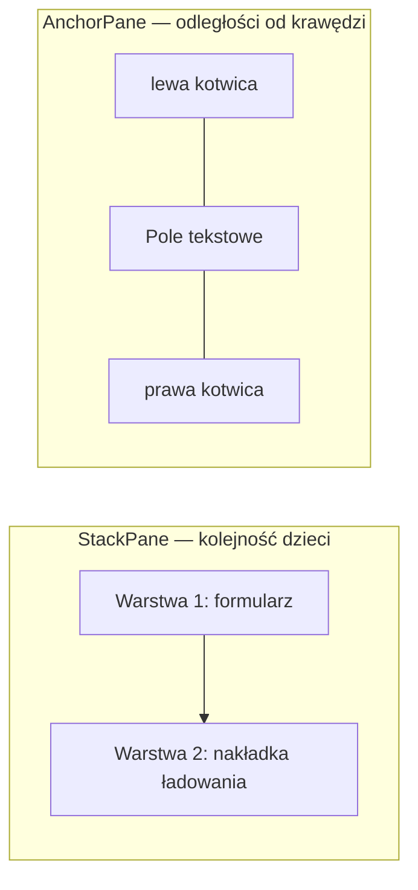

W `StackPane` ostatnie dziecko jest domyślnie na wierzchu. Węzeł z `visible=false`
może nadal brać udział w obliczaniu układu; `managed=false` wyłącza go z tych obliczeń.
Przezroczystość `opacity=0` nie oznacza automatycznie przepuszczania kliknięć.
Jeśli nakładka ma przepuszczać zdarzenia myszy, rozważ `mouseTransparent`;
jeśli blokuje operację, zablokuj też akcje dostępne z klawiatury.

`AnchorPane` utrzymuje odległości od wskazanych krawędzi. Dwie przeciwległe
kotwice mogą rozciągać resizowalny węzeł z uwzględnieniem jego minimum.
Nie tworzą automatycznie układu mobilnego i nie zapobiegają kolizjom przy zbyt małym oknie.

```java
TextField name = new TextField();
AnchorPane anchored = new AnchorPane(name);
AnchorPane.setLeftAnchor(name, 12.0);
AnchorPane.setRightAnchor(name, 12.0);
AnchorPane.setTopAnchor(name, 12.0);
```

**Doświadczenie:** w `StackPane` należy włączać i wyłączać nakładkę oraz
sprawdzić możliwość edycji pola. W `AnchorPane` trzeba porównać zachowanie pola
z dwiema kotwicami i przycisku zakotwiczonego tylko do prawej i dolnej krawędzi.

### Przewijanie i zwijanie zawartości (ScrollPane, TitledPane, Accordion)

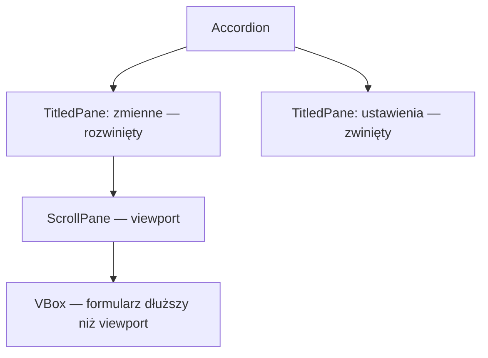

`ScrollPane` udostępnia przewijane okno na zawartość. `fitToWidth=true` dopasowuje
szerokość resizowalnej zawartości do viewportu, z uwzględnieniem jej ograniczeń.
Samo umieszczenie kontrolki w `ScrollPane` tego nie włącza. `TitledPane` ma tytuł
i zwijaną zawartość. Kilka niezależnych paneli może być rozwiniętych naraz;
w `Accordion` rozwinięty jest najwyżej jeden.

```java
VBox fields = new VBox(8);
for (int i = 1; i <= 16; i++) fields.getChildren().add(new TextField("Zmienna " + i));
ScrollPane scroll = new ScrollPane(fields);
scroll.setFitToWidth(true);
TitledPane variables = new TitledPane("Zmienne", scroll);
TitledPane options = new TitledPane("Ustawienia", new CheckBox("Pokaż legendę"));
Accordion sections = new Accordion(variables, options);
sections.setExpandedPane(variables);
```

**Doświadczenie:** formularz należy przewinąć do ostatniego pola i zmienić sekcję.
Następnie trzeba wyłączyć `fitToWidth` w kodzie, porównać szerokość pól i zwiększyć
czcionkę, aby sprawdzić, czy przewijanie nadal udostępnia wszystkie pola i nagłówki.

### Zagnieżdżanie i graf sceny

`Node` może mieć jednego rodzica. Panel filtrów należy usunąć z poprzedniego
miejsca przed przeniesieniem między `left` i `top`; modelu danych nie należy
odtwarzać.
`Group` grupuje węzły, lecz nie jest zamiennikiem resizowalnego kontenera głównego
formularza. W praktyce korzeniem okna często zostaje `BorderPane` albo `VBox`.

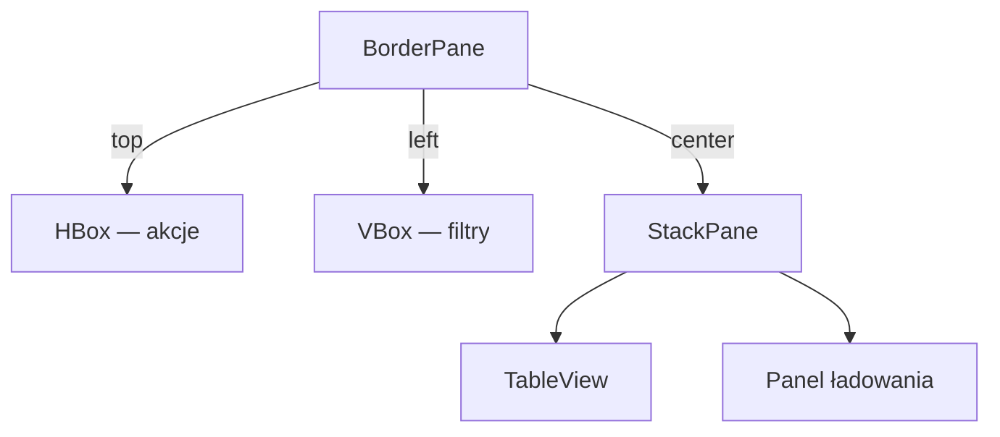

Wszystkie powyższe fragmenty należy umieszczać wewnątrz tworzenia widoku. Importy
kontenerów pochodzą z `javafx.scene.layout`, kontrolek z `javafx.scene.control`,
a `Insets` i `Pos` z `javafx.geometry`. Pełny przykład z importami jest w aplikacji demo.

### Budowa adaptacyjnego panelu danych (JavaFX)

Istniejący pulpit należy rozbudować przez `BorderPane`, pasek akcji u góry,
formularz w `GridPane` i tabelę w obszarze głównym. Filtry można zagnieździć
w `VBox`, a szczegóły udostępnić w zwijanym `TitledPane`. Należy porównać dwa
rozmiary okna i tekst powiększony o 25%; dla każdego kontenera zapisać ustawienie,
przewidywany efekt i rzeczywisty efekt.

## 4. Tworzenie formularza obserwacji i własnego komponentu (JavaFX)

Pulpit startowy należy rozbudować o formularz nowej obserwacji. Rekord składa się
z roku, regionu i wartości stopy bezrobocia; po poprawnej walidacji trafia do tej
samej kolekcji, którą wykorzystują tabela, karty podsumowań i wykres.

### Kontrolki i reguły danych

| Pole | Kontrolka | Reguła walidacji |
|---|---|---|
| rok | `TextField` albo `Spinner<Integer>` | liczba całkowita z zakresu 1990–2035 |
| region | `ComboBox<String>` lub `TextField` | wartość wymagana; nazwa bez samych białych znaków |
| stopa bezrobocia | `TextField` | skończona liczba z zakresu 0–100; obsłużyć przecinek i kropkę dziesiętną |

`TextField.getText()` zawsze zwraca tekst, dlatego parsowanie może zgłosić
`NumberFormatException`. Podpowiedź pola nie zastępuje walidacji. Reguły należy
wydzielić do metod, z których skorzystają formularz, edycja tabeli i import.
Komunikat powinien wskazywać pole i przyczynę, a błędne dane pozostać w formularzu.

Projekt udostępnia `ObservationValidation.parseRate(text)` oraz
`validate(year, region, rate, observations, edited)`. Druga metoda zwraca nazwę
regionu bez skrajnych spacji i sprawdza unikalność `(rok, region)` bez rozróżniania
wielkości liter. Przy dodawaniu należy przekazać `null` jako `edited`; przy edycji
— zmieniany obiekt, który trzeba pominąć podczas szukania duplikatu. Podczas
importu należy sprawdzać rekord względem tymczasowej listy już odczytanych wierszy.
Nowy import zastępuje cały zbiór, więc nie należy porównywać go z poprzednimi danymi.

Parser dopuszcza zapis dziesiętny, np. `5`, `5,7`, `5.7`, bez separatorów tysięcy
i notacji wykładniczej. Puste pole, `NaN`, nieskończoność i tekst z dopiskiem
mają zostać odrzucone. Reguły te należy zachować w formularzu, tabeli i imporcie.

### Obsługa zdarzeń w formularzu

Listener przycisku można zapisać jako klasę implementującą `EventHandler<ActionEvent>`,
klasę anonimową albo lambdę. To trzy formy realizacji tego samego interfejsu.
Handler należy przypisać do właściwej kontrolki; ponowne `setOnAction` na tym
samym przycisku zastępuje poprzednią wartość. `addEventHandler` pozwala dodać
obsługę bez zastępowania tej właściwości.

```java
Button calculate = new Button("Oblicz");
calculate.setOnAction(event -> System.out.println("Wywołano analizę"));
```

Zdarzenie ma typ, źródło i cel. Filtry uczestniczą w przejściu do celu,
a handlery w powrocie do rodziców. Wywołanie `consume()` zatrzymuje dalszą
propagację; nie należy go stosować bez uzasadnienia do wszystkich zdarzeń.

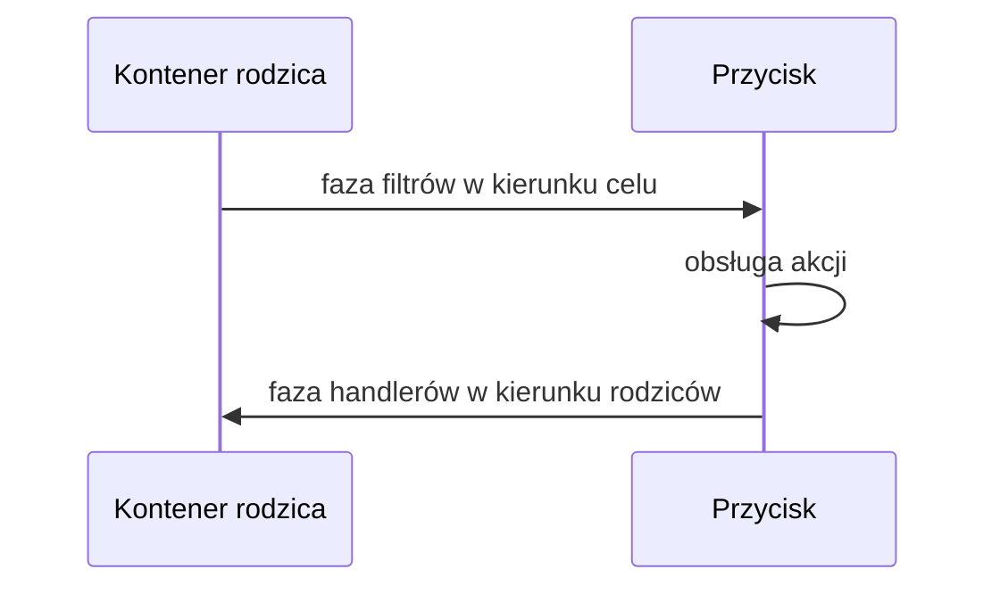

W pokazie **Zdarzenia** należy odczytać dziennik kliknięcia, zaznaczyć zatrzymanie
w filtrze i porównać wynik. Następnie trzeba dodać dwa przyciski i osobny handler
dla każdego. Zmiana obsługi jednego nie powinna wyłączać drugiego.

### Budowa wielokrotnego użytku komponentu podsumowania

Karta miary może być złożona z istniejących kontrolek i dziedziczyć po `VBox`.
Nie należy rysować jej ręcznie, jeżeli wystarcza zagnieżdżenie `Label` i nadanie
klasie CSS. Karta ma własne właściwości, a etykiety są z nimi powiązane:

```java
import javafx.beans.property.SimpleStringProperty;
import javafx.beans.property.StringProperty;
import javafx.geometry.Insets;
import javafx.scene.control.Label;
import javafx.scene.layout.VBox;

public class MetricCard extends VBox {
    private final StringProperty title = new SimpleStringProperty(this, "title", "");
    private final StringProperty value = new SimpleStringProperty(this, "value", "");

    public MetricCard(String title, String value) {
        Label titleLabel = new Label();
        titleLabel.textProperty().bind(this.title);
        titleLabel.getStyleClass().add("metric-title");
        Label valueLabel = new Label();
        valueLabel.textProperty().bind(this.value);
        valueLabel.getStyleClass().add("metric-value");
        getStyleClass().add("metric-card");
        setSpacing(5);
        setPadding(new Insets(12, 16, 12, 16));
        getChildren().addAll(titleLabel, valueLabel);
        setTitle(title);
        setValue(value);
    }

    public StringProperty titleProperty() { return title; }
    public StringProperty valueProperty() { return value; }
    public String getTitle() { return title.get(); }
    public void setTitle(String title) { this.title.set(title); }
    public String getValue() { return value.get(); }
    public void setValue(String value) { this.value.set(value); }
}
```

Ten fragment ilustruje strukturę klasy; plik projektu startowego zawiera
kompletną implementację i dodatkowe ograniczenie szerokości. Węzeł JavaFX może
mieć tylko jednego rodzica;
jeśli karta ma wystąpić w dwóch widokach, należy utworzyć dwa węzły oparte na
tym samym modelu, a nie dodawać jeden `Node` do dwóch kontenerów.

`visible=false` ukrywa węzeł, ale pozostawia go w obliczeniach układu.
`managed=false` wyłącza go z tych obliczeń. Aby ukryta jednostka nie zajmowała
miejsca, obie właściwości jej etykiety należy powiązać z warunkiem niepustej
jednostki. Wartość liczbowa i jednostka powinny być wyświetlane osobno;
po rozbudowie kart nie należy dopisywać `%` także do tekstu wartości.

### Implementacja formularza i testów walidacji

1. Dodać formularz regionu, roku i wartości oraz przyciski „Dodaj” i „Wyczyść”.
2. W metodzie obsługującej formularz wykorzystać `ObservationValidation` i wydzielić
   tworzenie `Observation`; do listy źródłowej dodać obiekt dopiero po przejściu
   wszystkich kontroli, w tym sprawdzeniu duplikatu.
3. Skonfigurować „Wyczyść”, aby resetował pola i komunikat oraz ustawił fokus
   na pierwszym polu. Czyszczenie formularza nie może usuwać rekordów z tabeli.
4. Sprawdzić poprawne dane, brak regionu, pusty rok, tekst `abc`, wartość `-1`,
   wartość `100,1` i liczbę nieskończoną. Błędne rekordy nie trafiają do modelu.
5. Rozbudować istniejący `MetricCard` o `StringProperty unit` i etykietę jednostki.
   Dodać `BooleanProperty empty` oraz wyświetlanie `—`, gdy brak wyniku.
   Dla pustej jednostki powiązać `visibleProperty()` i `managedProperty()` etykiety,
   aby nie pozostawiała pustego miejsca. Sprawdzić dwie instancje karty z różnymi
   wartościami i wspólnymi regułami CSS.

**Punkt kontrolny:** walidacja działa przed utworzeniem rekordu, a wyczyszczenie
formularza nie usuwa innych danych aplikacji. Dodanie obserwacji aktualizuje
tabelę i podsumowanie; klasa komponentu nie przechowuje kopii modelu.

## 5. Powiązanie modelu obserwacji z edytowalną tabelą (JavaFX)

### Model przed widokiem

`TableView<Observation>` wyświetla obiekty, a `ObservableList<Observation>` informuje
widok o dodaniu i usunięciu wierszy. `ObservationModel` z projektu startowego
udostępnia jedną kolekcję dla wszystkich widoków. Plik `Observation.java` pokazuje
właściwości obserwowalne dla roku, regionu, stopy bezrobocia oraz uwzględnienia
rekordu w obliczeniach. Właściwość
zwraca się metodą `rateProperty()`, odczytuje przez `getRate()`, a zmienia przez
`setRate(...)`:

```java
package pl.uczelnia.lab2;

import javafx.beans.property.DoubleProperty;
import javafx.beans.property.BooleanProperty;
import javafx.beans.property.IntegerProperty;
import javafx.beans.property.SimpleBooleanProperty;
import javafx.beans.property.SimpleDoubleProperty;
import javafx.beans.property.SimpleIntegerProperty;
import javafx.beans.property.SimpleStringProperty;
import javafx.beans.property.StringProperty;

public class Observation {
    private final IntegerProperty year = new SimpleIntegerProperty(this, "year");
    private final StringProperty region = new SimpleStringProperty(this, "region");
    private final DoubleProperty rate = new SimpleDoubleProperty(this, "rate");
    private final BooleanProperty includedInAnalysis =
            new SimpleBooleanProperty(this, "includedInAnalysis", true);

    public Observation(int year, String region, double rate) {
        setYear(year);
        setRegion(region);
        setRate(rate);
    }

    public IntegerProperty yearProperty() { return year; }
    public StringProperty regionProperty() { return region; }
    public DoubleProperty rateProperty() { return rate; }
    public BooleanProperty includedInAnalysisProperty() { return includedInAnalysis; }
    public int getYear() { return year.get(); }
    public void setYear(int value) { year.set(value); }
    public String getRegion() { return region.get(); }
    public void setRegion(String value) { region.set(value); }
    public double getRate() { return rate.get(); }
    public void setRate(double value) { rate.set(value); }
    public boolean isIncludedInAnalysis() { return includedInAnalysis.get(); }
    public void setIncludedInAnalysis(boolean value) { includedInAnalysis.set(value); }
}
```

Typ edytora należy dopasować do zmiennej. Okres w tym zbiorze oznacza rok, więc
nie należy dodawać dnia i miesiąca przez `DatePicker`; kalendarz ma sens dla
obserwacji przypisanych do konkretnej daty.

### Utworzenie tabeli

W metodzie budującej widok należy pobrać kolekcję z `ObservationModel` i przekazać
ją do tabeli. Nie należy tworzyć nowej listy przy każdej zmianie zakładki. `ObservationModel`
buduje listę z extractorem, który obserwuje właściwości roku, regionu, stopy
bezrobocia i uwzględnienia rekordu w analizie:

```java
ObservableList<Observation> data = model.getObservations();
TableView<Observation> table = new TableView<>(data);
TableColumn<Observation, Number> rateColumn = new TableColumn<>("Stopa (%)");
rateColumn.setCellValueFactory(cell -> cell.getValue().rateProperty());
table.getColumns().add(rateColumn);
```

Extractor w liście zgłasza aktualizację przy zmianie wymienionych właściwości.
Jest potrzebny, żeby tabela, karty statystyczne i wykres zareagowały także na
edycję obiektu. Do extractora należy dodać każdą właściwość używaną w predykacie
albo obliczeniach.

### Edycja komórki

Fabryka wartości wskazuje obserwowaną właściwość, a fabryka komórek określa edytor.
W projekcie startowym kolumna pozostaje typu `Number`, aby sortowanie było
liczbowe. Własna komórka `RateEditingCell` zawiera `TextField`: Enter najpierw
wywołuje `ObservationValidation.parseRate`, a dopiero po sukcesie `commitEdit`.
Błędny tekst pozostaje w edytorze, a Escape anuluje edycję.
Walidacja dopiero w `setOnEditCommit` nie przechwytuje błędów wcześniejszej
konwersji wykonywanej przez standardowy `NumberStringConverter`.

W `Main.createTable()` należy odszukać konfigurację edytora i obsługę zatwierdzenia.
Poniżej tę samą kolumnę oznaczono nazwą `rateColumn`:

```java
rateColumn.setCellValueFactory(cell -> cell.getValue().rateProperty());
rateColumn.setCellFactory(column -> new RateEditingCell());
table.setEditable(true);
rateColumn.setOnEditCommit(event -> {
    double value = event.getNewValue().doubleValue();
    if (Double.isFinite(value) && value >= 0 && value <= 100) {
        event.getRowValue().setRate(value);
    } else {
        new javafx.scene.control.Alert(javafx.scene.control.Alert.AlertType.ERROR,
                "Wartość musi należeć do zakresu 0–100.").showAndWait();
        // Model nie został zmieniony; ponowne wyświetlenie przywraca poprzednią wartość.
        table.refresh();
    }
});
```

Zwykła `ObservableList` zgłasza dodanie i usunięcie elementu, ale nie obserwuje
automatycznie pól obiektu. W przykładzie extractor obejmuje właściwości modelu;
fabryka wartości komórki zwraca property obserwowaną przez tabelę. Własne komórki
należy czyścić w `updateItem`, ponieważ JavaFX używa ich ponownie dla innych wierszy.

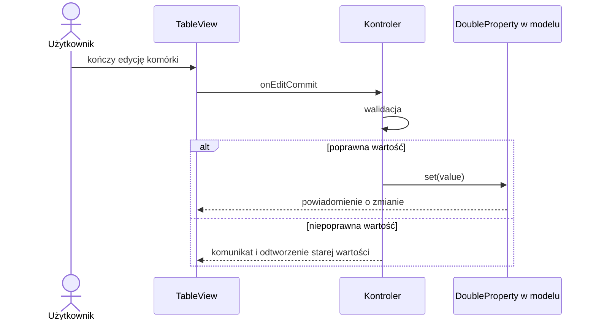

### Edycja kategorii i włączenie rekordu do obliczeń

Pole tekstowe nie jest właściwym edytorem dla każdej kolumny. Dla regionu
wybieranego z listy można zastosować [`ComboBoxTableCell`](https://openjfx.io/javadoc/27/javafx.controls/javafx/scene/control/cell/ComboBoxTableCell.html),
a dla flagi logicznej [`CheckBoxTableCell`](https://openjfx.io/javadoc/27/javafx.controls/javafx/scene/control/cell/CheckBoxTableCell.html).
Właściwość logiczna jest częścią modelu; odznaczenie rekordu wyłącza go z kart
statystycznych i wykresu, lecz nie usuwa wiersza z tabeli.

```java
TableColumn<Observation, String> regionColumn = new TableColumn<>("Region");
regionColumn.setCellValueFactory(cell -> cell.getValue().regionProperty());
regionColumn.setCellFactory(ComboBoxTableCell.forTableColumn(regionOptions));
regionColumn.setOnEditCommit(event -> {
    Observation item = event.getRowValue();
    try {
        String region = ObservationValidation.validate(item.getYear(),
                event.getNewValue(), item.getRate(), data, item);
        item.setRegion(region);
    } catch (IllegalArgumentException error) {
        new Alert(Alert.AlertType.ERROR, error.getMessage()).showAndWait();
        table.refresh();
    }
});

TableColumn<Observation, Boolean> includeColumn = new TableColumn<>("W analizie");
includeColumn.setCellValueFactory(cell ->
        cell.getValue().includedInAnalysisProperty());
includeColumn.setCellFactory(CheckBoxTableCell.forTableColumn(includeColumn));

List<Observation> analyzed = filtered.stream()
        .filter(Observation::isIncludedInAnalysis)
        .toList();
```

`regionOptions` należy utrzymywać na podstawie regionów dostępnych w modelu i
odświeżać po imporcie, dodaniu, usunięciu lub zmianie nazwy regionu. Lista
filtrowana nadal zawiera wyłączone rekordy, aby można je było ponownie uwzględnić. Extractor
`ObservationModel` musi zatem obserwować również `includedInAnalysisProperty()`;
zmiana pola wyboru uruchamia ponowne obliczenie kart i serii wykresu.

### Filtrowanie, sortowanie i rozmiar

Po utworzeniu `data` i `table` należy dodać pole filtra do widoku i podmienić źródło tabeli:

```java
TextField filter = new TextField();
filter.setPromptText("Filtruj po regionie");
var filtered = new javafx.collections.transformation.FilteredList<>(data, observation -> true);
var sorted = new javafx.collections.transformation.SortedList<>(filtered);
sorted.comparatorProperty().bind(table.comparatorProperty());
table.setItems(sorted);
filter.textProperty().addListener((observable, before, after) -> {
    String fragment = after.strip().toLowerCase(java.util.Locale.ROOT);
    filtered.setPredicate(observation -> observation.getRegion()
            .toLowerCase(java.util.Locale.ROOT).contains(fragment));
});
VBox content = new VBox(8, filter, table);
VBox.setVgrow(table, Priority.ALWAYS);
```

Obiekty należy dodawać i usuwać w źródłowej `data`, nie w `FilteredList` ani
`SortedList`. Przy usuwaniu należy pobrać wybrany obiekt przez
`table.getSelectionModel().getSelectedItem()`; indeks w widoku przekształconym
nie jest indeksem listy źródłowej.

### Implementacja edycji i filtrowania tabeli

1. Rozszerzyć próbkę projektu z 10 do co najmniej 20 syntetycznych obserwacji
   dla kilku regionów i lat. Kombinacja `(rok, region)` ma być unikalna.
2. Dodawać obserwację do listy źródłowej po zatwierdzeniu formularza; po usunięciu
   używać wybranego obiektu, nie indeksu widoku.
3. Sprawdzić istniejące edytory: wpisać `abc`, pusty tekst, `5,7`, `5.7`, `5abc`,
   `-1` i `100,1`. Poprawne liczby mają być akceptowane, a błędne zachowywać
   poprzednią wartość modelu. Następnie spróbować zmienić region tak, aby powstał
   duplikat dla tego samego roku. Operacja ma zostać odrzucona z komunikatem.
4. Rozbudować istniejącą kolumnę „W analizie” o przyciski „Uwzględnij widoczne”
   i „Wyłącz widoczne”. Operacje mają zmieniać flagi wyłącznie rekordów z `filtered`;
   rekordy poza filtrem zachowują stan. Wiersze wyłączone pozostają w tabeli.
5. Do istniejącego filtra regionu dodać dolną i górną granicę roku. Jeden predykat
   ma łączyć wszystkie warunki przez AND. Odwrócony zakres ma wyświetlać błąd
   i pozostawiać poprzedni filtr. „Wyczyść filtr” resetuje wszystkie trzy pola.
6. Sprawdzić wysokość tabeli z `VBox.setVgrow(table, Priority.ALWAYS)` i bez niego.
7. Powiązać `disableProperty()` przycisku „Usuń” z brakiem zaznaczenia przez
   `selectedItemProperty().isNull()`. Usuwanie po filtrowaniu i sortowaniu ma
   dotyczyć wybranego obiektu, a nie indeksu listy źródłowej.

**Punkt kontrolny:** po dodaniu lub edycji tabeli nie trzeba tworzyć od nowa,
sortowanie nie zmienia tożsamości rekordów, filtr reaguje na zmiany obserwowanych
pól, a odznaczenie rekordu aktualizuje statystyki bez ukrywania wiersza.

## 6. Import danych, obliczenia opisowe i wykres (JavaFX)

### Format pliku i bezpieczna walidacja

Do projektu należy dodać `FileChooser` dla lokalnego pliku UTF-8 o nagłówku
`rok;region;stopa_bezrobocia`. Przykładowy plik znajduje się w
`src/main/resources/bezrobocie.csv` i zawiera 20 demonstracyjnych obserwacji.
Flaga „W analizie” jest ustawieniem aplikacji, a nie zmienną źródłowego pliku;
nowe obserwacje po imporcie są domyślnie uwzględniane.
Plik wejściowy powinien zawierać co najmniej
20 obserwacji, kilka regionów i kilka lat; stopę należy zapisywać w procentach,
np. `5,7` oznacza 5,7%. Parser `ObservationValidation.parseRate` obsługuje
przecinek i kropkę. Wartości muszą być skończone i mieścić się w zakresie 0–100, a klucz
`(rok, region)` ma być unikalny.

Przy prostym `split(";", -1)` należy jawnie ograniczyć format: pola nie mogą
zawierać separatora ani cytowanych wartości wielowierszowych. Pełny CSV wymaga
parsera obsługującego cytowanie. Dane należy najpierw wczytać do tymczasowej listy,
sprawdzić wszystkie wiersze i dopiero po poprawnej walidacji zastąpić kolekcję
modelu. Błąd powinien wskazywać numer wiersza; anulowanie okna wyboru pliku nie
zmienia aktualnych danych.

```java
if (lineNumber == 1) {
    if (!line.equals("rok;region;stopa_bezrobocia")) {
        throw new IllegalArgumentException("Nieznany nagłówek CSV");
    }
    continue;
}
String[] fields = line.split(";", -1);
if (fields.length != 3) {
    throw new IllegalArgumentException("Oczekiwano 3 kolumn");
}
int year = Integer.parseInt(fields[0].strip());
String region = fields[1].strip();
double rate = ObservationValidation.parseRate(fields[2]);
region = ObservationValidation.validate(year, region, rate, pending, null);
pending.add(new Observation(year, region, rate));
```

`pending` to lokalna `List<Observation>` utworzona przed pętlą odczytu.
Wyjątki parsowania i walidacji należy opakować komunikatem z numerem wiersza.
Po błędzie nie należy wykonywać `observations.setAll(pending)`.

### Aktualizacja podsumowania i modelu

Karty podsumowania należy wyliczać z obserwacji, które pasują do filtra i mają
włączoną flagę „W analizie”, nie z osobnej, ręcznie utrzymywanej kopii. Wiersze
z wyłączoną flagą pozostają w tabeli. Dla średniej można użyć strumienia:

```java
List<Observation> analyzed = filtered.stream()
        .filter(Observation::isIncludedInAnalysis)
        .toList();
double mean = analyzed.stream()
        .mapToDouble(Observation::getRate)
        .average()
        .orElse(Double.NaN);

double[] sortedRates = analyzed.stream()
        .mapToDouble(Observation::getRate)
        .sorted()
        .toArray();
double median = Double.NaN;
if (sortedRates.length > 0) {
    int middle = sortedRates.length / 2;
    median = sortedRates.length % 2 == 0
            ? (sortedRates[middle - 1] + sortedRates[middle]) / 2
            : sortedRates[middle];
}
double sampleSd = Double.NaN;
if (sortedRates.length > 1) {
    double sumSquares = 0;
    for (double value : sortedRates) sumSquares += Math.pow(value - mean, 2);
    sampleSd = Math.sqrt(sumSquares / (sortedRates.length - 1));
}
```

Istniejące podsumowanie należy rozszerzyć o karty mediany i odchylenia standardowego
próby, obliczanego z mianownikiem `n − 1`. Dla pustego zbioru wszystkie miary
mają wyświetlać `—`; dla jednego rekordu średnia i mediana są równe jego wartości,
a odchylenie próby jest nieokreślone i ma wyświetlać `—`, nie zero ani `NaN`.
Średnia i mediana mają jednostkę `%`, a odchylenie — punkty procentowe (`p.p.`).
Średnia arytmetyczna obserwowanych stóp region–rok opisuje wybrany zbiór;
nie jest stopą bezrobocia całego kraju. Do takiej agregacji potrzebne byłyby
odpowiednie liczebności bezrobotnych i aktywnych zawodowo dla tego samego okresu.
Po dodaniu, usunięciu, edycji, zmianie filtra lub odznaczeniu
wiersza tabela, karty i wykres muszą zachować spójność: tabela pokazuje wszystkie
wiersze spełniające filtr, a obliczenia obejmują dodatkowo tylko zaznaczone.

### Samodzielne sprawdzenie obliczeń

Należy przygotować trzy obserwacje o wartościach `2`, `4`, `6` dla różnych lat
tego samego regionu. Sprawdzenie należy wykonać bez importu pliku, przez model.

| Stan zbioru objętego analizą | Średnia | Mediana | Odchylenie próby |
|---|---|---|---|
| 2, 4, 6 | 4% | 4% | 2 p.p. |
| 2, 4 (rekord 6 wyłączony) | 3% | 3% | około 1,4142 p.p. |
| tylko 4 | 4% | 4% | — |
| brak rekordów | — | — | — |

Należy uzyskać te stany przez flagę analizy i filtr, a następnie sprawdzić,
że zmiana sortowania nie zmienia miar. Zaokrąglanie należy stosować przy
wyświetlaniu, bez zaokrąglania danych źródłowych.

### Grupowanie obserwacji w `LineChart`

`LineChart<Number, Number>` otrzymuje rok na osi X i stopę bezrobocia na osi Y.
Każdy region jest osobnym `XYChart.Series`; obserwacje w serii należy posortować
rosnąco po roku. Oś Y ma etykietę z jednostką `%`, a legenda musi wskazywać regiony.
Na wykresie nie należy łączyć wskaźników o różnych jednostkach bez osobnej skali.
Różnica pomiędzy 5% i 6% wynosi 1 punkt procentowy; względny wzrost wynosi 20%.

```java
Map<String, XYChart.Series<Number, Number>> seriesByRegion = new TreeMap<>();
for (Observation observation : analyzed.stream()
        .sorted(java.util.Comparator.comparingInt(Observation::getYear)).toList()) {
    XYChart.Series<Number, Number> series = seriesByRegion.computeIfAbsent(
            observation.getRegion(), region -> {
                XYChart.Series<Number, Number> created = new XYChart.Series<>();
                created.setName(region);
                return created;
            });
    series.getData().add(new XYChart.Data<>(observation.getYear(), observation.getRate()));
}
chart.getData().setAll(seriesByRegion.values());
```

### Odczyt pliku w tle

Jeżeli plik może być duży, odczyt i walidację należy wykonać w `Task<List<Observation>>`.
Metoda `call()` nie może odwoływać się do kontrolek. `setOnSucceeded` zastępuje
model zwalidowanymi danymi, `setOnFailed` pokazuje błąd, a `setOnRunning` zmienia
status; przycisk importu można powiązać z `runningProperty()`. Callbacks `Task` są wykonywane
w JavaFX Application Thread. Własny executor należy zamknąć w `stop()`.

```java
import javafx.concurrent.Task;
import java.io.File;
import java.nio.file.Path;
import java.util.List;

File selected = chooser.showOpenDialog(stage);
if (selected == null) return; // anulowanie nie zmienia modelu
Path path = selected.toPath();
Task<List<Observation>> task = new Task<>() {
    @Override
    protected List<Observation> call() throws Exception {
        return readAndValidate(path); // bez dostępu do kontrolek
    }
};
importButton.disableProperty().unbind();
importButton.disableProperty().bind(task.runningProperty());
task.setOnRunning(event -> status.setText("Importowanie danych…"));
task.setOnSucceeded(event -> {
    observations.setAll(task.getValue());
    status.setText("Import zakończony");
});
task.setOnFailed(event -> showImportError(task.getException()));
Thread worker = new Thread(task, "csv-import");
worker.setDaemon(true);
worker.start();
```

Każda próba importu wymaga nowego obiektu `Task`; zadania po wykonaniu nie uruchamia
się ponownie. W przypadku użycia executora przycisk trzeba odwiązać lub obsłużyć
stan zadania tak, aby kolejny import mógł być uruchomiony.

### Implementacja importu, statystyk i wykresu

1. Dodać menu „Plik → Importuj CSV…” i obsłużyć `null` po anulowaniu wyboru.
2. Wczytać co najmniej 20 wierszy do tymczasowej listy; podawać numer błędnego
   wiersza i zachować dotychczasowy model, jeżeli dowolny wiersz jest niepoprawny.
3. Zastąpić kolekcję modelu dopiero po poprawnej walidacji całego pliku.
4. Rozbudować obliczenia o medianę i odchylenie standardowe próby dla rekordów
   spełniających filtr i zaznaczonych „W analizie”. Wykonać próby z tabeli powyżej.
5. Rozbudować istniejący wykres o komunikat dla pustej analizy i czytelne
   całkowite oznaczenia lat. Zachować osobną serię na region i porządek lat.
   Edycja tabeli, filtr i flaga analizy mają odświeżać te same wyniki.
6. Dla importu w tle sprawdzić, że okno pozostaje responsywne, przycisk jest
   zablokowany podczas pracy, a błąd nie zastępuje poprzednich danych.

**Punkt kontrolny:** import jest atomowy z punktu widzenia użytkownika, statystyki
obejmują obserwacje spełniające filtr i zaznaczone „W analizie”, a tabela pozostawia
widoczne także rekordy wyłączone z obliczeń.

## 7. Wydzielenie widoków FXML i powiązanie ich z kontrolerami (JavaFX)

### Separacja widoku, kontrolera i modelu

Widok opisuje strukturę kontrolek w FXML, kontroler łączy je z obsługą zdarzeń,
a model przechowuje obserwacje i reguły. FXML nie jest osobną sceną ani oknem;
to deklaratywny zapis węzłów, który po załadowaniu staje się częścią grafu sceny.
Scene Builder może edytować układ, lecz walidacja i obliczenia pozostają w Javie.

### Powiązanie kontrolek i kontrolera

Plik `src/main/resources/pl/uczelnia/lab2/data-view.fxml` należy utworzyć dla
zakładki danych. `fx:id` łączy kontrolkę z polem `@FXML`, a `onAction` wskazuje
metodę kontrolera:

```xml
<?xml version="1.0" encoding="UTF-8"?>
<?import javafx.scene.control.*?>
<?import javafx.scene.layout.BorderPane?>
<BorderPane xmlns:fx="http://javafx.com/fxml/1"
            fx:controller="pl.uczelnia.lab2.DataViewController">
    <top>
        <TextField fx:id="regionFilter" promptText="Filtruj region"/>
    </top>
    <center>
        <TableView fx:id="observationTable"/>
    </center>
    <bottom>
        <Button text="Wyczyść filtr" onAction="#clearFilter"/>
    </bottom>
</BorderPane>
```

W kontrolerze `initialize()` jest wywoływane po wstrzyknięciu pól `@FXML`.
Wspólny model przekazuje się osobną metodą po `loader.load()`.

Kontroler nie powinien wykonywać `new ObservationModel()`: oba widoki muszą
otrzymać model utworzony raz w `Main`. `initialize()` konfiguruje kontrolki,
ale nie może jeszcze korzystać z modelu przekazywanego późniejszym setterem.
Nasłuchiwanie wspólnych danych należy skonfigurować po ich przekazaniu.

W tym projekcie bez `module-info.java` pola i metody kontrolera mogą być prywatne,
jeżeli są oznaczone `@FXML`. Klasa kontrolera wskazana przez `fx:controller`
powinna być publiczna i mieć dostępny konstruktor bezargumentowy dla `FXMLLoader`.
Adnotacja umożliwia dostęp do prywatnych pól i metod, nie zastępuje utworzenia
instancji kontrolera.

```java
public class DataViewController {
    @FXML private TextField regionFilter;
    @FXML private TableView<Observation> observationTable;
    private ObservableList<Observation> observations;

    @FXML private void initialize() {
        // Konfiguracja kolumn i handlerów kontrolek FXML.
    }

    public void setObservations(ObservableList<Observation> observations) {
        this.observations = observations;
        observationTable.setItems(observations);
    }

    @FXML private void clearFilter() {
        regionFilter.clear();
    }
}
```

### Umieszczenie widoków FXML w zakładkach

W `Main.start` należy załadować oba widoki przez `FXMLLoader`, pobrać kontrolery
metodą `getController()` i przekazać im tę samą kolekcję lub wspólny model.
Załadowane korzenie należy umieścić w zawartości `TabPane`; `Stage` i `Scene`
pozostają te same:

```java
FXMLLoader dataLoader = new FXMLLoader(
        Main.class.getResource("/pl/uczelnia/lab2/data-view.fxml"));
Parent dataRoot = dataLoader.load();
DataViewController dataController = dataLoader.getController();
dataController.setObservations(observations);
dataTab.setContent(dataRoot);
```

Pola `@FXML` są dostępne po `load()`, nie w konstruktorze kontrolera.
Nie należy tworzyć przez `new` drugiego kontrolera do załadowanego widoku ani
dodawać jednego węzła do kilku rodziców. Wykonanie `clean` i ponowne uruchomienie
powinno potwierdzić, że FXML jest ładowany z classpath.

### Integracja widoków i kontrolerów

1. Przenieść formularz obserwacji i tabelę do `data-view.fxml`; powiązać pola
   z kontrolerem przez `fx:id` i obsłużyć przyciski przez `onAction`.
2. Przygotować `chart-view.fxml` z wykresem i kartami statystycznymi; oba widoki
   wczytać do zakładek tej samej aplikacji.
3. Przekazać obu kontrolerom wspólne źródło obserwacji oraz filtrowane dane.
   Edycja lub import ma być widoczny w tabeli, kartach i wykresie bez duplikowania modelu.
4. Zachować filtr i dane po przełączeniu zakładek; nie tworzyć nowego `Stage`
   ani nie zastępować sceny przy zwykłej zmianie widoku.
5. Uruchomić `clean`, zbudować i otworzyć aplikację; wszystkie pliki FXML
   mają być ładowane z zasobów projektu.

**Punkt kontrolny:** kontrolery obsługują widok i zdarzenia, a model pozostaje
wspólny dla zakładek. Zmiana zakładki nie usuwa danych ani nie uruchamia drugiej aplikacji.

## 8. Dostosowanie układu, motywów i HiDPI (JavaFX CSS)

Pulpit obserwacji należy sprawdzić w szerokim i wąskim oknie. W szerszym układzie
filtry mogą znaleźć się obok tabeli; w wąskim powinny przejść nad treść lub do
zwijanego `TitledPane`. Zakładki tabeli i wykresu zachowują wspólny model, filtr
i dane. Formularz, menu, tabela, karty oraz legenda wykresu muszą pozostać czytelne.

Szerokość kontenera należy obserwować, np. przez `root.widthProperty()`.
Wariant powinien zmieniać się dopiero po przekroczeniu wybranego progu.
Przed przeniesieniem węzła trzeba usunąć go z poprzedniego rodzica. `GridPane`
wymaga odpowiednich `ColumnConstraints`, `hgrow` i maksymalnych rozmiarów
kontrolek; samo umieszczenie w siatce nie gwarantuje ich rozciągania.

### Kaskadowanie stylów (JavaFX CSS)

CSS ma kilka poziomów: arkusz bazowy JavaFX, arkusze sceny/rodzica i styl inline.
`getStyleClass().add("warning")` odwołuje się do `.warning`, a `setId("summary")`
do `#summary`. Własne role należy opisywać klasami, a motywy przechowywać
w plikach CSS.
`Application.setUserAgentStylesheet` zmienia warstwę bazową; do ćwiczenia jasnego
i ciemnego motywu należy stosować arkusze sceny nad domyślnym stylem kontrolek.
Stały kolor w `setStyle` może wygrać z arkuszem i zepsuć przełączanie motywu.

### Motyw systemowy i ręczne warianty

Projekt startowy zawiera `src/main/resources/css/base.css`, `light.css` i
`dark.css`. Reguły komponentów należy dopisywać do `base.css`, a paletę kolorów
do obu arkuszy motywu. Poniższe przykłady pokazują role klas i kolorów; po zmianie
trzeba sprawdzić popupy, tabelę, osie, legendę i wszystkie stany kontrolek.

`base.css`:

```css
.root { -fx-font-family: "Segoe UI", sans-serif; -fx-font-size: 14px; }
.metric-card { -fx-padding: 1em; -fx-background-radius: 0.7em; }
.status-error { -fx-text-fill: app-error; }
.chart-plot-background { -fx-background-color: -fx-control-inner-background; }
.axis { -fx-tick-label-fill: -fx-text-background-color; }
```

`light.css`:

```css
.root {
    -fx-base: #edf1f6;
    -fx-background: #f7f9fc;
    -fx-control-inner-background: #ffffff;
    -fx-text-background-color: #1f2937;
    -fx-accent: #245fba;
    -fx-focus-color: #245fba;
    app-muted: #5b6878;
    app-border: #d6dee9;
    app-error: #b42318;
}
```

`dark.css`:

```css
.root {
    -fx-base: #283241;
    -fx-background: #1b2430;
    -fx-control-inner-background: #242f3e;
    -fx-text-background-color: #edf2f8;
    -fx-accent: #83b5ff;
    -fx-focus-color: #83b5ff;
    app-muted: #a9b6c7;
    app-border: #3c4a5d;
    app-error: #ffb4ab;
}
```

W JavaFX są to *looked-up colors*, a nie przeglądarkowe zmienne `var(--color)`. Odstępy w `em` odnoszą się do wielkości czcionki. Nie należy stosować `scaleX/scaleY` na całej scenie jako sposobu obsługi HiDPI. [Referencja CSS JavaFX 27](https://openjfx.io/javadoc/27/javafx.graphics/javafx/scene/doc-files/cssref.html).

Metodę pomocniczą klasy `Main` należy wywoływać w JavaFX Application Thread.
Tryb `SYSTEM` korzysta z `Platform.getPreferences().getColorScheme()` podczas
uruchamiania, a następnie nasłuchuje zmian `colorSchemeProperty()`. Listener ma
aktualizować motyw tylko wtedy, gdy użytkownik nie wybrał ręcznie `LIGHT` albo
`DARK`:

```java
var systemScheme = javafx.application.Platform.getPreferences()
        .colorSchemeProperty();
systemScheme.addListener((observable, previous, current) -> {
    if (themeMode == ThemeMode.SYSTEM) {
        applyTheme(scene, current == javafx.application.ColorScheme.DARK);
    }
});
```

Metoda `applyTheme` ustawia arkusze sceny:

```java
static void applyTheme(javafx.scene.Scene scene, boolean dark) {
    String base = java.util.Objects.requireNonNull(
            Main.class.getResource("/css/base.css")).toExternalForm();
    String theme = java.util.Objects.requireNonNull(
            Main.class.getResource(dark ? "/css/dark.css" : "/css/light.css"))
            .toExternalForm();
    scene.getStylesheets().setAll(base, theme);
}
```

Ten przykład zakłada dwa arkusze sceny. Dodatkowe arkusze funkcjonalne należy
zachować przy zmianie motywu. `DialogPane` okna `Alert` może wymagać osobnego
przekazania arkuszy; trzeba sprawdzić wygląd okien pomocniczych i wszystkich widoków.
Natywny `FileChooser` może mieć wygląd kontrolowany przez system, co należy opisać
w raporcie.

### Weryfikacja motywów, dostępności i skalowania

1. W trybie „Systemowy” zmienić motyw systemu podczas działania aplikacji.
   Sprawdzić zmianę kolorów bez restartu i bez odtwarzania modelu. Następnie
   wybrać ręcznie oba warianty, zmienić ustawienie systemu i potwierdzić, że
   ręczny wybór pozostaje aktywny do czasu powrotu do „Systemowego”.
2. Oznaczyć komunikat błędu klasą `status-error`; komunikat musi zawierać treść,
   a nie przekazywać informację wyłącznie kolorem.
3. Dostosować wykres tak, aby osie i legenda były czytelne w obu motywach,
   a serie rozróżnialne także symbolem lub stylem linii. Zachować znaczenie kolorów
   przy przełączaniu.
4. Sprawdzić w tabeli zaznaczenie, edycję, fokus klawiatury, puste dane i długą
   nazwę regionu. Nie ustawiać zbyt małej stałej wysokości komórki.
5. Wykonać pełną [macierz testów](../../jakosc-gui.html). Dołączyć zrzuty obu układów
   i motywów oraz próbę zwiększenia czcionki o 25%.

Warunkiem wykonania jest działający adaptacyjny układ, automatyczna reakcja na
motyw systemu oraz kompletne ręczne warianty jasny i ciemny — samo dodanie plików
CSS nie wystarcza.

## Testy końcowe i przygotowanie projektu do oddania

Scenariusz końcowy należy przeprowadzić od początku: uruchomić aplikację, dodać
i poprawić obserwację, wyłączyć i ponownie włączyć rekord w analizie, przefiltrować
i posortować tabelę, zaimportować plik,
sprawdzić statystyki, wyświetlić wykres, przełączyć zakładkę i motyw oraz zmienić
szerokość okna.

| Sprawdzenie | Oczekiwany rezultat |
|---|---|
| poprawne i błędne dane w formularzu / edycji | te same reguły walidacji; brak błędnego rekordu w modelu |
| zmiana regionu tworząca istniejącą parę `(rok, region)` | komunikat; dotychczasowy rekord pozostaje bez zmian |
| trzy wartości 2, 4, 6; następnie jedna i zero | miary zgodne z tabelą kontrolną; brak `NaN` i dzielenia przez zero |
| filtr regionu i lat, następnie wyłączenie widocznych | warunki działają łącznie, flagi ukrytych rekordów pozostają |
| sortowanie, filtrowanie i usuwanie | operacja dotyczy wskazanej obserwacji |
| anulowany lub błędny import | poprzedni zbiór pozostaje; błąd wskazuje wiersz |
| filtrowanie, edycja i flaga analizy | tabela pokazuje pasujące wiersze, a karty i wykres uwzględniają tylko zaznaczone rekordy |
| przełączanie zakładek FXML | dane i stan widoków pozostają w jednym `Stage` i `Scene` |
| zmiana motywu i szerokości | akcje dostępne, formularz i wykres czytelne |
| skale 100%, 150%, 200% | wyniki zapisane w [macierzy jakości GUI](../../jakosc-gui.html) |

Do oddania należy przygotować projekt Maven z kodem, FXML i CSS, plik CSV danych
demonstracyjnych z opisem formatu, tabelę obserwacji kontenerów, opis propagacji
zdarzeń oraz raport testów GUI ze zrzutami działającej aplikacji. Zrzuty powinny
pokazywać formularz, edytowaną tabelę, karty statystyczne i wykres.

## Weryfikacja wiedzy o JavaFX

1. Czym różnią się `Application`, `Stage`, `Scene` i `Node`?
2. Kiedy wykonywana jest lambda z `setOnAction` i w jakim wątku?
3. Jaka jest kolejność od `launch(args)` do widocznego okna i co należy umieścić jako korzeń `Scene`?
4. Jak współdziałają `min/pref/max`, `grow`, padding i odstępy?
5. Czym różnią się `FlowPane`, `TilePane` i `GridPane`?
6. Co zgłasza `ObservableList`, a co właściwość obiektu? Po co extractor?
7. Dlaczego nie usuwamy danych przez indeks posortowanej tabeli?
8. Jak należy rozdzielić pracę `Task.call()` i aktualizację GUI?
9. Jak FXML jest powiązany z kontrolerem i wspólnym modelem?
10. Jak należy zachować dane i motyw podczas przełączania zakładek?
11. Dlaczego test rozmiaru okna nie zastępuje testu DPI?
12. Jak `CheckBoxTableCell` zmienia właściwość modelu i skąd pozostałe widoki otrzymują powiadomienie?
