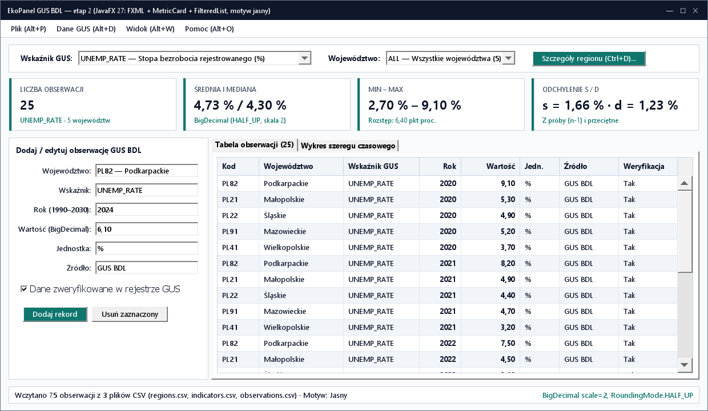
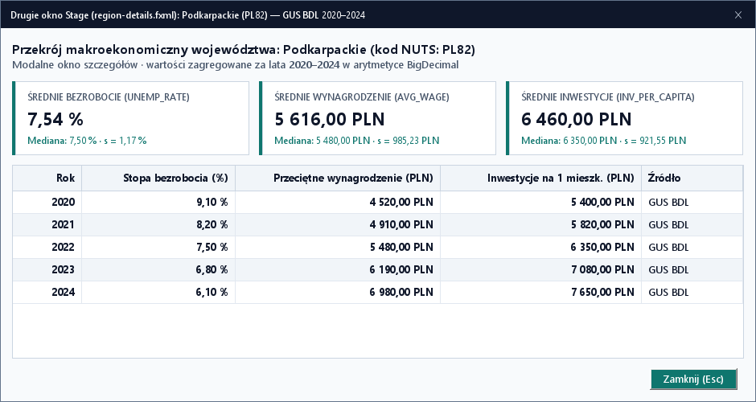
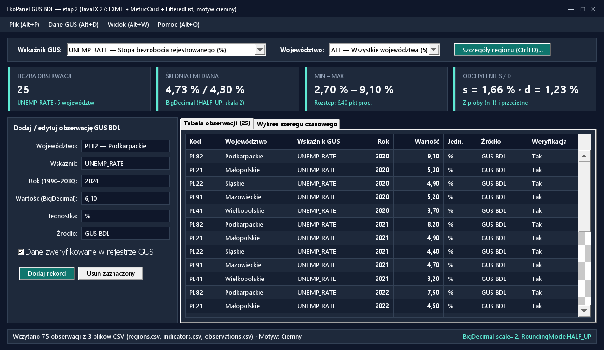

# Lab 2. Przeniesienie aplikacji GUS BDL do JavaFX 27 i FXML

<script id="MathJax-script" async src="https://cdn.jsdelivr.net/npm/mathjax@3/es5/tex-mml-chtml.js"></script>

[Etap 1: Swing](../../lab1/v2/README.html) · [Wyjaśnienia JavaFX (v1)](../v1/README.html) · [Interaktywny poradnik animowany](poradnik.html) · [Etap 3: JDBC](../../lab3/v2/README.html)

Należy wykonywać zadania w podanej kolejności. Wszystkie zadania są wymagane. W tym laboratorium model trzech encji GUS BDL (`Region`, `Indicator`, `Observation`), serwis i czytnik pakietu CSV z Lab 1 otrzymują nowoczesny interfejs **JavaFX 27 + FXML + CSS** z reużywalnym komponentem `MetricCard` (`fx:root`), paskiem `MenuBar`, menu kontekstowym oraz modalnym oknem szczegółów województwa ładowanym z osobnego pliku FXML.

## Zadanie 2.1. Przygotowanie projektu JavaFX 27

1. Skopiować projekt `ekopanel-swing` jako `PO2-EkoPanel/ekopanel-fx` (przenieść `pom.xml`, `src`, `data` i `docs`, bez `target` oraz `.idea`). Zachować pakiety `model`, `repository`, `service`, `io`, `swing`.
2. W `pom.xml` ustawić `artifactId` na `ekopanel-fx`, zachować **JDK 27 GA** i dodać zależności **JavaFX 27** ([dokumentacja JavaFX 27](https://openjfx.io/javadoc/27/)):

   ```xml
   <dependency>
       <groupId>org.openjfx</groupId>
       <artifactId>javafx-controls</artifactId>
       <version>27</version>
   </dependency>
   <dependency>
       <groupId>org.openjfx</groupId>
       <artifactId>javafx-fxml</artifactId>
       <version>27</version>
   </dependency>
   ```

3. Do `build/plugins` dodać `org.openjfx:javafx-maven-plugin:0.0.8` z `mainClass` ustawionym na `pl.uczelnia.ekopanel.fx.FxApp` oraz opcją `--enable-native-access=javafx.graphics`.
4. Przeładować Maven. Utworzyć pakiet `pl.uczelnia.ekopanel.fx` oraz katalogi `src/main/resources/fxml` i `src/main/resources/css`.

**Wynik:** projekt kompiluje się z JavaFX 27 i współdzieli trójencjowy model GUS BDL z etapem Swing.

## Zadanie 2.2. Ćwiczenie pośrednie z kontenerami JavaFX i główny widok `main-view.fxml`

🎬 **[Otwórz animowaną miniinstrukcję: HBox/VBox (hgrow), FlowPane vs TilePane oraz StackPane](poradnik.html#panes)** · 📚 [Javadoc `javafx.scene.layout`](https://openjfx.io/javadoc/27/javafx.graphics/javafx/scene/layout/package-summary.html)

<details>
<summary><strong>Krótka instrukcja: Dobór kontenerów układu w JavaFX (kliknij, aby rozwinąć)</strong></summary>

- `BorderPane` rozdziela okno na `top` (pasek `MenuBar` i nagłówek), `center` (główna zawartość) i `bottom` (pasek statusu).
- `HBox` i `VBox` układają elementy w wierszu lub kolumnie; dopiero dodanie atrybutu `HBox.hgrow="ALWAYS"` lub `VBox.vgrow="ALWAYS"` na wybranym dziecku przekazuje mu wolne miejsce przy powiększaniu okna.
- `FlowPane` zawija kontrolki o różnych szerokościach, natomiast `TilePane` tworzy kafelki o jednakowym rozmiarze (idealne dla kart KPI).
- `StackPane` układa warstwy jedna na drugiej — pozwala nałożyć `ProgressIndicator` nad tabelą danych bez przesuwania kontrolek, gdy nakładka ma `visible="false" managed="false"`.
</details>

1. Utworzyć klasę `fx/MainController.java` oraz plik `src/main/resources/fxml/main-view.fxml` oparty na `BorderPane`:
   - W `<top>` umieścić `VBox` zawierający `MenuBar` oraz pasek nagłówka z tytułem `EkoPanel — GUS BDL (Rynek pracy, wynagrodzenia i inwestycje)` i kontener `TilePane fx:id="kpiPane" hgap="10" vgap="10" prefColumns="4"`.
   - W `<center>` umieścić `StackPane`:
     - pierwszą warstwą jest `TabPane fx:id="tabs" tabClosingPolicy="UNAVAILABLE"` z trzema zakładkami: `Dane` (`SplitPane fx:id="dataSplit"`), `Wykres` (`VBox fx:id="chartBox" spacing="10"`) oraz `Kalkulator` (`VBox fx:id="calculatorBox" spacing="10"`);
     - drugą warstwą w `StackPane` jest nakładka `VBox fx:id="loadingOverlay" alignment="CENTER" visible="false" managed="false"` z `ProgressIndicator` i etykietą `Przetwarzanie danych GUS…`.
   - W `<bottom>` umieścić `Label fx:id="statusLabel" text="Gotowe." styleClass="status-bar"`.
2. **Ćwiczenie pośrednie z układami w FXML:**
   - W pasku filtra nad tabelą użyć `HBox spacing="8"` z `ComboBox fx:id="filterIndicatorCombo"`, `TextField fx:id="filterField"` i przyciskiem `Import CSV`. Najpierw pominąć `HBox.hgrow="ALWAYS"` na `filterField`, uruchomić okno i poszerzyć je — zaobserwować puste miejsce po prawej stronie. Następnie dodać `HBox.hgrow="ALWAYS"` na `filterField` i sprawdzić, że pole wypełnia wiersz.
   - Dla `kpiPane` porównać zachowanie `FlowPane` i `TilePane` przy zwężeniu okna z `1080 px` do `520 px` — pozostawić `TilePane`, który utrzymuje równą szerokość kafelków.
3. Utworzyć `fx/FxApp extends Application`, załadować `/fxml/main-view.fxml` przez `FXMLLoader`, utworzyć `Scene(root, 1080, 720)`, ustawić minimum `480 × 360` i tytuł `EkoPanel — GUS BDL`.

**Wynik:** okno uruchamia się przez `javafx:run`, a struktura kontenerów pochodzi w całości z pliku FXML.

## Zadanie 2.3. Reużywalny komponent `MetricCard` (`fx:root` + `/fxml/metric-card.fxml`)

🎬 **[Otwórz animowaną miniinstrukcję: Wzorzec fx:root dla komponentu MetricCard](poradnik.html#fxroot)** · 📚 [Wprowadzenie do FXML (`fx:root`)](https://openjfx.io/javadoc/27/javafx.fxml/javafx/fxml/doc-files/introduction_to_fxml.html)

<details>
<summary><strong>Krótka instrukcja: Jak działa konstrukcja fx:root w JavaFX? (kliknij, aby rozwinąć)</strong></summary>

Wzorzec `<fx:root type="javafx.scene.layout.VBox">` pozwala zdefiniować własny komponent JavaFX (`MetricCard extends VBox`), który ładuje swój układ z `/fxml/metric-card.fxml`, ustawiając `loader.setRoot(this)` oraz `loader.setController(this)`. Dzięki temu w `main-view.fxml` można wielokrotnie wstawiać `<MetricCard fx:id="meanCard" title="Średnia"/>` dokładnie tak jak wbudowane kontrolki JavaFX!
</details>

1. Utworzyć plik `src/main/resources/fxml/metric-card.fxml` oparty na korzeniu `<fx:root type="javafx.scene.layout.VBox" xmlns:fx="http://javafx.com/fxml/1" styleClass="metric-card" spacing="4">` zawierający trzy etykiety `Label`: `titleLabel` (`styleClass="metric-title"`), `valueLabel` (`styleClass="metric-value"`, domyślnie `"—"`) oraz `subtitleLabel` (`styleClass="metric-subtitle"`).
2. Utworzyć klasę `fx/MetricCard extends VBox`:
   - W konstruktorze załadować `/fxml/metric-card.fxml` przez `FXMLLoader` z ustawionym `setRoot(this)` oraz `setController(this)`.
   - Zdefiniować właściwość `StringProperty title` (metody `getTitle()`, `setTitle(String)`, `titleProperty()`) powiązaną z `titleLabel.textProperty()` oraz metodę `public void setMetric(String valueText, String subtitleText)`.
3. W `main-view.fxml` zaimportować `pl.uczelnia.ekopanel.fx.MetricCard` i wewnątrz `TilePane fx:id="kpiPane"` umieścić **cztery instancje** odpowiadające liczbie obserwacji, średniej ($\bar{x}$), medianie ($Me$) oraz odchyleniu ($s$ / $d$).
4. **Sprawdzenie komponentu na warunkach brzegowych:** wywołać na karcie `setMetric("—", "Brak danych")` dla pustego filtra (np. wpisując w `filterField` ciąg `xyz`) oraz sprawdzić zachowanie długiego napisu `6 562,80 PLN` przy zwężeniu okna do `480 px` — karty w `TilePane` mają zawijać się do dwóch wierszy bez ucinania liczb.

**Wynik:** cztery karty KPI w nagłówku są instancjami jednego reużywalnego komponentu FXML.

## Zadanie 2.4. Formularz `GridPane`, `TableView` oraz rozbudowane `MenuBar` i `ContextMenu`

📚 [Javadoc `MenuBar`](https://openjfx.io/javadoc/27/javafx.controls/javafx/scene/control/MenuBar.html) · [Javadoc `TableView`](https://openjfx.io/javadoc/27/javafx.controls/javafx/scene/control/TableView.html)

1. W `main-view.fxml` rozbudować `MenuBar` o cztery menu z mnemonikami (`mnemonicParsing="true"`, znak `_` przed literą) i akceleratorami:
   - `_Plik`: `Importuj pakiet GUS CSV…` (`accelerator="Shortcut+O"`), `Nowa obserwacja` (`Shortcut+N`), `Zapisz` (`Shortcut+S`), `SeparatorMenuItem`, `Zakończ` (`Shortcut+Q`).
   - `_Widok`: `Zakładka Dane` (`Shortcut+DIGIT1`), `Zakładka Wykres` (`Shortcut+DIGIT2`), `Zakładka Kalkulator` (`Shortcut+DIGIT3`), `SeparatorMenuItem`, `Szczegóły wybranego regionu…` (`Shortcut+I`).
   - `_Motyw`: trzy `RadioMenuItem` w jednej `ToggleGroup`: `Systemowy`, `Jasny`, `Ciemny`.
   - `P_omoc`: `O programie EkoPanel`.
2. W lewej części `dataSplit` umieścić `ScrollPane fitToWidth="true"` z formularzem `GridPane hgap="8" vgap="8"` (druga kolumna `hgrow="ALWAYS"`):
   - Wiersz 0: `Label text="_Rok"` + `TextField fx:id="yearField" text="2025"`
   - Wiersz 1: `Label text="_Województwo"` + `ComboBox fx:id="regionCombo" maxWidth="Infinity"`
   - Wiersz 2: `Label text="W_skaźnik GUS"` + `ComboBox fx:id="indicatorCombo" maxWidth="Infinity"`
   - Wiersz 3: `Label text="W_artość"` + `TextField fx:id="valueField" text="5,80"`
   - Wiersz 4: `CheckBox fx:id="includedBox" text="Uwzględnij w analizie" selected="true"`
   - Pod siatką `FlowPane hgap="8" vgap="8"` z przyciskami `Nowa`, `Zapisz`, `Usuń` oraz `Szczegóły regionu…`.
3. W prawej części `dataSplit` umieścić pasek filtrów (`filterIndicatorCombo`, `filterField`, `importButton`) oraz `TableView fx:id="table" VBox.vgrow="ALWAYS"` z kolumnami: `Rok`, `Kod reg.`, `Województwo`, `Wskaźnik`, `Wartość`, `Jedn.`, `Analiza`.
4. Dodać do `table` menu kontekstowe `ContextMenu` (`Edytuj w formularzu`, `Szczegóły regionu…`, `Pokaż na wykresie`, `Usuń`).

**Wynik:** formularz i tabela obsługują trzy encje GUS BDL, a wszystkie operacje są dostępne z paska `MenuBar`, skrótów klawiszowych oraz `ContextMenu`.

## Zadanie 2.5. Łańcuch `ObservableList` → `FilteredList` → `SortedList` i CRUD

🎬 **[Otwórz animowaną miniinstrukcję: Przepływ danych przez FilteredList i SortedList](poradnik.html#lists)**

1. W `MainController` utworzyć `ObservableList<Observation> masterRows = FXCollections.observableArrayList()`, `FilteredList<Observation> filtered = new FilteredList<>(masterRows, r -> true)` oraz `SortedList<Observation> sorted = new SortedList<>(filtered)`.
2. Powiązać `sorted.comparatorProperty().bind(table.comparatorProperty())` i przypisać `table.setItems(sorted)`.
3. Skonfigurować fabryki komórek: nazwę województwa i jednostkę wskaźnika wyznaczać ze słowników pobranych z `ObservationService`, a kolumnę `Wartość` (`TableColumn<Observation, BigDecimal>`) formatować własną `TableCell` do dwóch miejsc po przecinku w `pl-PL`.
4. Ustawić predykat `filtered` aktualizowany przy zmianie `filterIndicatorCombo` lub `filterField.textProperty()`. Po każdej zmianie danych lub filtra wywoływać `refreshSummary()` (aktualizujące 4 komponenty `MetricCard` na podstawie `StatisticsService` operującego na `BigDecimal`: $\bar{x} = \frac{1}{n}\sum_{i=1}^n x_i$, mediana $Me$, $s = \sqrt{\frac{1}{n-1}\sum_{i=1}^n (x_i - \bar{x})^2}$ oraz $d = \frac{1}{n}\sum_{i=1}^n |x_i - \bar{x}|$) oraz `refreshChart()`.
5. Powiązać `deleteButton.disableProperty().bind(table.getSelectionModel().selectedItemProperty().isNull())`. Podpiąć `onNew()`, `onSave()` i `onDelete()` (z `Alert(AlertType.CONFIRMATION)` i `initOwner`).
6. Włączyć edycję w miejscu (`table.setEditable(true)`) dla kolumny `Wartość` lub `Uwzględnij w analizie` i zapisywać zmianę przez `service.save(...)`.

**Wynik:** filtrowanie po wskaźniku `UNEMP_RATE` dla załadowanego pakietu 75 obserwacji pokazuje 25 wierszy w tabeli i wartości `N = 25`, `4,73 %`, `4,30 %`, `1,66 p.p. (d = 1,23 p.p.)` na kartach `MetricCard`; przełączenie na `AVG_WAGE` zmienia karty na `N = 25`, `6 562,80 PLN`, `6 490,00 PLN`, `1 298,97 PLN (d = 1 046,91 PLN)`.



## Zadanie 2.6. Drugie okno `Stage` ładowane z `/fxml/region-details.fxml`

🎬 **[Otwórz animowaną miniinstrukcję: Otwieranie modalnego okna Stage z osobnego FXML](poradnik.html#windows)** · 📚 [Javadoc `Stage`](https://openjfx.io/javadoc/27/javafx.graphics/javafx/stage/Stage.html)

1. Utworzyć plik `src/main/resources/fxml/region-details.fxml` z kontrolerem `fx/RegionDetailsController`:
   - W górnej części umieścić nagłówek z kodem, nazwą i makroregionem województwa oraz 3 instancje reużywalnego komponentu `<MetricCard>` (prezentujące ostatnie wartości 2024 dla `UNEMP_RATE`, `AVG_WAGE` i `INV_PER_CAPITA`).
   - W środkowej części umieścić `TableView` porównujące statystyki 5-letnie (2020–2024) wszystkich trzech wskaźników GUS dla tego województwa.
   - W dolnej części umieścić przycisk `Zamknij` (`cancelButton="true"`, reagujący na `Escape`).
2. W `MainController.onShowRegionDetails()` załadować `/fxml/region-details.fxml` przez `FXMLLoader`, przekazać dane wybranego `Region` do `RegionDetailsController`, utworzyć nowy `Stage`, ustawić `initOwner(root.getScene().getWindow())`, `initModality(Modality.WINDOW_MODAL)`, przypisać aktywne arkusze CSS motywu do nowej sceny i wywołać `showAndWait()`.

**Wynik:** aplikacja wykorzystuje dwa niezależne widoki FXML i dwa kontrolery oraz reużywa komponent `MetricCard` w obu oknach.



## Zadanie 2.7. Asynchroniczny import w `Task`, wykres wieloseryjny `LineChart` i kalkulator

1. W `onImport()` uruchamiać `Task<Void>` w wątku daemonowym: w `call()` wczytać pliki przez `GusCsvPackageReader`, a w `setOnSucceeded` zaktualizować `service.replaceDataset(...)` i odświeżyć widok. Na czas pracy pokazywać warstwę `loadingOverlay` w `StackPane` (`visible=true`, `managed=true`).
2. W zakładce `Wykres` dodać `ComboBox fx:id="chartIndicatorCombo"` oraz `LineChart<Number, Number> fx:id="rateChart" animated="false"`. Dla wybranego wskaźnika GUS rysować osobne serie `XYChart.Series` dla każdego województwa widocznego w bieżącym filtrze; podpis osi Y aktualizować wraz z jednostką wskaźnika (`Wartość [%]` lub `Wartość [PLN]`).
3. W zakładce `Kalkulator` podpiąć `ChangeCalculator` z Lab 1 do pól `startRateField` i `endRateField`.

**Wynik:** import 75 rekordów oraz 3 plików z błędami w wierszu 77 działa bez blokowania wątku JavaFX, a wykres porównuje województwa dla wybranego wskaźnika GUS.

## Zadanie 2.8. Responsywność (`SplitPane`), arkusze CSS i 3 tryby motywu (`SYSTEM`, `LIGHT`, `DARK`)

1. Skopiować [base.css](../v1/projekt-startowy/src/main/resources/css/base.css), [light.css](../v1/projekt-startowy/src/main/resources/css/light.css) i [dark.css](../v1/projekt-startowy/src/main/resources/css/dark.css) do `src/main/resources/css/`. Dodać reguły `.metric-card`, `.metric-title`, `.metric-value`, `.metric-subtitle` z akcentem `#0F766E` (jasny) i `#5EEAD4` (ciemny).
2. W `MainController.initialize()` nasłuchiwać `root.widthProperty()`: poniżej `760 px` przełączać `dataSplit` na `Orientation.VERTICAL` (dzielnik `0.45`), a od `760 px` na `Orientation.HORIZONTAL` (dzielnik `0.32`).
3. Zaimplementować `fx/ThemeManager` wykorzystujący [`Platform.getPreferences().colorSchemeProperty()`](https://openjfx.io/javadoc/27/javafx.graphics/javafx/application/Platform.Preferences.html) dla trybu `SYSTEM` oraz zapis w `Preferences`. Aktualizować arkusze CSS zarówno głównej sceny, jak i otwartych okien `Stage` / `Alert`.
4. Wykonać [macierz 12 prób DPI i motywów](../../jakosc-gui.html) oraz zapisać wnioski w `docs/lab2.md`.



**Do oddania:** projekt `ekopanel-fx`, pliki `main-view.fxml`, `metric-card.fxml`, `region-details.fxml`, arkusze CSS, dane GUS BDL, `docs/lab2.md` i zrzuty ekranu.
