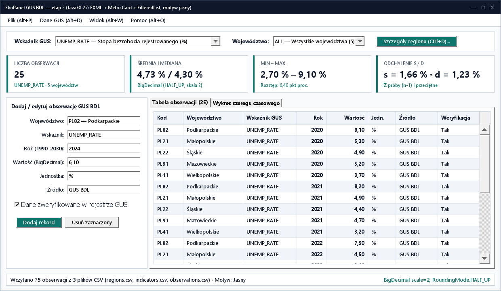
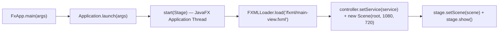
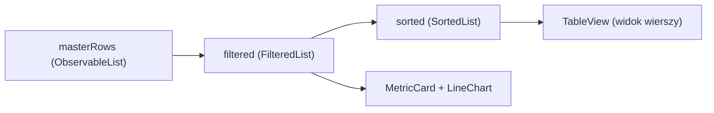
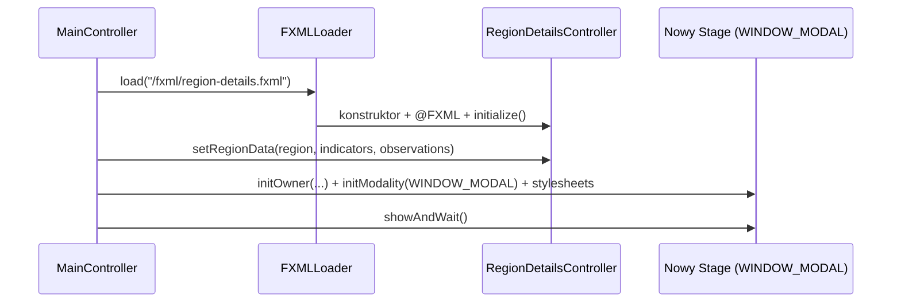
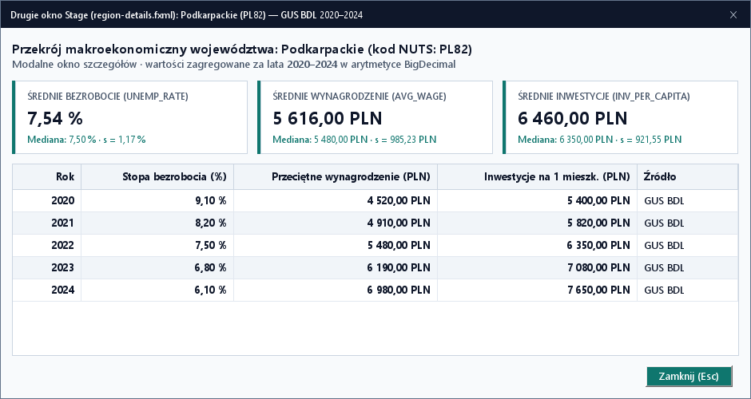
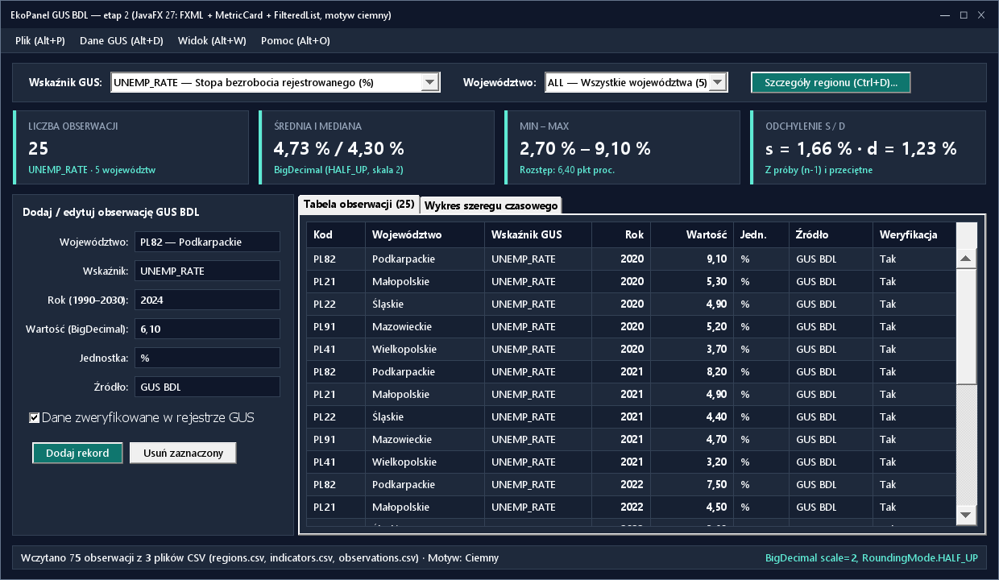

# Lab 2. Przeniesienie aplikacji GUS BDL do JavaFX 27 i FXML


[Etap 1: Swing](../../lab1/v2/README.html) · [Wyjaśnienia JavaFX (v1)](../v1/README.html) · [Interaktywny poradnik animowany](poradnik.html) · [Punkt startowy Lab 2 (ZIP)](projekt-startowy.zip) · [Etap 3: JDBC](../../lab3/v2/README.html)

Należy wykonywać zadania w podanej kolejności. Wszystkie zadania są wymagane. W tym laboratorium model trzech encji GUS BDL (`Region`, `Indicator`, `Observation`), serwis i czytnik pakietu CSV z Lab 1 otrzymują nowoczesny interfejs **JavaFX 27 + FXML + CSS** z reużywalnym komponentem `MetricCard` (`fx:root`), paskiem `MenuBar`, menu kontekstowym oraz modalnym oknem szczegółów województwa ładowanym z osobnego pliku FXML.

**Trzy główne efekty nauki w tym laboratorium:**
1. **Deklaratywna budowa widoków w FXML:** tworzenie układu głównego okna (`main-view.fxml`), reużywalnego komponentu karty wskaźnika (`metric-card.fxml` z `fx:root`) oraz drugiego modalnego okna (`region-details.fxml`).
2. **Powiązanie interfejsu JavaFX z modelem danych z Lab 1:** obsługa tabeli `TableView`, łańcucha `ObservableList` → `FilteredList` → `SortedList`, operacji CRUD, miar statystycznych na `BigDecimal`, wykresu `LineChart` oraz wielowątkowego importu CSV w klasie `Task`.
3. **Adaptacyjny układ, motywy CSS i skalowanie HiDPI:** dynamiczne przełączanie orientacji `SplitPane` przy zmianie szerokości okna, stylizacja arkuszami CSS oraz obsługa trzech trybów motywu (`SYSTEM`, `LIGHT`, `DARK`) z zapisem preferencji.

**Środowisko pracy:** **IntelliJ IDEA 2026.3** (stabilne wydanie GA, bez wersji EAP), **JDK 27 GA** (poziom języka 27 bez *preview*), **JavaFX 27** oraz Maven — szczegóły w [konfiguracji środowiska](../../srodowisko.html). Każdy krok w instrukcji wskazuje kolejno: **plik → miejsce w pliku → czynność (`dopisać` lub `zastąpić`) → widoczny wynik po kompilacji lub uruchomieniu**.

<figure class="image-example" markdown="1">
  
  <figcaption>Docelowy wygląd aplikacji EkoPanel w JavaFX 27 (motyw jasny) z kartami MetricCard, formularzem i tabelą danych GUS BDL.</figcaption>
</figure>

<details markdown="1">
<summary><strong>Czym różni się architektura JavaFX od biblioteki Swing?</strong></summary>

Biblioteka Swing jest wbudowana w standardowe JDK (`javax.swing`), buduje widoki imperatywnie w kodzie Javy i deleguje rozmieszczanie komponentów do osobnych obiektów `LayoutManager`. **JavaFX** (rozwijane w projekcie OpenJFX) stanowi odrębną platformę graficzną dołączaną jako zależność Maven i wprowadza cztery zmiany architektoniczne:

| Zagadnienie | Swing (Lab 1) | JavaFX 27 (Lab 2) |
|---|---|---|
| Hierarchia okna | `JFrame` → `contentPane` (`JPanel`) → komponenty `JComponent` | `Application` → `Stage` (okno) → `Scene` (scena) → drzewo węzłów `Node` (*graf sceny*) |
| Budowa widoku | Imperatywnie w konstruktorze klasy Javy | Deklaratywnie w plikach XML (**FXML**) powiązanych z klasą kontrolera (`@FXML`) |
| Odświeżanie stanu | Ręczne wywołania setterów, `AbstractTableModel.fireTableDataChanged()`, `repaint()` | Właściwości obserwowalne (*JavaFX Properties*), wiązania `bind(...)` oraz kolekcje `ObservableList` |
| Stylizacja i wątek GUI | Klasy `UIManager` / FlatLaf; wątek **EDT** (`SwingUtilities.invokeLater` + `SwingWorker`) | Kaskadowe arkusze stylów **JavaFX CSS** (`.css`); **JavaFX Application Thread** (`Platform.runLater` + `Task`) |

Dzięki rozdzieleniu warstwy modelu (`model`, `repository`, `service`, `io`) od warstwy widoku wszystkie rekordy domenowe operujące na `BigDecimal`, walidator, serwis statystyczny oraz czytnik plików CSV z Lab 1 pozostają bez zmian i są bezpośrednio wykorzystywane przez kontrolery JavaFX.

</details>

## Zadanie 2.1. Przygotowanie projektu JavaFX 27

1. **Kopiowanie projektu z Lab 1 (lub pobranie gotowego punktu startowego):**
   - W Eksploratorze plików utworzyć folder `PO2-EkoPanel/ekopanel-fx` i skopiować do niego z własnego projektu `ekopanel-swing` plik `pom.xml` oraz katalogi `src` i `data` (**pominąć** foldery `target` oraz `.idea`). Utworzyć pusty podkatalog `PO2-EkoPanel/ekopanel-fx/docs` (jeśli jeszcze nie istnieje).
   - **Dla osób, którym projekt z Lab 1 nie uruchamia się lub ma zaległości:** pobrać gotowe archiwum [projekt-startowy.zip](projekt-startowy.zip) (zawierające kompletny, działający model 3 encji, repozytorium pamięciowe, walidator, serwis statystyczny, kalkulator dynamiki, czytnik pakietu CSV, `pom.xml` oraz dane w `data/`), rozpakować jego zawartość bezpośrednio do `PO2-EkoPanel/ekopanel-fx` i przejść od razu do otwarcia `pom.xml` poniżej.
   - Otworzyć w IntelliJ IDEA plik `PO2-EkoPanel/ekopanel-fx/pom.xml` jako osobny projekt (**File → Open… → wskazać `ekopanel-fx/pom.xml` → Open as Project**) i upewnić się, że w projekcie znajdują się następujące klasy i pliki:
     - `pl.uczelnia.ekopanel.model`: `Region.java`, `Indicator.java`, `Observation.java`, `Statistics.java`;
     - `pl.uczelnia.ekopanel.repository`: `ObservationRepository.java`, `MemoryObservationRepository.java`;
     - `pl.uczelnia.ekopanel.service`: `Numbers.java`, `ObservationValidator.java`, `ObservationService.java`, `StatisticsService.java`, `ChangeCalculator.java`;
     - `pl.uczelnia.ekopanel.io`: `GusCsvPackageReader.java`;
     - katalog `data/`: 6 plików CSV (`regions.csv`, `indicators.csv`, `observations.csv`, `observations-bledne.csv`, `observations-duplikat.csv`, `observations-brak-klucza.csv`).

   <details markdown="1">
   <summary><strong>Rola pomijanych folderów target oraz .idea i obsługa pakietu swing z własnej kopii</strong></summary>

   - **Dlaczego pomija się `target` oraz `.idea`?** Katalog `target` zawiera skompilowane pliki `.class` poprzedniego etapu, natomiast ukryty katalog `.idea` przechowuje konfigurację IDE powiązaną ze ścieżką `ekopanel-swing`.
   - **Co z pakietem `swing` przy kopiowaniu własnego projektu?** Nowy interfejs JavaFX nie wywołuje żadnej klasy z pakietu `swing`. Jeżeli we własnym `ekopanel-swing` klasy okienkowe kompilują się poprawnie, można je zachować wraz z zależnościami `flatlaf` i `jSystemThemeDetector` w `pom.xml`; jeżeli w pakiecie `swing` występują błędy kompilacji, zawartość pakietu `swing` w `ekopanel-fx` można usunąć lub skorzystać z gotowego [projekt-startowy.zip](projekt-startowy.zip).

   </details>

2. **Dodanie bibliotek JavaFX 27 w `pom.xml`:**
   - **Plik:** `ekopanel-fx/pom.xml` → znacznik `<artifactId>`: **zastąpić** dotychczasową nazwę wartością `ekopanel-fx` (zachowując `<maven.compiler.release>27</maven.compiler.release>`).
   - **Plik:** `ekopanel-fx/pom.xml` → wewnątrz istniejącej sekcji `<dependencies>` (pod dotychczasowymi zależnościami, przed `</dependencies>`): **dopisać** dwa moduły **JavaFX 27** ([dokumentacja JavaFX 27](https://openjfx.io/javadoc/27/)):

     <figure class="code-example" markdown="1">
     <figcaption>ekopanel-fx/pom.xml — fragment dopisywany wewnątrz istniejącego &lt;dependencies&gt;</figcaption>

     ```xml
     <dependency>
         <groupId>org.openjfx</groupId>
         <artifactId>javafx-controls</artifactId>
         <version>27</version>
     </dependency>
     <dependency>
         <groupId>org.openjfx</groupId>
         <artifactId>javafx-fxml</artifactId>
         <version>27</version>
     </dependency>
     ```

     </figure>

   <details markdown="1">
   <summary><strong>Moduły JavaFX w Mavenie i zakaz tworzenia module-info.java</strong></summary>

   Artefakt `javafx-controls` dostarcza kontrolki i wykresy (oraz automatycznie dociąga `javafx-base` i `javafx-graphics`), natomiast `javafx-fxml` udostępnia `FXMLLoader` i `@FXML`. W projekcie **nie należy tworzyć pliku `module-info.java`** — praca na ścieżce klas (*classpath*) z wtyczką `javafx-maven-plugin` pozwala `FXMLLoader` wstrzykiwać prywatne pola kontrolerów bez dodatkowych deklaracji `opens`.

   </details>

3. **Konfiguracja wtyczki `javafx-maven-plugin` w `pom.xml`:**
   - **Plik:** `ekopanel-fx/pom.xml` → wewnątrz **istniejącej** sekcji `<build><plugins>` (bezpośrednio pod istniejącym wpisem `<plugin>` dla `maven-compiler-plugin`, przed `</plugins>` — nie tworzyć drugiego znacznika `<build>`!): **dopisać** blok `<plugin>`:

     <figure class="code-example" markdown="1">
     <figcaption>ekopanel-fx/pom.xml — blok dopisywany wewnątrz istniejącego &lt;build&gt;&lt;plugins&gt;</figcaption>

     ```xml
     <plugin>
         <groupId>org.openjfx</groupId>
         <artifactId>javafx-maven-plugin</artifactId>
         <version>0.0.8</version>
         <configuration>
             <mainClass>pl.uczelnia.ekopanel.fx.FxApp</mainClass>
             <options>
                 <option>--enable-native-access=javafx.graphics</option>
             </options>
         </configuration>
     </plugin>
     ```

     </figure>

   <details markdown="1">
   <summary><strong>Dlaczego aplikację JavaFX uruchamia się przez javafx:run zamiast zielonej strzałki przy main()?</strong></summary>

   Opcja `--enable-native-access=javafx.graphics` nadaje silnikowi graficznemu JavaFX uprawnienia do wywołań natywnych wymagane w JDK 27. Uruchomienie klasy `Application` zieloną strzałką przy `main()` pomija konfigurację modułów wtyczki i kończy się błędem `Error: JavaFX runtime components are missing, and are required to run this application`. Dlatego od Zadania 2.2 aplikację należy uruchamiać wyłącznie z panelu **Maven → Plugins → javafx → `javafx:run`**.

   </details>

4. **Utworzenie pakietu `fx`, katalogów zasobów i sprawdzenie kompilacji Maven:**
   - W `src/main/java/pl/uczelnia/ekopanel` utworzyć nowy pakiet `fx` (**New → Package** → `pl.uczelnia.ekopanel.fx`).
   - Utworzyć katalogi zasobów `src/main/resources/fxml` oraz `src/main/resources/css` (jeśli w `src/main` brakuje katalogu `resources`: prawy przycisk myszy na `src/main` → **New → Directory** → wybrać `resources`, a wewnątrz utworzyć podkatalogi `fxml` i `css`).

     <figure class="code-example" markdown="1">
     <figcaption>Oczekiwane drzewo katalogów projektu PO2-EkoPanel/ekopanel-fx po Zadaniu 2.1</figcaption>

     ```text
     PO2-EkoPanel/ekopanel-fx/
     ├── pom.xml
     ├── data/
     │   ├── indicators.csv
     │   ├── observations.csv
     │   ├── observations-bledne.csv
     │   ├── observations-brak-klucza.csv
     │   ├── observations-duplikat.csv
     │   └── regions.csv
     ├── docs/
     └── src/main/
         ├── java/pl/uczelnia/ekopanel/
         │   ├── fx/          ← nowy pakiet na klasy JavaFX i kontrolery
         │   ├── io/
         │   ├── model/
         │   ├── repository/
         │   ├── service/
         │   └── swing/       ← opcjonalnie zachowany pakiet z Lab 1
         └── resources/
             ├── css/         ← arkusze stylów (.css)
             └── fxml/        ← deklaratywne widoki (.fxml)
     ```

     </figure>

   <details markdown="1">
   <summary><strong>Znaczenie wiodącego ukośnika / przy ładowaniu plików z src/main/resources</strong></summary>

   Maven kopiuje zawartość `src/main/resources` bezpośrednio do głównego katalogu klas `target/classes`. Ścieżka z wiodącym ukośnikiem w `getClass().getResource("/fxml/main-view.fxml")` oznacza wyszukiwanie od korzenia `src/main/resources`. Pominięcie ukośnika (`"fxml/main-view.fxml"`) szukałoby pliku wewnątrz pakietu `pl/uczelnia/ekopanel/fx/` i zgłosiło wyjątek `IllegalStateException: Location is not set`.

   </details>

   - **Sprawdzenie Zadania 2.1:** kliknąć ikonę **Reload All Maven Projects** w prawym panelu **Maven**, a następnie rozwinąć **`ekopanel-fx` → Lifecycle** i kliknąć dwukrotnie **`compile`** (nie uruchamiać jeszcze `javafx:run`, ponieważ klasa `FxApp` powstanie w Zadaniu 2.2). W dolnym oknie **Run** musi pojawić się komunikat **`BUILD SUCCESS`**, a w drzewie **External Libraries** muszą być widoczne pakiety `org.openjfx:javafx-controls:27` oraz `org.openjfx:javafx-fxml:27`.

**Wynik:** projekt buduje się z JavaFX 27 (`BUILD SUCCESS`) i współdzieli trójencjowy model GUS BDL z etapem z Lab 1.

## Zadanie 2.2. Ćwiczenie pośrednie z kontenerami JavaFX i główny widok `main-view.fxml`

🎬 **[Otwórz animowaną miniinstrukcję: HBox/VBox (hgrow), FlowPane vs TilePane oraz StackPane](poradnik.html#panes)** · 📚 [Javadoc `javafx.scene.layout`](https://openjfx.io/javadoc/27/javafx.graphics/javafx/scene/layout/package-summary.html)

<details markdown="1">
<summary><strong>Dobór kontenerów układu, cykl życia Application i działanie FXMLLoader</strong></summary>

W JavaFX okno systemowe (`Stage`) oraz jego zawartość (`Scene`) są rozdzielone, a kontenery układu (`BorderPane`, `VBox`, `HBox`, `TilePane`, `StackPane`, `TabPane`) dziedziczą po `javafx.scene.Node` i tworzą drzewo zwane **grafem sceny**:



- **Rola głównych kontenerów układu:**
  - `BorderPane` dzieli okno na strefy `top` (menu i nagłówek), `center` (obszar roboczy) oraz `bottom` (pasek statusu).
  - `HBox` i `VBox` układają dzieci w wierszu lub kolumnie; dopiero dodanie atrybutu `HBox.hgrow="ALWAYS"` (lub `VBox.vgrow="ALWAYS"`) przekazuje wybranemu dziecku wolną przestrzeń przy powiększaniu okna (dla kontrolek takich jak `ComboBox` należy dodatkowo ustawić `maxWidth="Infinity"`).
  - `FlowPane` zawija elementy o różnych szerokościach, natomiast `TilePane` nadaje wszystkim komórkom jednakowy rozmiar kafelka.
  - `StackPane` układa warstwy jedna na drugiej — pozwala nałożyć `ProgressIndicator` nad zakładkami bez przesuwania kontrolek, gdy nieaktywna nakładka ma `visible="false" managed="false"`.
- **Składnia FXML i kolejność inicjalizacji kontrolera:**
  - Znaczniki z **wielkiej litery** tworzą obiekty klas zaimportowanych przez `<?import ...?>` (`<BorderPane>`, `<VBox>`, `<Label>`), natomiast znaczniki z **małej litery** wskazują właściwości rodzica (`<top>`, `<center>`, `<bottom>`, `<tabs>`, `<content>`).
  - Atrybut `fx:controller` wskazuje klasę kontrolera, `fx:id="statusLabel"` wstrzykuje utworzoną kontrolkę do pola `@FXML private Label statusLabel;`, a `onAction="#metoda"` podpina zdarzenie kliknięcia do metody `@FXML`.
  - Podczas `loader.load()` najpierw wykonywany jest konstruktor kontrolera (pola `@FXML` mają w nim jeszcze wartość `null`), następnie wstrzykiwane są pola `@FXML` i wywoływana jest metoda `@FXML private void initialize()`. Serwis domenowy przekazuje się z `FxApp` **dopiero po `loader.load()`** przez `controller.setService(service)`.

</details>

Widok główny należy zbudować w czterech małych etapach, uruchamiając aplikację po każdym z nich.

1. **Etap 1 — minimalne okno startowe i przekazanie serwisu (`MainController`, `main-view.fxml`, `FxApp`):**
   - **Plik:** `src/main/java/pl/uczelnia/ekopanel/fx/MainController.java` — utworzyć nową klasę kontrolera z pierwszymi polami widoku i metodą odbierającą `ObservationService`:

     <figure class="code-example" markdown="1">
     <figcaption>src/main/java/pl/uczelnia/ekopanel/fx/MainController.java (nowy plik)</figcaption>

     ```java
     package pl.uczelnia.ekopanel.fx;

     import javafx.fxml.FXML;
     import javafx.scene.control.Label;
     import javafx.scene.layout.BorderPane;
     import pl.uczelnia.ekopanel.service.ObservationService;

     public class MainController {
         @FXML private BorderPane root;
         @FXML private Label statusLabel;

         private ObservationService service;

         public void setService(ObservationService service) {
             this.service = service;
             statusLabel.setText("Gotowe. Słowniki: " + service.findAllRegions().size()
                     + " regionów, " + service.findAllIndicators().size() + " wskaźniki.");
         }
     }
     ```

     </figure>

   - **Plik:** `src/main/resources/fxml/main-view.fxml` — utworzyć nowy plik XML ze szkieletem `BorderPane`:

     <figure class="code-example" markdown="1">
     <figcaption>src/main/resources/fxml/main-view.fxml (nowy plik)</figcaption>

     ```xml
     <?xml version="1.0" encoding="UTF-8"?>
     <?import javafx.geometry.Insets?>
     <?import javafx.scene.control.*?>
     <?import javafx.scene.layout.*?>

     <BorderPane fx:id="root" xmlns="http://javafx.com/javafx/27"
                 xmlns:fx="http://javafx.com/fxml/1"
                 fx:controller="pl.uczelnia.ekopanel.fx.MainController"
                 styleClass="app-root">
         <top>
             <VBox spacing="8">
                 <padding><Insets top="12" right="16" bottom="8" left="16"/></padding>
                 <Label text="EkoPanel — GUS BDL (Rynek pracy, wynagrodzenia i inwestycje)"
                        styleClass="page-title"/>
             </VBox>
         </top>
         <bottom>
             <Label fx:id="statusLabel" text="Gotowe." maxWidth="Infinity" styleClass="status-bar"/>
         </bottom>
     </BorderPane>
     ```

     </figure>

   - **Plik:** `src/main/java/pl/uczelnia/ekopanel/fx/FxApp.java` — utworzyć klasę startową dziedziczącą po `Application`:

     <figure class="code-example" markdown="1">
     <figcaption>src/main/java/pl/uczelnia/ekopanel/fx/FxApp.java (nowy plik)</figcaption>

     ```java
     package pl.uczelnia.ekopanel.fx;

     import javafx.application.Application;
     import javafx.fxml.FXMLLoader;
     import javafx.scene.Parent;
     import javafx.scene.Scene;
     import javafx.stage.Stage;
     import pl.uczelnia.ekopanel.repository.MemoryObservationRepository;
     import pl.uczelnia.ekopanel.service.ObservationService;

     public class FxApp extends Application {
         @Override
         public void start(Stage stage) throws Exception {
             FXMLLoader loader = new FXMLLoader(getClass().getResource("/fxml/main-view.fxml"));
             Parent root = loader.load();

             ObservationService service = new ObservationService(new MemoryObservationRepository());
             MainController controller = loader.getController();
             controller.setService(service);

             Scene scene = new Scene(root, 1080, 720);
             stage.setTitle("EkoPanel — GUS BDL");
             stage.setMinWidth(480);
             stage.setMinHeight(360);
             stage.setScene(scene);
             stage.show();
         }

         public static void main(String[] args) {
             launch(args);
         }
     }
     ```

     </figure>

   - **Sprawdzenie etapu 1:** w prawym panelu **Maven** rozwinąć **`ekopanel-fx` → Plugins → javafx** i kliknąć dwukrotnie **`javafx:run`**. Otwiera się okno o rozmiarze `1080 × 720` z tytułem paska okna `EkoPanel — GUS BDL`, nagłówkiem `EkoPanel — GUS BDL (Rynek pracy, wynagrodzenia i inwestycje)` u góry, pustym środkiem oraz napisem `Gotowe. Słowniki: 5 regionów, 3 wskaźniki.` na dolnym pasku statusu.

2. **Etap 2 — ćwiczenie łączące FXML z Javą (`fx:id`, `@FXML`, `onAction`) oraz porównanie `FlowPane` i `TilePane`:**
   - **Ćwiczenie z `onAction`:**
     - **Plik:** `src/main/resources/fxml/main-view.fxml` → wewnątrz `<VBox spacing="8">` w `<top>`: zmienić tymczasowo tekst etykiety tytułu na `"EkoPanel — test FXML"`, a bezpośrednio pod nią **dopisać** przycisk `<Button text="Sprawdź połączenie FXML" onAction="#onTestFxml"/>`.
     - **Plik:** `MainController.java` → wewnątrz klasy `MainController`: **dopisać** metodę `@FXML private void onTestFxml() { statusLabel.setText("FXML działa"); }`.
     - Uruchomić `javafx:run`: w nagłówku widoczny jest zmieniony tekst `"EkoPanel — test FXML"`, a kliknięcie przycisku zmienia tekst dolnego paska statusu na **`FXML działa`**.
   - **Docelowy nagłówek i porównanie `FlowPane` z `TilePane`:**
     - **Plik:** `MainController.java` → **usunąć** próbną metodę `onTestFxml()`, a pod polem `statusLabel` **dopisać** pola `@FXML private MenuBar menuBar;` oraz `@FXML private TilePane kpiPane;` (importując `javafx.scene.control.MenuBar` i `javafx.scene.layout.TilePane`).
     - **Plik:** `src/main/resources/fxml/main-view.fxml` → **zastąpić** całą sekcję `<top>...</top>` poniższym układem z paskiem `MenuBar` i czterema kafelkami próbnymi (najpierw tymczasowo użyć `FlowPane` bez `fx:id`, a po sprawdzeniu zamienić go na `TilePane` jak poniżej):

       <figure class="code-example" markdown="1">
       <figcaption>Sekcja &lt;top&gt; w src/main/resources/fxml/main-view.fxml (zastąpić dotychczasowe &lt;top&gt;)</figcaption>

       ```xml
       <top>
           <VBox>
               <MenuBar fx:id="menuBar"/>
               <VBox spacing="8">
                   <padding><Insets top="8" right="16" bottom="8" left="16"/></padding>
                   <Label text="EkoPanel — GUS BDL (Rynek pracy, wynagrodzenia i inwestycje)"
                          styleClass="page-title"/>
                   <TilePane fx:id="kpiPane" hgap="10" vgap="10" prefColumns="4" tileAlignment="TOP_LEFT">
                       <Label text="Liczba: 25"/>
                       <Label text="Średnia: 6 562,80 PLN"/>
                       <Label text="Mediana: 6 490,00 PLN"/>
                       <Label text="Odchylenie: 1 298,97 PLN (d = 1 046,91 PLN)"/>
                   </TilePane>
               </VBox>
           </VBox>
       </top>
       ```

       </figure>

     - Dla porównania najpierw zmienić znacznik `TilePane` na `<FlowPane hgap="10" vgap="10">...</FlowPane>`, uruchomić `javafx:run` i zwęzić okno z `1080 px` do `520 px` (elementy mają nierówne szerokości zależne od napisu), a następnie przywrócić `<TilePane fx:id="kpiPane" ...>` z listingu powyżej.
   - **Sprawdzenie etapu 2:** po uruchomieniu `javafx:run` z `TilePane` wszystkie cztery elementy zajmują kafelki o jednakowej szerokości i przy zwężeniu okna do `520 px` zawijają się w równą siatkę.

3. **Etap 3 — część centralna `StackPane`, trzy zakładki `TabPane` i ukryta nakładka `loadingOverlay`:**
   - **Plik:** `src/main/resources/fxml/main-view.fxml` → pomiędzy `</top>` a `<bottom>`: **dopisać** sekcję `<center>`:

     <figure class="code-example" markdown="1">
     <figcaption>Sekcja &lt;center&gt; dopisywana w src/main/resources/fxml/main-view.fxml</figcaption>

     ```xml
     <center>
         <StackPane>
             <TabPane fx:id="tabs" tabClosingPolicy="UNAVAILABLE">
                 <tabs>
                     <Tab text="Dane">
                         <content>
                             <SplitPane fx:id="dataSplit"/>
                         </content>
                     </Tab>
                     <Tab text="Wykres">
                         <content>
                             <VBox fx:id="chartBox" spacing="10">
                                 <padding><Insets top="10" right="16" bottom="10" left="16"/></padding>
                             </VBox>
                         </content>
                     </Tab>
                     <Tab text="Kalkulator">
                         <content>
                             <VBox fx:id="calculatorBox" spacing="10">
                                 <padding><Insets top="10" right="16" bottom="10" left="16"/></padding>
                             </VBox>
                         </content>
                     </Tab>
                 </tabs>
             </TabPane>
             <VBox fx:id="loadingOverlay" alignment="CENTER" spacing="8" visible="false" managed="false">
                 <ProgressIndicator/>
                 <Label text="Przetwarzanie danych GUS…"/>
             </VBox>
         </StackPane>
     </center>
     ```

     </figure>

   - **Plik:** `MainController.java` → pod istniejącymi polami `@FXML`: **dopisać** pola `@FXML private TabPane tabs;`, `@FXML private SplitPane dataSplit;`, `@FXML private VBox chartBox;`, `@FXML private VBox calculatorBox;` oraz `@FXML private VBox loadingOverlay;` (importując `javafx.scene.control.*` oraz `javafx.scene.layout.VBox` — nie stosować importu z gwiazdką `javafx.scene.layout.*`, aby w dalszych krokach uniknąć kolizji nazwy `javafx.scene.layout.Region` z rekordem domenowym `Region`).
   - **Sprawdzenie etapu 3:** po uruchomieniu `javafx:run` widoczne są trzy nieusuwalne zakładki (`Dane`, `Wykres`, `Kalkulator`), między którymi można się przełączać, a ukryta nakładka `loadingOverlay` nie przesuwa zakładek.

4. **Etap 4 — pasek filtra w `HBox` i ćwiczenie `HBox.hgrow="ALWAYS"`:**
   - **Plik:** `src/main/resources/fxml/main-view.fxml` → wewnątrz zakładki `Dane`: **zastąpić** pusty znacznik `<SplitPane fx:id="dataSplit"/>` kontenerem zawierającym prawy panel z paskiem filtra (najpierw pominąć `HBox.hgrow="ALWAYS"` na `filterField`, a po obserwacji go dopisać):

     <figure class="code-example" markdown="1">
     <figcaption>Wnętrze zakładki Dane w main-view.fxml (zastąpić &lt;SplitPane fx:id="dataSplit"/&gt;)</figcaption>

     ```xml
     <SplitPane fx:id="dataSplit">
         <items>
             <VBox spacing="8">
                 <padding><Insets top="8" right="8" bottom="8" left="8"/></padding>
                 <HBox spacing="8" alignment="CENTER_LEFT">
                     <ComboBox fx:id="filterIndicatorCombo" promptText="Wskaźnik GUS"/>
                     <TextField fx:id="filterField" promptText="Szukaj województwa lub kodu" HBox.hgrow="ALWAYS"/>
                     <Button fx:id="importButton" text="Import CSV"/>
                 </HBox>
             </VBox>
         </items>
     </SplitPane>
     ```

     </figure>

   - **Plik:** `MainController.java` → wśród pól `@FXML`: **dopisać** `@FXML private ComboBox<Indicator> filterIndicatorCombo;` (import `pl.uczelnia.ekopanel.model.Indicator`), `@FXML private TextField filterField;` oraz `@FXML private Button importButton;`.
   - Najpierw usunąć tymczasowo atrybut `HBox.hgrow="ALWAYS"` z `filterField`, uruchomić `javafx:run` i poszerzyć okno — po prawej stronie przycisku `Import CSV` pozostaje puste miejsce. Następnie przywrócić `HBox.hgrow="ALWAYS"` i ponownie uruchomić `javafx:run`.
   - **Sprawdzenie etapu 4:** pole `filterField` wypełnia całą wolną szerokość wiersza podczas zmiany rozmiaru okna.

**Wynik:** okno uruchamia się przez `javafx:run`, a struktura kontenerów pochodzi w całości z pliku FXML.

## Zadanie 2.3. Reużywalny komponent `MetricCard` (`fx:root` + `/fxml/metric-card.fxml`)

🎬 **[Otwórz animowaną miniinstrukcję: Wzorzec fx:root dla komponentu MetricCard](poradnik.html#fxroot)** · 📚 [Wprowadzenie do FXML (`fx:root`)](https://openjfx.io/javadoc/27/javafx.fxml/javafx/fxml/doc-files/introduction_to_fxml.html)

<details markdown="1">
<summary><strong>Jak działa konstrukcja fx:root i właściwość StringProperty w JavaFX?</strong></summary>

Wzorzec `<fx:root type="javafx.scene.layout.VBox">` pozwala zdefiniować własny komponent JavaFX (`MetricCard extends VBox`), który ładuje swój układ z `/fxml/metric-card.fxml`, ustawiając w konstruktorze `loader.setRoot(this)` oraz `loader.setController(this)`.

- **Brak `fx:controller` w szablonie:** W pliku `metric-card.fxml` nie umieszcza się atrybutu `fx:controller`, ponieważ kontrolerem jest sama instancja `this` przekazywana w kodzie Javy (jednoczesne podanie obu zgłasza `LoadException: Controller value already specified`).
- **Właściwość `StringProperty` i konwencja JavaFX Beans:** Powiązanie `titleLabel.textProperty().bind(title)` automatycznie aktualizuje tekst etykiety przy każdej zmianie właściwości. Udostępnienie publicznego konstruktora bezargumentowego (bez `throws`) oraz metod `getTitle()`, `setTitle(String)` i `titleProperty()` sprawia, że w `main-view.fxml` można ustawiać tytuł bezpośrednio atrybutem XML: `<MetricCard fx:id="meanCard" title="Średnia (x̄)"/>`.

</details>

1. **Krok 1 — utworzenie szablonu widoku karty (`metric-card.fxml`):**
   - **Plik:** `src/main/resources/fxml/metric-card.fxml` — utworzyć nowy plik XML z korzeniem `<fx:root>` i trzema etykietami:

     <figure class="code-example" markdown="1">
     <figcaption>src/main/resources/fxml/metric-card.fxml (nowy plik)</figcaption>

     ```xml
     <?xml version="1.0" encoding="UTF-8"?>
     <?import javafx.geometry.Insets?>
     <?import javafx.scene.control.Label?>
     <?import javafx.scene.layout.VBox?>

     <fx:root type="javafx.scene.layout.VBox" xmlns="http://javafx.com/javafx/27"
              xmlns:fx="http://javafx.com/fxml/1"
              styleClass="metric-card" spacing="4">
         <padding>
             <Insets top="10" right="14" bottom="10" left="14"/>
         </padding>
         <Label fx:id="titleLabel" styleClass="metric-title"/>
         <Label fx:id="valueLabel" text="—" styleClass="metric-value"/>
         <Label fx:id="subtitleLabel" text="Brak danych" styleClass="metric-subtitle"/>
     </fx:root>
     ```

     </figure>

2. **Krok 2 — utworzenie klasy komponentu (`MetricCard.java`):**
   - **Plik:** `src/main/java/pl/uczelnia/ekopanel/fx/MetricCard.java` — utworzyć klasę komponentu łączącą szablon FXML z właściwością `title` oraz metodą `setMetric`:

     <figure class="code-example" markdown="1">
     <figcaption>src/main/java/pl/uczelnia/ekopanel/fx/MetricCard.java (nowy plik)</figcaption>

     ```java
     package pl.uczelnia.ekopanel.fx;

     import java.io.IOException;
     import java.io.UncheckedIOException;
     import javafx.beans.property.SimpleStringProperty;
     import javafx.beans.property.StringProperty;
     import javafx.fxml.FXML;
     import javafx.fxml.FXMLLoader;
     import javafx.scene.control.Label;
     import javafx.scene.layout.VBox;

     public class MetricCard extends VBox {
         @FXML private Label titleLabel;
         @FXML private Label valueLabel;
         @FXML private Label subtitleLabel;

         private final StringProperty title = new SimpleStringProperty(this, "title", "");

         public MetricCard() {
             FXMLLoader loader = new FXMLLoader(getClass().getResource("/fxml/metric-card.fxml"));
             loader.setRoot(this);
             loader.setController(this);
             try {
                 loader.load();
             } catch (IOException ex) {
                 throw new UncheckedIOException("Nie udało się wczytać metric-card.fxml", ex);
             }
             setMaxWidth(Double.MAX_VALUE);
             titleLabel.textProperty().bind(title);
         }

         public String getTitle() { return title.get(); }
         public void setTitle(String value) { title.set(value); }
         public StringProperty titleProperty() { return title; }

         public void setMetric(String valueText, String subtitleText) {
             valueLabel.setText(valueText);
             subtitleLabel.setText(subtitleText);
         }
     }
     ```

     </figure>

3. **Krok 3 — osadzenie czterech instancji w `main-view.fxml` i sprawdzenie niezależności właściwości `title`:**
   - **Plik:** `src/main/resources/fxml/main-view.fxml` → pod istniejącymi instrukcjami `<?import ...?>` na początku pliku: **dopisać** `<?import pl.uczelnia.ekopanel.fx.MetricCard?>`.
   - **Plik:** `src/main/resources/fxml/main-view.fxml` → wewnątrz `<TilePane fx:id="kpiPane" ...>`: **zastąpić** cztery tymczasowe etykiety `<Label>` czterema instancjami komponentu `<MetricCard>`:

     <figure class="code-example" markdown="1">
     <figcaption>Karty KPI wewnątrz TilePane w main-view.fxml (zastąpić zawartość kpiPane)</figcaption>

     ```xml
     <TilePane fx:id="kpiPane" hgap="10" vgap="10" prefColumns="4" tileAlignment="TOP_LEFT">
         <MetricCard fx:id="countCard" title="Liczba obserwacji"/>
         <MetricCard fx:id="meanCard" title="Średnia (x̄)"/>
         <MetricCard fx:id="medianCard" title="Mediana (Me)"/>
         <MetricCard fx:id="sdCard" title="Odchylenie (s / d)"/>
     </TilePane>
     ```

     </figure>

   - **Plik:** `MainController.java` → **dopisać** cztery pola `@FXML private MetricCard countCard, meanCard, medianCard, sdCard;` oraz metodę inicjalizującą:

     <figure class="code-example" markdown="1">
     <figcaption>Pola kart i metoda initialize() dopisywane w MainController.java</figcaption>

     ```java
     @FXML private MetricCard countCard;
     @FXML private MetricCard meanCard;
     @FXML private MetricCard medianCard;
     @FXML private MetricCard sdCard;

     @FXML
     private void initialize() {
         countCard.setMetric("—", "Brak danych");
         meanCard.setMetric("—", "Brak danych");
         medianCard.setMetric("—", "Brak danych");
         sdCard.setMetric("—", "Brak danych");
     }
     ```

     </figure>

   - **Sprawdzenie kroku 3:** uruchomić `javafx:run` — w nagłówku pojawiają się cztery karty z tytułami przekazanymi z pliku FXML i wartością `"—"`. Następnie w `main-view.fxml` zmienić tymczasowo atrybut `title` wyłącznie na drugiej karcie (`meanCard`) na `title="Średnia arytmetyczna"`, ponownie uruchomić `javafx:run` i potwierdzić, że zmienił się tytuł **tylko tej jednej instancji** (pozostałe trzy karty zachowały swoje nagłówki); po sprawdzeniu przywrócić `title="Średnia (x̄)"`.

4. **Krok 4 — sprawdzenie komponentu przy pustym stanie i zwężeniu okna:**
   - W `MainController.initialize()` zmienić tymczasowo wywołanie dla drugiej karty na `meanCard.setMetric("6 562,80 PLN", "AVG_WAGE")`, pozostawiając `countCard.setMetric("—", "Brak danych")`.
   - **Sprawdzenie kroku 4:** uruchomić `javafx:run` i zwęzić okno do minimalnej szerokości `480 px` — karty w `TilePane` zawijają się do kolejnych wierszy, a kwota `6 562,80 PLN` pozostaje w pełni czytelna bez ucinania cyfr (liczba wierszy w siatce zależy od aktualnego rozmiaru czcionki i skalowania ekranu). Po sprawdzeniu przywrócić `meanCard.setMetric("—", "Brak danych")`.

**Wynik:** cztery karty KPI w nagłówku są niezależnymi instancjami jednego reużywalnego komponentu FXML.

## Zadanie 2.4. Formularz `GridPane`, `TableView` oraz rozbudowane `MenuBar` i `ContextMenu`

📚 [Javadoc `MenuBar`](https://openjfx.io/javadoc/27/javafx.controls/javafx/scene/control/MenuBar.html) · [Javadoc `TableView`](https://openjfx.io/javadoc/27/javafx.controls/javafx/scene/control/TableView.html) · [Rozwiązywanie odwołań `$` w FXML](https://openjfx.io/javadoc/27/javafx.fxml/javafx/fxml/doc-files/introduction_to_fxml.html#variable_resolution)

<details markdown="1">
<summary><strong>Mnemoniki (_), skróty Shortcut+, kolejność odwołań $id oraz siatka GridPane w FXML</strong></summary>

- **Mnemoniki i skróty klawiszowe:** Przy `mnemonicParsing="true"` znak `_` przed literą wyznacza mnemonik otwierany z klawiszem `Alt` (`_Plik` → `Alt+P`, `P_omoc` → `Alt+O`). W atrybucie `accelerator="Shortcut+O"` słowo `Shortcut` automatycznie oznacza `Ctrl` w Windows/Linux i `Cmd` w macOS, a cyfry zapisuje się jako `Shortcut+DIGIT1..DIGIT3`.
- **Jednoprzebiegowe rozwiązywanie zmiennych `$nazwa` w FXML:** Znak `$` (w `toggleGroup="$themeGroup"` oraz `labelFor="$yearField"`) wskazuje istniejący w przestrzeni nazw obiekt o danym `fx:id`. Ponieważ `FXMLLoader` czyta plik XML z góry na dół w jednym przebiegu, element posiadający `fx:id="yearField"` **musi być zadeklarowany w pliku XML wcześniej** niż odwołująca się do niego etykieta z `labelFor="$yearField"`. W `GridPane` kolejność znaczników w XML nie wpływa na układ na ekranie, ponieważ o położeniu wizualnym decydują atrybuty `GridPane.rowIndex` oraz `GridPane.columnIndex`.
- **Ograniczenia kolumn w `GridPane`:** W sekcji `<columnConstraints>` pierwsza `<ColumnConstraints hgrow="NEVER"/>` utrzymuje stałą szerokość etykiet, a druga `<ColumnConstraints hgrow="ALWAYS"/>` rozciąga kolumnę pól wejściowych (`ComboBox` wymaga dodatkowo `maxWidth="Infinity"`).

</details>

Rozbudowę paska menu, formularza i tabeli należy wykonać w czterech małych uruchomieniach.

1. **Etap 1a — pierwsza działająca akcja w `MenuBar` (`Pomoc → O programie EkoPanel`):**
   - **Plik:** `src/main/resources/fxml/main-view.fxml` → w sekcji `<top>`: **zastąpić** pusty znacznik `<MenuBar fx:id="menuBar"/>` paskiem z jednym menu `P_omoc`:

     <figure class="code-example" markdown="1">
     <figcaption>Pierwsze menu w main-view.fxml (zastąpić &lt;MenuBar fx:id="menuBar"/&gt;)</figcaption>

     ```xml
     <MenuBar fx:id="menuBar">
         <menus>
             <Menu text="P_omoc" mnemonicParsing="true">
                 <items>
                     <MenuItem text="O programie EkoPanel" onAction="#onAbout"/>
                 </items>
             </Menu>
         </menus>
     </MenuBar>
     ```

     </figure>

   - **Plik:** `MainController.java` → wewnątrz klasy: **dopisać** metodę `onAbout()` (import `javafx.scene.control.Alert`):

     <figure class="code-example" markdown="1">
     <figcaption>Metoda onAbout() dopisywana w MainController.java</figcaption>

     ```java
     @FXML
     private void onAbout() {
         Alert info = new Alert(Alert.AlertType.INFORMATION);
         info.initOwner(root.getScene().getWindow());
         info.setTitle("O programie EkoPanel");
         info.setHeaderText("EkoPanel — Bank Danych Lokalnych GUS");
         info.setContentText("Trzy encje: Region, Indicator, Observation.\nŚrodowisko: JDK "
                 + System.getProperty("java.version") + ", JavaFX 27.");
         info.showAndWait();
     }
     ```

     </figure>

   - **Sprawdzenie etapu 1a:** uruchomić `javafx:run`, nacisnąć `Alt+O` i wybrać `O programie EkoPanel` — otwiera się okno dialogowe z opisem zbioru i wersją JDK 27.

2. **Etap 1b — pełny pasek czterech menu (`_Plik`, `_Widok`, `_Motyw`, `P_omoc`) i przełączanie zakładek:**
   - **Plik:** `src/main/resources/fxml/main-view.fxml` → **zastąpić** blok `<MenuBar fx:id="menuBar">...</MenuBar>` pełną definicją czterech menu:

     <figure class="code-example" markdown="1">
     <figcaption>Pełny pasek MenuBar w src/main/resources/fxml/main-view.fxml</figcaption>

     ```xml
     <MenuBar fx:id="menuBar">
         <menus>
             <Menu text="_Plik" mnemonicParsing="true">
                 <items>
                     <MenuItem text="Importuj pakiet GUS CSV…" accelerator="Shortcut+O" onAction="#onImport"/>
                     <MenuItem text="Nowa obserwacja" accelerator="Shortcut+N" onAction="#onNew"/>
                     <MenuItem text="Zapisz" accelerator="Shortcut+S" onAction="#onSave"/>
                     <SeparatorMenuItem/>
                     <MenuItem text="Zakończ" accelerator="Shortcut+Q" onAction="#onExit"/>
                 </items>
             </Menu>
             <Menu text="_Widok" mnemonicParsing="true">
                 <items>
                     <MenuItem text="Zakładka Dane" accelerator="Shortcut+DIGIT1" onAction="#onShowDataTab"/>
                     <MenuItem text="Zakładka Wykres" accelerator="Shortcut+DIGIT2" onAction="#onShowChartTab"/>
                     <MenuItem text="Zakładka Kalkulator" accelerator="Shortcut+DIGIT3" onAction="#onShowCalculatorTab"/>
                     <SeparatorMenuItem/>
                     <MenuItem text="Szczegóły wybranego regionu…" accelerator="Shortcut+I" onAction="#onShowRegionDetails"/>
                 </items>
             </Menu>
             <Menu text="_Motyw" mnemonicParsing="true">
                 <fx:define>
                     <ToggleGroup fx:id="themeGroup"/>
                 </fx:define>
                 <items>
                     <RadioMenuItem fx:id="systemThemeItem" text="Systemowy" toggleGroup="$themeGroup" selected="true" onAction="#onThemeChange"/>
                     <RadioMenuItem fx:id="lightThemeItem" text="Jasny" toggleGroup="$themeGroup" onAction="#onThemeChange"/>
                     <RadioMenuItem fx:id="darkThemeItem" text="Ciemny" toggleGroup="$themeGroup" onAction="#onThemeChange"/>
                 </items>
             </Menu>
             <Menu text="P_omoc" mnemonicParsing="true">
                 <items>
                     <MenuItem text="O programie EkoPanel" onAction="#onAbout"/>
                 </items>
             </Menu>
         </menus>
     </MenuBar>
     ```

     </figure>

   - **Plik:** `MainController.java` → **dopisać** pola przełączników motywu oraz metody obsługi pozostałych pozycji menu (metody dla dalszych zadań mają jawne komunikaty tymczasowe na pasku statusu):

     <figure class="code-example" markdown="1">
     <figcaption>Pola i metody obsługi MenuBar dopisywane w MainController.java</figcaption>

     ```java
     @FXML private RadioMenuItem systemThemeItem;
     @FXML private RadioMenuItem lightThemeItem;
     @FXML private RadioMenuItem darkThemeItem;

     @FXML private void onShowDataTab() { tabs.getSelectionModel().select(0); }
     @FXML private void onShowChartTab() { tabs.getSelectionModel().select(1); }
     @FXML private void onShowCalculatorTab() { tabs.getSelectionModel().select(2); }
     @FXML private void onExit() { javafx.application.Platform.exit(); }

     @FXML private void onNew() { statusLabel.setText("Akcja Nowa — obsługa zostanie dodana w Zadaniu 2.5."); }
     @FXML private void onSave() { statusLabel.setText("Akcja Zapisz — obsługa zostanie dodana w Zadaniu 2.5."); }
     @FXML private void onShowRegionDetails() { statusLabel.setText("Szczegóły regionu — okno zostanie dodane w Zadaniu 2.6."); }
     @FXML private void onImport() { statusLabel.setText("Import CSV — zadanie w tle zostanie dodane w Zadaniu 2.7."); }
     @FXML private void onThemeChange() { statusLabel.setText("Zmiana motywu — obsługa zostanie dodana w Zadaniu 2.8."); }
     ```

     </figure>

   - **Sprawdzenie etapu 1b:** uruchomić `javafx:run`, nacisnąć kolejno `Ctrl+2`, `Ctrl+3` i `Ctrl+1` (zakładki przełączają się), a następnie `Ctrl+S` — na pasku statusu pojawia się komunikat `Akcja Zapisz — obsługa zostanie dodana w Zadaniu 2.5.`.

3. **Etap 2 — formularz `GridPane` w lewej części `dataSplit` i wybór `PL82` oraz `UNEMP_RATE` po kodzie:**
   - **Plik:** `src/main/resources/fxml/main-view.fxml` → na znaczniku `<SplitPane fx:id="dataSplit">` dopisać atrybut `dividerPositions="0.32"`, a wewnątrz jego sekcji `<items>` jako **pierwszy** element (przed istniejącym prawym `<VBox spacing="8">`) **dopisać** `<ScrollPane fitToWidth="true">` z formularzem (w każdym wierszu pole z `fx:id` umieszczono przed etykietą z `labelFor="$..."`):

     <figure class="code-example" markdown="1">
     <figcaption>Lewy panel formularza dopisywany na początku &lt;SplitPane&gt;&lt;items&gt; w main-view.fxml</figcaption>

     ```xml
     <ScrollPane fitToWidth="true">
         <content>
             <VBox spacing="10">
                 <padding><Insets top="8" right="8" bottom="8" left="8"/></padding>
                 <GridPane hgap="8" vgap="8">
                     <columnConstraints>
                         <ColumnConstraints hgrow="NEVER" minWidth="110"/>
                         <ColumnConstraints hgrow="ALWAYS"/>
                     </columnConstraints>

                     <TextField fx:id="yearField" text="2025" GridPane.rowIndex="0" GridPane.columnIndex="1"/>
                     <Label text="_Rok" mnemonicParsing="true" labelFor="$yearField" GridPane.rowIndex="0" GridPane.columnIndex="0"/>

                     <ComboBox fx:id="regionCombo" maxWidth="Infinity" GridPane.rowIndex="1" GridPane.columnIndex="1"/>
                     <Label text="_Województwo" mnemonicParsing="true" labelFor="$regionCombo" GridPane.rowIndex="1" GridPane.columnIndex="0"/>

                     <ComboBox fx:id="indicatorCombo" maxWidth="Infinity" GridPane.rowIndex="2" GridPane.columnIndex="1"/>
                     <Label text="W_skaźnik GUS" mnemonicParsing="true" labelFor="$indicatorCombo" GridPane.rowIndex="2" GridPane.columnIndex="0"/>

                     <TextField fx:id="valueField" text="5,80" GridPane.rowIndex="3" GridPane.columnIndex="1"/>
                     <Label text="W_artość" mnemonicParsing="true" labelFor="$valueField" GridPane.rowIndex="3" GridPane.columnIndex="0"/>

                     <CheckBox fx:id="includedBox" text="Uwzględnij w analizie" selected="true" GridPane.rowIndex="4" GridPane.columnIndex="1"/>
                 </GridPane>
                 <FlowPane hgap="8" vgap="8">
                     <Button text="Nowa" onAction="#onNew"/>
                     <Button text="Zapisz" defaultButton="true" onAction="#onSave"/>
                     <Button fx:id="deleteButton" text="Usuń" onAction="#onDelete"/>
                     <Button text="Szczegóły regionu…" onAction="#onShowRegionDetails"/>
                 </FlowPane>
             </VBox>
         </content>
     </ScrollPane>
     ```

     </figure>

   - **Plik:** `MainController.java` → **dopisać** pola formularza, tymczasową metodę `onDelete()` oraz **zastąpić** metodę `setService(...)` wersją ładującą słowniki i wybierającą domyślnie `PL82` oraz `UNEMP_RATE` po ich kodach (zaimportować `pl.uczelnia.ekopanel.model.Region` — przy podpowiedzi `Alt+Enter` wskazać rekord z pakietu `.model`, a nie klasę `javafx.scene.layout.Region`):

     <figure class="code-example" markdown="1">
     <figcaption>Pola formularza i zaktualizowane setService(...) w MainController.java</figcaption>

     ```java
     @FXML private TextField yearField;
     @FXML private ComboBox<Region> regionCombo;
     @FXML private ComboBox<Indicator> indicatorCombo;
     @FXML private TextField valueField;
     @FXML private CheckBox includedBox;
     @FXML private Button deleteButton;

     @FXML private void onDelete() { statusLabel.setText("Akcja Usuń — obsługa zostanie dodana w Zadaniu 2.5."); }

     public void setService(ObservationService service) {
         this.service = service;
         var regions = service.findAllRegions();
         var indicators = service.findAllIndicators();
         regionCombo.getItems().setAll(regions);
         regions.stream().filter(r -> "PL82".equals(r.code())).findFirst()
                 .ifPresentOrElse(regionCombo::setValue, () -> regionCombo.getSelectionModel().selectFirst());
         indicatorCombo.getItems().setAll(indicators);
         indicators.stream().filter(i -> "UNEMP_RATE".equals(i.code())).findFirst()
                 .ifPresentOrElse(indicatorCombo::setValue, () -> indicatorCombo.getSelectionModel().selectFirst());
         statusLabel.setText("Gotowe. Słowniki: " + regions.size()
                 + " regionów, " + indicators.size() + " wskaźniki.");
     }
     ```

     </figure>

   - **Sprawdzenie etapu 2:** uruchomić `javafx:run` — po lewej stronie zakładki `Dane` widoczny jest formularz z wybranym województwem `PL82 — Podkarpackie` i wskaźnikiem `UNEMP_RATE (%)`, a naciśnięcie `Alt+R` przenosi kursor bezpośrednio do pola roku `2025`.

4. **Etap 3 — tabela `TableView` z 7 kolumnami i `ContextMenu` w prawej części `dataSplit`:**
   - **Plik:** `src/main/resources/fxml/main-view.fxml` → w prawym `<VBox spacing="8">` wewnątrz `dataSplit`: dopisać `onAction="#onImport"` na przycisku `importButton`, a bezpośrednio pod paskiem `HBox` filtrów **dopisać** `<TableView fx:id="table">`:

     <figure class="code-example" markdown="1">
     <figcaption>Tabela i menu kontekstowe dopisywane pod paskiem HBox w prawym VBox w main-view.fxml</figcaption>

     ```xml
     <TableView fx:id="table" VBox.vgrow="ALWAYS">
         <columns>
             <TableColumn fx:id="yearCol" text="Rok" prefWidth="70"/>
             <TableColumn fx:id="regionCodeCol" text="Kod reg." prefWidth="80"/>
             <TableColumn fx:id="regionNameCol" text="Województwo" prefWidth="140"/>
             <TableColumn fx:id="indicatorCol" text="Wskaźnik" prefWidth="130"/>
             <TableColumn fx:id="valueCol" text="Wartość" prefWidth="110"/>
             <TableColumn fx:id="unitCol" text="Jedn." prefWidth="65"/>
             <TableColumn fx:id="includedCol" text="Analiza" prefWidth="75"/>
         </columns>
         <contextMenu>
             <ContextMenu>
                 <items>
                     <MenuItem text="Edytuj w formularzu" onAction="#onEditSelected"/>
                     <MenuItem text="Szczegóły regionu…" onAction="#onShowRegionDetails"/>
                     <MenuItem text="Pokaż na wykresie" onAction="#onShowOnChart"/>
                     <MenuItem text="Usuń" onAction="#onDelete"/>
                 </items>
             </ContextMenu>
         </contextMenu>
     </TableView>
     ```

     </figure>

   - **Plik:** `MainController.java` → **dopisać** pola 7 kolumn tabeli oraz dwie metody tymczasowe dla `ContextMenu` (importy `java.math.BigDecimal` i `pl.uczelnia.ekopanel.model.Observation`):

     <figure class="code-example" markdown="1">
     <figcaption>Pola TableView i metody ContextMenu dopisywane w MainController.java</figcaption>

     ```java
     @FXML private TableView<Observation> table;
     @FXML private TableColumn<Observation, Integer> yearCol;
     @FXML private TableColumn<Observation, String> regionCodeCol;
     @FXML private TableColumn<Observation, String> regionNameCol;
     @FXML private TableColumn<Observation, String> indicatorCol;
     @FXML private TableColumn<Observation, BigDecimal> valueCol;
     @FXML private TableColumn<Observation, String> unitCol;
     @FXML private TableColumn<Observation, Boolean> includedCol;

     @FXML private void onEditSelected() { statusLabel.setText("Edycja wiersza — obsługa zostanie dodana w Zadaniu 2.5."); }
     @FXML private void onShowOnChart() { statusLabel.setText("Wykres regionu — obsługa zostanie dodana w Zadaniu 2.7."); }
     ```

     </figure>

   - **Sprawdzenie etapu 3:** uruchomić `javafx:run` — okno dzieli się uchwytem `SplitPane` na formularz i tabelę z 7 nagłówkami kolumn, a kliknięcie prawym przyciskiem myszy na obszarze tabeli otwiera menu kontekstowe.

**Wynik:** formularz i tabela obsługują trzy encje GUS BDL, a wszystkie operacje są dostępne z paska `MenuBar`, skrótów klawiszowych oraz `ContextMenu`.

## Zadanie 2.5. Łańcuch `ObservableList` → `FilteredList` → `SortedList` i CRUD

🎬 **[Otwórz animowaną miniinstrukcję: Przepływ danych przez FilteredList i SortedList](poradnik.html#lists)**

<details markdown="1">
<summary><strong>Przepływ danych w dekoratorach kolekcji, fabryki komórek dla rekordów i recykling TableCell</strong></summary>

W JavaFX filtrowanie i sortowanie tabeli realizuje się za pomocą warstw dekorujących kolekcję obserwowalną bez kopiowania i bez modyfikowania listy źródłowej:



- **Jedno źródło prawdy (`masterRows`):** Wszystkie zmiany zbioru danych wykonuje się **wyłącznie** na liście źródłowej `masterRows`, ponieważ `FilteredList` i `SortedList` są widokami tylko do odczytu (`add`/`remove` zgłasza `UnsupportedOperationException`). W odróżnieniu od `JTable` ze Swinga metoda `table.getSelectionModel().getSelectedItem()` zwraca bezpośrednio zaznaczony rekord `Observation`, bez ręcznego przeliczania indeksów widoku.
- **Fabryki wartości dla rekordów Javy (`record`) i recykling komórek:** Rekord `Observation` udostępnia akcesory bez przedrostka `get` (`year()`, `value()`, `included()`), dlatego w `setCellValueFactory` stosuje się wyrażenia lambda z `ReadOnlyObjectWrapper` / `SimpleStringProperty`. Kontrolka `TableView` wielokrotnie wykorzystuje (*recyklinguje*) te same instancje `TableCell` podczas przewijania, więc w nadpisanej metodzie `updateItem(item, empty)` należy zawsze wywołać `super.updateItem(item, empty)` i dla `empty || item == null` jawnie wyczyścić `setText(null)` oraz `setGraphic(null)`.
- **Interpretacja ekonomiczna kart KPI przy wielu wskaźnikach:** Średnia arytmetyczna obliczona łącznie ze stóp procentowych (`%`) i wynagrodzeń w złotych (`PLN`) nie ma sensu ekonomicznego. Dlatego przy wybranej opcji `"Wszystkie wskaźniki"` tabela prezentuje pełny zbiór obserwacji, karta `countCard` wyświetla ich liczbę, a trzy pozostałe karty miar wyświetlają `"—"` z komunikatem `"Wybierz jeden wskaźnik"`.
- **Rozdział formatu prezentacji (`6 980,00`) od formatu edycji (`6980,00`):** Polski `NumberFormat` (`pl-PL`) grupuje tysiące za pomocą spacji nierozdzielającej (`U+00A0`, np. `6 980,00`), podczas gdy metoda `Numbers.parseDecimal` z Lab 1 usuwa zwykłe spacje ASCII. Dlatego do wyświetlania komórek i kart służy `nf.format(...)`, natomiast do wypełniania pól tekstowych formularza i edytora komórki należy używać osobnej metody `formatForEdit(...)` zwracającej czysty zapis `6980,00` bez separatora tysięcy.

</details>

Obsługę danych w `MainController` należy wdrażać w pięciu kolejno uruchamianych etapach.

1. **Etap 1 — podłączenie łańcucha kolekcji, wspólnego formattera `nf`, fabryk kolumn i jednego wiersza kontrolnego:**
   - **Plik:** `MainController.java` → na poziomie pól klasy (pod `private ObservationService service;`): **dopisać** kolekcje, mapy słownikowe, serwis statystyczny, pole `NumberFormat nf` do prezentacji, metodę `formatForEdit(...)` do pól edycji oraz metodę `reloadDictionaries()` (wymagane importy: `java.math.RoundingMode`, `java.text.NumberFormat`, `java.util.*`, `javafx.beans.property.*`, `javafx.collections.*`, `javafx.collections.transformation.*`, `pl.uczelnia.ekopanel.model.Statistics`, `pl.uczelnia.ekopanel.service.*`):

     <figure class="code-example" markdown="1">
     <figcaption>Pola danych, formatowanie kwot i metoda reloadDictionaries() dopisywane w MainController.java</figcaption>

     ```java
     private final ObservableList<Observation> masterRows = FXCollections.observableArrayList();
     private final FilteredList<Observation> filtered = new FilteredList<>(masterRows, r -> true);
     private final SortedList<Observation> sorted = new SortedList<>(filtered);
     private final Map<String, Region> regionsByCode = new HashMap<>();
     private final Map<String, Indicator> indicatorsByCode = new HashMap<>();
     private final StatisticsService statisticsService = new StatisticsService();
     private final NumberFormat nf = createDecimalFormat();

     private static NumberFormat createDecimalFormat() {
         NumberFormat format = NumberFormat.getNumberInstance(Locale.of("pl", "PL"));
         format.setMinimumFractionDigits(2);
         format.setMaximumFractionDigits(2);
         return format;
     }

     private static String formatForEdit(BigDecimal value) {
         return value == null ? ""
                 : value.setScale(2, RoundingMode.HALF_UP).toPlainString().replace('.', ',');
     }

     private void reloadDictionaries() {
         regionsByCode.clear();
         for (Region r : service.findAllRegions()) {
             regionsByCode.put(r.code(), r);
         }
         indicatorsByCode.clear();
         for (Indicator ind : service.findAllIndicators()) {
             indicatorsByCode.put(ind.code(), ind);
         }
         regionCombo.getItems().setAll(service.findAllRegions());
         service.findAllRegions().stream().filter(r -> "PL82".equals(r.code())).findFirst()
                 .ifPresentOrElse(regionCombo::setValue, () -> regionCombo.getSelectionModel().selectFirst());

         indicatorCombo.getItems().setAll(service.findAllIndicators());
         service.findAllIndicators().stream().filter(i -> "UNEMP_RATE".equals(i.code())).findFirst()
                 .ifPresentOrElse(indicatorCombo::setValue, () -> indicatorCombo.getSelectionModel().selectFirst());
     }
     ```

     </figure>

   - **Plik:** `MainController.java` → na końcu istniejącej metody `initialize()` (pod czterema wywołaniami `setMetric("—", "Brak danych")`): **dopisać** konfigurację `sorted`, przypisanie danych do `table` oraz fabryki 7 kolumn:

     <figure class="code-example" markdown="1">
     <figcaption>Fragment dopisywany na końcu metody MainController.initialize()</figcaption>

     ```java
     sorted.comparatorProperty().bind(table.comparatorProperty());
     table.setItems(sorted);

     yearCol.setCellValueFactory(c -> new ReadOnlyObjectWrapper<>(c.getValue().year()));
     regionCodeCol.setCellValueFactory(c -> new SimpleStringProperty(c.getValue().regionCode()));
     regionNameCol.setCellValueFactory(c -> {
         Region r = regionsByCode.get(c.getValue().regionCode());
         return new SimpleStringProperty(r != null ? r.name() : c.getValue().regionCode());
     });
     indicatorCol.setCellValueFactory(c -> new SimpleStringProperty(c.getValue().indicatorCode()));
     valueCol.setCellValueFactory(c -> new ReadOnlyObjectWrapper<>(c.getValue().value()));
     unitCol.setCellValueFactory(c -> {
         Indicator ind = indicatorsByCode.get(c.getValue().indicatorCode());
         return new SimpleStringProperty(ind != null ? ind.unit() : "");
     });
     includedCol.setCellValueFactory(c -> new SimpleBooleanProperty(c.getValue().included()));

     valueCol.setCellFactory(col -> new TableCell<>() {
         @Override
         protected void updateItem(BigDecimal item, boolean empty) {
             super.updateItem(item, empty);
             setText(empty || item == null ? null : nf.format(item));
         }
     });
     ```

     </figure>

   - **Plik:** `MainController.java` → **zastąpić** metodę `setService(...)` wersją wywołującą `reloadDictionaries()` i dodającą jeden startowy rekord kontrolny, aby od razu zweryfikować renderowanie wiersza w tabeli:

     <figure class="code-example" markdown="1">
     <figcaption>Zaktualizowana metoda setService(...) w MainController.java</figcaption>

     ```java
     public void setService(ObservationService service) {
         this.service = service;
         reloadDictionaries();
         if (service.findAllObservations().isEmpty()) {
             service.save(new Observation(null, 2024, "PL82", "UNEMP_RATE", new BigDecimal("6.10"), true));
         }
         masterRows.setAll(service.findAllObservations());
         statusLabel.setText("Gotowe. Rekordów w pamięci: " + masterRows.size() + ".");
     }
     ```

     </figure>

   - **Sprawdzenie etapu 1:** uruchomić `javafx:run` — w `TableView` widoczny jest jeden kompletny wiersz: `2024` | `PL82` | `Podkarpackie` | `UNEMP_RATE` | `6,10` | `%` | `true`.

2. **Etap 2 — dodawanie i edycja obserwacji przez formularz (`onNew`, `onSave`, `onEditSelected`):**
   - **Plik:** `MainController.java` → na końcu metody `initialize()`: **dopisać** nasłuchiwacz zaznaczenia wiersza wypełniający formularz:
     `table.getSelectionModel().selectedItemProperty().addListener((obs, oldRow, newRow) -> { if (newRow != null) fillForm(newRow); });`
   - **Plik:** `MainController.java` → **dopisać** pole `private Long editedId = null;`, metody pomocnicze `fillForm(...)` i `showError(...)`, a następnie **zastąpić** tymczasowe metody `onNew()`, `onSave()` oraz `onEditSelected()` poniższym kodem:

     <figure class="code-example" markdown="1">
     <figcaption>Obsługa formularza (zastąpić onNew, onSave i onEditSelected w MainController.java)</figcaption>

     ```java
     private Long editedId = null;

     private void fillForm(Observation obs) {
         editedId = obs.id();
         yearField.setText(String.valueOf(obs.year()));
         Region reg = regionsByCode.get(obs.regionCode());
         if (reg != null) regionCombo.setValue(reg);
         Indicator ind = indicatorsByCode.get(obs.indicatorCode());
         if (ind != null) indicatorCombo.setValue(ind);
         valueField.setText(formatForEdit(obs.value()));
         includedBox.setSelected(obs.included());
     }

     private void showError(String message) {
         statusLabel.setText("Błąd: " + message);
         Alert alert = new Alert(Alert.AlertType.ERROR, message);
         alert.initOwner(root.getScene().getWindow());
         alert.setHeaderText("Błąd danych");
         alert.showAndWait();
     }

     @FXML
     private void onEditSelected() {
         Observation selected = table.getSelectionModel().getSelectedItem();
         if (selected != null) {
             fillForm(selected);
             valueField.requestFocus();
         }
     }

     @FXML
     private void onNew() {
         editedId = null;
         table.getSelectionModel().clearSelection();
         yearField.setText("2025");
         valueField.setText("5,80");
         includedBox.setSelected(true);
         statusLabel.setText("Tryb nowej obserwacji.");
     }

     @FXML
     private void onSave() {
         try {
             int year;
             try {
                 year = Integer.parseInt(yearField.getText().strip());
             } catch (NumberFormatException ex) {
                 throw new IllegalArgumentException("Rok musi być liczbą całkowitą.");
             }
             Region region = regionCombo.getValue();
             Indicator indicator = indicatorCombo.getValue();
             if (region == null || indicator == null) {
                 throw new IllegalArgumentException("Należy wybrać województwo oraz wskaźnik GUS.");
             }
             BigDecimal value = Numbers.parseDecimal(valueField.getText());
             service.save(new Observation(editedId, year, region.code(),
                     indicator.code(), value, includedBox.isSelected()));
             masterRows.setAll(service.findAllObservations());
             editedId = null;
             table.getSelectionModel().clearSelection();
             statusLabel.setText("Zapisano obserwację.");
         } catch (IllegalArgumentException ex) {
             showError(ex.getMessage());
         }
     }
     ```

     </figure>

   - **Sprawdzenie etapu 2:** uruchomić `javafx:run` i kliknąć `Zapisz` dla domyślnego formularza (`2025 / PL82 / UNEMP_RATE / 5,80`) — w tabeli pojawia się drugi wiersz (`2025`, `5,80`). Kliknąć wiersz `2025` w tabeli, zmienić wartość w polu na `5,60` i kliknąć `Zapisz` — wiersz zmienia wartość na `5,60`. Kliknąć `Nowa` i ponownie `Zapisz` dla `2025 / PL82 / UNEMP_RATE` — pojawia się okno błędu `Obserwacja dla tego roku, regionu i wskaźnika już istnieje.`.

3. **Etap 3 — usuwanie obserwacji z reaktywnym wiązaniem `disableProperty` (`onDelete`):**
   - **Plik:** `MainController.java` → na końcu metody `initialize()`: **dopisać** wiązanie blokujące przycisk `Usuń` przy braku zaznaczenia:
     `deleteButton.disableProperty().bind(table.getSelectionModel().selectedItemProperty().isNull());`
   - **Plik:** `MainController.java` → **zastąpić** tymczasową metodę `onDelete()` poniższą implementacją (import `javafx.scene.control.ButtonType`):

     <figure class="code-example" markdown="1">
     <figcaption>Metoda onDelete() zastępowana w MainController.java</figcaption>

     ```java
     @FXML
     private void onDelete() {
         Observation selected = table.getSelectionModel().getSelectedItem();
         if (selected == null) return;

         Alert confirm = new Alert(Alert.AlertType.CONFIRMATION,
                 "Usunąć obserwację " + selected.year() + " / "
                         + selected.regionCode() + " / " + selected.indicatorCode() + "?");
         confirm.initOwner(root.getScene().getWindow());
         confirm.setTitle("Potwierdzenie usunięcia");
         confirm.setHeaderText(null);
         if (confirm.showAndWait().orElse(ButtonType.CANCEL) == ButtonType.OK) {
             service.delete(selected.id());
             masterRows.setAll(service.findAllObservations());
             onNew();
             statusLabel.setText("Usunięto obserwację.");
         }
     }
     ```

     </figure>

   - **Sprawdzenie etapu 3:** uruchomić `javafx:run` — dopóki żaden wiersz nie jest zaznaczony, przycisk `Usuń` jest nieaktywny. Zaznaczyć wiersz `2024 / PL82` i kliknąć `Usuń` → `OK` — wiersz znika z tabeli, a przycisk `Usuń` ponownie ulega zablokowaniu.

4. **Etap 4 — filtrowanie wielokryterialne i karty `MetricCard` (`updateFilter`, `refreshSummary`):**
   - **Plik:** `MainController.java` → na końcu metody `reloadDictionaries()`: **dopisać** konfigurację listy `filterIndicatorCombo` z pozycją `null` reprezentującą `"Wszystkie wskaźniki"` oraz domyślnym wyborem `UNEMP_RATE` po kodzie (import `javafx.scene.control.ListCell`):

     <figure class="code-example" markdown="1">
     <figcaption>Konfiguracja filterIndicatorCombo dopisywana na końcu reloadDictionaries()</figcaption>

     ```java
     List<Indicator> filterOptions = new ArrayList<>();
     filterOptions.add(null);
     filterOptions.addAll(service.findAllIndicators());
     filterIndicatorCombo.getItems().setAll(filterOptions);
     filterIndicatorCombo.setButtonCell(new ListCell<>() {
         @Override protected void updateItem(Indicator item, boolean empty) {
             super.updateItem(item, empty);
             setText(empty ? null : (item == null ? "Wszystkie wskaźniki" : item.toString()));
         }
     });
     filterIndicatorCombo.setCellFactory(cb -> new ListCell<>() {
         @Override protected void updateItem(Indicator item, boolean empty) {
             super.updateItem(item, empty);
             setText(empty ? null : (item == null ? "Wszystkie wskaźniki" : item.toString()));
         }
     });
     service.findAllIndicators().stream().filter(i -> "UNEMP_RATE".equals(i.code())).findFirst()
             .ifPresent(filterIndicatorCombo::setValue);
     ```

     </figure>

   - **Plik:** `MainController.java` → **dopisać** metody `updateFilter()`, `refreshSummary()` oraz pustą na razie metodę `refreshChart()` (wykorzystującą `StatisticsService` na `BigDecimal`: $\bar{x} = \frac{1}{n}\sum_{i=1}^n x_i$, mediana $Me$, $s = \sqrt{\frac{1}{n-1}\sum_{i=1}^n (x_i - \bar{x})^2}$ oraz $d = \frac{1}{n}\sum_{i=1}^n |x_i - \bar{x}|$):

     <figure class="code-example" markdown="1">
     <figcaption>Metody updateFilter(), refreshSummary() i refreshChart() dopisywane w MainController.java</figcaption>

     ```java
     private void updateFilter() {
         Indicator selectedInd = filterIndicatorCombo.getValue();
         String query = filterField.getText() == null ? ""
                 : filterField.getText().strip().toLowerCase(Locale.ROOT);

         filtered.setPredicate(obs -> {
             if (selectedInd != null && !obs.indicatorCode().equals(selectedInd.code())) {
                 return false;
             }
             if (query.isEmpty()) {
                 return true;
             }
             Region r = regionsByCode.get(obs.regionCode());
             String regName = r != null ? r.name().toLowerCase(Locale.ROOT) : "";
             return obs.regionCode().toLowerCase(Locale.ROOT).contains(query)
                     || regName.contains(query);
         });
         refreshSummary();
         refreshChart();
     }

     private void refreshSummary() {
         Statistics stats = statisticsService.calculate(filtered);
         Indicator selectedInd = filterIndicatorCombo.getValue();

         if (stats.count() == 0) {
             countCard.setMetric("0", "Widocznych wierszy: " + filtered.size());
             meanCard.setMetric("—", "Brak danych");
             medianCard.setMetric("—", "Brak danych");
             sdCard.setMetric("—", "Brak danych");
             return;
         }

         countCard.setMetric("N = " + stats.count(), "Widocznych wierszy: " + filtered.size());
         if (selectedInd == null) {
             meanCard.setMetric("—", "Wybierz jeden wskaźnik");
             medianCard.setMetric("—", "Wybierz jeden wskaźnik");
             sdCard.setMetric("—", "Wybierz jeden wskaźnik");
             return;
         }

         boolean percent = "%".equals(selectedInd.unit());
         String valUnit = percent ? " %" : " " + selectedInd.unit();
         String sdUnit = percent ? " p.p." : " " + selectedInd.unit();

         meanCard.setMetric(nf.format(stats.mean()) + valUnit, selectedInd.code());
         medianCard.setMetric(nf.format(stats.median()) + valUnit,
                 "Min: " + nf.format(stats.min()) + " · Max: " + nf.format(stats.max()));
         String sdText = stats.sampleSd() == null ? "—" : nf.format(stats.sampleSd()) + sdUnit;
         sdCard.setMetric(sdText, "d = " + nf.format(stats.meanAbsDeviation()) + sdUnit);
     }

     private void refreshChart() {
         // Wypełniane w Zadaniu 2.7 (Etap 2).
     }
     ```

     </figure>

   - **Plik:** `MainController.java` → na końcu `initialize()` **dopisać** dwa nasłuchiwacze:
     `filterIndicatorCombo.valueProperty().addListener((o, oldV, newV) -> updateFilter());`
     oraz `filterField.textProperty().addListener((o, oldV, newV) -> updateFilter());`.
     Ponadto zaraz po każdym wywołaniu `masterRows.setAll(...)` w metodach `setService(...)`, `onSave()` i `onDelete()` **dopisać** wywołania `updateFilter();` (lub `refreshSummary(); refreshChart();`).
   - **Sprawdzenie etapu 4:** uruchomić `javafx:run`, zmienić wartość startowego wiersza `2024 / PL82 / UNEMP_RATE` na `4,00` i dodać drugi wiersz `2023 / PL82 / UNEMP_RATE / 2,00` — cztery karty `MetricCard` pokazują `N = 2`, `3,00 %`, `3,00 %` oraz `1,41 p.p.` (`d = 1,00 p.p.`). Przełączyć `filterIndicatorCombo` na `"Wszystkie wskaźniki"` — karta liczby obserwacji pokazuje `N = 2`, natomiast trzy pozostałe karty pokazują `"—"` i podpis `"Wybierz jeden wskaźnik"`. Wpisać `xyz` w `filterField` — karty pokazują `0` i `"Brak danych"`.

5. **Etap 5 — edycja w miejscu w `TableView` (kolumny `Analiza` oraz `Wartość`):**
   - **Plik:** `MainController.java` → w metodzie `initialize()`: **zastąpić** wcześniejsze `valueCol.setCellFactory(...)` z Etapu 1 poniższym kodem obejmującym włączenie edycji tabeli, komórkę z `CheckBox` dla kolumny `includedCol` oraz komórkę edycyjną z `TextField` dla kolumny `valueCol`:

     <figure class="code-example" markdown="1">
     <figcaption>Edycja kolumn Wartość i Analiza w MainController.initialize() (zastąpić wcześniejsze valueCol.setCellFactory)</figcaption>

     ```java
     table.setEditable(true);
     valueCol.setEditable(true);
     includedCol.setEditable(true);

     includedCol.setCellFactory(col -> new TableCell<>() {
         private final CheckBox checkBox = new CheckBox();
         {
             checkBox.setOnAction(e -> {
                 if (getIndex() < 0 || getIndex() >= getTableView().getItems().size()) return;
                 Observation old = getTableView().getItems().get(getIndex());
                 service.save(new Observation(old.id(), old.year(), old.regionCode(),
                         old.indicatorCode(), old.value(), checkBox.isSelected()));
                 masterRows.setAll(service.findAllObservations());
                 refreshSummary();
                 refreshChart();
             });
         }
         @Override
         protected void updateItem(Boolean item, boolean empty) {
             super.updateItem(item, empty);
             if (empty || item == null) {
                 setGraphic(null);
             } else {
                 checkBox.setSelected(item);
                 setGraphic(checkBox);
             }
         }
     });

     valueCol.setCellFactory(col -> new TableCell<>() {
         private final TextField editor = new TextField();
         {
             editor.setOnAction(e -> {
                 try {
                     commitEdit(Numbers.parseDecimal(editor.getText()));
                 } catch (IllegalArgumentException ex) {
                     showError(ex.getMessage());
                 }
             });
         }
         @Override public void startEdit() {
             super.startEdit();
             if (getItem() != null) {
                 editor.setText(formatForEdit(getItem()));
                 setText(null);
                 setGraphic(editor);
                 editor.selectAll();
                 editor.requestFocus();
             }
         }
         @Override public void cancelEdit() {
             super.cancelEdit();
             setGraphic(null);
             setText(getItem() == null ? null : nf.format(getItem()));
         }
         @Override protected void updateItem(BigDecimal item, boolean empty) {
             super.updateItem(item, empty);
             if (empty || item == null) { setText(null); setGraphic(null); }
             else if (isEditing()) { editor.setText(formatForEdit(item)); setText(null); setGraphic(editor); }
             else { setGraphic(null); setText(nf.format(item)); }
         }
     });

     valueCol.setOnEditCommit(event -> {
         Observation old = event.getRowValue();
         try {
             service.save(new Observation(old.id(), old.year(), old.regionCode(),
                     old.indicatorCode(), event.getNewValue(), old.included()));
             masterRows.setAll(service.findAllObservations());
             refreshSummary();
             refreshChart();
         } catch (IllegalArgumentException ex) {
             showError(ex.getMessage());
             table.refresh();
         }
     });
     ```

     </figure>

   - **Sprawdzenie etapu 5:**
     1. Uruchomić `javafx:run`, dodać drugi wiersz `2023 / PL82 / UNEMP_RATE / 2,00` (obok startowego `2024 / 6,10`), dwukrotnie kliknąć komórkę `6,10` w kolumnie `Wartość`, wpisać `8,00` i nacisnąć `Enter` — średnia na karcie `meanCard` zmienia się na `5,00 %`. Odznaczyć pole wyboru w kolumnie `Analiza` przy jednym z wierszy — rekord pozostaje widoczny w tabeli, lecz `countCard` zmienia się na `N = 1`, a odchylenie próby na `—`.
     2. **Próba formatowania i edycji kwoty powyżej tysiąca (`6 980,00` vs `6980,00`):** w formularzu wybrać wskaźnik `AVG_WAGE`, wpisać rok `2024`, wartość `6980,00` i kliknąć `Zapisz`, a w filtrze `filterIndicatorCombo` wybrać `AVG_WAGE` — w tabeli kwota wyświetla się z separatorem tysięcy jako **`6 980,00`**. Dwukrotnie kliknąć komórkę `6 980,00` — w polu edycji pojawia się **`6980,00`** (bez spacji nierozdzielającej); nacisnąć `Enter` bez zmieniania tekstu (a następnie kliknąć ten wiersz i nacisnąć `Zapisz` w formularzu) — obie operacje kończą się sukcesem bez błędu parsowania.

**Wynik:** filtrowanie po wskaźniku `UNEMP_RATE` dla pełnego pakietu 75 obserwacji (importowanego w Zadaniu 2.7) pokazuje 25 wierszy w tabeli i wartości `N = 25`, `4,73 %`, `4,30 %`, `1,66 p.p.` (`d = 1,23 p.p.`) na kartach `MetricCard`; przełączenie na `AVG_WAGE` zmienia karty na `N = 25`, `6 562,80 PLN`, `6 490,00 PLN`, `1 298,97 PLN` (`d = 1 046,91 PLN`).

## Zadanie 2.6. Drugie okno `Stage` ładowane z `/fxml/region-details.fxml`

🎬 **[Otwórz animowaną miniinstrukcję: Otwieranie modalnego okna Stage z osobnego FXML](poradnik.html#windows)** · 📚 [Javadoc `Stage`](https://openjfx.io/javadoc/27/javafx.graphics/javafx/stage/Stage.html)

<details markdown="1">
<summary><strong>Wzorzec wielu widoków FXML, przekazywanie danych między kontrolerami i modalność Stage</strong></summary>

Podczas gdy `TabPane` przełącza zakładki w obrębie tej samej sceny `Scene`, okno szczegółów regionu stanowi odrębny egzemplarz `Stage` z własną sceną, osobnym plikiem `/fxml/region-details.fxml` i dedykowanym kontrolerem `RegionDetailsController`:



- **Przekazywanie parametrów i brak kolizji z edycją w miejscu:** Po `loader.load()` pobiera się drugi kontroler metodą `loader.getController()` i przekazuje mu wybrany `Region` przed wywołaniem `showAndWait()`. Okno szczegółów otwierane jest z przycisku `Szczegóły regionu…`, skrótu `Shortcut+I` oraz `ContextMenu` — nie podpina się pod nie dwukliku na tabeli, aby dwukrotne kliknięcie komórki `Wartość` bezkolizyjnie uruchamiało jej edycję w miejscu z Zadania 2.5.
- **Modalność, arkusze CSS i klawisz `Escape`:** Ustawienie `initOwner(...)` oraz `Modality.WINDOW_MODAL` blokuje okno główne do czasu zamknięcia dialogu, skopiowanie `getStylesheets()` przenosi aktywny motyw, a atrybut `cancelButton="true"` na przycisku `Zamknij` automatycznie podpina klawisz `Escape`.

</details>

Drugie okno należy zbudować w trzech małych uruchomieniach.

1. **Etap 1 — otwarcie i zamknięcie szkieletu drugiego okna (`region-details.fxml`, `RegionDetailsController`):**
   - **Plik:** `src/main/java/pl/uczelnia/ekopanel/model/RegionIndicatorSummary.java` — utworzyć rekord reprezentujący wiersz tabeli podsumowującej wskaźnik w województwie:

     <figure class="code-example" markdown="1">
     <figcaption>src/main/java/pl/uczelnia/ekopanel/model/RegionIndicatorSummary.java (nowy plik)</figcaption>

     ```java
     package pl.uczelnia.ekopanel.model;

     import java.math.BigDecimal;

     public record RegionIndicatorSummary(
             String regionCode, String regionName,
             String indicatorCode, String indicatorName, String unit,
             long count, BigDecimal mean, BigDecimal min, BigDecimal max) {}
     ```

     </figure>

   - **Plik:** `src/main/resources/fxml/region-details.fxml` — utworzyć plik widoku drugiego okna z nagłówkiem, 3 kartami `<MetricCard>`, tabelą i przyciskiem `Zamknij`:

     <figure class="code-example" markdown="1">
     <figcaption>src/main/resources/fxml/region-details.fxml (nowy plik)</figcaption>

     ```xml
     <?xml version="1.0" encoding="UTF-8"?>
     <?import javafx.geometry.Insets?>
     <?import javafx.scene.control.*?>
     <?import javafx.scene.layout.*?>
     <?import pl.uczelnia.ekopanel.fx.MetricCard?>

     <VBox xmlns="http://javafx.com/javafx/27" xmlns:fx="http://javafx.com/fxml/1"
           fx:controller="pl.uczelnia.ekopanel.fx.RegionDetailsController"
           spacing="12" styleClass="app-root">
         <padding><Insets top="16" right="16" bottom="16" left="16"/></padding>

         <Label fx:id="headerLabel" text="Szczegóły regionu" styleClass="page-title"/>

         <TilePane hgap="10" vgap="10" prefColumns="3" tileAlignment="TOP_LEFT">
             <MetricCard fx:id="unempCard" title="Bezrobocie (2024)"/>
             <MetricCard fx:id="wageCard" title="Wynagrodzenie (2024)"/>
             <MetricCard fx:id="invCard" title="Inwestycje (2024)"/>
         </TilePane>

         <TableView fx:id="summaryTable" VBox.vgrow="ALWAYS">
             <columns>
                 <TableColumn fx:id="codeCol" text="Kod" prefWidth="120"/>
                 <TableColumn fx:id="nameCol" text="Wskaźnik GUS" prefWidth="210"/>
                 <TableColumn fx:id="unitCol" text="Jedn." prefWidth="60"/>
                 <TableColumn fx:id="countCol" text="Lata" prefWidth="60"/>
                 <TableColumn fx:id="meanCol" text="Średnia" prefWidth="95"/>
                 <TableColumn fx:id="minCol" text="Min" prefWidth="95"/>
                 <TableColumn fx:id="maxCol" text="Max" prefWidth="95"/>
             </columns>
         </TableView>

         <HBox alignment="CENTER_RIGHT">
             <Button fx:id="closeButton" text="Zamknij" cancelButton="true" onAction="#onClose"/>
         </HBox>
     </VBox>
     ```

     </figure>

   - **Plik:** `src/main/java/pl/uczelnia/ekopanel/fx/RegionDetailsController.java` — utworzyć początkowy kontroler z polami `@FXML` oraz zamykaniem okna w `onClose()`:

     <figure class="code-example" markdown="1">
     <figcaption>src/main/java/pl/uczelnia/ekopanel/fx/RegionDetailsController.java (etap 1)</figcaption>

     ```java
     package pl.uczelnia.ekopanel.fx;

     import java.math.BigDecimal;
     import javafx.fxml.FXML;
     import javafx.scene.control.*;
     import javafx.stage.Stage;
     import pl.uczelnia.ekopanel.model.RegionIndicatorSummary;

     public class RegionDetailsController {
         @FXML private Label headerLabel;
         @FXML private MetricCard unempCard;
         @FXML private MetricCard wageCard;
         @FXML private MetricCard invCard;
         @FXML private TableView<RegionIndicatorSummary> summaryTable;
         @FXML private TableColumn<RegionIndicatorSummary, String> codeCol;
         @FXML private TableColumn<RegionIndicatorSummary, String> nameCol;
         @FXML private TableColumn<RegionIndicatorSummary, String> unitCol;
         @FXML private TableColumn<RegionIndicatorSummary, Long> countCol;
         @FXML private TableColumn<RegionIndicatorSummary, BigDecimal> meanCol;
         @FXML private TableColumn<RegionIndicatorSummary, BigDecimal> minCol;
         @FXML private TableColumn<RegionIndicatorSummary, BigDecimal> maxCol;
         @FXML private Button closeButton;

         @FXML
         private void onClose() {
             ((Stage) closeButton.getScene().getWindow()).close();
         }
     }
     ```

     </figure>

   - **Plik:** `MainController.java` → **zastąpić** tymczasową metodę `onShowRegionDetails()` otwieraniem nowego modalnego okna `Stage` (importy `java.io.IOException`, `javafx.fxml.FXMLLoader`, `javafx.scene.Parent`, `javafx.scene.Scene`, `javafx.stage.Modality`, `javafx.stage.Stage`):

     <figure class="code-example" markdown="1">
     <figcaption>Metoda onShowRegionDetails() zastępowana w MainController.java (etap 1)</figcaption>

     ```java
     @FXML
     private void onShowRegionDetails() {
         try {
             FXMLLoader loader = new FXMLLoader(getClass().getResource("/fxml/region-details.fxml"));
             Parent dialogRoot = loader.load();

             Stage dialog = new Stage();
             dialog.setTitle("Szczegóły regionu");
             dialog.initOwner(root.getScene().getWindow());
             dialog.initModality(Modality.WINDOW_MODAL);
             Scene dialogScene = new Scene(dialogRoot, 760, 440);
             dialogScene.getStylesheets().setAll(root.getScene().getStylesheets());
             dialog.setScene(dialogScene);
             dialog.showAndWait();
         } catch (IOException ex) {
             showError("Nie udało się otworzyć okna szczegółów: " + ex.getMessage());
         }
     }
     ```

     </figure>

   - **Sprawdzenie etapu 1:** uruchomić `javafx:run` i kliknąć `Szczegóły regionu…` (lub `Ctrl+I`) — otwiera się drugie okno blokujące kliknięcia w oknie głównym, a przycisk `Zamknij` lub klawisz `Escape` je zamyka.

2. **Etap 2 — przekazanie wybranego obiektu `Region` (`PL82 — Podkarpackie`):**
   - **Plik:** `RegionDetailsController.java` → **dopisać** metodę `public void setRegionData(Region region, List<Indicator> indicators, List<Observation> regionObservations)` ustawiającą na tym etapie nagłówek:
     `headerLabel.setText(region.code() + " — " + region.name() + " (Makroregion: " + region.macroregion() + ")");` (importy `java.util.List` oraz `Indicator`, `Observation`, `Region`, `Statistics` z `pl.uczelnia.ekopanel.model`).
   - **Plik:** `MainController.java` → w `onShowRegionDetails()` zaraz po `Parent dialogRoot = loader.load();` **dopisać** pobranie zaznaczonego regionu (z wiersza tabeli, a przy braku zaznaczenia z `regionCombo`) i przekazanie go do drugiego kontrolera:

     <figure class="code-example" markdown="1">
     <figcaption>Przekazanie regionu w MainController.onShowRegionDetails() (dopisać po loader.load())</figcaption>

     ```java
     Observation selectedRow = table.getSelectionModel().getSelectedItem();
     Region region = selectedRow != null
             ? regionsByCode.get(selectedRow.regionCode())
             : regionCombo.getValue();
     if (region == null) {
         showError("Brak wybranego województwa.");
         return;
     }
     List<Observation> regionObs = service.findAllObservations().stream()
             .filter(o -> region.code().equals(o.regionCode()))
             .toList();
     RegionDetailsController controller = loader.getController();
     controller.setRegionData(region, service.findAllIndicators(), regionObs);
     ```

     </figure>

     Ustawić również tytuł okna `dialog.setTitle("Szczegóły regionu: " + region.name());`.
   - **Sprawdzenie etapu 2:** uruchomić `javafx:run` i bez zaznaczania wiersza kliknąć `Szczegóły regionu…` — w nagłówku drugiego okna wyświetla się `PL82 — Podkarpackie (Makroregion: Wschodni)`.

3. **Etap 3 — wypełnienie 3 kart `MetricCard` (rok 2024) i tabeli przekrojowej 3 wskaźników:**
   - **Plik:** `RegionDetailsController.java` → **dopisać** pola pomocnicze oraz metodę `initialize()` z konfiguracją kolumn `summaryTable`, a roboczą metodę `setRegionData(...)` z Etapu 2 **zastąpić** pełną wersją wraz z `updateCard2024(...)` (importy `java.text.NumberFormat`, `java.util.ArrayList`, `java.util.Locale`, `javafx.beans.property.*`, `javafx.collections.FXCollections`, `pl.uczelnia.ekopanel.service.StatisticsService`):

     <figure class="code-example" markdown="1">
     <figcaption>Metoda initialize() i pełne setRegionData(...) w RegionDetailsController.java</figcaption>

     ```java
     private final StatisticsService statisticsService = new StatisticsService();
     private final NumberFormat nf = createFormat();

     private static NumberFormat createFormat() {
         NumberFormat f = NumberFormat.getNumberInstance(Locale.of("pl", "PL"));
         f.setMinimumFractionDigits(2);
         f.setMaximumFractionDigits(2);
         return f;
     }

     @FXML
     private void initialize() {
         codeCol.setCellValueFactory(c -> new SimpleStringProperty(c.getValue().indicatorCode()));
         nameCol.setCellValueFactory(c -> new SimpleStringProperty(c.getValue().indicatorName()));
         unitCol.setCellValueFactory(c -> new SimpleStringProperty(c.getValue().unit()));
         countCol.setCellValueFactory(c -> new ReadOnlyObjectWrapper<>(c.getValue().count()));
         meanCol.setCellValueFactory(c -> new ReadOnlyObjectWrapper<>(c.getValue().mean()));
         minCol.setCellValueFactory(c -> new ReadOnlyObjectWrapper<>(c.getValue().min()));
         maxCol.setCellValueFactory(c -> new ReadOnlyObjectWrapper<>(c.getValue().max()));

         for (TableColumn<RegionIndicatorSummary, BigDecimal> col : List.of(meanCol, minCol, maxCol)) {
             col.setCellFactory(tc -> new TableCell<>() {
                 @Override protected void updateItem(BigDecimal item, boolean empty) {
                     super.updateItem(item, empty);
                     setText(empty || item == null ? "—" : nf.format(item));
                 }
             });
         }
     }

     public void setRegionData(Region region, List<Indicator> indicators, List<Observation> regionObservations) {
         headerLabel.setText(region.code() + " — " + region.name() + " (Makroregion: " + region.macroregion() + ")");
         updateCard2024(unempCard, "UNEMP_RATE", "%", regionObservations);
         updateCard2024(wageCard, "AVG_WAGE", "PLN", regionObservations);
         updateCard2024(invCard, "INV_PER_CAPITA", "PLN", regionObservations);

         List<RegionIndicatorSummary> rows = new ArrayList<>();
         for (Indicator ind : indicators) {
             List<Observation> indObs = regionObservations.stream()
                     .filter(o -> ind.code().equals(o.indicatorCode()))
                     .toList();
             Statistics st = statisticsService.calculate(indObs);
             rows.add(new RegionIndicatorSummary(region.code(), region.name(),
                     ind.code(), ind.name(), ind.unit(),
                     st.count(), st.mean(), st.min(), st.max()));
         }
         summaryTable.setItems(FXCollections.observableArrayList(rows));
     }

     private void updateCard2024(MetricCard card, String code, String unit, List<Observation> obsList) {
         obsList.stream()
                 .filter(o -> code.equals(o.indicatorCode()) && o.year() == 2024 && o.included() && o.value() != null)
                 .findFirst()
                 .ifPresentOrElse(
                         o -> card.setMetric(nf.format(o.value()) + " " + unit, code + " · rok 2024"),
                         () -> card.setMetric("—", "Brak danych z 2024 r."));
     }
     ```

     </figure>

   - **Sprawdzenie etapu 3:** uruchomić `javafx:run` i kliknąć `Szczegóły regionu…` — dla startowego rekordu `2024 / PL82 / UNEMP_RATE / 6,10` pierwsza karta pokazuje `6,10 %`, dwie pozostałe pokazują `"—"`, a tabela prezentuje 3 wiersze wskaźników GUS (dla `UNEMP_RATE`: `1` rok i średnią `6,10`). Po zaimportowaniu pełnego pakietu CSV w Zadaniu 2.7 dla `PL82` karta bezrobocia za 2024 r. pokaże **`6,10 %`**, płacy **`6 980,00 PLN`**, inwestycji **`7 650,00 PLN`**, a tabela w wierszu `UNEMP_RATE` pokaże **`5` lat** i średnią **`7,54`**.

**Wynik:** aplikacja wykorzystuje dwa niezależne widoki FXML i dwa kontrolery oraz reużywa komponent `MetricCard` w obu oknach.

<figure class="image-example" markdown="1">
  
  <figcaption>Okno szczegółów województwa PL82 wczytywane z osobnego pliku FXML.</figcaption>
</figure>

## Zadanie 2.7. Asynchroniczny import w `Task`, wykres wieloseryjny `LineChart` i kalkulator

<details markdown="1">
<summary><strong>Wielowątkowość w klasie Task, nakładka w StackPane i dynamiczny zakres osi LineChart</strong></summary>

- **Praca w tle (`javafx.concurrent.Task<V>`) i reset trybu edycji po imporcie:** Wybór pliku przez `FileChooser.showOpenDialog(...)` wykonuje się w wątku GUI przed startem wątku roboczego (`null` po anulowaniu przerywa metodę bez zmiany danych). Metoda `call()` działa w osobnym wątku (`worker.setDaemon(true)`) i wywołuje wyłącznie `GusCsvPackageReader` — nie wolno w niej odwoływać się do kontrolek FXML. Handlery `setOnRunning`, `setOnSucceeded` i `setOnFailed` wykonują się z powrotem w **JavaFX Application Thread**. Ponieważ `service.replaceDataset(...)` nadaje nowo wczytanym rekordom świeże identyfikatory od `1`, w `setOnSucceeded` należy wywołać `onNew()`, aby wyczyścić `editedId` i zaznaczenie sprzed importu — w przeciwnym razie kliknięcie `Zapisz` nadpisałoby inny rekord z nowego zbioru.
- **Deklaracja osi `LineChart` i zakres lat:** Kontrolka `LineChart` w FXML wymaga zdefiniowania `<xAxis><NumberAxis .../></xAxis>` oraz `<yAxis><NumberAxis .../></yAxis>`. Wyznaczanie granic `lowerBound` i `upperBound` osi X na podstawie minimalnego i maksymalnego roku obecnego w rysowanych seriach (`tickUnit="1"`, `autoRanging="false"`) zapobiega ułamkowym etykietom lat typu `2020,5` i pozwala automatycznie uwzględnić na wykresie rekordy dodane w formularzu np. dla roku `2025`.

</details>

1. **Etap 1 — asynchroniczny import pakietu CSV w `MainController.onImport()`:**
   - **Plik:** `MainController.java` → **zastąpić** tymczasową metodę `onImport()` poniższym kodem z `FileChooser` i zadaniem `Task` (importy `java.io.File`, `java.nio.file.Files`, `java.nio.file.Path`, `javafx.concurrent.Task`, `javafx.stage.FileChooser`, `pl.uczelnia.ekopanel.io.GusCsvPackageReader`):

     <figure class="code-example" markdown="1">
     <figcaption>Metoda onImport() zastępowana w MainController.java</figcaption>

     ```java
     private record LoadedBatch(List<Region> regions, List<Indicator> indicators, List<Observation> observations) {}

     @FXML
     private void onImport() {
         FileChooser chooser = new FileChooser();
         chooser.setTitle("Wybierz plik obserwacji GUS BDL (CSV)");
         chooser.getExtensionFilters().add(new FileChooser.ExtensionFilter("Pliki CSV", "*.csv"));
         Path dataDir = Path.of("data");
         if (Files.isDirectory(dataDir)) {
             chooser.setInitialDirectory(dataDir.toFile());
         }
         File selectedFile = chooser.showOpenDialog(root.getScene().getWindow());
         if (selectedFile == null) {
             return;
         }
         Path obsPath = selectedFile.toPath();

         Task<LoadedBatch> task = new Task<>() {
             @Override
             protected LoadedBatch call() throws Exception {
                 GusCsvPackageReader reader = new GusCsvPackageReader();
                 Path parent = obsPath.getParent();
                 List<Region> regs = (parent != null && Files.exists(parent.resolve("regions.csv")))
                         ? reader.readRegions(parent.resolve("regions.csv"))
                         : service.findAllRegions();
                 List<Indicator> inds = (parent != null && Files.exists(parent.resolve("indicators.csv")))
                         ? reader.readIndicators(parent.resolve("indicators.csv"))
                         : service.findAllIndicators();

                 Map<String, Region> regMap = new HashMap<>();
                 regs.forEach(r -> regMap.put(r.code(), r));
                 Map<String, Indicator> indMap = new HashMap<>();
                 inds.forEach(i -> indMap.put(i.code(), i));

                 List<Observation> obs = reader.readObservations(obsPath, regMap, indMap);
                 return new LoadedBatch(regs, inds, obs);
             }
         };

         task.setOnRunning(e -> {
             loadingOverlay.setVisible(true);
             loadingOverlay.setManaged(true);
             statusLabel.setText("Wczytywanie pakietu GUS…");
         });
         task.setOnSucceeded(e -> {
             loadingOverlay.setVisible(false);
             loadingOverlay.setManaged(false);
             LoadedBatch batch = task.getValue();
             service.replaceDataset(batch.regions(), batch.indicators(), batch.observations());
             reloadDictionaries();
             masterRows.setAll(service.findAllObservations());
             updateFilter();
             onNew();
             statusLabel.setText("Wczytano " + batch.observations().size() + " obserwacji ("
                     + batch.regions().size() + " regionów, " + batch.indicators().size() + " wskaźniki).");
         });
         task.setOnFailed(e -> {
             loadingOverlay.setVisible(false);
             loadingOverlay.setManaged(false);
             Throwable ex = task.getException();
             showError(ex != null ? ex.getMessage() : "Błąd importu pakietu CSV.");
         });

         Thread worker = new Thread(task, "gus-csv-import");
         worker.setDaemon(true);
         worker.start();
     }
     ```

     </figure>

   - **Trzy sprawdzenia etapu 1:**
     1. **Anulowanie wyboru:** kliknąć `Import CSV`, a w oknie wyboru pliku kliknąć `Anuluj` — dotychczasowy rekord w tabeli i tekst paska statusu pozostają bez zmian.
     2. **Poprawny import (`data/observations.csv`) i wyczyszczenie trybu edycji:** najpierw zaznaczyć w tabeli wiersz startowy (aby ustawić `editedId`), a następnie zaimportować `data/observations.csv` — pasek statusu wyświetla `Wczytano 75 obserwacji (5 regionów, 3 wskaźniki).`, zaznaczenie wiersza znika, a formularz wraca do trybu nowej obserwacji (`2025 / 5,80`; kliknięcie `Zapisz` dodaje 76. rekord dla roku `2025`, zamiast nadpisywać pierwszy wiersz z roku `2020`, po czym rekord `2025` można usunąć). Przy domyślnym filtrze `UNEMP_RATE` w tabeli widocznych jest **25 wierszy**, a karty `MetricCard` pokazują `N = 25`, `4,73 %`, `4,30 %`, `1,66 p.p.` (`d = 1,23 p.p.`). Przełączyć filtr na `AVG_WAGE` — karty zmieniają się na `N = 25`, `6 562,80 PLN`, `6 490,00 PLN`, `1 298,97 PLN` (`d = 1 046,91 PLN`). Otworzyć `Szczegóły regionu…` dla `PL82` i potwierdzić wartości z Zadania 2.6 (`6,10 %` za 2024 r. oraz `5` lat i średnią `7,54` w tabeli).
     3. **Błędny import (`observations-bledne.csv`, `observations-duplikat.csv`, `observations-brak-klucza.csv`):** każdy z trzech plików wyświetla okno błędu wskazujące **wiersz 77**, a po jego zamknięciu w pamięci pozostaje wszystkie **75 wczytanych obserwacji** (tj. **25 widocznych wierszy** w tabeli przy wybranym pojedynczym wskaźniku lub **75 wierszy** po wybraniu `"Wszystkie wskaźniki"`).

2. **Etap 2 — wykres wieloseryjny `LineChart` (od jednej serii `PL82` do pięciu województw):**
   - **Plik:** `src/main/resources/fxml/main-view.fxml` → na początku pliku **dopisać** `<?import javafx.scene.chart.*?>`, a wewnątrz zakładki `Wykres` w `<VBox fx:id="chartBox" ...>` (pod znacznikiem `<padding>`) **dopisać** wybór wskaźnika i wykres liniowy:

     <figure class="code-example" markdown="1">
     <figcaption>Kontrolki dopisywane wewnątrz VBox fx:id="chartBox" w main-view.fxml</figcaption>

     ```xml
     <HBox spacing="8" alignment="CENTER_LEFT">
         <Label text="Wskaźnik GUS na wykresie:"/>
         <ComboBox fx:id="chartIndicatorCombo"/>
     </HBox>
     <LineChart fx:id="rateChart" animated="false" VBox.vgrow="ALWAYS">
         <xAxis>
             <NumberAxis fx:id="yearAxis" label="Rok" autoRanging="false" lowerBound="2020" upperBound="2025" tickUnit="1"/>
         </xAxis>
         <yAxis>
             <NumberAxis fx:id="valueAxis" label="Wartość [%]"/>
         </yAxis>
     </LineChart>
     ```

     </figure>

   - **Plik:** `MainController.java` → **dopisać** pola wykresu, w `reloadDictionaries()` wypełnić `chartIndicatorCombo` (z wyborem `"UNEMP_RATE"` po kodzie), na końcu `initialize()` podpiąć `chartIndicatorCombo.valueProperty().addListener((o, oldV, newV) -> refreshChart())`, a następnie **zastąpić** pustą metodę `refreshChart()` oraz tymczasową metodę `onShowOnChart()` poniższym kodem (wskaźnik na wykresie określa `chartIndicatorCombo`, natomiast widoczne województwa uwzględniają filtr tekstowy regionu z `filterField` oraz flagę `included() == true`; import `javafx.scene.chart.*`):

     <figure class="code-example" markdown="1">
     <figcaption>Pola wykresu oraz metody refreshChart() i onShowOnChart() w MainController.java</figcaption>

     ```java
     @FXML private ComboBox<Indicator> chartIndicatorCombo;
     @FXML private LineChart<Number, Number> rateChart;
     @FXML private NumberAxis yearAxis;
     @FXML private NumberAxis valueAxis;

     // Dopisać na końcu reloadDictionaries():
     // chartIndicatorCombo.getItems().setAll(service.findAllIndicators());
     // service.findAllIndicators().stream().filter(i -> "UNEMP_RATE".equals(i.code())).findFirst()
     //         .ifPresentOrElse(chartIndicatorCombo::setValue, () -> chartIndicatorCombo.getSelectionModel().selectFirst());

     private void refreshChart() {
         if (rateChart == null || chartIndicatorCombo == null) return;
         Indicator ind = chartIndicatorCombo.getValue();
         if (ind == null) {
             rateChart.getData().clear();
             return;
         }
         valueAxis.setLabel("Wartość [" + ind.unit() + "]");
         String query = filterField.getText() == null ? ""
                 : filterField.getText().strip().toLowerCase(Locale.ROOT);

         Map<String, List<Observation>> byRegion = new TreeMap<>();
         int minYear = Integer.MAX_VALUE;
         int maxYear = Integer.MIN_VALUE;

         for (Observation obs : masterRows) {
             if (!obs.included() || obs.value() == null || !ind.code().equals(obs.indicatorCode())) {
                 continue;
             }
             Region r = regionsByCode.get(obs.regionCode());
             String regName = r != null ? r.name().toLowerCase(Locale.ROOT) : "";
             if (!query.isEmpty() && !obs.regionCode().toLowerCase(Locale.ROOT).contains(query)
                     && !regName.contains(query)) {
                 continue;
             }
             byRegion.computeIfAbsent(obs.regionCode(), k -> new ArrayList<>()).add(obs);
             minYear = Math.min(minYear, obs.year());
             maxYear = Math.max(maxYear, obs.year());
         }

         if (minYear <= maxYear) {
             yearAxis.setLowerBound(minYear);
             yearAxis.setUpperBound(Math.max(maxYear, minYear + 1));
         }

         List<XYChart.Series<Number, Number>> seriesList = new ArrayList<>();
         for (var entry : byRegion.entrySet()) {
             Region r = regionsByCode.get(entry.getKey());
             XYChart.Series<Number, Number> series = new XYChart.Series<>();
             series.setName(r != null ? r.toString() : entry.getKey());
             entry.getValue().stream()
                     .sorted(Comparator.comparingInt(Observation::year))
                     .forEach(o -> series.getData().add(new XYChart.Data<>(o.year(), o.value())));
             seriesList.add(series);
         }
         rateChart.getData().setAll(seriesList);
     }

     @FXML
     private void onShowOnChart() {
         Observation selected = table.getSelectionModel().getSelectedItem();
         if (selected != null) {
             Indicator ind = indicatorsByCode.get(selected.indicatorCode());
             if (ind != null) chartIndicatorCombo.setValue(ind);
             filterField.setText(selected.regionCode());
         }
         tabs.getSelectionModel().select(1);
     }
     ```

     </figure>

   - **Sprawdzenie etapu 2:** uruchomić `javafx:run` i zaimportować `data/observations.csv`:
     1. Wpisać `PL82` w `filterField` i przejść na zakładkę `Wykres` — wyświetlana jest **jedna seria** `PL82 — Podkarpackie` z 5 punktami za lata `2020–2024`.
     2. Wyczyścić `filterField` w zakładce `Dane` i wrócić na `Wykres` — wyświetlanych jest **pięć serii wojewódzkich**.
     3. W zakładce `Dane` kliknąć `Nowa` i `Zapisz` dla `2025 / PL82 / UNEMP_RATE / 5,80`, po czym sprawdzić zakładkę `Wykres` — oś X rozszerza górną granicę do roku **`2025`** i dorysowuje nowy punkt.

3. **Etap 3 — zakładka `Kalkulator` z klasą `ChangeCalculator`:**
   - **Plik:** `src/main/resources/fxml/main-view.fxml` → wewnątrz zakładki `Kalkulator` w `<VBox fx:id="calculatorBox" ...>` (pod `<padding>`): **dopisać** pola wejściowe, przycisk oraz etykietę wyniku:

     <figure class="code-example" markdown="1">
     <figcaption>Zawartość dopisywana wewnątrz VBox fx:id="calculatorBox" w main-view.fxml</figcaption>

     ```xml
     <GridPane hgap="8" vgap="8">
         <columnConstraints>
             <ColumnConstraints hgrow="NEVER" minWidth="170"/>
             <ColumnConstraints hgrow="ALWAYS" maxWidth="240"/>
         </columnConstraints>
         <TextField fx:id="startRateField" text="4520,00" GridPane.rowIndex="0" GridPane.columnIndex="1"/>
         <Label text="Wartość początkowa (x₀):" labelFor="$startRateField" GridPane.rowIndex="0" GridPane.columnIndex="0"/>

         <TextField fx:id="endRateField" text="6980,00" GridPane.rowIndex="1" GridPane.columnIndex="1"/>
         <Label text="Wartość końcowa (x₁):" labelFor="$endRateField" GridPane.rowIndex="1" GridPane.columnIndex="0"/>

         <Button text="Oblicz dynamikę" onAction="#onCalculate" GridPane.rowIndex="2" GridPane.columnIndex="1"/>
     </GridPane>
     <Label fx:id="calcResultLabel" text="Wprowadź wartości i kliknij Oblicz dynamikę." wrapText="true"/>
     ```

     </figure>

   - **Plik:** `MainController.java` → **dopisać** pola i metodę `onCalculate()` wywołującą `ChangeCalculator` z Lab 1:

     <figure class="code-example" markdown="1">
     <figcaption>Pola i metoda onCalculate() dopisywane w MainController.java</figcaption>

     ```java
     @FXML private TextField startRateField;
     @FXML private TextField endRateField;
     @FXML private Label calcResultLabel;
     private final ChangeCalculator changeCalculator = new ChangeCalculator();

     @FXML
     private void onCalculate() {
         try {
             BigDecimal start = Numbers.parseDecimal(startRateField.getText());
             BigDecimal end = Numbers.parseDecimal(endRateField.getText());
             BigDecimal diff = changeCalculator.difference(start, end);
             BigDecimal rel = changeCalculator.relativeChange(start, end);
             BigDecimal idx = changeCalculator.dynamicsIndex(start, end);
             String diffSign = diff.signum() > 0 ? "+" : "";
             String relSign = rel.signum() > 0 ? "+" : "";
             calcResultLabel.setText("Przyrost: " + diffSign + nf.format(diff)
                     + "; tempo zmian: " + relSign + nf.format(rel)
                     + " %; indeks dynamiki: " + nf.format(idx) + " %");
         } catch (IllegalArgumentException ex) {
             showError(ex.getMessage());
         }
     }
     ```

     </figure>

   - **Sprawdzenie etapu 3:** w zakładce `Kalkulator` kliknąć `Oblicz dynamikę` dla `4520,00` i `6980,00` — pojawia się wynik `Przyrost: +2460,00; tempo zmian: +54,42 %; indeks dynamiki: 154,42 %`. Wpisać wartość początkową `0,00` i końcową `100,00`, po czym kliknąć `Oblicz dynamikę` — wyświetla się okno błędu z dokładnym komunikatem **`Nie można obliczyć zmiany względnej dla zera.`**.

**Wynik:** import 75 rekordów oraz 3 plików z błędami w wierszu 77 działa bez blokowania wątku JavaFX, a wykres porównuje województwa dla wybranego wskaźnika GUS w pełnym zakresie lat z formularza.

## Zadanie 2.8. Responsywność (`SplitPane`), arkusze CSS i 3 tryby motywu (`SYSTEM`, `LIGHT`, `DARK`)

<details markdown="1">
<summary><strong>Kolory wyszukiwane (looked-up colors) w JavaFX CSS, widthProperty i Platform.Preferences</strong></summary>

- **Kolory wyszukiwane (*looked-up colors*):** W JavaFX CSS właściwości mają prefiks `-fx-` (`-fx-background-color`, `-fx-text-fill`, `-fx-border-color`). Zamiast `var(--kolor)` definiuje się nazwane stałe w selektorze `.root` arkuszy palety (`light.css` i `dark.css`), do których odwołuje się wspólny arkusz `base.css`. Podmiana arkuszy przez `scene.getStylesheets().setAll(baseUrl, themeUrl)` natychmiast zmienia kolory wszystkich kontrolek bez utraty danych formularza (nie należy używać sztywnych kolorów w `style="..."`).
- **Adaptacyjny układ i tryb `SYSTEM`:** Nasłuchiwanie `root.widthProperty()` pozwala przełączać orientację `SplitPane` bez odtwarzania kontrolek. W trybie `SYSTEM` aplikacja obserwuje [`Platform.getPreferences().colorSchemeProperty()`](https://openjfx.io/javadoc/27/javafx.graphics/javafx/application/Platform.Preferences.html), reagując w locie na zmianę motywu systemu operacyjnego, natomiast zapis wybranego wariantu (`SYSTEM`, `LIGHT`, `DARK`) w `java.util.prefs.Preferences` przywraca ustawienie po restarcie.

</details>

Adaptacyjny układ, motywy i testy skalowania należy wdrożyć w czterech sprawdzalnych etapach.

1. **Etap 1 — adaptacyjny układ `SplitPane` przy zmianie szerokości okna (`820 px` vs `700 px`):**
   - **Plik:** `MainController.java` → wewnątrz klasy **dopisać** metodę `updateSplitOrientation(double width)`, a na końcu metody `initialize()` zarejestrować nasłuchiwacz `root.widthProperty()` (import `javafx.geometry.Orientation`):

     <figure class="code-example" markdown="1">
     <figcaption>Responsywne przełączanie orientacji SplitPane w MainController.java</figcaption>

     ```java
     // Dopisać na końcu initialize():
     root.widthProperty().addListener((obs, oldW, newW) -> updateSplitOrientation(newW.doubleValue()));

     // Dopisać metodę w MainController:
     private void updateSplitOrientation(double width) {
         if (width < 760 && dataSplit.getOrientation() != Orientation.VERTICAL) {
             dataSplit.setOrientation(Orientation.VERTICAL);
             dataSplit.setDividerPositions(0.45);
         } else if (width >= 760 && dataSplit.getOrientation() != Orientation.HORIZONTAL) {
             dataSplit.setOrientation(Orientation.HORIZONTAL);
             dataSplit.setDividerPositions(0.32);
         }
     }
     ```

     </figure>

   - **Sprawdzenie etapu 1:** uruchomić `javafx:run`, wpisać w formularzu w polu `Wartość` liczbę `7,25`, ustawić szerokość okna na około **`820 px`** (formularz znajduje się **po lewej stronie obok tabeli**), a następnie zwęzić okno do około **`700 px`** — formularz przechodzi **nad tabelę** (układ pionowy `0.45`). Ponownie poszerzyć okno powyżej `820 px` — formularz wraca obok tabeli (`0.32`), a wpisana wartość `7,25` pozostaje w polu.

2. **Etap 2 — arkusze CSS (`base.css`, `light.css`, `dark.css`) oraz ręczne przełączanie `Jasny` i `Ciemny`:**
   - Utworzyć trzy arkusze stylów w katalogu `src/main/resources/css/` (z akcentem `#0F766E` dla motywu jasnego oraz `#5EEAD4` dla ciemnego):

     <figure class="code-example" markdown="1">
     <figcaption>src/main/resources/css/base.css (nowy plik)</figcaption>

     ```css
     .root {
         -fx-font-family: "Segoe UI", sans-serif;
         -fx-font-size: 14px;
     }
     .app-root { -fx-background-color: -fx-background; }
     .page-title { -fx-font-size: 1.35em; -fx-font-weight: bold; }
     .metric-card {
         -fx-background-color: -fx-control-inner-background;
         -fx-background-radius: 10;
         -fx-border-color: app-border app-border app-border -fx-accent;
         -fx-border-width: 1 1 1 4;
         -fx-border-radius: 10;
     }
     .metric-title { -fx-text-fill: app-muted; -fx-font-size: 0.9em; }
     .metric-value { -fx-font-size: 1.45em; -fx-font-weight: bold; }
     .metric-subtitle { -fx-text-fill: -fx-accent; -fx-font-size: 0.9em; }
     .status-bar {
         -fx-padding: 8 16 8 16;
         -fx-background-color: -fx-control-inner-background;
         -fx-border-color: app-border transparent transparent transparent;
     }
     .chart-plot-background { -fx-background-color: -fx-control-inner-background; }
     .axis { -fx-tick-label-fill: -fx-text-background-color; }
     ```

     </figure>

     <figure class="code-example" markdown="1">
     <figcaption>src/main/resources/css/light.css oraz src/main/resources/css/dark.css (dwa osobne pliki)</figcaption>

     ```css
     /* Zawartość pliku src/main/resources/css/light.css */
     .root {
         -fx-base: #edf1f6;
         -fx-background: #f7f9fc;
         -fx-control-inner-background: #ffffff;
         -fx-text-background-color: #1f2937;
         -fx-accent: #0F766E;
         -fx-focus-color: #0F766E;
         app-muted: #5b6878;
         app-border: #d6dee9;
         app-error: #b42318;
     }
     ```

     ```css
     /* Zawartość pliku src/main/resources/css/dark.css */
     .root {
         -fx-base: #283241;
         -fx-background: #1b2430;
         -fx-control-inner-background: #242f3e;
         -fx-text-background-color: #edf2f8;
         -fx-accent: #5EEAD4;
         -fx-focus-color: #5EEAD4;
         app-muted: #a9b6c7;
         app-border: #3c4a5d;
         app-error: #ffb4ab;
     }
     ```

     </figure>

   - Utworzyć plik `src/main/java/pl/uczelnia/ekopanel/fx/ThemeMode.java` z wyliczeniem `public enum ThemeMode { SYSTEM, LIGHT, DARK }` oraz plik `src/main/java/pl/uczelnia/ekopanel/fx/ThemeManager.java`:

     <figure class="code-example" markdown="1">
     <figcaption>src/main/java/pl/uczelnia/ekopanel/fx/ThemeManager.java (nowy plik)</figcaption>

     ```java
     package pl.uczelnia.ekopanel.fx;

     import java.util.ArrayList;
     import java.util.List;
     import java.util.Objects;
     import java.util.prefs.Preferences;
     import javafx.application.ColorScheme;
     import javafx.application.Platform;
     import javafx.collections.ObservableList;
     import javafx.scene.Scene;
     import javafx.scene.control.Dialog;

     public class ThemeManager {
         private static final String PREF_KEY = "themeMode";
         private final Preferences prefs = Preferences.userNodeForPackage(ThemeManager.class);
         private final List<Scene> scenes = new ArrayList<>();
         private ThemeMode mode;

         public ThemeManager() {
             String saved = prefs.get(PREF_KEY, ThemeMode.SYSTEM.name());
             try {
                 mode = ThemeMode.valueOf(saved);
             } catch (IllegalArgumentException ex) {
                 mode = ThemeMode.SYSTEM;
             }
             Platform.getPreferences().colorSchemeProperty().addListener((obs, oldS, newS) -> {
                 if (mode == ThemeMode.SYSTEM) {
                     scenes.forEach(this::applyTo);
                 }
             });
         }

         public ThemeMode getMode() { return mode; }

         public void setMode(ThemeMode newMode) {
             this.mode = Objects.requireNonNull(newMode);
             prefs.put(PREF_KEY, mode.name());
             scenes.forEach(this::applyTo);
         }

         public void registerScene(Scene scene) {
             if (!scenes.contains(scene)) {
                 scenes.add(scene);
             }
             applyTo(scene);
         }

         public void unregisterScene(Scene scene) { scenes.remove(scene); }

         public void applyTo(Scene scene) { applyStylesheets(scene.getStylesheets()); }

         public void styleDialog(Dialog<?> dialog) {
             applyStylesheets(dialog.getDialogPane().getStylesheets());
         }

         private void applyStylesheets(ObservableList<String> stylesheets) {
             boolean dark = mode == ThemeMode.DARK || (mode == ThemeMode.SYSTEM
                     && Platform.getPreferences().getColorScheme() == ColorScheme.DARK);
             String base = Objects.requireNonNull(getClass().getResource("/css/base.css")).toExternalForm();
             String palette = Objects.requireNonNull(
                     getClass().getResource(dark ? "/css/dark.css" : "/css/light.css")).toExternalForm();
             stylesheets.setAll(base, palette);
         }
     }
     ```

     </figure>

   - **Plik:** `FxApp.java` → w metodzie `start(...)` po utworzeniu `Scene scene = new Scene(root, 1080, 720);`: **dopisać** `ThemeManager themeManager = new ThemeManager(); themeManager.registerScene(scene); controller.setThemeManager(themeManager);`.
   - **Plik:** `MainController.java` → **dopisać** pole `private ThemeManager themeManager;`, metodę `setThemeManager(...)` oraz **zastąpić** tymczasową metodę `onThemeChange()`:

     <figure class="code-example" markdown="1">
     <figcaption>Podłączenie ThemeManager w MainController.java</figcaption>

     ```java
     private ThemeManager themeManager;

     public void setThemeManager(ThemeManager themeManager) {
         this.themeManager = themeManager;
         switch (themeManager.getMode()) {
             case LIGHT -> lightThemeItem.setSelected(true);
             case DARK -> darkThemeItem.setSelected(true);
             case SYSTEM -> systemThemeItem.setSelected(true);
         }
     }

     @FXML
     private void onThemeChange() {
         if (themeManager == null) return;
         if (lightThemeItem.isSelected()) themeManager.setMode(ThemeMode.LIGHT);
         else if (darkThemeItem.isSelected()) themeManager.setMode(ThemeMode.DARK);
         else themeManager.setMode(ThemeMode.SYSTEM);
     }
     ```

     </figure>

     Dodatkowo w `MainController` w metodzie `onShowRegionDetails()` zastąpić ręczne kopiowanie arkuszy wywołaniem `if (themeManager != null) { themeManager.registerScene(dialogScene); dialog.setOnHidden(ev -> themeManager.unregisterScene(dialogScene)); }`, a w metodach `showError(...)`, `onDelete()` oraz `onAbout()` przed `showAndWait()` dopisać `if (themeManager != null) themeManager.styleDialog(...);`.
   - **Sprawdzenie etapu 2:** uruchomić `javafx:run`, zaimportować `data/observations.csv`, wpisać w formularzu wartość `7,25` i kliknąć kolejno `Motyw → Ciemny` oraz `Motyw → Jasny`:
     - kolory tła, tabeli, wykresu `LineChart` i kart `MetricCard` (`#5EEAD4` vs `#0F766E`) zmieniają się natychmiast bez utraty wpisanej wartości `7,25` i bez resetowania tabeli;
     - w motywie ciemnym otwarte okno `Szczegóły regionu…` oraz dialog `Pomoc → O programie EkoPanel` mają ciemne tło i jasny tekst.

3. **Etap 3 — sprawdzenie trybu `Systemowy` i zapamiętania wyboru po restarcie:**
   - Wykonać trzy próby bez zmian w kodzie:
     1. Wybrać w menu `Motyw → Ciemny`, zamknąć aplikację (`Ctrl+Q`) i ponownie uruchomić `javafx:run` — okno otwiera się od razu w motywie ciemnym, a w menu `Motyw` zaznaczona jest pozycja `Ciemny`.
     2. Przy wybranym ręcznie wariancie `Ciemny` przełączyć tryb jasny/ciemny w ustawieniach systemu Windows (**Ustawienia → Personalizacja → Kolory**) — wygląd aplikacji nie zmienia się (ręczny wybór nie jest nadpisywany).
     3. Przełączyć w menu na `Motyw → Systemowy` i zmienić motyw w ustawieniach systemu Windows podczas działania aplikacji — kolory otwartego okna przełączają się w locie bez restartu.

4. **Etap 4 — testy skalowania HiDPI (100%, 150%, 200%) i raport w `docs/lab2.md`:**
   - Wykonać [macierz 12 prób DPI i motywów](../../jakosc-gui.html) dla trzech skal (`100%`, `150%`, `200%`), dwóch motywów (`Jasny`, `Ciemny` w trybie `Systemowy`) oraz dwóch szerokości okna (wąskie `700 px` i szerokie `1080 px`). Jeżeli zmiana skali systemowej w Windows nie jest możliwa, wykonać próby pomocnicze przez tymczasowe dopisanie `<option>-Dglass.win.uiScale=150%</option>` (a następnie `200%`) wewnątrz `<options>` wtyczki `javafx-maven-plugin` w `pom.xml` (po zakończeniu prób usunąć opcję wymuszającą skalę, zachowując `--enable-native-access=javafx.graphics`).
   - Utworzyć plik `docs/lab2.md` według poniższego szablonu (pierwszy wiersz pokazuje wzór opisu wyniku, pozostałe należy wypełnić na podstawie własnych prób):

     <figure class="code-example" markdown="1">
     <figcaption>Szablon pliku docs/lab2.md z przykładowo wypełnionym pierwszym wierszem</figcaption>

     ```markdown
     # Lab 2 — Raport responsywności, motywów i skalowania HiDPI (JavaFX 27)

     - **Środowisko:** JDK 27 GA, JavaFX 27, system Windows 11, rozdzielczość ekranu: ...
     - **Sposób uzyskania skali:** skala systemowa Windows / skala wymuszona JVM (`-Dglass.win.uiScale=...`)

     ## Macierz 12 prób GUI (w trybie Motyw → Systemowy)

     | Skala | Jasny, wąskie (700 px) | Jasny, szerokie (1080 px) | Ciemny, wąskie (700 px) | Ciemny, szerokie (1080 px) |
     |---|---|---|---|---|
     | 100% | OK — formularz nad tabelą (`VERTICAL`), karty MetricCard zawinięte, kwoty czytelne | OK — formularz obok tabeli (`HORIZONTAL`), 4 karty w 1 rzędzie, osie wykresu czytelne | OK — kontrast tekstu i kart `#5EEAD4` poprawny, ScrollPane dostępny | OK — pełna tabela, dialog szczegółów PL82 i Alert w ciemnym motywie |
     | 150% | ... | ... | ... | ... |
     | 200% | ... | ... | ... | ... |

     ## Próby trwałości motywu i reakcji na system
     - Zmiana motywu podczas edycji formularza (zachowanie wpisanej wartości `7,25`): ...
     - Odtworzenie wybranego motywu `Ciemny` po restarcie aplikacji: ...
     - Reakcja w locie w trybie `Systemowy` vs blokada nadpisania w trybie ręcznym: ...
     ```

     </figure>

   - **Sprawdzenie etapu 4:** przy skali `200%` w oknie `700 px` i `1080 px` żaden tekst na przyciskach, w kartach `MetricCard`, w komórkach tabeli ani w oknie `Szczegóły regionu…` nie jest ucięty w sposób uniemożliwiający odczyt liczb, a `ScrollPane` pozwala przewinąć cały formularz.

<figure class="image-example" markdown="1">
  
  <figcaption>Główne okno EkoPanel w motywie ciemnym.</figcaption>
</figure>

## Sprawdzenie końcowe przed oddaniem

Przed spakowaniem projektu należy przejść poniższy scenariusz weryfikacyjny od czystego uruchomienia:

1. W panelu **Maven → `ekopanel-fx` → Lifecycle** uruchomić `clean`, a następnie `compile` (`BUILD SUCCESS`), po czym uruchomić aplikację przez **Plugins → javafx → `javafx:run`**.
2. Wybrać `Plik → Importuj pakiet GUS CSV…` (`Ctrl+O`) i wskazać `data/observations.csv` — pasek statusu potwierdza wczytanie **75 obserwacji**, a dla `UNEMP_RATE` widocznych jest **25 wierszy** i miary `4,73 %`, `4,30 %`, `1,66 p.p.`.
3. Ponownie wywołać `Ctrl+O` i wskazać `data/observations-bledne.csv` — pojawia się komunikat o błędzie w **wierszu 77**, a w aplikacji pozostaje dotychczasowe **75 obserwacji**.
4. W formularzu kliknąć `Nowa` (`Ctrl+N`) i `Zapisz` (`Ctrl+S`) dla `2025 / PL82 / UNEMP_RATE / 5,80`, dwukrotnie kliknąć komórkę `5,80` w tabeli i zmienić ją na `5,60`, sprawdzić na zakładce `Wykres` wydłużenie osi lat do `2025`, odznaczyć i zaznaczyć `Analiza`, a następnie usunąć rekord `2025` przyciskiem `Usuń` z potwierdzeniem.
5. Kliknąć `Szczegóły regionu…` (`Ctrl+I`) dla `PL82` — sprawdzić kartę `6,10 %` za 2024 r. i średnią `7,54` z `5` lat w tabeli, po czym zamknąć okno klawiszem `Escape`.
6. W zakładce `Kalkulator` sprawdzić wynik dla `4520,00` i `6980,00` (`+54,42 %`) oraz komunikat błędu dla `0,00`.
7. Zwęzić okno z `820 px` do `700 px` (przełączenie `SplitPane` w pion), wybrać `Motyw → Ciemny`, zamknąć program (`Ctrl+Q`) i uruchomić ponownie `javafx:run` — potwierdzić start w motywie ciemnym.

**Do oddania:** projekt `ekopanel-fx`, pliki `main-view.fxml`, `metric-card.fxml`, `region-details.fxml`, arkusze CSS, dane GUS BDL, uzupełniony raport `docs/lab2.md` i zrzuty ekranu.
