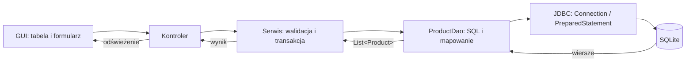
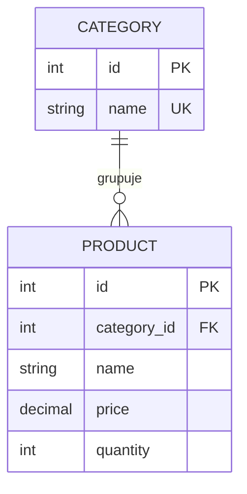
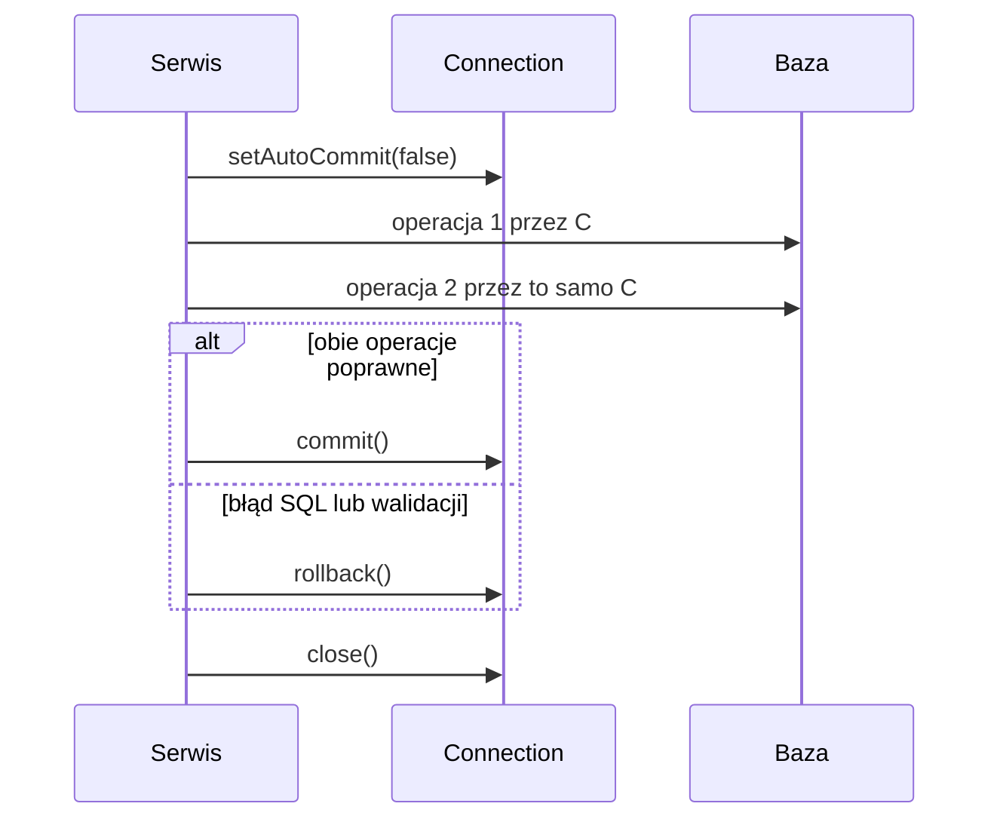

# Lab 3 - JDBC i relacyjne bazy danych

<script type="module">
import mermaid from "https://cdn.jsdelivr.net/npm/mermaid@12/dist/mermaid.esm.min.mjs";
document.querySelectorAll(".language-mermaid").forEach((block) => block.classList.add("mermaid"));
mermaid.initialize({ startOnLoad: true });
</script>

## Zakres: 3 zajęcia

## Cel zajęć

Utwórz projekt Maven `lab3` w [IntelliJ IDEA](../srodowisko.md). Najpierw uruchom warstwę bazy przez `main`, dopiero potem podłącz GUI. Working directory ustaw na katalog projektu.

JDBC jest standardowym interfejsem Javy do komunikacji z relacyjnymi bazami danych. W laboratorium użyjemy SQLite, ponieważ baza jest przechowywana w jednym pliku i nie wymaga uruchamiania serwera. Te same zasady można później zastosować do MySQL lub PostgreSQL, zmieniając sterownik i adres połączenia.

## Zależność Maven

```xml
<dependency>
    <groupId>org.xerial</groupId>
    <artifactId>sqlite-jdbc</artifactId>
    <version>3.46.1.0</version>
</dependency>
```

Przykładowy adres bazy:

```java
String url = "jdbc:sqlite:data/products.db";
```

Maven pobiera sterownik, a mechanizm dostawców JDBC rejestruje go podczas uruchamiania aplikacji. Katalog na plik bazy utwórz przed otwarciem połączenia.

## Schemat bazy

Utwórz tabelę `product`:

```sql
CREATE TABLE IF NOT EXISTS product (
    id INTEGER PRIMARY KEY AUTOINCREMENT,
    name TEXT NOT NULL,
    price NUMERIC NOT NULL CHECK (price >= 0),
    quantity INTEGER NOT NULL CHECK (quantity >= 0)
);
```

Możesz użyć SQLite Browser albo SQLiteStudio do podglądu danych. Schemat powinien być zapisany jako skrypt SQL, aby dało się odtworzyć bazę na innym komputerze.

## Połączenie i tworzenie tabeli

```java
import java.nio.file.Files;
import java.nio.file.Path;
import java.sql.Connection;
import java.sql.DriverManager;
import java.sql.SQLException;
import java.sql.Statement;

public class Database {
    private static final String URL = "jdbc:sqlite:data/products.db";

    public static Connection open() throws SQLException {
        try {
            Files.createDirectories(Path.of("data"));
        } catch (Exception e) {
            throw new IllegalStateException("Nie można utworzyć katalogu data", e);
        }
        return DriverManager.getConnection(URL);
    }

    public static void createSchema() throws SQLException {
        String sql = """
                CREATE TABLE IF NOT EXISTS product (
                    id INTEGER PRIMARY KEY AUTOINCREMENT,
                    name TEXT NOT NULL,
                    price NUMERIC NOT NULL CHECK (price >= 0),
                    quantity INTEGER NOT NULL CHECK (quantity >= 0)
                )
                """;
        try (Connection connection = open();
             Statement statement = connection.createStatement()) {
            statement.executeUpdate(sql);
        }
    }
}
```

## CRUD i `PreparedStatement`

```java
public void add(Product product) throws SQLException {
    String sql = "INSERT INTO product(name, price, quantity) VALUES (?, ?, ?)";
    try (Connection connection = Database.open();
         PreparedStatement statement = connection.prepareStatement(sql)) {
        statement.setString(1, product.name());
        statement.setBigDecimal(2, product.price());
        statement.setInt(3, product.quantity());
        statement.executeUpdate();
    }
}
```

Wartości użytkownika zawsze przekazuj parametrami `PreparedStatement`; nie sklejaj zapytań przez konkatenację napisów. Chroni to przed SQL injection i poprawia czytelność kodu.

Odczyt wielu wierszy:

```java
public List<Product> findByName(String fragment) throws SQLException {
    String sql = "SELECT id, name, price, quantity "
            + "FROM product WHERE name LIKE ? ORDER BY name";
    List<Product> result = new ArrayList<>();

    try (Connection connection = Database.open();
         PreparedStatement statement = connection.prepareStatement(sql)) {
        statement.setString(1, "%" + fragment + "%");
        try (ResultSet rows = statement.executeQuery()) {
            while (rows.next()) {
                result.add(new Product(
                        rows.getLong("id"),
                        rows.getString("name"),
                        rows.getBigDecimal("price"),
                        rows.getInt("quantity")));
            }
        }
    }
    return result;
}
```

## Transakcje

Jeśli kilka operacji musi wykonać się razem, użyj transakcji:

```java
try (Connection connection = Database.open()) {
    connection.setAutoCommit(false);
    try {
        // kilka INSERT/UPDATE na tym samym połączeniu
        connection.commit();
    } catch (SQLException e) {
        connection.rollback();
        throw e;
    }
}
```

## Zadania

1. Utwórz bazę `BAZA_PRODUKTOW` z tabelą produktów i skryptem tworzącym schemat.
2. Zaimplementuj `Product` oraz `ProductDao` z metodami dodawania, wyszukiwania, aktualizacji i usuwania.
3. Dodaj wyszukiwanie po nazwie i przedziale cenowym. Użyj parametrów `PreparedStatement`.
4. Utwórz aplikację Swing albo JavaFX, która wyświetla dane w tabeli i pozwala je edytować.
5. Dodaj osobne formularze lub panel do dodawania i modyfikacji produktu. Błędy SQL pokaż użytkownikowi jako komunikat, a nie ślad stosu.
6. Dodaj drugą tabelę, np. `category`, oraz relację jeden-do-wielu. Wyświetl kategorię produktu przez `JOIN`.
7. Zaimplementuj operację grupową wymagającą transakcji, np. utworzenie zamówienia i jego pozycji.
8. Powtórz połączenie z MySQL lub PostgreSQL, podmieniając sterownik, URL i typy danych.

## Pytania kontrolne

1. Czym różni się `Statement` od `PreparedStatement`?
2. Po co stosuje się transakcję?
3. Co robi `ResultSet`?
4. Dlaczego połączenia i strumienie trzeba zamykać?

## Plan pracy na trzy spotkania

| Spotkanie | Zakres | Punkt kontrolny |
|---|---|---|
| 1 | połączenie, schemat, insert/select | rekord przetrwa restart aplikacji |
| 2 | DAO, CRUD i GUI | tabela pokazuje wynik zapisany w bazie |
| 3 | relacja, JOIN, transakcja i błędy | awaria drugiej operacji wycofuje pierwszą |

## Warstwy aplikacji



Użyj osobnych plików `Database.java`, `Product.java`, `ProductDao.java` i `Main.java` w tym samym pakiecie. Fragmenty metod `add` i `findByName` należą do `ProductDao`; zaimportuj `java.sql.*`, `java.util.List` oraz `java.util.ArrayList`.

```java
public record Product(long id, String name, java.math.BigDecimal price, int quantity) {}
```

Uruchomienie kontrolne w `main` (zadeklaruj `throws SQLException` lub obsłuż wyjątek):

```java
Database.createSchema();
ProductDao dao = new ProductDao();
dao.add(new Product(0, "Koszyk demonstracyjny", new java.math.BigDecimal("12.50"), 4));
dao.findByName("demonstracyjny").forEach(System.out::println);
```

Ponowne uruchomienie dodaje kolejny rekord — to celowe w tym małym teście, nie mechanizm inicjalizacji danych. Docelowo przygotuj osobną akcję wczytania danych demonstracyjnych zabezpieczoną przed duplikatami.

## Relacje i integralność



Przed modyfikacją schematu zachowaj potrzebne dane. `CREATE TABLE IF NOT EXISTS` nie dodaje kolumn do istniejącej tabeli. Przygotuj migrację albo osobną bazę ćwiczeniową ze zmienionym schematem.

SQLite wymaga włączenia kontroli kluczy obcych na **każdym nowym połączeniu**, przed transakcją. W metodzie `open()` zastąp samo `return DriverManager.getConnection(URL)`:

```java
Connection connection = DriverManager.getConnection(URL);
try (Statement statement = connection.createStatement()) {
    statement.execute("PRAGMA foreign_keys = ON");
} catch (SQLException ex) {
    connection.close();
    throw ex;
}
return connection;
```

Dodaj kategorię przez klucz obcy, określ, czy brak kategorii jest dopuszczalny, i sprawdź próbę usunięcia używanej kategorii. W `UPDATE` i `DELETE` stosuj `WHERE id = ?`; wynik `executeUpdate()` powinien odpowiadać liczbie rzeczywiście zmienionych rekordów.

SQLite ma dynamiczne typowanie. Samo `NUMERIC` i `BigDecimal` po stronie Javy nie gwarantuje dokładnej reprezentacji kwot w bazie. Dla kwot pieniężnych w rozwinięciu przechowuj całkowitą liczbę groszy w `INTEGER`; konwersję wykonuj z jawnym zaokrągleniem. Dla wskaźników analitycznych dokumentuj precyzję.

## Transakcja musi korzystać z jednego połączenia



Metody DAO pokazane wcześniej otwierają własne połączenia. Wywołanie dwóch takich metod wewnątrz transakcji na trzecim połączeniu **nie łączy ich w transakcję**. Dodaj warianty przyjmujące `Connection`; te warianty zamykają tylko swoje statementy, a połączeniem zarządza serwis.

```java
try (Connection connection = Database.open()) {
    connection.setAutoCommit(false);
    try {
        // dao.operationOne(connection, ...);
        // dao.operationTwo(connection, ...);
        connection.commit();
    } catch (SQLException | RuntimeException ex) {
        try { connection.rollback(); }
        catch (SQLException rollbackError) { ex.addSuppressed(rollbackError); }
        throw ex;
    }
}
```

Zadanie transakcyjne można wykonać na aktualnym modelu: dodanie kategorii i pierwszego produktu. Wariant z zamówieniami z wcześniejszej listy wymaga dodatkowych tabel. Wybierz jeden z tych wariantów.

## Sprawdzenie i oddanie

Po podłączeniu bazy wykonaj ponownie [testy jakości GUI](../jakosc-gui.md).
Zmień rozmiar okna i motyw przy aktywnym filtrze oraz zaznaczonym rekordzie:
filtr, identyfikator zaznaczenia i niezapisane dane formularza mają pozostać.
Sprawdź błąd SQL w obu motywach oraz tekst wierszy przy 200% skali.
Zapytania wykonuj poza EDT/JavaFX Application Thread; w czasie odczytu
okno nadal reaguje, a ponowne wysłanie tego samego zapisu jest zablokowane.

| Próba | Oczekiwany wynik |
|---|---|
| nazwa `O'Brien` | zapis i odczyt bez błędu SQL |
| wyszukiwanie `%' OR 1=1 --` | tekst trafia do parametru; nie zmienia struktury SQL |
| cena lub ilość ujemna | walidacja w aplikacji i ograniczenie bazy odrzucają zapis |
| nieistniejący klucz kategorii | błąd integralności, bez osieroconego produktu |
| wyjątek między dwoma zapisami | po ponownym połączeniu nie ma żadnego z zapisów |
| ponowne uruchomienie | dane pozostają w tej samej bazie |

`LIKE` nadal interpretuje `%` i `_` jako wzorce, nawet przy parametrach. Jeśli wyszukiwanie ma traktować je dosłownie, dodaj escapowanie i klauzulę `ESCAPE`.

Oddaj projekt, skrypt schematu, dane demonstracyjne, ERD w Mermaid i opis testu wycofania. GUI powinno pokazać błąd i zachować wpisane dane, a techniczne szczegóły wyjątku zapisać w logu. Zapisz miesięczne ceny koszyka i oblicz zmianę ceny względem poprzedniego okresu.
