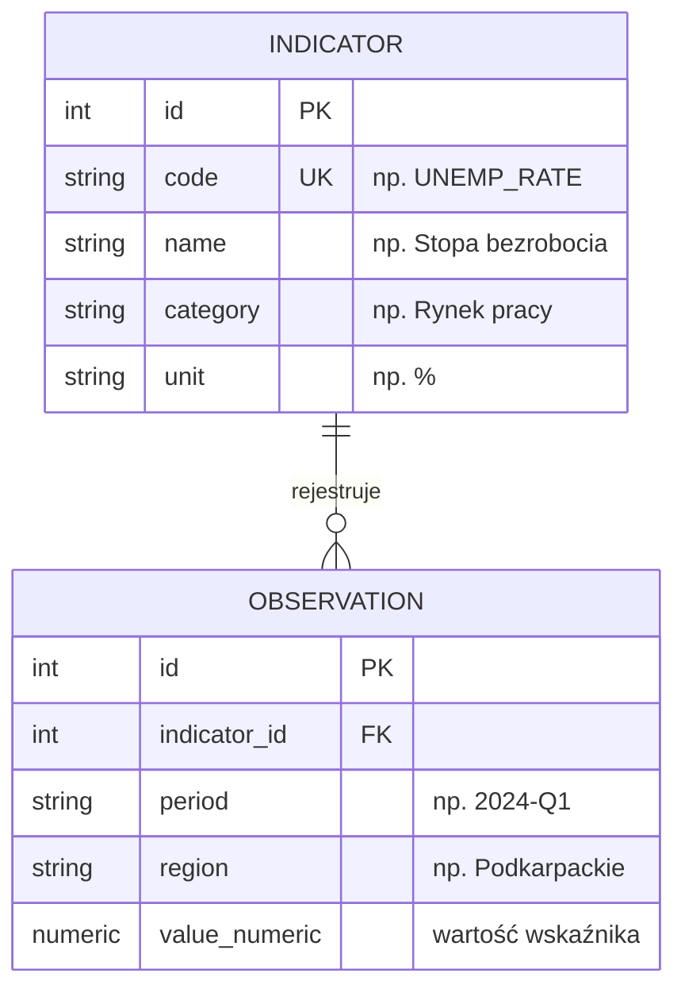
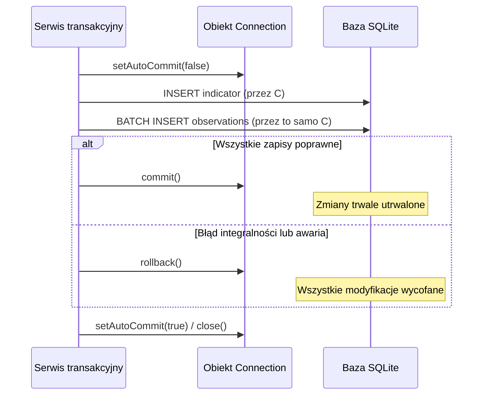
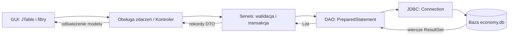

# Lab 3 - JDBC i relacyjne bazy danych

## Zakres laboratorium

Celem laboratorium jest zaprojektowanie relacyjnej bazy danych dla wskaźników
ekonomicznych, zaimplementowanie warstwy dostępu do danych (DAO) z wykorzystaniem
interfejsu JDBC, obsługa transakcji atomowych oraz połączenie warstwy persystencji
z graficznym interfejsem użytkownika.

Zakres obejmuje rozbudowę aplikacji desktopowej o trwały zapis w SQLite,
implementację warstwy DAO, obsługę transakcji oraz integrację z GUI. Rozdziały
poniżej prowadzą przez te elementy w kolejności ich realizacji.

Projekt demonstracyjny JDBC można [pobrać jako ZIP](demo/projekt-do-modyfikacji.zip),
otworzyć w IntelliJ IDEA i rozwijać na jego podstawie. Należy ustawić **JDK 27 GA**;
konfigurację opisano w [instrukcji środowiska](../../srodowisko.html). Przykład działania
znajduje się również w [opisie projektu](demo/README.html).

---

## 1. Konfiguracja projektu i sterownika bazy (IntelliJ IDEA / Maven)

JDBC (*Java Database Connectivity*) jest standardowym interfejsem biblioteki Javy
do komunikacji z relacyjnymi systemami baz danych. W laboratorium wykorzystywana jest
baza SQLite, która przechowuje całość danych w jednym lokalnym pliku i nie wymaga
uruchamiania zewnętrznego procesu serwerowego. Te same reguły projektowe (DAO, transakcje,
`PreparedStatement`) mają bezpośrednie zastosowanie w systemach PostgreSQL i MySQL.

Projekt do modyfikacji zawiera ten plik `pom.xml` i gotową aplikację. Po otwarciu
archiwum w IntelliJ IDEA należy sprawdzić wersje zależności z poniższą konfiguracją;
projektu nie trzeba tworzyć od pustego folderu:

```xml
<project xmlns="http://maven.apache.org/POM/4.0.0"
         xmlns:xsi="http://www.w3.org/2001/XMLSchema-instance"
         xsi:schemaLocation="http://maven.apache.org/POM/4.0.0 https://maven.apache.org/xsd/maven-4.0.0.xsd">
    <modelVersion>4.0.0</modelVersion>
    <groupId>pl.uczelnia</groupId>
    <artifactId>lab3</artifactId>
    <version>1.0-SNAPSHOT</version>

    <properties>
        <maven.compiler.release>27</maven.compiler.release>
        <project.build.sourceEncoding>UTF-8</project.build.sourceEncoding>
        <sqlite.version>3.46.1.0</sqlite.version>
        <slf4j.version>2.0.12</slf4j.version>
        <flatlaf.version>3.7</flatlaf.version>
    </properties>

    <dependencies>
        <dependency>
            <groupId>org.xerial</groupId>
            <artifactId>sqlite-jdbc</artifactId>
            <version>${sqlite.version}</version>
        </dependency>
        <dependency>
            <groupId>org.slf4j</groupId>
            <artifactId>slf4j-simple</artifactId>
            <version>${slf4j.version}</version>
        </dependency>
        <dependency>
            <groupId>com.formdev</groupId>
            <artifactId>flatlaf</artifactId>
            <version>${flatlaf.version}</version>
        </dependency>
    </dependencies>

    <build>
        <plugins>
            <plugin>
                <groupId>org.apache.maven.plugins</groupId>
                <artifactId>maven-compiler-plugin</artifactId>
                <version>3.13.0</version>
            </plugin>
        </plugins>
    </build>
</project>
```

Sterownik JDBC rejestruje się automatycznie przez mechanizm `ServiceLoader`.
W konfiguracji uruchomieniowej IntelliJ parametr **Working directory** należy ustawić
na główny katalog modułu, aby ścieżka względna `data/economy.db` wskazywała właściwe miejsce.

---

## 2. Projektowanie relacyjnego schematu danych (SQLite / DDL)

Dane analityczne wymagają powiązania definicji wskaźnika makroekonomicznego z jego
konkretnymi obserwacjami w czasie i przestrzeni. Należy zdefiniować dwie tabele:
`indicator` (słownik wskaźników) oraz `observation` (wartości szeregów czasowych).



Skrypt DDL tworzący schemat bazy:

```sql
CREATE TABLE IF NOT EXISTS indicator (
    id INTEGER PRIMARY KEY AUTOINCREMENT,
    code TEXT NOT NULL UNIQUE,
    name TEXT NOT NULL,
    category TEXT NOT NULL,
    unit TEXT NOT NULL
);

CREATE TABLE IF NOT EXISTS observation (
    id INTEGER PRIMARY KEY AUTOINCREMENT,
    indicator_id INTEGER NOT NULL,
    period TEXT NOT NULL,
    region TEXT NOT NULL,
    value_numeric NUMERIC NOT NULL,
    FOREIGN KEY (indicator_id) REFERENCES indicator(id) ON DELETE CASCADE,
    UNIQUE (indicator_id, period, region)
);
```

Ograniczenie `UNIQUE (indicator_id, period, region)` zabezpiecza przed zduplikowaniem
odczytu tego samego wskaźnika w zadanym okresie dla danego regionu. Klauzula `ON DELETE CASCADE`
gwarantuje usunięcie obserwacji powiązanych z usuwanym wskaźnikiem.

---

## 3. Zarządzanie połączeniem i integralnością referencyjną (JDBC)

Domyślnie silnik SQLite ma wyłączoną weryfikację ograniczeń kluczy obcych (`FOREIGN KEY`).
Włączenie sprawdzania więzów integralności musi nastąpić na **każdym nowo otwartym połączeniu**,
przed wykonaniem operacji bazodanowych.

`PRAGMA foreign_keys = ON` jest ustawieniem połączenia, nie trwałym ustawieniem
pliku bazy. Każde połączenie aplikacji należy otwierać przez `Database.open()`;
ominięcie tej metody bez ponownego włączenia kontroli może wyłączyć sprawdzanie
relacji i `ON DELETE CASCADE`. Ustawienie trzeba wykonać przed rozpoczęciem
transakcji; próbę potwierdzenia można przeprowadzić przez `PRAGMA foreign_keys`
na tym samym połączeniu — oczekiwany wynik to `1`.
[Dokumentacja kluczy obcych SQLite](https://www.sqlite.org/foreignkeys.html).

Należy utworzyć klasę `Database.java` zarządzającą tworzeniem katalogu bazy i nawiązywaniem połączeń:

```java
package pl.uczelnia.lab3;

import java.io.IOException;
import java.nio.file.Files;
import java.nio.file.Path;
import java.sql.Connection;
import java.sql.DriverManager;
import java.sql.SQLException;
import java.sql.Statement;

public final class Database {
    public static final String DEFAULT_URL = "jdbc:sqlite:data/economy.db";

    private Database() {}

    public static Connection open() throws SQLException {
        return open(DEFAULT_URL);
    }

    public static Connection open(String url) throws SQLException {
        if (url.startsWith("jdbc:sqlite:") && !url.contains(":memory:")) {
            Path dbPath = Path.of(url.substring("jdbc:sqlite:".length()));
            Path parent = dbPath.getParent();
            if (parent != null) {
                try {
                    Files.createDirectories(parent);
                } catch (IOException e) {
                    throw new IllegalStateException("Nie można utworzyć katalogu bazy", e);
                }
            }
        }

        Connection conn = DriverManager.getConnection(url);
        try (Statement stmt = conn.createStatement()) {
            stmt.execute("PRAGMA foreign_keys = ON;");
        } catch (SQLException ex) {
            conn.close();
            throw ex;
        }
        return conn;
    }

    public static void initSchema(Connection conn) throws SQLException {
        String ddl = """
                CREATE TABLE IF NOT EXISTS indicator (
                    id INTEGER PRIMARY KEY AUTOINCREMENT,
                    code TEXT NOT NULL UNIQUE,
                    name TEXT NOT NULL,
                    category TEXT NOT NULL,
                    unit TEXT NOT NULL
                );

                CREATE TABLE IF NOT EXISTS observation (
                    id INTEGER PRIMARY KEY AUTOINCREMENT,
                    indicator_id INTEGER NOT NULL,
                    period TEXT NOT NULL,
                    region TEXT NOT NULL,
                    value_numeric NUMERIC NOT NULL,
                    FOREIGN KEY (indicator_id) REFERENCES indicator(id) ON DELETE CASCADE,
                    UNIQUE (indicator_id, period, region)
                );
                """;
        try (Statement stmt = conn.createStatement()) {
            stmt.executeUpdate(ddl);
        }
    }
}
```

---

## 4. Implementacja warstwy dostępu do danych (DAO / PreparedStatement)

Wzorzec DAO (*Data Access Object*) izoluje zapytania SQL i mapowanie wierszy od reszty aplikacji.
Wszystkie parametry przekazywane od użytkownika należy bezwzględnie wstrzykiwać przez metody
obiektu `PreparedStatement` (`setString`, `setLong`, `setBigDecimal`).

Nigdy nie wolno sklejać łańcuchów SQL za pomocą operatora `+`, co stwarza bezpośrednie
zagrożenie atakiem typu SQL Injection.

### Modele danych (Java Record)

```java
package pl.uczelnia.lab3;

import java.math.BigDecimal;

public record Indicator(long id, String code, String name, String category, String unit) {}

public record Observation(
        long id,
        long indicatorId,
        String indicatorCode,
        String period,
        String region,
        BigDecimal value
) {}
```

### Operacje DAO na tabeli słownikowej (`IndicatorDao`)

Po `INSERT` należy pobrać identyfikator przez `getGeneratedKeys()` tego samego
`PreparedStatement`, po sprawdzeniu `keys.next()`, i odczytać go metodą
`keys.getLong(1)`. Identyfikator należy przechowywać jako `long`.
Zapytanie `SELECT MAX(id)` nie wskazuje bezpiecznie rekordu właśnie dodanego
przez daną operację: inny zapis może już zmienić największą wartość w tabeli.

```java
package pl.uczelnia.lab3;

import java.sql.*;
import java.util.ArrayList;
import java.util.List;
import java.util.Optional;

public class IndicatorDao {

    public long insert(Connection conn, Indicator indicator) throws SQLException {
        String sql = "INSERT INTO indicator(code, name, category, unit) VALUES (?, ?, ?, ?)";
        try (PreparedStatement stmt = conn.prepareStatement(sql, Statement.RETURN_GENERATED_KEYS)) {
            stmt.setString(1, indicator.code());
            stmt.setString(2, indicator.name());
            stmt.setString(3, indicator.category());
            stmt.setString(4, indicator.unit());
            stmt.executeUpdate();

            try (ResultSet keys = stmt.getGeneratedKeys()) {
                if (keys.next()) {
                    return keys.getLong(1);
                }
            }
        }
        throw new SQLException("Nie udało się pobrać wygenerowanego ID wskaźnika");
    }

    public Optional<Indicator> findByCode(Connection conn, String code) throws SQLException {
        String sql = "SELECT id, code, name, category, unit FROM indicator WHERE code = ?";
        try (PreparedStatement stmt = conn.prepareStatement(sql)) {
            stmt.setString(1, code);
            try (ResultSet rs = stmt.executeQuery()) {
                if (rs.next()) {
                    return Optional.of(new Indicator(
                            rs.getLong("id"),
                            rs.getString("code"),
                            rs.getString("name"),
                            rs.getString("category"),
                            rs.getString("unit")
                    ));
                }
            }
        }
        return Optional.empty();
    }

    public List<Indicator> findAll(Connection conn) throws SQLException {
        String sql = "SELECT id, code, name, category, unit FROM indicator ORDER BY code";
        List<Indicator> list = new ArrayList<>();
        try (PreparedStatement stmt = conn.prepareStatement(sql);
             ResultSet rs = stmt.executeQuery()) {
            while (rs.next()) {
                list.add(new Indicator(
                        rs.getLong("id"),
                        rs.getString("code"),
                        rs.getString("name"),
                        rs.getString("category"),
                        rs.getString("unit")
                ));
            }
        }
        return list;
    }
}
```

### Odczyt obserwacji z klauzulą `JOIN` (`ObservationDao`)

W celu wyświetlenia kodu wskaźnika przy obserwacji zapytanie łączy obie tabele:

```java
public List<Observation> findByIndicator(Connection conn, long indicatorId) throws SQLException {
    String sql = """
            SELECT o.id, o.indicator_id, i.code AS indicator_code, o.period, o.region, o.value_numeric
            FROM observation o
            JOIN indicator i ON i.id = o.indicator_id
            WHERE o.indicator_id = ?
            ORDER BY o.period, o.region
            """;
    List<Observation> list = new ArrayList<>();
    try (PreparedStatement stmt = conn.prepareStatement(sql)) {
        stmt.setLong(1, indicatorId);
        try (ResultSet rs = stmt.executeQuery()) {
            while (rs.next()) {
                list.add(new Observation(
                        rs.getLong("id"),
                        rs.getLong("indicator_id"),
                        rs.getString("indicator_code"),
                        rs.getString("period"),
                        rs.getString("region"),
                        rs.getBigDecimal("value_numeric")
                ));
            }
        }
    }
    return list;
}
```

---

## 5. Koordynacja transakcji i wycofywanie błędów (JDBC Transaction)

Transakcja gwarantuje właściwość **ACID** — wszystkie operacje wchodzące w jej skład
muszą zostać zatwierdzone łącznie, albo żadna z nich nie może pozostać w bazie.

Aby transakcja objęła kilka zapytań (np. dodanie wskaźnika oraz paczki powiązanych
z nim obserwacji), wszystkie te zapytania muszą być wykonywane na **tym samym obiekcie `Connection`**.



Implementacja w klasie serwisowej `EconomicDataService.java`:

```java
package pl.uczelnia.lab3;

import java.sql.Connection;
import java.sql.SQLException;
import java.util.List;

public class EconomicDataService {
    private final IndicatorDao indicatorDao;
    private final ObservationDao observationDao;

    public EconomicDataService(IndicatorDao indicatorDao, ObservationDao observationDao) {
        this.indicatorDao = indicatorDao;
        this.observationDao = observationDao;
    }

    public long saveSeriesInTransaction(Connection conn, Indicator indicator, List<Observation> observations)
            throws SQLException {
        boolean originalAutoCommit = conn.getAutoCommit();
        conn.setAutoCommit(false);
        try {
            var existing = indicatorDao.findByCode(conn, indicator.code());
            long indicatorId = existing.isPresent()
                    ? existing.get().id()
                    : indicatorDao.insert(conn, indicator);

            for (Observation obs : observations) {
                // Przypisanie klucza obcego nowo utworzonego wskaźnika:
                observationDao.insert(conn, new Observation(
                        0, indicatorId, indicator.code(), obs.period(), obs.region(), obs.value()
                ));
            }

            conn.commit();
            return indicatorId;
        } catch (SQLException | RuntimeException ex) {
            try {
                conn.rollback();
            } catch (SQLException rollbackEx) {
                ex.addSuppressed(rollbackEx);
            }
            throw ex;
        } finally {
            conn.setAutoCommit(originalAutoCommit);
        }
    }
}
```

---

## 6. Integracja bazy danych z graficznym interfejsem użytkownika (Swing / FlatLaf)

Architektura aplikacji rozdziela warstwę prezentacji od logiki bazodanowej:



### Zasady poprawnej integracji:
1. **Brak zapytań SQL w widoku:** Komponenty `JTable` ani listenery przycisków nie mogą zawierać poleceń SQL ani odwołań do `ResultSet`.
2. **Niezawodność wątku UI:** Długotrwałe zapytania lub operacje wsadowe należy delegować do osobnego wątku (np. `SwingWorker`), aby interfejs nie ulegał zamrożeniu.
3. **Obsługa błędów:** Wyjątki `SQLException` powinny być tłumaczone na komunikaty zrozumiałe dla użytkownika (np. „Podany kod wskaźnika już istnieje w bazie”) zamiast zrzucania surowego śladu stosu do konsoli.
4. **Trwałość i dopasowanie motywu:** Tryb `SYSTEM` domyślnie podąża za ustawieniami systemu i reaguje na ich zmianę; ręczny wybór `LIGHT` lub `DARK` ma go nadpisywać do powrotu do `SYSTEM`. Do wykrywania preferencji użyć `OsThemeDetector` poznanego w Lab 1, a Look and Feel zmieniać w EDT. Zapisać wybrany tryb w `Preferences.userNodeForPackage`, zgodnie z [wymaganiami jakości GUI](../../jakosc-gui.html).

Pełna implementacja okna demonstracyjnego znajduje się w klasie [Main.java](demo/src/main/java/pl/uczelnia/lab3/Main.java).

---

## 7. Rozbudowa projektu JDBC i testowanie wymaganych funkcji

1. **Uruchomienie projektu:** Otworzyć kopię projektu startowego i potwierdzić działanie połączenia z bazą oraz widoku tabeli.
2. **Filtrowanie obserwacji:** Rozszerzyć istniejące filtrowanie o region i zakres wartości. Zapytania należy parametryzować przez `PreparedStatement`.
3. **Obsługa pustych kryteriów:** Umożliwić pomijanie niezadanych filtrów i przywrócenie pełnego zbioru obserwacji.
4. **Transakcja zapisu szeregu:** Rozszerzyć formularz o zapis wskaźnika z listą obserwacji w jednej transakcji; zweryfikować wycofanie (`rollback`) po duplikacie klucza.
5. **Wynik ekonometryczny:** Dodać widok zmian okres do okresu (dynamiki procentowej) dla wybranego szeregu czasowego.
6. **Integracja z GUI:** Podłączyć nowe kryteria i wynik obliczeń do tabeli `JTable`; zapytania i obliczenia należy wykonywać poza wątkiem zdarzeń Swing.
7. **Motyw systemowy i HiDPI:** Domyślnie podążać za ustawieniami systemu, reagować na ich zmianę bez restartu, zachować ręczne warianty FlatLaf i sprawdzić czytelność interfejsu przy skalowaniu 100%, 150% i 200%.

---

## 8. Weryfikacja jakości i procedura testowa

Przed oddaniem laboratorium należy wykonać poniższe próby testowe:

| Przypadek testowy | Wprowadzone dane | Oczekiwane zachowanie systemu |
|---|---|---|
| Ochrona przed SQL Injection | Wyszukiwanie: `%' OR 1=1 --` | Wartość trafia bezpiecznie do parametru zapytania; brak naruszenia struktury SQL |
| Znaki specjalne w nazwie | Nazwa regionu: `Kraj / Woj. O'Brien` | Prawidłowy zapis i odczyt apostrofów i ukośników bez błędów składni |
| Więzy unikalności | Próba dodania drugiego rekordu `(indicator_id, period, region)` | Przechwycenie błędu integralności, czytelny komunikat dla użytkownika |
| Spójność transakcyjna | Błąd w 2. rekordzie paczki obserwacji | Wycofanie transakcji — ani wskaźnik, ani żadna obserwacja z paczki nie zostaje w bazie |
| Trwałość danych | Ponowne uruchomienie programu | Wcześniej zapisane rekordy pozostają w pliku bazy danych |
| Skalowanie monitora | Skala systemowa 150% i 200% | Tekst komórek tabeli i etykiet nie ulega przycięciu; zachowane proporcje |

---

## Testowanie i przygotowanie projektu do oddania

Do oddania należy przygotować:
1. Kod źródłowy projektu Maven w pakiecie `pl.uczelnia.lab3`.
2. Skrypt DDL inicjalizujący schemat bazy danych.
3. Plik bazy z wprowadzonymi co najmniej dwoma wskaźnikami i serią obserwacji.
4. Diagram ERD bazy w formacie Mermaid.
5. Krótki raport z weryfikacji transakcji (dowód wycofania zmian przy błędzie) oraz zrzuty ekranu działającego GUI w motywie jasnym i ciemnym.

---

## Pytania kontrolne

1. Dlaczego `PreparedStatement` chroni aplikację przed atakiem typu SQL Injection?
2. W jakim celu na początku każdego połączenia w SQLite wykonuje się polecenie `PRAGMA foreign_keys = ON`?
3. Jakie warunki muszą być spełnione, aby kilka zapytań SQL wykonało się w ramach jednej transakcji?
4. Dlaczego pobieranie danych z bazy nie powinno być realizowane bezpośrednio w wątku obsługi zdarzeń interfejsu graficznego?
5. Czym różni się wywołanie metody `executeQuery()` od `executeUpdate()`?
