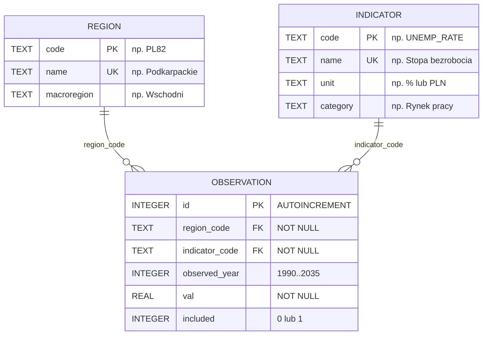
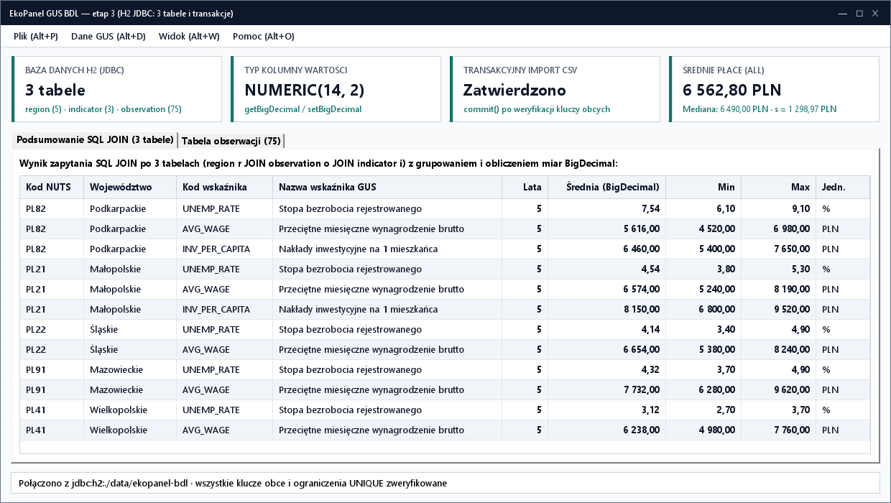

# Lab 3. Podłączenie relacyjnej bazy 3 tabel GUS BDL przez JDBC

<script id="MathJax-script" async src="https://cdn.jsdelivr.net/npm/mathjax@3/es5/tex-mml-chtml.js"></script>

[Etap 2: JavaFX i FXML](../../lab2/v2/README.html) · [Wyjaśnienia JDBC (v1)](../v1/README.html) · [Interaktywny poradnik animowany](poradnik.html) · [Etap 4: Hibernate ORM](../../lab4/v2/README.html)

Należy wykonywać zadania w podanej kolejności. Wszystkie zadania są wymagane. W tym laboratorium trójencjowy model GUS BDL otrzymuje trwałą relacyjną bazę SQLite składającą się z **trzech powiązanych kluczami obcymi tabel**: `region`, `indicator` oraz `observation`.

## Zadanie 3.1. Konfiguracja sterownika SQLite i klasy połączeń `Database`

📚 [Javadoc `java.sql.Connection`](https://docs.oracle.com/en/java/javase/27/docs/api/java.sql/java/sql/Connection.html) · [Javadoc `DriverManager`](https://docs.oracle.com/en/java/javase/27/docs/api/java.sql/java/sql/DriverManager.html)

1. Skopiować `ekopanel-fx` jako `PO2-EkoPanel/ekopanel-jdbc`. Zmienić w `pom.xml` `artifactId` na `ekopanel-jdbc` i dodać zależności `org.xerial:sqlite-jdbc:3.46.1.0` oraz `org.slf4j:slf4j-simple:2.0.12`. Przeładować Maven.
2. Utworzyć `src/main/resources/application.properties` z wpisem `db.url=jdbc:sqlite:./data/ekopanel_gus.db`.
3. Utworzyć `jdbc/Database.java`:
   - W konstruktorze wczytać `/application.properties` i utworzyć katalog `data` przez `Files.createDirectories(Path.of("data"))`.
   - W metodzie `public Connection open() throws SQLException` otworzyć połączenie przez `DriverManager.getConnection(url)` i na każdym nowym połączeniu wykonać `PRAGMA foreign_keys = ON` oraz `PRAGMA busy_timeout = 5000` (w razie błędu zamknąć połączenie przed ponownym zgłoszeniem wyjątku).
4. Utworzyć klasę kontrolną `jdbc/DatabaseCheck.java` z metodą `main()`, wypisać nazwę silnika bazy (`SQLite`) i wartość `PRAGMA foreign_keys` (`1`).

**Wynik:** połączenie z lokalną bazą `data/ekopanel_gus.db` ma zawsze aktywną kontrolę kluczy obcych.

## Zadanie 3.2. Zbudowanie schematu 3 powiązanych tabel GUS BDL (`region`, `indicator`, `observation`)

🎬 **[Otwórz animowaną miniinstrukcję: Relacje 3 tabel GUS BDL i klucze obce](poradnik.html#schema)**

<details>
<summary><strong>Schemat ERD trzech tabel GUS BDL</strong></summary>

Tabela faktów `observation` posiada dwa klucze obce wskazujące tabele słownikowe `region` oraz `indicator` z klauzulą `ON DELETE RESTRICT` (uniemożliwiającą usunięcie województwa lub wskaźnika posiadającego obserwacje):


</details>

1. Utworzyć plik `src/main/resources/db/schema.sql`:

   ```sql
   CREATE TABLE IF NOT EXISTS region (
       code TEXT PRIMARY KEY CHECK(length(trim(code)) = 4),
       name TEXT NOT NULL UNIQUE CHECK(length(trim(name)) BETWEEN 1 AND 80),
       macroregion TEXT NOT NULL CHECK(length(trim(macroregion)) BETWEEN 1 AND 80)
   );

   CREATE TABLE IF NOT EXISTS indicator (
       code TEXT PRIMARY KEY CHECK(length(trim(code)) BETWEEN 2 AND 30),
       name TEXT NOT NULL UNIQUE CHECK(length(trim(name)) BETWEEN 1 AND 120),
       unit TEXT NOT NULL CHECK(unit IN ('%', 'PLN')),
       category TEXT NOT NULL CHECK(length(trim(category)) BETWEEN 1 AND 60)
   );

   CREATE TABLE IF NOT EXISTS observation (
       id INTEGER PRIMARY KEY AUTOINCREMENT,
       region_code TEXT NOT NULL REFERENCES region(code) ON DELETE RESTRICT,
       indicator_code TEXT NOT NULL REFERENCES indicator(code) ON DELETE RESTRICT,
       observed_year INTEGER NOT NULL CHECK(observed_year BETWEEN 1990 AND 2035),
       val NUMERIC(14, 2) NOT NULL,
       included INTEGER NOT NULL CHECK(included IN (0, 1)),
       UNIQUE(region_code, indicator_code, observed_year)
   );

   CREATE INDEX IF NOT EXISTS ix_observation_lookup
       ON observation(indicator_code, region_code, observed_year);

   INSERT INTO region(code, name, macroregion) VALUES
       ('PL82', 'Podkarpackie', 'Wschodni'),
       ('PL21', 'Małopolskie', 'Południowy'),
       ('PL22', 'Śląskie', 'Południowy'),
       ('PL91', 'Mazowieckie', 'Województwo mazowieckie'),
       ('PL41', 'Wielkopolskie', 'Północno-zachodni')
       ON CONFLICT(code) DO NOTHING;

   INSERT INTO indicator(code, name, unit, category) VALUES
       ('UNEMP_RATE', 'Stopa bezrobocia rejestrowanego', '%', 'Rynek pracy'),
       ('AVG_WAGE', 'Przeciętne miesięczne wynagrodzenie brutto', 'PLN', 'Wynagrodzenia'),
       ('INV_PER_CAPITA', 'Nakłady inwestycyjne na 1 mieszkańca', 'PLN', 'Inwestycje')
       ON CONFLICT(code) DO NOTHING;
   ```

2. W `Database.initialize()` wykonać polecenia z `schema.sql`. W `DatabaseCheck` wywołać `initialize()` dwukrotnie i sprawdzić liczby wierszy: `region` = `5`, `indicator` = `3`.

**Wynik:** baza zawiera 3 powiązane tabele z wypełnionymi słownikami województw i wskaźników GUS.

## Zadanie 3.3. Implementacja `JdbcObservationRepository` (`PreparedStatement` i CRUD)

📚 [Javadoc `PreparedStatement`](https://docs.oracle.com/en/java/javase/27/docs/api/java.sql/java/sql/PreparedStatement.html) · [Javadoc `ResultSet`](https://docs.oracle.com/en/java/javase/27/docs/api/java.sql/java/sql/ResultSet.html)

1. Utworzyć `repository/DataAccessException extends RuntimeException`.
2. Utworzyć `jdbc/JdbcObservationRepository implements ObservationRepository` przyjmujące `Database` w konstruktorze.
3. Zaimplementować `findAllRegions()`, `findAllIndicators()` oraz `findAllObservations()` (z `ORDER BY observed_year, region_code, indicator_code`) przy użyciu `try-with-resources`, `PreparedStatement` i `ResultSet`. Wartość kolumny `val` zapisywać przez `ps.setBigDecimal(...)` i odczytywać jako `new BigDecimal(rs.getString("val")).setScale(2, RoundingMode.HALF_UP)` (lub `rs.getBigDecimal("val")`).
4. W `save(Observation obs)`:
   - dla `obs.id() == null` wykonać parametryzowany `INSERT INTO observation(region_code, indicator_code, observed_year, val, included) VALUES (?, ?, ?, ?, ?)` i odczytać wygenerowany klucz z `SELECT last_insert_rowid()`;
   - dla `obs.id() != null` wykonać `UPDATE observation SET region_code=?, indicator_code=?, observed_year=?, val=?, included=? WHERE id=?` (gdy `executeUpdate() != 1`, zgłosić `IllegalArgumentException("Nie znaleziono obserwacji.")`).
5. W `delete(long id)` wykonać `DELETE FROM observation WHERE id=?` i sprawdzić, że usunięto dokładnie 1 wiersz.
6. W `DatabaseCheck` przetestować dodanie `2025 / PL82 / UNEMP_RATE / 5.8`, zmianę na `5.6`, odczyt i usunięcie.

**Wynik:** repozytorium JDBC realizuje pełny kontrakt `ObservationRepository` na trzech tabelach.

## Zadanie 3.4. Atomowy import pakietu 3 plików CSV w transakcji i test `rollback()`

🎬 **[Otwórz animowaną miniinstrukcję: Transakcja atomowa i rollback w JDBC](poradnik.html#tx)**

1. W `JdbcObservationRepository.replaceDataset(regions, indicators, observations)` otworzyć jedno połączenie i ustawić `conn.setAutoCommit(false)`:
   - Zaktualizować słowniki `region` oraz `indicator` przez `INSERT INTO ... ON CONFLICT(code) DO UPDATE SET ...` przy użyciu `addBatch()` i `executeBatch()`.
   - Wykonać `DELETE FROM observation`, a następnie wstawić wszystkie obserwacje przez `PreparedStatement` z `addBatch()`, `executeBatch()` oraz `conn.commit()`.
   - W bloku `catch (Exception ex)` wykonać `conn.rollback()`, dołączyć ewentualny błąd wycofania przez `addSuppressed` i rzucić `DataAccessException`.
2. W `DatabaseCheck` wczytać 3 pliki z katalogu `data/` przez `GusCsvPackageReader` i wywołać `service.replaceDataset(...)` — potwierdzić `75` obserwacji w bazie.
3. **Próba rzeczywistego rollbacku bazy:** przekazać bezpośrednio do `repository.replaceDataset(...)` listę dwóch obserwacji, z których druga ma nieistniejący kod regionu `PL99` (lub rok `2099` naruszający `CHECK`). Przechwycić `DataAccessException` i porównać listę `before.equals(after)`.

**Wynik:** `before.equals(after)` zwraca `true` — po błędzie klucza obcego lub `CHECK` w trakcie wsadu baza wycofuje również wcześniejszy `DELETE` i zachowuje wszystkie 75 obserwacji.

## Zadanie 3.5. Zapytania analityczne `JOIN` łączące wszystkie 3 tabele

1. Dodać w `JdbcObservationRepository` (i `ObservationService`) metodę `List<RegionIndicatorSummary> findSummariesByRegion(String regionCode)`:
   - Samodzielnie ułożyć parametryzowane zapytanie SQL łączące tabele `region`, `indicator` oraz `observation` (`LEFT JOIN` dla obserwacji z `o.included = 1`), grupujące wyniki po regionie i wskaźniku oraz wyliczające `COUNT(o.id)`, `AVG(o.val)`, `MIN(o.val)` i `MAX(o.val)` posortowane po kodzie wskaźnika.
2. Przy odczycie `AVG`, `MIN`, `MAX` sprawdzać `rs.wasNull()`, aby brak obserwacji (np. gdy wszystkie obserwacje danego wskaźnika mają `included = 0`) zwracał `null` zamiast `0.00`.
3. **Testy weryfikacyjne i warunki brzegowe (`DatabaseCheck`):**
   - Wywołać `findSummariesByRegion("PL82")` dla załadowanych 75 obserwacji i potwierdzić wyniki złączenia 3 tabel:
     - `AVG_WAGE` (`PLN`): `n = 5`, średnia `5616,00`, min `4520,00`, max `6980,00`
     - `INV_PER_CAPITA` (`PLN`): `n = 5`, średnia `6460,00`, min `5400,00`, max `7650,00`
     - `UNEMP_RATE` (`%`): `n = 5`, średnia `7,54`, min `6,10`, max `9,10`
   - Wywołać `findSummariesByRegion("PL99")` (nieistniejący kod regionu) — oczekiwać pustej listy `List.of()` bez wyjątku SQL.
   - Odznaczyć `included = false` dla wszystkich 5 lat `PL82 / UNEMP_RATE` i ponownie wywołać `findSummariesByRegion("PL82")` — wiersz `UNEMP_RATE` nadal ma się pojawić (dzięki `LEFT JOIN`), lecz z `n = 0` oraz `mean = null`, `min = null`, `max = null`. Przywrócić `included = true`.
4. Sprawdzić ochronę klucza obcego `ON DELETE RESTRICT`: w `DatabaseCheck` spróbować wykonać `DELETE FROM region WHERE code = 'PL82'` — oczekiwać wyjątku klucza obcego SQLite.

**Wynik:** jedno zapytanie SQL `JOIN` po 3 tabelach zasila okno szczegółów regionu (`RegionDetailsController`).



## Zadanie 3.6. Integracja repozytorium JDBC z oknem JavaFX poza wątkiem GUI

1. W `FxApp` podmienić `MemoryObservationRepository` na `JdbcObservationRepository`.
2. W `MainController` utworzyć jednowątkowy `ExecutorService` (`Executors.newSingleThreadExecutor()`) zamykany w `FxApp.stop()`, właściwość `BooleanProperty busy` oraz pomocniczą metodę `runDb(...)` uruchamiającą operacje JDBC w `Task` i wyświetlającą nakładkę `loadingOverlay` w `StackPane`.
3. Po restarcie aplikacji bez ponownego importu CSV sprawdzić automatyczne wczytanie 75 obserwacji z pliku `data/ekopanel_gus.db`, otworzyć okno `Szczegóły regionu…` dla `PL82`, wykonać [macierz GUI](../../jakosc-gui.html) i opisać schemat 3 tabel oraz wyniki prób w `docs/lab3.md`.

**Do oddania:** projekt `ekopanel-jdbc`, `schema.sql` z 3 tabelami, `docs/lab3.md` z diagramem ERD i wynikami rollbacku oraz zrzuty ekranu.
