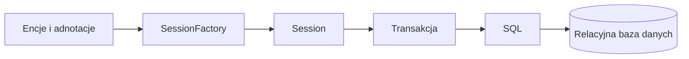
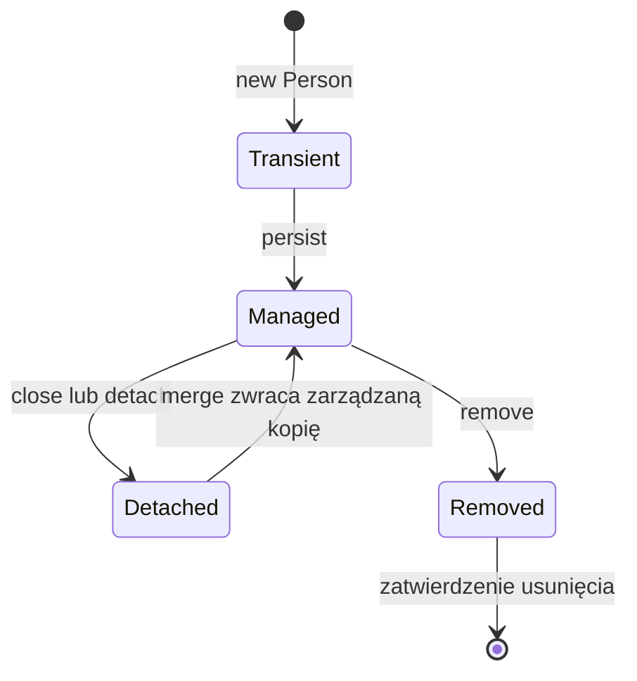
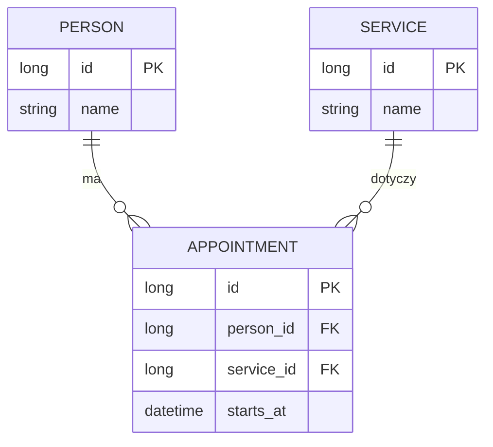
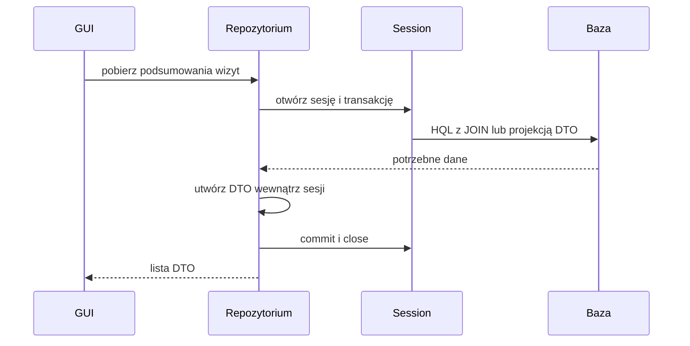

# Lab 4 - Hibernate i mapowanie obiektowo-relacyjne

<script type="module">
import mermaid from "https://cdn.jsdelivr.net/npm/mermaid@12/dist/mermaid.esm.min.mjs";
document.querySelectorAll(".language-mermaid").forEach((block) => block.classList.add("mermaid"));
mermaid.initialize({ startOnLoad: true });
</script>

## Zakres: 2 zajęcia

## Cel zajęć

Przygotuj projekt Maven `lab4` według [instrukcji IntelliJ IDEA](../srodowisko.md). Użyj pakietu `pl.uczelnia.lab4` we wszystkich klasach; w szczególności dopisz go do `Person.java`. Konfigurację umieść w resources, zsynchronizuj Maven i uruchom klasę `Main`.

Hibernate jest narzędziem ORM. Mapuje obiekty Javy na tabele i pozwala pracować na encjach zamiast ręcznie pisać większość zapytań SQL. JDBC z Lab 3 nadal jest potrzebne do zrozumienia, co dzieje się pod spodem.

## ORM, JPA i Hibernate

ORM oznacza mapowanie obiektowo-relacyjne: klasy, ich pola i relacje są odwzorowywane na tabele, kolumny i klucze obce. Programista pracuje na obiektach, a narzędzie ORM tłumaczy operacje na odpowiednie zapytania SQL.

JPA (obecnie Jakarta Persistence) jest specyfikacją opisującą standard adnotacji i API persystencji. Nie jest konkretnym silnikiem. Hibernate jest implementacją tego standardu i dodatkowo dostarcza własne API, m.in. `Session` i `SessionFactory`.

Typowy przepływ pracy wygląda tak:



`SessionFactory` jest ciężkim, współdzielonym obiektem tworzonym raz dla aplikacji. `Session` reprezentuje krótszą jednostkę pracy z bazą. Encja zarządzana przez sesję znajduje się w kontekście persystencji; `flush` synchronizuje zmiany z bazą, zwykle także przed zatwierdzeniem transakcji. Nie należy przechowywać sesji w kontrolerach GUI ani traktować encji jako obiektów globalnych.

## Zależności Maven

Przykład używa Hibernate 6, Jakarta Persistence i lokalnej bazy H2. W projekcie można zamienić H2 na MySQL albo PostgreSQL, zachowując model encji i zmieniając sterownik oraz konfigurację.

```xml
<properties>
    <hibernate.version>6.5.2.Final</hibernate.version>
</properties>

<dependencies>
    <dependency>
        <groupId>org.hibernate.orm</groupId>
        <artifactId>hibernate-core</artifactId>
        <version>${hibernate.version}</version>
    </dependency>
    <dependency>
        <groupId>com.h2database</groupId>
        <artifactId>h2</artifactId>
        <version>2.2.224</version>
        <scope>runtime</scope>
    </dependency>
    <dependency>
        <groupId>jakarta.persistence</groupId>
        <artifactId>jakarta.persistence-api</artifactId>
        <version>3.1.0</version>
    </dependency>
</dependencies>
```

## Encja

```java
import jakarta.persistence.*;

@Entity
@Table(name = "person")
public class Person {
    @Id
    @GeneratedValue(strategy = GenerationType.IDENTITY)
    private Long id;

    @Column(nullable = false, length = 80)
    private String name;

    protected Person() {
        // Konstruktor wymagany przez Hibernate.
    }

    public Person(String name) {
        this.name = name;
    }

    public Long getId() {
        return id;
    }

    public String getName() {
        return name;
    }

    public void setName(String name) {
        this.name = name;
    }
}
```

`@Entity` oznacza klasę mapowaną na tabelę. Pole z `@Id` jest kluczem głównym. Konstruktor bezargumentowy powinien być co najmniej `protected`, ponieważ Hibernate używa go przy odtwarzaniu obiektu.

## Konfiguracja

Utwórz `src/main/resources/hibernate.cfg.xml`:

```xml
<?xml version="1.0" encoding="utf-8"?>
<!DOCTYPE hibernate-configuration PUBLIC
        "-//Hibernate/Hibernate Configuration DTD 3.0//EN"
        "https://hibernate.org/dtd/hibernate-configuration-3.0.dtd">
<hibernate-configuration>
    <session-factory>
        <property name="hibernate.connection.driver_class">org.h2.Driver</property>
        <property name="hibernate.connection.url">jdbc:h2:./data/po</property>
        <property name="hibernate.dialect">org.hibernate.dialect.H2Dialect</property>
        <property name="hibernate.hbm2ddl.auto">update</property>
        <property name="hibernate.show_sql">true</property>
        <mapping class="pl.uczelnia.lab4.Person"/>
    </session-factory>
</hibernate-configuration>
```

Fabrykę sesji twórz raz dla aplikacji:

```java
SessionFactory factory = new Configuration()
        .configure()
        .buildSessionFactory();
```

## CRUD i transakcja

```java
try (Session session = factory.openSession()) {
    Transaction transaction = session.beginTransaction();

    Person person = new Person("Anna Nowak");
    session.persist(person);

    transaction.commit();
}
```

Odczyt z HQL:

```java
List<Person> people = session.createQuery(
        "from Person p where lower(p.name) like :name order by p.name",
        Person.class)
        .setParameter("name", "%anna%")
        .getResultList();
```

Nie przechowuj `Session` w obiektach GUI. Otwieraj krótkie sesje na czas operacji, używaj transakcji dla zapisu i nie pokazuj encji bezpośrednio jako warstwy widoku w większej aplikacji.

## Relacje

Przykład relacji jeden-do-wielu:

```java
@OneToMany(mappedBy = "person", cascade = CascadeType.ALL,
        orphanRemoval = true)
private List<Appointment> appointments = new ArrayList<>();
```

Po stronie `Appointment`:

```java
@ManyToOne(fetch = FetchType.LAZY, optional = false)
@JoinColumn(name = "person_id", nullable = false)
private Person person;
```

Relacje powinny mieć określone zachowanie przy usuwaniu i nie powinny prowadzić do niekontrolowanego ładowania całego grafu obiektów.

## Zadania

1. Zamapuj encję `Person` i wykonaj zapis, odczyt, aktualizację oraz usunięcie.
2. Dodaj encje `Appointment` i `Service` tak, aby powstały co najmniej trzy tabele z relacjami.
3. Utwórz repozytorium z metodami `findById`, `findAll`, `save` i `delete`.
4. Dodaj wyszukiwanie po nazwie oraz zapytanie z `JOIN`.
5. Zrealizuj zapis osoby i wizyty w jednej transakcji. Sprawdź zachowanie po wymuszeniu wyjątku przed `commit`.
6. Dodaj GUI z tabelą i formularzem. Warstwa widoku nie może tworzyć zapytań HQL bezpośrednio.
7. Porównaj SQL generowany przez Hibernate z rozwiązaniem JDBC z Lab 3.
8. Przygotuj skrypt lub instrukcję odtworzenia bazy i wyjaśnij różnicę między `create`, `update` i migracjami.

## Pytania kontrolne

1. Co oznacza ORM?
2. Po co Hibernate wymaga konstruktora bezargumentowego?
3. Czym różni się `persist` od zapytania SQL `INSERT`?
4. Dlaczego operacje zapisu powinny odbywać się w transakcji?
5. Co oznaczają `LAZY`, `EAGER`, `cascade` i `orphanRemoval`?

## Plan pracy na dwa spotkania

| Spotkanie | Zakres | Punkt kontrolny |
|---|---|---|
| 1 | konfiguracja, encja, stany obiektu, CRUD | ślad SQL potwierdza zapis i aktualizację |
| 2 | relacje, HQL, transakcje i GUI | wycofanie dwóch zapisów i wyświetlenie danych po zamknięciu sesji |

Model osób, wizyt i usług jest ćwiczeniem ORM. W projekcie ekonomicznym przenieś poznaną relację na zbiór danych, obserwacje i zapisane analizy.

## Pierwsze uruchomienie z obsługą wycofania

Utwórz `Main.java`. W aplikacji desktopowej fabryka działa przez cały czas życia aplikacji; poniżej kończy pracę razem z krótkim przykładem konsolowym.

```java
package pl.uczelnia.lab4;

import org.hibernate.Session;
import org.hibernate.SessionFactory;
import org.hibernate.Transaction;
import org.hibernate.cfg.Configuration;

public class Main {
    public static void main(String[] args) throws Exception {
        java.nio.file.Files.createDirectories(java.nio.file.Path.of("data"));
        try (SessionFactory factory = new Configuration().configure().buildSessionFactory();
             Session session = factory.openSession()) {
            Transaction tx = session.beginTransaction();
            try {
                session.persist(new Person("Anna Nowak"));
                tx.commit();
            } catch (RuntimeException ex) {
                try { if (tx.isActive()) tx.rollback(); }
                catch (RuntimeException rollbackError) { ex.addSuppressed(rollbackError); }
                throw ex;
            }
        }
    }
}
```

Efekt: w konsoli pojawia się SQL `insert`, a w katalogu `data` plik bazy H2. Ponowne uruchomienie dopisuje osobę. Nie myl tego z idempotentnym skryptem danych demonstracyjnych.

## Cykl życia encji



Po `merge(person)` używaj zwróconego obiektu; przekazany obiekt odłączony nie staje się automatycznie zarządzany. Zmiana pola encji zarządzanej jest wykrywana przez dirty checking, więc nie wymaga osobnego `UPDATE` w kodzie. `flush()` nie jest tym samym co `commit()` — zsynchronizowane SQL nadal może zostać wycofane.

## Która strona relacji zapisuje klucz obcy



`Appointment.person` jest stroną posiadającą klucz obcy. `mappedBy = "person"` wskazuje nazwę pola Javy, nie kolumny SQL. W klasie `Person` dodaj metodę utrzymującą obie strony:

```java
public void addAppointment(Appointment appointment) {
    appointments.add(appointment);
    appointment.setPerson(this);
}
```

Zaimplementuj `Appointment` i `Service` jako pełne encje z identyfikatorem i konstruktorem bezargumentowym. Dodaj obie klasy do `hibernate.cfg.xml` przez kolejne wpisy `mapping`. Importy kolekcji to `java.util.List` i `java.util.ArrayList`.

`cascade` określa propagację operacji na encjach; nie jest tym samym co reguła `ON DELETE` w bazie. `orphanRemoval` usuwa obiekt zależny po odłączeniu od kolekcji. Nie przenoś bezmyślnie `CascadeType.ALL` na relację wizyty do współdzielonej usługi: usunięcie jednej wizyty nie powinno usuwać usługi używanej przez inne wizyty.

## Odczyt danych do GUI



Próba odczytu niezaładowanej relacji `LAZY` po zamknięciu sesji może zakończyć się `LazyInitializationException`. Pobierz potrzebne dane w repozytorium, np. przez projekcję DTO albo świadome `join fetch`. Nie rozwiązuj problemu przez globalną sesję lub zmianę wszystkich relacji na `EAGER`. Obserwuj SQL: wiele dodatkowych zapytań dla pojedynczej listy to możliwy problem N+1.

## Sprawdzenie i oddanie

Zachowaj [adaptacyjny układ, HiDPI i motywy](../jakosc-gui.md) przy integracji
z Hibernate. Podczas pobierania danych zmień rozmiar okna: interfejs powinien
reagować, a wskaźnik pracy być czytelny w obu motywach. Sesję otwieraj i zamykaj
w obrębie operacji w tle; do wątku GUI przekazuj gotowe DTO. Nie współdziel
jednej `Session` między wątkiem GUI a zadaniem. Zweryfikuj tabelę i dialog błędu
przy skali 200% oraz zachowanie filtra po zmianie motywu.

1. Zapisz osobę, odczytaj ją w nowej sesji i zmień nazwę w transakcji. Sprawdź wygenerowany SQL.
2. Dodaj wizytę i usługę, zamknij sesję i wyświetl dane przez DTO.
3. Wymuś wyjątek po pierwszym `persist`, przed `commit`; w nowej sesji potwierdź brak obu planowanych zapisów.
4. Usuń wizytę i sprawdź, że współdzielona usługa nadal istnieje.
5. Po restarcie aplikacji potwierdź trwałość danych oraz wyjaśnij działanie `hbm2ddl.auto=update`.

Oddaj projekt, ERD Mermaid, opis mapowań oraz przykładowy SQL. `update` pomaga w ćwiczeniu, ale nie zastępuje kontrolowanych migracji. `create` odtwarza schemat i może usunąć dane; używaj go wyłącznie dla świadomie wybranej bazy testowej. Porównaj liczbę zapytań przed i po zastosowaniu projekcji DTO.
