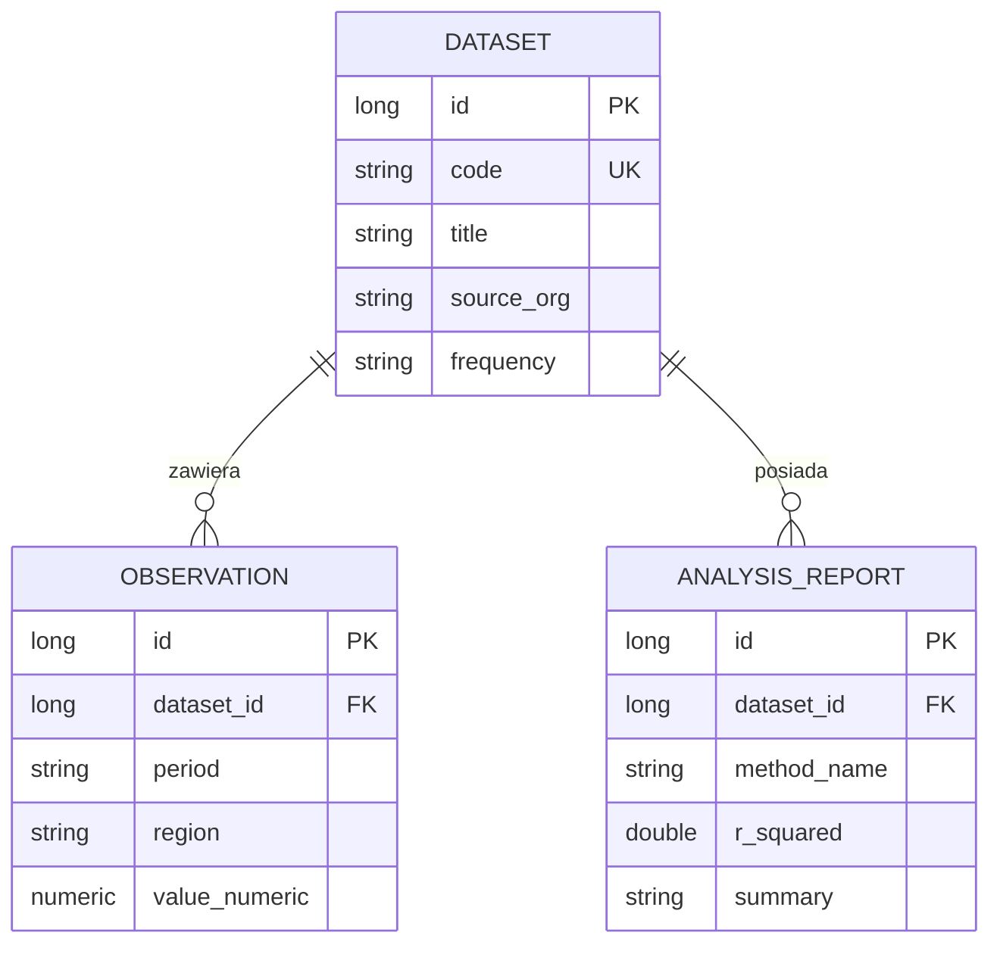
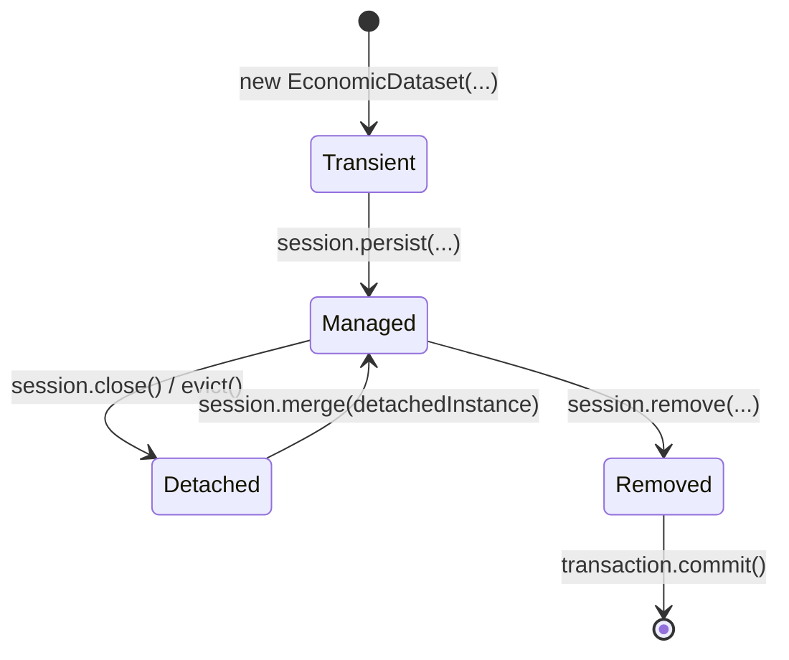
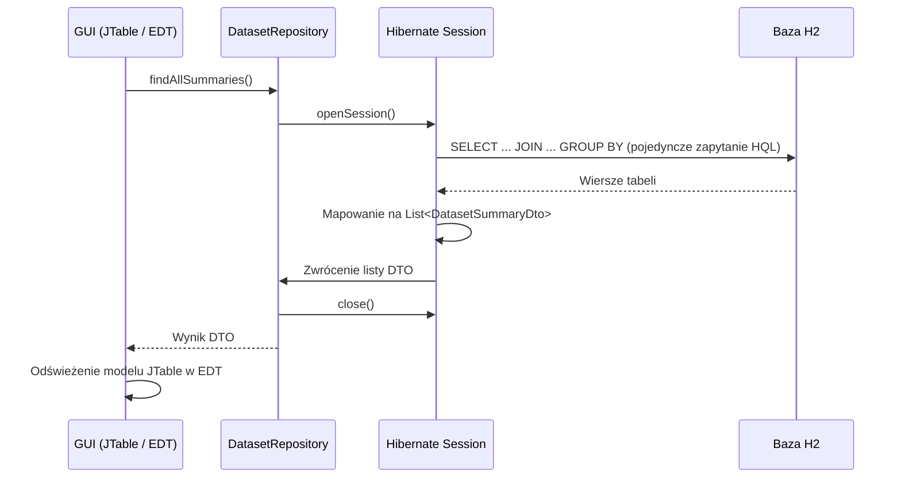

# Lab 4 - Hibernate i mapowanie obiektowo-relacyjne

## Zakres laboratorium

Celem laboratorium jest opanowanie technik mapowania obiektowo-relacyjnego (ORM)
z wykorzystaniem specyfikacji Jakarta Persistence oraz biblioteki Hibernate 6.
Ćwiczenia obejmują modelowanie relacji między encjami ekonomicznymi, zarządzanie
cyklem życia obiektów, konstruowanie zapytań w języku HQL, optymalizację pobierania
danych za pomocą projekcji DTO oraz integrację warstwy persystencji z aplikacją desktopową.

Zakres obejmuje modelowanie relacji między encjami ekonomicznymi, zarządzanie
ich cyklem życia, zapytania HQL, projekcje DTO oraz integrację z aplikacją
desktopową. Kolejne sekcje prowadzą przez te zagadnienia.

Projekt demonstracyjny Hibernate można [pobrać jako ZIP](demo/projekt-do-modyfikacji.zip),
otworzyć w IntelliJ IDEA i rozwijać na jego podstawie. Należy ustawić **JDK 27 GA**,
Hibernate 6 i bazę H2 zgodnie z [instrukcją środowiska](../../srodowisko.html).
Opis działającego przykładu znajduje się w [dokumentacji projektu](demo/README.html).

---

## 1. Konfiguracja projektu i narzędzi ORM (Maven / IntelliJ IDEA)

Narzędzia ORM (*Object-Relational Mapping*) tłumaczą klasy, ich pola oraz relacje
na tabele, kolumny i klucze obce bazy relacyjnej. Programista operuje na obiektach
Javy, a silnik persystencji generuje właściwy kod SQL.

Projekt do modyfikacji zawiera ten plik `pom.xml` i działającą aplikację. Po otwarciu
archiwum w IntelliJ IDEA należy sprawdzić wersje zależności z poniższą konfiguracją;
projektu nie trzeba tworzyć od pustego folderu:

```xml
<project xmlns="http://maven.apache.org/POM/4.0.0"
         xmlns:xsi="http://www.w3.org/2001/XMLSchema-instance"
         xsi:schemaLocation="http://maven.apache.org/POM/4.0.0 https://maven.apache.org/xsd/maven-4.0.0.xsd">
    <modelVersion>4.0.0</modelVersion>
    <groupId>pl.uczelnia</groupId>
    <artifactId>lab4</artifactId>
    <version>1.0-SNAPSHOT</version>

    <properties>
        <maven.compiler.release>27</maven.compiler.release>
        <project.build.sourceEncoding>UTF-8</project.build.sourceEncoding>
        <hibernate.version>6.6.1.Final</hibernate.version>
        <h2.version>2.2.224</h2.version>
        <jakarta.persistence.version>3.1.0</jakarta.persistence.version>
        <flatlaf.version>3.7</flatlaf.version>
    </properties>

    <dependencies>
        <dependency>
            <groupId>org.hibernate.orm</groupId>
            <artifactId>hibernate-core</artifactId>
            <version>${hibernate.version}</version>
        </dependency>
        <dependency>
            <groupId>com.h2database</groupId>
            <artifactId>h2</artifactId>
            <version>${h2.version}</version>
            <scope>runtime</scope>
        </dependency>
        <dependency>
            <groupId>jakarta.persistence</groupId>
            <artifactId>jakarta.persistence-api</artifactId>
            <version>${jakarta.persistence.version}</version>
        </dependency>
        <dependency>
            <groupId>com.formdev</groupId>
            <artifactId>flatlaf</artifactId>
            <version>${flatlaf.version}</version>
        </dependency>
    </dependencies>

    <build>
        <plugins>
            <plugin>
                <groupId>org.apache.maven.plugins</groupId>
                <artifactId>maven-compiler-plugin</artifactId>
                <version>3.13.0</version>
            </plugin>
        </plugins>
    </build>
</project>
```

---

## 2. Modelowanie encji i relacji obiektowo-relacyjnych (Jakarta Persistence)

Domena analityczna obejmuje zbiory wskaźników (`EconomicDataset`), wielookresowe
obserwacje (`Observation`) oraz wygenerowane raporty z modeli analitycznych (`AnalysisReport`).



### Zasady definiowania encji:
1. **Adnotacja `@Entity`:** Wskazuje klasę mapowaną na tabelę bazy danych.
2. **Klucz główny `@Id`:** Wskazuje pole identyfikatora z generacją klucza `@GeneratedValue(strategy = GenerationType.IDENTITY)`.
3. **Konstruktor bezargumentowy:** Wymagany przez specyfikację JPA do odtwarzania instancji obiektu przez refleksję (może mieć zasięg `protected`).
4. **Relacje dwukierunkowe:** Strona `ManyToOne` jest właścicielem klucza obcego (`@JoinColumn`). Strona `OneToMany` wskazuje pole Javy w adnotacji `mappedBy`.

### Encja nadrzędna: `EconomicDataset.java`

```java
package pl.uczelnia.lab4;

import jakarta.persistence.*;
import java.util.ArrayList;
import java.util.List;

@Entity
@Table(name = "dataset")
public class EconomicDataset {

    @Id
    @GeneratedValue(strategy = GenerationType.IDENTITY)
    private Long id;

    @Column(nullable = false, unique = true, length = 50)
    private String code;

    @Column(nullable = false, length = 150)
    private String title;

    @Column(name = "source_org", nullable = false, length = 100)
    private String sourceOrg;

    @Column(nullable = false, length = 30)
    private String frequency;

    @OneToMany(mappedBy = "dataset", cascade = CascadeType.ALL, orphanRemoval = true, fetch = FetchType.LAZY)
    private List<Observation> observations = new ArrayList<>();

    @OneToMany(mappedBy = "dataset", cascade = CascadeType.ALL, orphanRemoval = true, fetch = FetchType.LAZY)
    private List<AnalysisReport> reports = new ArrayList<>();

    protected EconomicDataset() {}

    public EconomicDataset(String code, String title, String sourceOrg, String frequency) {
        this.code = code;
        this.title = title;
        this.sourceOrg = sourceOrg;
        this.frequency = frequency;
    }

    public void addObservation(Observation observation) {
        observations.add(observation);
        observation.setDataset(this);
    }

    public void addReport(AnalysisReport report) {
        reports.add(report);
        report.setDataset(this);
    }

    // Gettery i settery
    public Long getId() { return id; }
    public String getCode() { return code; }
    public void setCode(String code) { this.code = code; }
    public String getTitle() { return title; }
    public void setTitle(String title) { this.title = title; }
    public String getSourceOrg() { return sourceOrg; }
    public void setSourceOrg(String sourceOrg) { this.sourceOrg = sourceOrg; }
    public String getFrequency() { return frequency; }
    public void setFrequency(String frequency) { this.frequency = frequency; }
    public List<Observation> getObservations() { return observations; }
    public List<AnalysisReport> getReports() { return reports; }
}
```

### Encja podrzędna: `Observation.java`

```java
package pl.uczelnia.lab4;

import jakarta.persistence.*;
import java.math.BigDecimal;

@Entity
@Table(name = "observation", uniqueConstraints = {
        @UniqueConstraint(columnNames = {"dataset_id", "period", "region"})
})
public class Observation {

    @Id
    @GeneratedValue(strategy = GenerationType.IDENTITY)
    private Long id;

    @ManyToOne(fetch = FetchType.LAZY, optional = false)
    @JoinColumn(name = "dataset_id", nullable = false)
    private EconomicDataset dataset;

    @Column(nullable = false, length = 30)
    private String period;

    @Column(nullable = false, length = 80)
    private String region;

    @Column(name = "value_numeric", nullable = false, precision = 15, scale = 4)
    private BigDecimal valueNumeric;

    protected Observation() {}

    public Observation(String period, String region, BigDecimal valueNumeric) {
        this.period = period;
        this.region = region;
        this.valueNumeric = valueNumeric;
    }

    public Long getId() { return id; }
    public EconomicDataset getDataset() { return dataset; }
    public void setDataset(EconomicDataset dataset) { this.dataset = dataset; }
    public String getPeriod() { return period; }
    public String getRegion() { return region; }
    public BigDecimal getValueNumeric() { return valueNumeric; }
}
```

---

## 3. Konfiguracja fabryki sesji i dialektu bazy (Hibernate / H2)

Konfigurację silnika należy umieścić w pliku `src/main/resources/hibernate.cfg.xml`.
Właściwość `hibernate.hbm2ddl.auto` ustawiona na `update` automatycznie aktualizuje
schemat bazy na podstawie zdefiniowanych adnotacji encji.

```xml
<?xml version="1.0" encoding="utf-8"?>
<!DOCTYPE hibernate-configuration PUBLIC
        "-//Hibernate/Hibernate Configuration DTD 3.0//EN"
        "https://hibernate.org/dtd/hibernate-configuration-3.0.dtd">
<hibernate-configuration>
    <session-factory>
        <property name="hibernate.connection.driver_class">org.h2.Driver</property>
        <property name="hibernate.connection.url">jdbc:h2:./data/economy_orm</property>
        <property name="hibernate.dialect">org.hibernate.dialect.H2Dialect</property>
        <property name="hibernate.hbm2ddl.auto">update</property>
        <property name="hibernate.show_sql">true</property>
        <property name="hibernate.format_sql">true</property>

        <mapping class="pl.uczelnia.lab4.EconomicDataset"/>
        <mapping class="pl.uczelnia.lab4.Observation"/>
        <mapping class="pl.uczelnia.lab4.AnalysisReport"/>
    </session-factory>
</hibernate-configuration>
```

Adres `jdbc:h2:./data/economy_orm` wskazuje bazę plikową względem katalogu
roboczego procesu. H2 tworzy plik `data/economy_orm.mv.db`; rozszerzenia `.mv.db`
nie należy dopisywać do adresu JDBC. Katalogiem roboczym powinien być folder
projektu zawierający `pom.xml`.

Fabrykę sesji `SessionFactory` należy utworzyć raz na cały cykl życia aplikacji:

```java
SessionFactory sessionFactory = new org.hibernate.cfg.Configuration()
        .configure()
        .buildSessionFactory();
```

---

## 4. Cykl życia encji i operacje persystencji (Session / Entity State)

Encja w Hibernate znajduje się w jednym z czterech stanów persystencji:



* **Transient (nowy):** Obiekt utworzony operatorem `new`, nieposiadający klucza głównego i niepowiązany z kontekstem sesji.
* **Managed (zarządzany):** Obiekt powiązany z aktywną sesją. Wszelkie zmiany pól są automatycznie śledzone (*dirty checking*) i wysyłane do bazy przy zatwierdzeniu transakcji (`commit`).
* **Detached (odłączony):** Sesja została zamknięta; obiekt istnieje w pamięci Javy, ale zmiany jego stanu nie są automatycznie synchronizowane z bazą.
* **Removed (usunięty):** Obiekt oznaczony do usunięcia, który zostanie skasowany z tabeli podczas zatwierdzania transakcji.

Operacje modyfikujące bazę danych muszą zawsze odbywać się wewnątrz aktywnej transakcji:

```java
try (Session session = sessionFactory.openSession()) {
    Transaction tx = session.beginTransaction();
    try {
        EconomicDataset dataset = new EconomicDataset("PL_GDP", "Produkt Krajowy Brutto", "GUS", "Kwartalna");
        dataset.addObservation(new Observation("2024-Q1", "Polska", new BigDecimal("3.2")));
        session.persist(dataset);
        tx.commit();
    } catch (Exception ex) {
        if (tx.isActive()) tx.rollback();
        throw ex;
    }
}
```

---

## 5. Zapytania HQL, projekcje DTO i optymalizacja pobierania (FetchType / N+1)

Relacje oznaczone jako `FetchType.LAZY` nie są ładowane natychmiast przy pobraniu encji
nadrzędnej. Odczyt leniwej kolekcji po zamknięciu sesji skutkuje wyjątkiem `LazyInitializationException`.

Do GUI należy przekazywać dane przygotowane przed zamknięciem `Session`.
Dla podsumowań służy do tego `DatasetSummaryDto`; dla szczegółów można pobrać
potrzebną relację zapytaniem `JOIN FETCH` i zbudować DTO wewnątrz sesji.
Samo pobranie encji nie inicjalizuje wszystkich jej relacji. Listener lub renderer
tabeli w EDT nie powinien uruchamiać odczytu leniwej kolekcji ani utrzymywać sesji
otwartej na czas pracy użytkownika. Zapytania należy wykonywać poza wątkiem GUI.

Z kolei nieostrożne pobieranie kolekcji w pętli prowadzi do **problemu N+1 zapytań** —
aplikacja wykonuje 1 zapytanie po listę główną oraz N dodatkowych zapytań dla każdego rekordu.

### Bezpieczna projekcja DTO

W celu bezpiecznego przekazania zagregowanych danych do tabeli GUI należy stosować
zapytania HQL tworzące bezpośrednio rekordy DTO (*Data Transfer Object*):

```java
package pl.uczelnia.lab4;

public record DatasetSummaryDto(
        Long id,
        String code,
        String title,
        long observationCount,
        long reportCount
) {}
```

Zapytanie w `DatasetRepository.java`:

```java
public List<DatasetSummaryDto> findAllSummaries() {
    try (Session session = sessionFactory.openSession()) {
        String hql = """
                select new pl.uczelnia.lab4.DatasetSummaryDto(
                    d.id,
                    d.code,
                    d.title,
                    count(distinct o.id),
                    count(distinct r.id)
                )
                from EconomicDataset d
                left join d.observations o
                left join d.reports r
                group by d.id, d.code, d.title
                order by d.code
                """;
        return session.createQuery(hql, DatasetSummaryDto.class).getResultList();
    }
}
```

Dzięki projekcji DTO:
- Wykonywane jest dokładnie jedno zoptymalizowane zapytanie SQL z klauzulami `LEFT JOIN` i `GROUP BY`.
- Pobrane obiekty są zwykłymi rekordami Javy, które można bezpiecznie przekazać do wątku interfejsu graficznego i odczytywać po zamknięciu sesji.

---

## 6. Integracja warstwy persystencji z GUI i obsługa motywów (Swing / FlatLaf)

Architektura integracji ORM z widokiem desktopowym:



### Reguły architektury:
1. Nie należy współdzielić instancji `Session` pomiędzy wątkiem EDT a wątkami roboczymi.
2. Formularze i okna dialogowe komunikują się wyłącznie z klasą repozytorium.
3. Tryb `SYSTEM` automatycznie dopasowuje FlatLaf do motywu systemu i reaguje na
   jego zmianę bez restartu. Do wykrywania preferencji użyć `OsThemeDetector`
   z Lab 1, a Look and Feel zmieniać w EDT. Ręczny wybór `LIGHT` lub `DARK` działa
   do powrotu do `SYSTEM`. Zmiana zachowuje zaznaczenie tabeli, a wybrany tryb
   jest utrwalany w `Preferences`.

Pełny kod demonstracyjny integrujący repozytorium z tabelą i podglądem szczegółów
znajduje się w pliku [Main.java](demo/src/main/java/pl/uczelnia/lab4/Main.java).

---

## 7. Rozbudowa projektu ORM

1. **Uruchomienie projektu:** Otworzyć kopię projektu startowego, sprawdzić inicjalizację H2 i prześledzić mapowanie `EconomicDataset`–`Observation`.
2. **Rozszerzenie metadanych zbioru:** Dodać do `EconomicDataset` pole `sourceUrl`, zmapować je w JPA i wyświetlić w panelu szczegółów zbioru.
3. **Wyszukiwanie zakresu okresów:** Dodać metodę repozytorium pobierającą obserwacje wybranego zbioru z zadanego zakresu okresów; parametry zapytania należy wiązać, a sesję zamknąć po pobraniu potrzebnych danych.
4. **Podsumowanie HQL:** Rozszerzyć `DatasetSummaryDto` o średnią wartość obserwacji i dodać projekcję HQL, która oblicza ją w bazie.
5. **Obsługa zmian i usuwania:** Zachować poprawne powiązania encji po dodaniu lub usunięciu obserwacji; sprawdzić kaskadowość i `orphanRemoval`.
6. **Weryfikacja transakcji:** Potwierdzić, że błąd unikalności wycofuje wszystkie zmiany i nie pozostawia osieroconych encji podrzędnych.
7. **Integracja i HiDPI:** Wyświetlić nowe dane w `JTable` i sprawdzić interfejs przy skalowaniu 100%, 150% i 200% w obu motywach.

---

## 8. Weryfikacja jakości i procedura testowa

| Przypadek testowy | Warunki testu | Oczekiwany rezultat |
|---|---|---|
| Kaskadowość zapisu (`ALL`) | Zapis `EconomicDataset` z 3 obserwacjami | Jeden `session.persist` wstawia zbiór i automatycznie nadaje identyfikatory obserwacjom |
| Kaskadowe usuwanie (`orphanRemoval`) | Usunięcie obserwacji z listy w encji zarządzanej | Hibernate generuje zapytanie `DELETE` dla usuniętej obserwacji |
| Izolacja sesji (DTO) | Odczyt podsumowań przez `findAllSummaries()` i zamknięcie sesji | Brak `LazyInitializationException`; tabela poprawnie wyświetla dane |
| Wycofanie transakcji (`rollback`) | Próba wstawienia encji z naruszeniem więzów `unique` | Transakcja wycofana; baza pozostaje nienaruszona |
| Dirty Checking | Zmiana tytułu zbioru w aktywnej sesji bez jawnego `UPDATE` | Hibernate automatycznie wykrywa zmianę i generuje zapytanie `UPDATE` przy `commit` |
| Skalowanie interfejsu | Uruchomienie aplikacji przy skali 200% | Teksty etykiet, nagłówki tabeli i panele podglądu są ostre i nieobcięte |

---

## Sprawdzenie całości i oddanie

Do zaliczenia laboratorium należy przedstawić:
1. Kompletny kod źródłowy projektu Maven w pakiecie `pl.uczelnia.lab4`.
2. Plik konfiguracyjny `hibernate.cfg.xml`.
3. Wygenerowany przez Hibernate schemat SQL (zrzut z konsoli przy uruchomieniu).
4. Diagram ERD encji w notacji Mermaid.
5. Zrzuty ekranu działającego GUI z tabelą DTO w motywie jasnym i ciemnym.

---

## Pytania kontrolne

1. Na czym polega różnica pomiędzy specyfikacją Jakarta Persistence (JPA) a biblioteką Hibernate?
2. Dlaczego encje JPA wymagają obecności bezargumentowego konstruktora?
3. Czym różni się stan encji *Detached* od stanu *Transient*?
4. Na czym polega problem N+1 zapytań i w jaki sposób projekcja DTO pozwala go wyeliminować?
5. Jaka jest różnica między operacją `cascade = CascadeType.REMOVE` a właściwością `orphanRemoval = true`?
