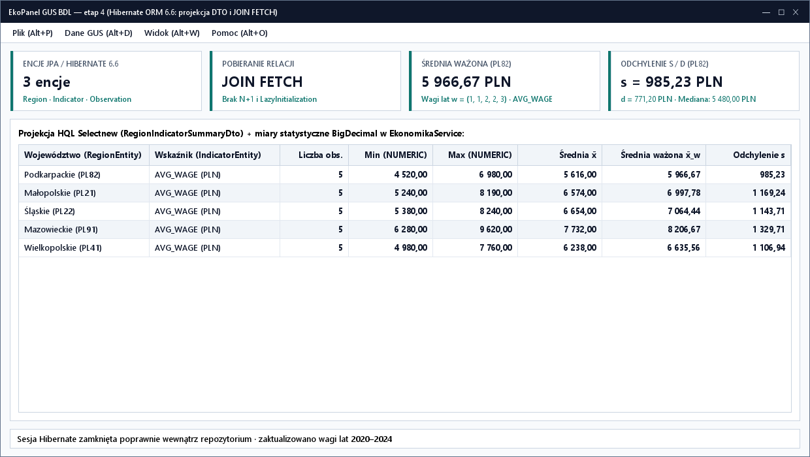

# Lab 4. Zastąpienie repozytorium JDBC przez Hibernate ORM (3 encje GUS BDL)


[Etap 3: JDBC](../../lab3/v2/README.html) · [Wyjaśnienia Hibernate (v1)](../v1/README.html) · [Interaktywny poradnik animowany](poradnik.html) · [Etap 5: JSP i Servlet API](../../lab5/v2/README.html)

Należy wykonywać zadania w podanej kolejności. Wszystkie zadania są wymagane. W tym laboratorium trzy tabele GUS BDL (`region`, `indicator`, `observation`) zostają odwzorowane na trzy powiązane encje Jakarta Persistence / Hibernate 7.4 (`RegionEntity`, `IndicatorEntity`, `ObservationEntity`) w bazie H2.

## Zadanie 4.1. Przygotowanie projektu ORM i schematu H2 dla 3 tabel

📚 [Dokumentacja Hibernate ORM 7.4](https://docs.hibernate.org/orm/7.4/introduction/html_single/) · [Jakarta Persistence 3.2 API](https://jakarta.ee/specifications/persistence/3.2/apidocs/)

1. Skopiować `ekopanel-jdbc` jako `PO2-EkoPanel/ekopanel-orm` i ustawić `artifactId` na `ekopanel-orm`.
2. Dodać zależności: `org.hibernate.orm:hibernate-core:7.4.13.Final`, `jakarta.persistence:jakarta.persistence-api:3.2.0` oraz `com.h2database:h2:2.2.224`. Przeładować Maven.
3. Utworzyć pakiet `pl.uczelnia.ekopanel.orm` i podpakiet `.entity`.
4. Utworzyć `src/main/resources/hibernate.properties`:

   <figure class="code-example" markdown="1">
   <figcaption>ekopanel-orm/src/main/resources/hibernate.properties</figcaption>

   ```properties
   hibernate.connection.driver_class=org.h2.Driver
   hibernate.connection.url=jdbc:h2:./data/ekopanel_orm
   hibernate.connection.username=sa
   hibernate.connection.password=
   hibernate.hbm2ddl.auto=validate
   hibernate.show_sql=true
   hibernate.format_sql=true
   hibernate.generate_statistics=true
   ```

   </figure>

5. Utworzyć `src/main/resources/db/schema-h2.sql` z trzema tabelami odpowiadającymi encjom:

   <figure class="code-example" markdown="1">
   <figcaption>ekopanel-orm/src/main/resources/db/schema-h2.sql</figcaption>

   ```sql
   CREATE TABLE IF NOT EXISTS region (
       code VARCHAR(4) PRIMARY KEY,
       name VARCHAR(80) NOT NULL UNIQUE,
       macroregion VARCHAR(80) NOT NULL
   );

   CREATE TABLE IF NOT EXISTS indicator (
       code VARCHAR(30) PRIMARY KEY,
       name VARCHAR(120) NOT NULL UNIQUE,
       unit VARCHAR(10) NOT NULL CHECK(unit IN ('%', 'PLN')),
       category VARCHAR(60) NOT NULL
   );

   CREATE TABLE IF NOT EXISTS observation (
       id BIGINT GENERATED BY DEFAULT AS IDENTITY PRIMARY KEY,
       region_code VARCHAR(4) NOT NULL REFERENCES region(code),
       indicator_code VARCHAR(30) NOT NULL REFERENCES indicator(code),
       observed_year INTEGER NOT NULL CHECK(observed_year BETWEEN 1990 AND 2035),
       val NUMERIC(14, 2) NOT NULL,
       included BOOLEAN NOT NULL,
       version BIGINT NOT NULL DEFAULT 0,
       CONSTRAINT uq_observation UNIQUE(region_code, indicator_code, observed_year)
   );

   CREATE INDEX IF NOT EXISTS ix_observation_lookup
       ON observation(indicator_code, region_code, observed_year);
   ```

   </figure>

6. Utworzyć `orm/HibernateBootstrap.java`, który przed zbudowaniem `SessionFactory` wykonuje `schema-h2.sql` i zasiewa 5 województw oraz 3 wskaźniki GUS, po czym uruchamia walidację schematu (`hbm2ddl.auto=validate`).

**Wynik:** powstaje baza `data/ekopanel_orm.mv.db` z trzema tabelami zweryfikowanymi względem encji.

## Zadanie 4.2. Mapowanie 3 encji (`RegionEntity`, `IndicatorEntity`, `ObservationEntity`) i relacji

🎬 **[Otwórz animowaną miniinstrukcję: Cykl życia encji i mapowanie 3 encji GUS](poradnik.html#lifecycle)**

<details>
<summary><strong>Relacje @ManyToOne i @OneToMany pomiędzy trzema encjami</strong></summary>

`ObservationEntity` jest stroną właścicielską dwóch relacji `@ManyToOne(fetch = FetchType.LAZY, optional = false)`:
- `@JoinColumn(name = "region_code", nullable = false)` wskazuje `RegionEntity`
- `@JoinColumn(name = "indicator_code", nullable = false)` wskazuje `IndicatorEntity`

Z kolei `RegionEntity` i `IndicatorEntity` mogą udostępniać kolekcje `@OneToMany(mappedBy = "...")`. Aby uniknąć wyjątku `LazyInitializationException` w wątku JavaFX, encje konwertujemy na rekordy DTO (`Region`, `Indicator`, `Observation`) wewnątrz otwartej sesji.
</details>

1. Utworzyć `orm/entity/RegionEntity.java` (`@Entity`, `@Table(name = "region")`):
   - `@Id @Column(length = 4) private String code;`
   - `@Column(nullable = false, unique = true, length = 80) private String name;`
   - `@Column(nullable = false, length = 80) private String macroregion;`
   - `@OneToMany(mappedBy = "region") private List<ObservationEntity> observations = new ArrayList<>();`
   - Metoda `public Region toDto() { return new Region(code, name, macroregion); }`.
2. Utworzyć `orm/entity/IndicatorEntity.java` (`@Entity`, `@Table(name = "indicator")`):
   - `@Id @Column(length = 30) private String code;`
   - `@Column(nullable = false, unique = true, length = 120) private String name;`
   - `@Column(nullable = false, length = 10) private String unit;`
   - `@Column(nullable = false, length = 60) private String category;`
   - `@OneToMany(mappedBy = "indicator") private List<ObservationEntity> observations = new ArrayList<>();`
   - Metoda `public Indicator toDto() { return new Indicator(code, name, unit, category); }`.
3. Utworzyć `orm/entity/ObservationEntity.java` (`@Entity`, `@Table(name = "observation", uniqueConstraints = @UniqueConstraint(name = "uq_observation", columnNames = {"region_code", "indicator_code", "observed_year"}))`):
   - `@Id @GeneratedValue(strategy = GenerationType.IDENTITY) private Long id;`
   - `@ManyToOne(fetch = FetchType.LAZY, optional = false) @JoinColumn(name = "region_code", nullable = false) private RegionEntity region;`
   - `@ManyToOne(fetch = FetchType.LAZY, optional = false) @JoinColumn(name = "indicator_code", nullable = false) private IndicatorEntity indicator;`
   - `@Column(name = "observed_year", nullable = false) private int year;`
   - `@Column(name = "val", nullable = false, precision = 14, scale = 2) private BigDecimal value;`
   - `@Column(nullable = false) private boolean included;`
   - `@Version private long version;`
   - Metody `apply(RegionEntity region, IndicatorEntity indicator, int year, BigDecimal value, boolean included)` oraz `toDto()`.
4. Zarejestrować wszystkie 3 klasy w `HibernateBootstrap` przez `addAnnotatedClass(...)`.

**Wynik:** trzy encje odwzorowują schemat bazy H2 i przechodzą walidację Hibernate przy starcie.

## Zadanie 4.3. Badanie cyklu życia encji (`Transient`, `Managed`, `Detached`, `Removed`)

1. Utworzyć klasę `orm/OrmCheck.java` z metodą `main()`:
   - Otworzyć sesję i transakcję, pobrać referencje `session.getReference(RegionEntity.class, "PL82")` i `session.getReference(IndicatorEntity.class, "UNEMP_RATE")`, utworzyć nową `ObservationEntity` (`2025 / PL82 / UNEMP_RATE / 5.80 / true`) i zapisać ją przez `session.persist(entity)`. Zatwierdzić transakcję i zamknąć sesję.
   - W drugiej sesji i transakcji pobrać tę encję przez `session.find(...)`, zmienić jej wartość na `5.60` bez wywoływania `persist`/`merge` i zatwierdzić transakcję — sprawdzić w logu wygenerowany `UPDATE` (mechanizm *dirty checking* oraz inkrementację pola `@Version`).
   - Po zamknięciu drugiej sesji zmienić w pamięci wartość odłączonego obiektu (*detached*) na `4.90`. Otworzyć trzecią sesję i odczytać rekord z bazy — potwierdzić, że wartość w bazie nadal wynosi `5.60`.
   - Usunąć rekord przez `session.remove(entity)` i zatwierdzić transakcję.

**Wynik:** log SQL potwierdza przejścia między stanami encji oraz automatyczne wykrywanie zmian w stanie `Managed`.

## Zadanie 4.4. Implementacja `HibernateObservationRepository` oraz problem `N+1` vs `JOIN FETCH`

🎬 **[Otwórz animowaną miniinstrukcję: Problem N+1 przy LAZY vs JOIN FETCH dla 3 encji](poradnik.html#nplus1)**

1. Utworzyć `orm/HibernateObservationRepository implements ObservationRepository` przyjmujące `SessionFactory` w konstruktorze.
2. W `findAllObservations()` samodzielnie napisać zapytanie HQL pobierające `ObservationEntity` wraz z obiema powiązanymi encjami słownikowymi (`region` oraz `indicator`) za pomocą klauzuli `join fetch`, posortowane po roku, kodzie regionu i kodzie wskaźnika. Wewnątrz sesji zmapować encje na rekordy DTO `Observation`.
3. W `save()`, `delete()` oraz `replaceDataset(...)` otwierać własną sesję i transakcję; w razie błędu wywoływać `tx.rollback()` i rzucać `DataAccessException`.
4. **Pomiar problemu `N+1` i testy warunków brzegowych w `OrmCheck`:**
   - Zaimportować pakiet 75 obserwacji GUS.
   - W nowej sesji wyczyścić statystyki (`factory.getStatistics().clear()`), wykonać zwykłe `from ObservationEntity o` (bez `join fetch`) i w pętli odczytać `o.getRegion().getName()` oraz `o.getIndicator().getUnit()`. Zapisać wartość `getPrepareStatementCount()` (zapytanie główne + dodatkowe zapytania dociągające `RegionEntity` i `IndicatorEntity`).
   - W kolejnej sesji powtórzyć odczyt przez `findAllObservations()` (z `join fetch`) i potwierdzić, że `getPrepareStatementCount()` wynosi dokładnie **`1`**.
   - Sprawdzić warunek brzegowy zamkniętej sesji: po wywołaniu `findAllObservations()` i zamknięciu sesji odczytać wszystkie pola zwróconych rekordów DTO — nie może wystąpić `LazyInitializationException`.

**Wynik:** `join fetch` eliminuje problem `N+1` przy pobieraniu obserwacji wraz ze słownikami GUS.

## Zadanie 4.5. Projekcje DTO w HQL i agregacja po 3 encjach

1. W `HibernateObservationRepository` zaimplementować `findSummariesByRegion(String regionCode)` przy użyciu projekcji konstruktorowej HQL (`select new pl.uczelnia.ekopanel.model.RegionIndicatorSummary(...)`), łącząc `ObservationEntity`, `RegionEntity` i `IndicatorEntity`, filtrując po `:regionCode` oraz `o.included = true` i grupując po polach regionu oraz wskaźnika.
2. W `OrmCheck` przetestować metodę dla `PL82` (zgodność z wynikami z Lab 3: `UNEMP_RATE` średnia `7,54 %`, `AVG_WAGE` średnia `5616,00 PLN`, `INV_PER_CAPITA` średnia `6460,00 PLN`) oraz dla nieistniejącego kodu `PL00` (oczekiwać pustej listy).

**Wynik:** projekcja HQL bezpośrednio tworzy obiekty DTO dla okna szczegółów regionu bez ładowania pełnych kolekcji encji.

<figure class="image-example" markdown="1">
  
  <figcaption>Zestawienie DTO z miarami statystycznymi i średnią ważoną.</figcaption>
</figure>

## Zadanie 4.6. Podłączenie `HibernateObservationRepository` do JavaFX i zamknięcie `SessionFactory`

1. W `FxApp` inicjalizować `SessionFactory` w zadaniu startowym poza wątkiem GUI, przekazać `HibernateObservationRepository` do `ObservationService`, a w `FxApp.stop()` zamknąć najpierw `ExecutorService`, a następnie `SessionFactory`.
2. Powtórzyć pełny scenariusz CRUD, import 75 obserwacji, próbę rollbacku dla błędnego rekordu, otwarcie okna `Szczegóły regionu…` oraz [macierz GUI](../../jakosc-gui.html). Zapisać wyniki i liczbę zapytań SQL w `docs/lab4.md`.

**Do oddania:** projekt `ekopanel-orm`, 3 klasy encji, `schema-h2.sql`, `hibernate.properties`, `docs/lab4.md` i zrzuty ekranu.
