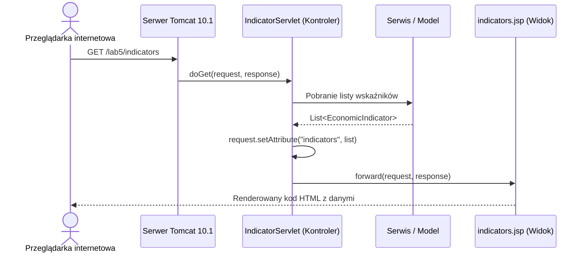
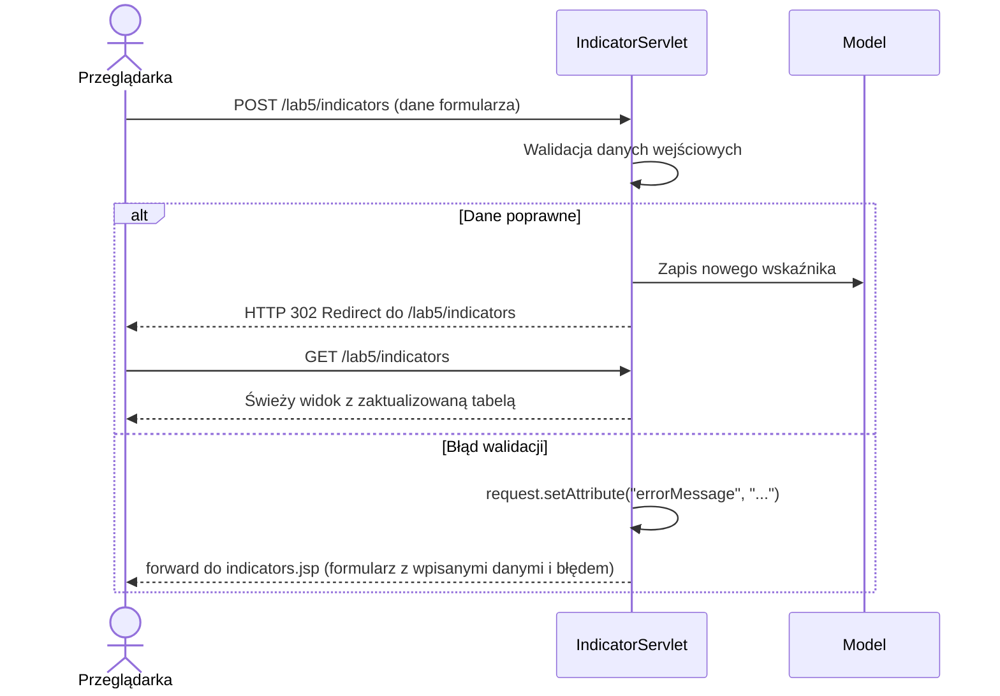

# Lab 5 - Wprowadzenie do JSP i Servlet API

## Zakres laboratorium

Celem laboratorium jest poznanie podstaw tworzenia aplikacji webowych w technologii
Java z wykorzystaniem Jakarta Servlet API oraz stron JSP (*Jakarta Server Pages*),
a także porównanie cyklu życia i architektury aplikacji webowej z desktopowymi
aplikacjami Swing i JavaFX. Projekt semestralny pozostaje aplikacją desktopową;
niniejsze laboratorium stanowi ćwiczenie porównawcze z zakresu wzorca MVC i komunikacji sieciowej.

Zakres obejmuje utworzenie aplikacji WAR prezentującej wskaźniki ekonomiczne
w przeglądarce oraz porównanie cyklu życia i architektury aplikacji webowej
z aplikacją desktopową. Projekt semestralny pozostaje aplikacją desktopową.

Projekt demonstracyjny Servlet/JSP można [pobrać jako ZIP](demo/projekt-do-modyfikacji.zip),
otworzyć w IntelliJ IDEA i rozwijać na jego podstawie. Należy użyć **JDK 27 GA**
i **Apache Tomcat 10.1** zgodnie z [instrukcją środowiska](../srodowisko.html).
Opis działania przykładu znajduje się w [dokumentacji projektu](demo/README.html).

---

## 1. Konfiguracja projektu webowego i serwera aplikacji (Maven / Tomcat 10.1)

Integracja serwera aplikacji z IDE nie jest wymagana. W IntelliJ bez konfiguracji
**Tomcat Server**, także w Community Edition, należy zbudować projekt przez
**Maven → Lifecycle → package**, skopiować `target/lab5.war` do `webapps`
zewnętrznego Tomcata 10.1 i uruchomić serwer z terminala. Pełna procedura wraz
z adresem aplikacji znajduje się w [instrukcji uruchomienia](demo/README.html#uruchomienie-na-serwerze-tomcat-101).
Ten sposób wdrożenia nie wymaga dodatkowej wtyczki IntelliJ.

Współczesne aplikacje webowe w ekosystemie Java korzystają z przestrzeni nazw `jakarta.*`
(od specyfikacji Jakarta EE 9/10). Wymaga to serwera aplikacji zgodnego z tą specyfikacją,
np. Apache Tomcat w wersji 10.1.x.

Archiwum projektu startowego zawiera standardowy moduł Maven z typem pakowania
`<packaging>war</packaging>`. Należy otworzyć jego `pom.xml` w IntelliJ IDEA;
poniżej przedstawiono kompletną konfigurację do sprawdzenia:

```xml
<project xmlns="http://maven.apache.org/POM/4.0.0"
         xmlns:xsi="http://www.w3.org/2001/XMLSchema-instance"
         xsi:schemaLocation="http://maven.apache.org/POM/4.0.0 https://maven.apache.org/xsd/maven-4.0.0.xsd">
    <modelVersion>4.0.0</modelVersion>
    <groupId>pl.uczelnia</groupId>
    <artifactId>lab5</artifactId>
    <version>1.0-SNAPSHOT</version>
    <packaging>war</packaging>

    <properties>
        <maven.compiler.release>27</maven.compiler.release>
        <project.build.sourceEncoding>UTF-8</project.build.sourceEncoding>
        <jakarta.servlet.version>6.0.0</jakarta.servlet.version>
        <jakarta.jstl.api.version>3.0.0</jakarta.jstl.api.version>
        <jakarta.jstl.impl.version>3.0.1</jakarta.jstl.impl.version>
    </properties>

    <dependencies>
        <dependency>
            <groupId>jakarta.servlet</groupId>
            <artifactId>jakarta.servlet-api</artifactId>
            <version>${jakarta.servlet.version}</version>
            <scope>provided</scope>
        </dependency>
        <dependency>
            <groupId>jakarta.servlet.jsp.jstl</groupId>
            <artifactId>jakarta.servlet.jsp.jstl-api</artifactId>
            <version>${jakarta.jstl.api.version}</version>
        </dependency>
        <dependency>
            <groupId>org.glassfish.web</groupId>
            <artifactId>jakarta.servlet.jsp.jstl</artifactId>
            <version>${jakarta.jstl.impl.version}</version>
        </dependency>
    </dependencies>

    <build>
        <finalName>lab5</finalName>
        <plugins>
            <plugin>
                <groupId>org.apache.maven.plugins</groupId>
                <artifactId>maven-compiler-plugin</artifactId>
                <version>3.13.0</version>
            </plugin>
            <plugin>
                <groupId>org.apache.maven.plugins</groupId>
                <artifactId>maven-war-plugin</artifactId>
                <version>3.4.0</version>
                <configuration>
                    <failOnMissingWebXml>false</failOnMissingWebXml>
                </configuration>
            </plugin>
        </plugins>
    </build>
</project>
```

Zależność `jakarta.servlet-api` posiada zakres `<scope>provided</scope>`, ponieważ jej
implementacja jest dostarczana w czasie działania przez kontener serwera Tomcat.

---

## 2. Architektura MVC i izolacja widoków (Servlet / JSP)

W aplikacjach webowych Java realizowany jest wzorzec **Model-View-Controller**:
- **Model:** Obiekty domenowe (np. `EconomicIndicator`) oraz serwisy danych reprezentujące stan systemu.
- **Controller (Servlet):** Odbiera żądania HTTP, przetwarza parametry, wywołuje logikę biznesową i decyduje o wyborze widoku.
- **View (JSP):** Szablon generujący wynikowy dokument HTML na podstawie atrybutów przekazanych w żądaniu (`HttpServletRequest`).



### Bezpieczna lokalizacja widoków w `/WEB-INF/`
Wszystkie pliki `.jsp` należy umieszczać w katalogu `src/main/webapp/WEB-INF/views/`.
Zawartość katalogu `WEB-INF` jest chroniona przez specyfikację serwera — użytkownik
nie może otworzyć pliku widoku bezpośrednio wpisując jego adres w przeglądarce.
Dostęp do widoku możliwy jest wyłącznie poprzez wywołanie metody `RequestDispatcher.forward()`
z poziomu autoryzowanego servletu.

---

## 3. Implementacja kontrolera servletu (`IndicatorServlet.java`)

Klasa servletu dziedziczy po `HttpServlet` i deklaruje obsługiwany adres URL za pomocą
adnotacji `@WebServlet("/indicators")`.

```java
package pl.uczelnia.lab5;

import jakarta.servlet.ServletException;
import jakarta.servlet.annotation.WebServlet;
import jakarta.servlet.http.HttpServlet;
import jakarta.servlet.http.HttpServletRequest;
import jakarta.servlet.http.HttpServletResponse;

import java.io.IOException;
import java.util.List;

@WebServlet("/indicators")
public class IndicatorServlet extends HttpServlet {
    private final IndicatorDataService service = IndicatorDataService.getInstance();

    @Override
    protected void doGet(HttpServletRequest req, HttpServletResponse resp)
            throws ServletException, IOException {
        String category = req.getParameter("category");
        List<EconomicIndicator> indicators = service.findAll(category);

        req.setAttribute("indicators", indicators);
        req.setAttribute("selectedCategory", category != null ? category : "Wszystkie");
        req.getRequestDispatcher("/WEB-INF/views/indicators.jsp").forward(req, resp);
    }
}
```

Serwer servletów jest wielowątkowy — pojedyncza instancja servletu obsługuje równolegle
wiele żądań od różnych użytkowników. **W polach klasy servletu nie wolno przechowywać
danych powiązanych z bieżącym żądaniem ani obiektów transakcji/połączeń bazy.**

---

## 4. Ochrona przed XSS i renderowanie danych w JSP (JSTL `<c:out>`)

W widokach JSP należy korzystać z biblioteki standardowych tagów JSTL (*Jakarta Standard Tag Library*)
zamiast przestarzałych i niebezpiecznych skryptletów Javy (`<% ... %>`).

```jsp
<%@ page contentType="text/html; charset=UTF-8" pageEncoding="UTF-8" %>
<%@ taglib prefix="c" uri="jakarta.tags.core" %>
```

Do wyświetlania wartości pochodzących od użytkownika należy bezwzględnie stosować tag `<c:out>`:

```jsp
<td><strong><c:out value="${item.code()}"/></strong></td>
<td><c:out value="${item.name()}"/></td>
<td><c:out value="${item.latestValue()}"/></td>
```

Użycie samego wyrażenia `${item.name}` bez escapowania stwarza podatność na atak
**Cross-Site Scripting (XSS)** — wprowadzenie tekstu zawierającego tag `<script>`
lub złośliwe atrybuty HTML zostałoby zinterpretowane przez przeglądarkę jako kod wykonywalny.
Tag `<c:out>` automatycznie zamienia znaki specjalne (`<`, `>`, `&`, `"`) na bezpieczne encje HTML.

---

## 5. Obsługa formularzy i wzorzec Post/Redirect/Get (PRG)

Modyfikacja stanu danych (dodanie lub usunięcie wskaźnika) musi być zawsze wykonywana
metodą HTTP **POST**, a nie linkiem GET.

W przypadku pomyślnego przetworzenia formularza należy zastosować wzorzec **Post/Redirect/Get (PRG)**:



Zastosowanie przekierowania `resp.sendRedirect(...)` sprawia, że odświeżenie strony
przez użytkownika (klawisz F5) wyśle bezpieczne żądanie `GET`, a nie ponowi operacji `POST`,
co zapobiega przypadkowemu podwojeniu wpisów w bazie.

Fragment metody `doPost`:

```java
@Override
protected void doPost(HttpServletRequest req, HttpServletResponse resp)
        throws ServletException, IOException {
    req.setCharacterEncoding("UTF-8");

    String code = req.getParameter("code");
    String name = req.getParameter("name");
    String category = req.getParameter("category");
    String unit = req.getParameter("unit");
    String valStr = req.getParameter("value");

    if (code == null || code.isBlank() || name == null || name.isBlank()) {
        req.setAttribute("errorMessage", "Kod i nazwa wskaźnika są wymagane.");
        doGet(req, resp);
        return;
    }

    try {
        double val = Double.parseDouble(valStr.replace(',', '.'));
        service.add(new EconomicIndicator(code.trim(), name.trim(), category.trim(), val, unit.trim()));
        resp.sendRedirect(req.getContextPath() + "/indicators");
    } catch (Exception ex) {
        req.setAttribute("errorMessage", ex.getMessage());
        req.setAttribute("formCode", code);
        req.setAttribute("formName", name);
        req.setAttribute("formValue", valStr);
        req.getRequestDispatcher("/WEB-INF/views/indicators.jsp").forward(req, resp);
    }
}
```

---

## 6. Standardy jakości interfejsu w środowisku WWW

W aplikacjach webowych obowiązuje odpowiednik desktopowych [wymagań jakości GUI](../jakosc-gui.html):
1. **Responsywność i elastyczny układ:** Zastosowanie elastycznej siatki CSS (*CSS Grid / Flexbox*), dzięki której pola formularza i kolumny tabeli płynnie dostosowują się do szerokości okna przeglądarki.
2. **Obsługa motywu jasnego i ciemnego:** Zastosowanie deklaracji `color-scheme: light dark` oraz reguły medialnej `@media (prefers-color-scheme: dark)`. Aplikacja powinna respektować preferencje systemowe użytkownika oraz oferować przełącznik motywu utrwalany w `localStorage`.
3. **Dostępność i skalowanie:** Interfejs musi zachowywać pełną czytelność i brak nakładania się elementów przy powiększeniu widoku przeglądarki do 200%.

Fragment arkusza stylów w nagłówku strony `indicators.jsp`:

```css
:root {
    color-scheme: light dark;
    --bg: #f8fafc;
    --card-bg: #ffffff;
    --text: #0f172a;
    --border: #e2e8f0;
    --primary: #2563eb;
}

@media (prefers-color-scheme: dark) {
    :root:not([data-theme="light"]) {
        --bg: #0f172a;
        --card-bg: #1e293b;
        --text: #f8fafc;
        --border: #334155;
        --primary: #3b82f6;
    }
}

body {
    background: var(--bg);
    color: var(--text);
    font-family: system-ui, sans-serif;
    margin: 0;
    padding: 1.5rem;
}
```

---

## 7. Rozbudowa aplikacji Servlet/JSP

1. **Uruchomienie projektu:** Otworzyć kopię projektu startowego, zbudować `target/lab5.war` i uruchomić aplikację na Tomcat 10.1.
2. **Filtrowanie tekstowe:** Rozszerzyć istniejący filtr kategorii o wyszukiwanie po kodzie i nazwie wskaźnika; oba kryteria powinny działać łącznie.
3. **Przekazywanie kryteriów:** Odczytać parametry filtra w `IndicatorServlet`, przekazać je do serwisu i zachować w formularzu po odświeżeniu wyników.
4. **Bezpieczne renderowanie:** Rozszerzyć tabelę o nowe wyniki wyszukiwania i zachować escapowanie danych przez `<c:out>`.
5. **Walidacja formularza:** Sprawdzić puste wartości, format liczbowy i unikalność kodu; po błędzie zachować wpisane dane i czytelny komunikat.
6. **Wzorzec PRG i usuwanie:** Zachować przekierowanie po `POST`; po dodaniu lub usunięciu odświeżenie strony nie może ponawiać operacji.
7. **Jakość i responsywność:** Zachować oba motywy i sprawdzić widok tabeli oraz formularza przy powiększeniu przeglądarki 100%, 150% i 200%.

---

## 8. Weryfikacja jakości i procedura testowa

| Przypadek testowy | Warunki testu | Oczekiwane zachowanie systemu |
|---|---|---|
| Izolacja katalogu `/WEB-INF/` | Wpisanie w przeglądarce bezpośredniego adresu `.../WEB-INF/views/indicators.jsp` | Serwer zwraca kod błędu HTTP 404 (brak bezpośredniego dostępu) |
| Bezpieczeństwo XSS | Wpisanie nazwy: `<script>alert('xss')</script>` | Tag `<c:out>` escapuje znaki; tekst wyświetla się dosłownie, brak wykonania skryptu |
| Wzorzec PRG | Dodanie poprawnego wskaźnika i wciśnięcie F5 | Przeglądarka odświeża stronę żądaniem GET bez ponawiania formularza POST |
| Walidacja błędów | Wysłanie pustego formularza lub błędnego formatu liczby | Wyświetlenie komunikatu o błędzie, zachowanie wpisanych wartości w polach |
| Polskie znaki (UTF-8) | Wpisanie wskaźnika: `Stopa referencyjna NBP — Kraków` | Prawidłowe zakodowanie i wyświetlenie polskich znaków diakrytycznych |
| Skalowanie strony | Powiększenie strony w przeglądarce do 200% (Ctrl + Plus) | Płynne zawijanie pól formularza, brak nakładania się tekstu i przycisków |

---

## Sprawdzenie całości i oddanie

Do zaliczenia etapu należy przygotować:
1. Projekt Maven budujący archiwum `target/lab5.war`.
2. Uruchomienie aplikacji w serwerze Apache Tomcat 10.1 na JDK 27 GA.
3. Zrzuty ekranu z przeglądarki:
   - widok tabeli wskaźników w motywie jasnym i ciemnym,
   - formularz po wykryciu błędu walidacji (np. błędna wartość),
   - widok przy powiększeniu 200%.
4. Krótkie pisemne porównanie architektury aplikacji desktopowej (Swing/JavaFX) z architekturą webową (Servlet/JSP): różnice w zarządzaniu stanem, wątkowości oraz obsłudze zdarzeń.

---

## Pytania kontrolne

1. Czym różni się model obsługi zdarzeń w aplikacji desktopowej (EDT) od cyklu żądanie-odpowiedź protokołu HTTP?
2. Dlaczego pliki widoków JSP umieszcza się w katalogu `WEB-INF/views/`, a nie bezpośrednio w głównym katalogu `webapp`?
3. Na czym polega wzorzec Post/Redirect/Get (PRG) i przed jakim problemem chroni użytkownika?
4. Dlaczego tag `<c:out>` jest bezpieczniejszy od bezpośredniego wyrażenia `${...}` w kodzie strony JSP?
5. Dlaczego w polach instancji klasy `HttpServlet` nie wolno przechowywać danych specyficznych dla pojedynczego żądania klienta?
