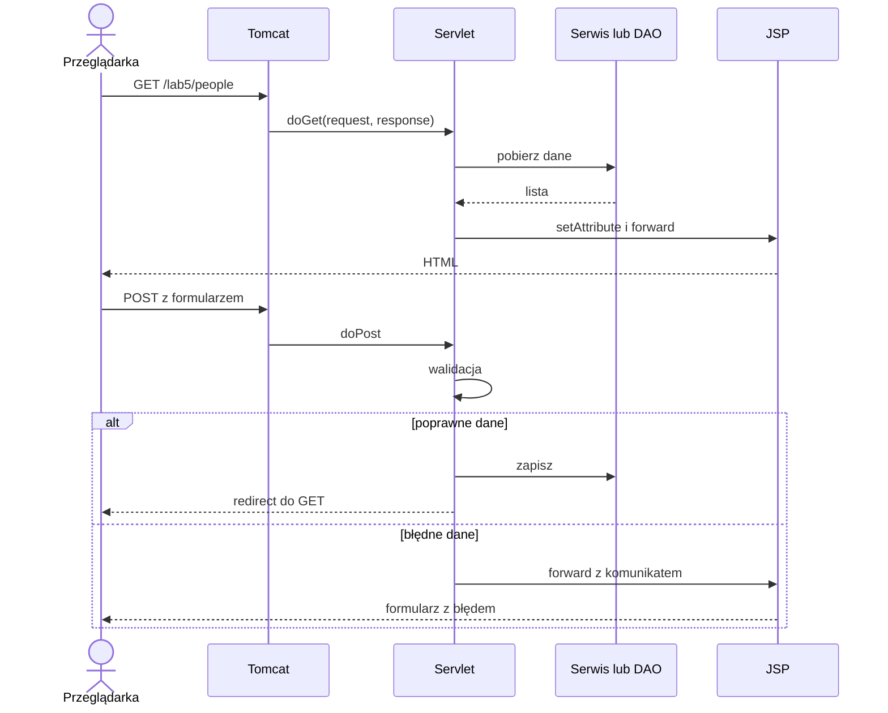

# Lab 5 - Wprowadzenie do JSP i Servlet API

## Zakres: 1 zajęcie

## Cel zajęć

Pracujemy w [IntelliJ IDEA i Maven](../srodowisko.md), w projekcie `lab5`. Jest to krótkie ćwiczenie porównawcze z aplikacją desktopową. Projekt zaliczeniowy pozostaje desktopowy.

JSP (JavaServer Pages) służy do generowania stron HTML po stronie serwera. Współczesne JSP działa razem z Jakarta Servlet API. Laboratorium pokazuje prosty przepływ MVC: żądanie trafia do servletu, servlet przygotowuje dane i przekazuje je do widoku JSP.

## Projekt Maven WAR

```xml
<packaging>war</packaging>

<dependencies>
    <dependency>
        <groupId>jakarta.servlet</groupId>
        <artifactId>jakarta.servlet-api</artifactId>
        <version>6.0.0</version>
        <scope>provided</scope>
    </dependency>
    <dependency>
        <groupId>jakarta.servlet.jsp.jstl</groupId>
        <artifactId>jakarta.servlet.jsp.jstl-api</artifactId>
        <version>3.0.0</version>
    </dependency>
    <dependency>
        <groupId>org.glassfish.web</groupId>
        <artifactId>jakarta.servlet.jsp.jstl</artifactId>
        <version>3.0.1</version>
    </dependency>
</dependencies>
```

Aplikację można uruchomić na serwerze zgodnym z Jakarta EE, np. Tomcat 10.1. Wersja serwera musi odpowiadać używanej przestrzeni nazw `jakarta.*`.

## Servlet i widok

```java
import jakarta.servlet.ServletException;
import jakarta.servlet.annotation.WebServlet;
import jakarta.servlet.http.HttpServlet;
import jakarta.servlet.http.HttpServletRequest;
import jakarta.servlet.http.HttpServletResponse;

import java.io.IOException;

@WebServlet("/hello")
public class HelloServlet extends HttpServlet {
    @Override
    protected void doGet(HttpServletRequest request,
                          HttpServletResponse response)
            throws ServletException, IOException {
        request.setAttribute("message", "Witaj w aplikacji Java");
        request.getRequestDispatcher("/WEB-INF/views/hello.jsp")
                .forward(request, response);
    }
}
```

`src/main/webapp/WEB-INF/views/hello.jsp`:

```jsp
<%@ page contentType="text/html; charset=UTF-8" %>
<!doctype html>
<html lang="pl">
<head>
    <meta charset="UTF-8">
    <title>Lab 5</title>
</head>
<body>
    <h1>${message}</h1>
</body>
</html>
```

Umieszczenie widoku w `WEB-INF` uniemożliwia bezpośrednie otwarcie pliku przez URL. Do widoku przechodzimy przez servlet.

## Formularz i bezpieczeństwo

Formularz powinien wysyłać dane metodą `POST`. W servletcie pobierz parametry, zweryfikuj je i dopiero wtedy wywołaj serwis.

```jsp
<form method="post" action="${pageContext.request.contextPath}/people">
    <label>Imię <input name="name" required></label>
    <button type="submit">Zapisz</button>
</form>
```

Nie wkładaj bezpośrednio danych użytkownika do HTML bez odpowiedniego escapowania. Nie umieszczaj haseł ani sekretów w kodzie i nie buduj zapytań SQL przez konkatenację parametrów formularza.

## Zadania

1. Utwórz aplikację WAR z servletami `GET /people` i `POST /people`.
2. Przygotuj widok JSP wyświetlający listę osób oraz formularz dodawania.
3. Dodaj walidację pustych danych i komunikat błędu przekazywany do JSP.
4. Podłącz warstwę DAO z Lab 3 albo repozytorium Hibernate z Lab 4.
5. Dodaj edycję i usuwanie osoby. Operacje destrukcyjne wykonuj metodą `POST`, nie przez zwykły link `GET`.
6. Dodaj JSTL do iterowania po liście i warunkowego wyświetlania komunikatów. Nie używaj skryptletów Java w JSP.
7. Opisz w dokumentacji przepływ: przeglądarka -> servlet -> serwis/DAO -> baza -> JSP.

## Pytania kontrolne

1. Czym różni się JSP od servletu?
2. Dlaczego widoki umieszcza się w `WEB-INF`?
3. Kiedy użyć `doGet`, a kiedy `doPost`?
4. Gdzie powinna znajdować się logika dostępu do bazy?

## Realny zakres jednego spotkania

Wykonaj uruchomienie WAR, `GET`, formularz `POST`, walidację, wyświetlenie wyniku i diagram przepływu. Korzystaj z wcześniej gotowego DAO lub repozytorium, jeśli model pasuje do formularza. Następnie dodaj edycję i usuwanie z wcześniejszej listy. Przygotuj warstwę persystencji przed spotkaniem, korzystając z poprzednich laboratoriów.

## Uruchomienie w IntelliJ bez integracji serwera w IDE

1. Utwórz zwykły projekt Maven. Dodaj `packaging` równy `war`, zależności powyżej i poniższy plugin do `build/plugins`.
2. W klasie servletu dopisz `package pl.uczelnia.lab5;`, a pliki JSP umieść dokładnie w `src/main/webapp/WEB-INF/views`.
3. W oknie Maven uruchom **Lifecycle → package**. Wynikiem ma być `target/lab5.war`.
4. Przygotuj Tomcat 10.1, uruchamiany na JDK 27 GA zgodnie z konfiguracją środowiska. Ustaw `JAVA_HOME` na katalog tego JDK. Skopiuj WAR do katalogu `webapps` Tomcata i uruchom `bin/catalina.bat run` w terminalu IntelliJ, z katalogu Tomcata. Pozostaw terminal otwarty.
5. Otwórz `http://localhost:8080/lab5/hello`. Zatrzymasz serwer przez Ctrl+C. Przed podmianą WAR na kolejny build zatrzymaj serwer.

```xml
<!-- Wewnątrz build: -->
<finalName>lab5</finalName>
<!-- Wewnątrz build/plugins, obok pluginu kompilatora: -->
<plugin>
    <groupId>org.apache.maven.plugins</groupId>
    <artifactId>maven-war-plugin</artifactId>
    <version>3.4.0</version>
    <configuration>
        <failOnMissingWebXml>false</failOnMissingWebXml>
    </configuration>
</plugin>
```

To dwa fragmenty w dwóch miejscach POM, nie jeden blok do wklejenia wewnątrz `plugins`. Adnotacja `@WebServlet` zastępuje deklarację w `web.xml` dla tego przykładu. Zależność `servlet-api` ma zakres `provided`, bo implementację zapewnia serwer. Tomcat 10.1 używa `jakarta.*`; nie mieszaj go z przykładami `javax.servlet.*`.

| Objaw | Przyczyna do sprawdzenia |
|---|---|
| 404 dla `/hello` | brakuje kontekstu `/lab5` w URL |
| 404 dla `/lab5/hello` | wdrożenie WAR, log serwera, adnotacja i pakiet servletu |
| 500 | wyjątek aplikacji — szczegóły w konsoli Tomcata |
| port 8080 zajęty | działa inny serwer; ustal proces lub zmień port konfiguracji Tomcata |

## Żądanie HTTP i MVC



`forward` pozostaje wewnątrz tego samego żądania, a `redirect` powoduje nowe żądanie przeglądarki. Po udanym zapisie stosuj Post/Redirect/Get, aby odświeżenie strony nie powtarzało `POST`. Atrybuty `request` nie przechodzą automatycznie przez redirect.

## Minimalny POST z walidacją

W istniejącym `HelloServlet` dodaj metodę poniżej; formularz skieruj na `/hello`. Wersja ta demonstruje walidację, bez zapisu w bazie. W zadaniu `/people` w miejscu komentarza wywołaj gotowy serwis i po udanym zapisie zastosuj redirect.

```java
@Override
protected void doPost(HttpServletRequest request, HttpServletResponse response)
        throws ServletException, IOException {
    request.setCharacterEncoding("UTF-8"); // przed pierwszym getParameter
    String value = request.getParameter("name");
    String name = value == null ? "" : value.trim();
    if (name.isEmpty() || name.length() > 80) {
        request.setAttribute("message", "Podaj od 1 do 80 znaków.");
    } else {
        // W wersji z bazą: service.save(name), następnie redirect.
        request.setAttribute("message", "Poprawne dane: " + name);
    }
    request.getRequestDispatcher("/WEB-INF/views/hello.jsp").forward(request, response);
}
```

W JSP dodaj deklarację JSTL i zastąp `<h1>${message}</h1>` bezpiecznym wyświetleniem. Samo `${...}` nie escapuje HTML:

```jsp
<%@ taglib prefix="c" uri="jakarta.tags.core" %>
<h1><c:out value="${message}"/></h1>
<form method="post" action="${pageContext.request.contextPath}/hello">
    <label>Imię <input name="name" maxlength="80" required></label>
    <button type="submit">Sprawdź</button>
</form>
```

Servlet obsługuje wiele żądań równocześnie. Nie przechowuj danych bieżącego formularza w polach servletu i nie współdziel `Connection` ani `Session` między żądaniami.

## Sprawdzenie i oddanie

W tym krótkim ćwiczeniu zastosuj webowy odpowiednik [zasad jakości GUI](../jakosc-gui.md):
formularz o elastycznej szerokości, przejście etykiet nad pola na wąskim ekranie
i kolory zależne od `prefers-color-scheme`. Użyj CSS z właściwością
`color-scheme: light dark` oraz regułą `@media (prefers-color-scheme: dark)`
dla własnych kolorów. Sprawdź jasny/ciemny wygląd przez ustawienie lub emulację
przeglądarki i powiększenie strony do 200%. Powiększenie przeglądarki jest tutaj
testem czytelności strony, nie zamiennikiem testu systemowego DPI aplikacji desktopowej.
Dodaj również przełącznik jasny/ciemny z zapamiętywaniem wyboru.
Ten sam mechanizm realizujemy w aplikacjach desktopowych Lab 1–2 i projekcie.

- `GET /lab5/hello` pokazuje stronę; bezpośredni adres pliku pod `WEB-INF` nie udostępnia widoku.
- `POST` z `Łukasz` zachowuje polskie znaki; pusty parametr zostaje odrzucony także po pominięciu walidacji przeglądarki.
- Tekst `<b>Jan</b>` jest pokazany dosłownie, nie jako pogrubiony HTML.
- W wersji z bazą odświeżenie po poprawnym zapisie nie dopisuje drugiego rekordu.

Oddaj projekt WAR, opis uruchomienia i trzy obrazy: widok początkowy, błędny formularz, poprawny wynik. Porównaj zdarzenie kliknięcia w Swing/JavaFX z cyklem żądania HTTP. [Dokumentacja Tomcat 10.1](https://tomcat.apache.org/tomcat-10.1-doc/) opisuje wymagania kontenera i obsługiwane specyfikacje.
