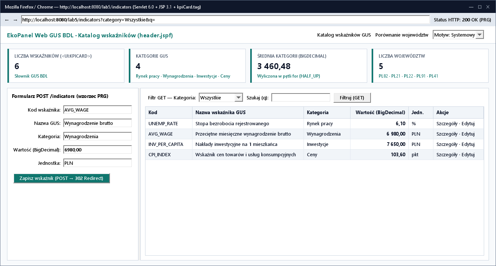
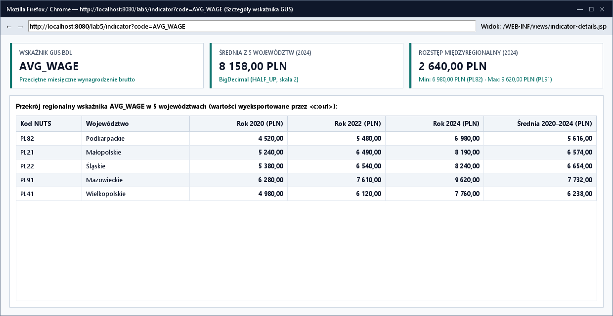

# Lab 5. Zbudowanie aplikacji webowej GUS BDL w Servlet 6.0 i JSP 3.1

<script id="MathJax-script" async src="https://cdn.jsdelivr.net/npm/mathjax@3/es5/tex-mml-chtml.js"></script>

[Etap 4: Hibernate ORM](../../lab4/v2/README.html) · [Wyjaśnienia Servlet/JSP (v1)](../v1/README.html) · [Interaktywny poradnik animowany](poradnik.html) · [Etap 6: Czyszczenie danych, 4 tabele i dystrybucja](../../lab6/v2/README.html)

Należy wykonywać zadania w podanej kolejności. Wszystkie zadania są wymagane. W ramach laboratorium powstaje osobny projekt webowy `ekopanel-web` prezentujący w przeglądarce słownik wskaźników i regionalnych przekrojów GUS BDL z wykorzystaniem wzorca MVC, przekierowania **POST-Redirect-GET (PRG)** oraz **reużywalnych komponentów widoku JSP** (wspólnych fragmentów `.jspf` i własnego znacznika `/WEB-INF/tags/kpiCard.tag`).

## Zadanie 5.1. Uruchomienie projektu WAR na serwerze Apache Tomcat 10.1

📚 [Dokumentacja Apache Tomcat 10.1](https://tomcat.apache.org/tomcat-10.1-doc/index.html) · [Jakarta Servlet 6.0 API](https://jakarta.ee/specifications/servlet/6.0/apidocs/)

1. Rozpakować [projekt demonstracyjny](../v1/demo/projekt-do-modyfikacji.zip) do `PO2-EkoPanel/ekopanel-web` i otworzyć jego `pom.xml` w IntelliJ IDEA.
2. Ustawić JDK 27 GA, zmienić `artifactId` na `ekopanel-web` (pozostawiając `packaging=war` i `finalName=lab5`).
3. Pobrać archiwum ZIP **Apache Tomcat 10.1.61** z [oficjalnych wydań Apache](https://archive.apache.org/dist/tomcat/tomcat-10/v10.1.61/bin/) i rozpakować do `PO2-EkoPanel/apache-tomcat-10.1.61`.
4. Wykonać cel Maven `clean package`, skopiować `target/lab5.war` do `apache-tomcat-10.1.61/webapps` i uruchomić serwer w PowerShell:

   ```powershell
   $env:JAVA_HOME = Split-Path (Split-Path (Get-Command javac.exe).Source)
   .\bin\catalina.bat run
   ```

5. Otworzyć `http://localhost:8080/lab5/indicators` oraz sprawdzić, że bezpośrednie wejście na `http://localhost:8080/lab5/WEB-INF/views/indicators.jsp` zwraca kod `404`.

**Wynik:** aplikacja działa na Tomcat 10.1, a pliki JSP w `/WEB-INF/views/` są chronione przed bezpośrednim dostępem z przeglądarki.

## Zadanie 5.2. Reużywalne komponenty widoku JSP: fragmenty `.jspf` oraz znacznik `kpiCard.tag`

🎬 **[Otwórz animowaną miniinstrukcję: Własny znacznik kpiCard.tag i wspólne fragmenty JSP](poradnik.html#tags)**

<details>
<summary><strong>Tworzenie reużywalnych komponentów w JSP</strong></summary>

W aplikacjach JSP unika się powielania kodu HTML na dwa uzupełniające sposoby:
1. **Fragmenty nagłówka i stopki (`/WEB-INF/views/fragments/header.jspf`, `footer.jspf`)** dołączane dyrektywą `<%@ include file="..." %>` zapewniają identyczne menu nawigacyjne i przełącznik motywu na wszystkich podstronach.
2. **Własne pliki znaczników (`/WEB-INF/tags/kpiCard.tag`)** działają analogicznie do `KpiCardPanel` w Swing i `MetricCard` w JavaFX — przyjmują atrybuty (`title`, `value`, `unit`, `subtitle`) i renderują spójną kartę podsumowania.
</details>

1. Samodzielnie utworzyć plik znacznika `src/main/webapp/WEB-INF/tags/kpiCard.tag` spełniający następujący kontrakt:
   - dyrektywa `<%@ tag pageEncoding="UTF-8" trimDirectiveWhitespaces="true" %>` oraz biblioteka `<%@ taglib prefix="c" uri="jakarta.tags.core" %>`,
   - dwa atrybuty wymagane (`required="true"`): `title` (`java.lang.String`) oraz `value` (`java.lang.Object`),
   - dwa atrybuty opcjonalne (`required="false"`): `unit` (`java.lang.String`) oraz `subtitle` (`java.lang.String`),
   - znacznik `<article class="kpi-card">` wypisujący wartości wyłącznie przez `<c:out value="..."/>` i wyświetlający sekcje `unit` oraz `subtitle` warunkowo (`<c:if test="${not empty ...}">`).
2. Utworzyć wspólny nagłówek `src/main/webapp/WEB-INF/views/fragments/header.jspf` zawierający pasek nawigacji (`Katalog wskaźników GUS`, `Porównanie województw`) oraz selektor motywu `themeMode` (`Systemowy`, `Jasny`, `Ciemny`).
3. W `indicators.jsp` zadeklarować `<%@ taglib prefix="ui" tagdir="/WEB-INF/tags" %>`, dołączyć `header.jspf` i wyświetlić w siatce 4 instancje `<ui:kpiCard>`: liczbę wskaźników, liczbę kategorii GUS, średnią wartość dla wybranej kategorii oraz liczbę województw w bazie.

**Wynik:** nagłówek, nawigacja i karty KPI są zdefiniowane w jednym miejscu i wielokrotnie wykorzystywane na stronach aplikacji.

## Zadanie 5.3. Filtrowanie GET, dodawanie i edycja POST z wzorcem PRG oraz walidacja

🎬 **[Otwórz animowaną miniinstrukcję: Przepływ POST → Redirect (302) → GET vs status 400](poradnik.html#prg)**

1. W `IndicatorServlet.doGet()` obsłużyć parametry `category` (domyślnie `Wszystkie`) oraz `q` (wyszukiwanie pełnotekstowe po kodzie i nazwie bez rozróżniania wielkości liter).
2. W modelu `EconomicIndicator` reprezentować wartość/cenę jako `BigDecimal latestValue` (ze skalą `2` i `RoundingMode.HALF_UP`). W `IndicatorDataService` samodzielnie zaimplementować metodę `BigDecimal calculateAverageValue(List<EconomicIndicator> items)` liczącą średnią arytmetyczną przefiltrowanych wskaźników w zwykłej pętli `for` na `BigDecimal` według wzoru $\bar{x} = \frac{1}{n}\sum_{i=1}^{n} x_i$ (dla pustej listy zwracającą `BigDecimal.ZERO.setScale(2, RoundingMode.HALF_UP)`) i przekazywać wynik do karty `<ui:kpiCard title="Średnia kategorii" .../>`.
3. W `doPost()` ustawić `req.setCharacterEncoding("UTF-8")`, znormalizować kod przez `strip().toUpperCase(Locale.ROOT)` i zweryfikować reguły:
   - kod pasuje do `[A-Z][A-Z0-9_]{1,29}`, nazwa 1–120 znaków, jednostka `%` lub `PLN` (oraz `pkt`), kategoria należy do słownika (`Rynek pracy`, `Wynagrodzenia`, `Inwestycje`, `Ceny`, `Rachunki narodowe`, `Handel`), wartość daje się sparsować przez `new BigDecimal(text.strip().replace(',', '.')).setScale(2, RoundingMode.HALF_UP)`;
   - przy błędzie ustawić `resp.setStatus(HttpServletResponse.SC_BAD_REQUEST)` i wykonać `forward()` do widoku z zachowanymi wartościami pól;
   - przy sukcesie wykonać zapis (`add` lub `update`) i przekierowanie `resp.sendRedirect(req.getContextPath() + "/indicators")`.
4. Dodać obsługę edycji (`?edit=KOD` w `doGet` oraz `action=update` w `doPost`) i przetestować warunki brzegowe w przeglądarce (zakładka *Network* w narzędziach deweloperskich `F12`):

   | Przypadek testowy | Żądanie / akcja | Oczekiwany wynik HTTP i stan widoku |
   |---|---|---|
   | Pusty wynik filtrowania | `GET /lab5/indicators?q=BRAK_TAKIEGO_KODU` | Status `200 OK`, 0 wierszy w tabeli, karta `Średnia kategorii` wyświetla `0,00` (brak wyjątku `ArithmeticException` dzielenia przez zero) |
   | Dodanie rekordu w `PLN` z przecinkiem | `POST /lab5/indicators` (`AVG_WAGE_2024`, `Wynagrodzenia`, `6980,00`, `PLN`) | Status `302 Found` → `GET /lab5/indicators` (`200 OK`), odświeżenie `F5` nie duplikuje rekordu |
   | Błędna liczba dziesiętna | `POST /lab5/indicators` (`latestValue=abc` lub `NaN`) | Status `400 Bad Request`, formularz zachowuje wpisane wartości i wyświetla komunikat błędu |
   | Niedozwolony format kodu | `POST /lab5/indicators` (`code=123_ZLY`) | Status `400 Bad Request`, odrzucenie przed zapisem |
   | Nieistniejący kod w szczegółach | `GET /lab5/indicator?code=NIEISTNIEJACY` | Status `404 Not Found` |

**Wynik:** formularz realizuje pełny cykl CRUD zgodnie z wzorcem PRG i zwraca status `400` przy błędnych danych.



## Zadanie 5.4. Podstrona szczegółów wskaźnika i przekroju województw (`/indicator`) oraz ochrona XSS

1. Utworzyć `IndicatorDetailsServlet` (`@WebServlet("/indicator")`) oraz widok `/WEB-INF/views/indicator-details.jsp` korzystający z tego samego `header.jspf` oraz kart `<ui:kpiCard>`.
2. Dla nieistniejącego kodu (`?code=BRAK`) zwracać `resp.sendError(HttpServletResponse.SC_NOT_FOUND, "Nie znaleziono wskaźnika.")`.
3. Dla poprawnego kodu wyświetlać kartę metadanych wskaźnika GUS oraz tabelę wartości w 5 województwach (`PL82`, `PL21`, `PL22`, `PL91`, `PL41`).
4. Przetestować odporność na XSS: dodać rekord `TEXT_CHECK` z nazwą `<b>Próba</b>`, sprawdzić na liście, w szczegółach i w formularzu edycji, że wyświetla się dosłowny tekst `<b>Próba</b>` (dzięki `<c:out>`), a następnie usunąć rekord przez POST.
5. Wydzielić arkusz `src/main/webapp/css/app.css` (kolory `#0F766E` / `#5EEAD4`, responsywny układ `@media (max-width: 48rem)`) i skrypt `src/main/webapp/js/theme.js` (`localStorage`, tryby `system`, `light`, `dark`), sprawdzić skalowanie 100%, 150%, 200% i zapisać raport w `docs/lab5.md`.

**Do oddania:** projekt `ekopanel-web`, `target/lab5.war`, plik znacznika `kpiCard.tag`, `docs/lab5.md` oraz zrzuty ekranu.


