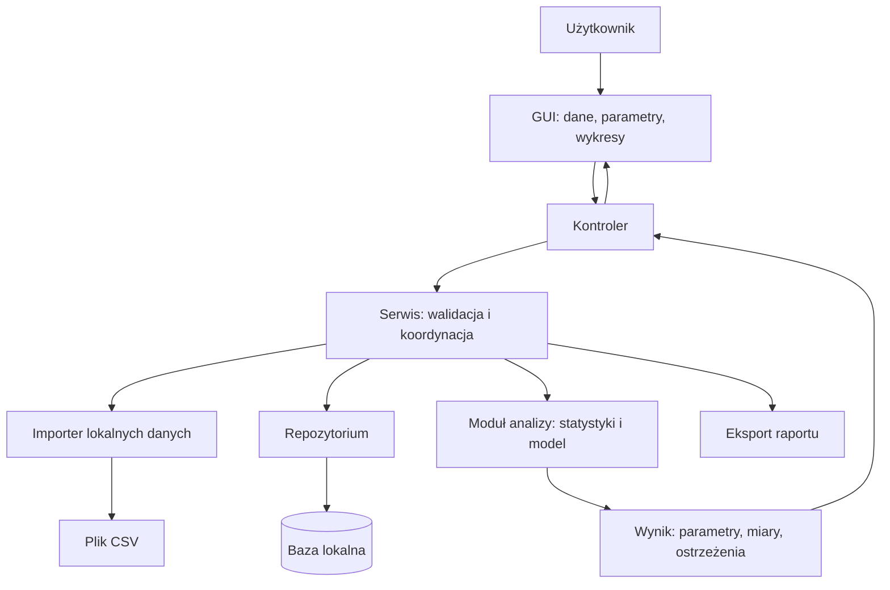
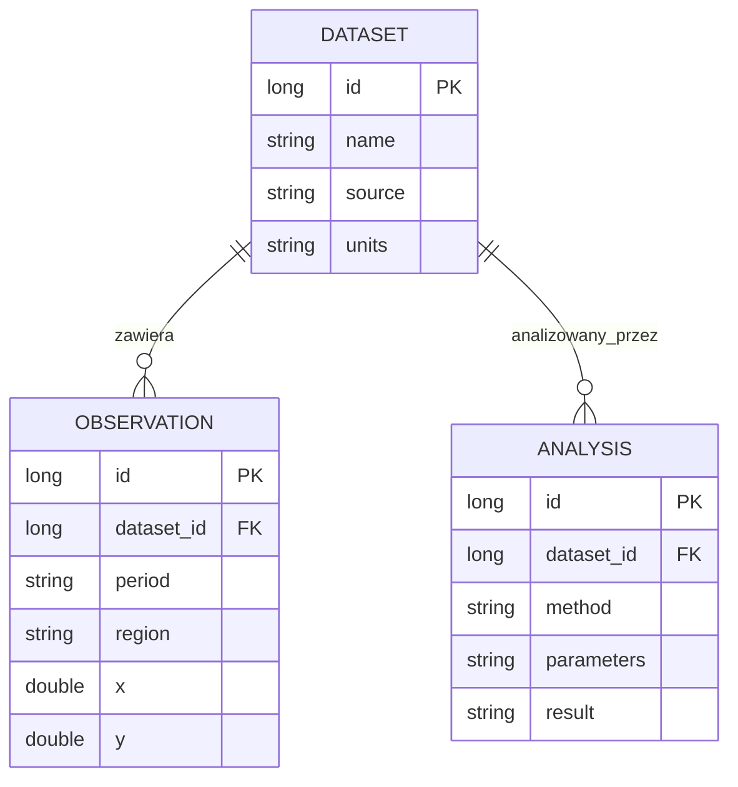
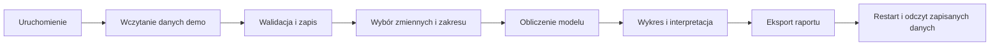

# Lab 6 - Projekt: integracja aplikacji desktopowej i obrona

## Zakres: 1 zajęcie

## Cel zajęć

Ostatnie zajęcia służą integracji elementów poznanych w semestrze oraz przygotowaniu działającej wersji projektu. Projekt ma być desktopową aplikacją Java z GUI, relacyjną bazą danych i analizą danych ekonomicznych lub ekonometrycznych.

Projekt rozwijaj stopniowo od Lab 1. Jedno ostatnie spotkanie służy sprawdzeniu integracji i obronie przygotowanego rozwiązania. Pełny zakres i punktacja znajdują się w [wymaganiach projektu](../projekt/README.md). Uruchamianie i budowanie wykonujemy w [IntelliJ IDEA](../srodowisko.md).

## Zakres pracy

1. Zdefiniuj problem ekonomiczny, użytkownika i pytanie analityczne.
2. Przygotuj lokalny plik danych demonstracyjnych albo skrypt inicjalizujący bazę.
3. Połącz widoki GUI z serwisem, repozytorium JDBC/Hibernate i bazą.
4. Dodaj statystyki opisowe, wybraną metodę analizy oraz wykres.
5. Obsłuż błędne dane, pusty wynik i brak połączenia z bazą.
6. Przygotuj ERD, instrukcję uruchomienia, opis metody i interpretację wyników.
7. Wykonaj demonstrację od importu danych do wyniku analizy.

## Checklista przed oddaniem

- [ ] układ adaptuje się do małego i dużego okna, a wszystkie podstawowe akcje pozostają dostępne;
- [ ] jasny i ciemny motyw obejmują formularze, menu, dialogi, tabele oraz wykresy;
- [ ] przełączenie motywu nie gubi danych, a wybór jest odtwarzany po restarcie;
- [ ] wykonano [macierz testów 100%, 150%, 200%](../jakosc-gui.md) i opisano wyniki;
- [ ] tekst, ikony, fokus i zaznaczenie są czytelne; większa czcionka nie ucina treści;

- [ ] aplikacja uruchamia się na czystym środowisku zgodnie z README;
- [ ] projekt działa bez dostępu do Internetu;
- [ ] dane demonstracyjne są dołączone do repozytorium;
- [ ] baza ma klucze, relacje i ograniczenia integralności;
- [ ] GUI nie zawiera zapytań SQL ani obliczeń biznesowych;
- [ ] analiza ma opis zmiennych, wzór/założenia i interpretację;
- [ ] wykresy mają podpisane osie i jednostki;
- [ ] dokumentacja zawiera ERD, instrukcję użytkownika i ograniczenia;
- [ ] student potrafi wyjaśnić przepływ danych i uruchomić testowy scenariusz.

## Pytania do obrony

1. Dlaczego wybrano ten model danych i metodę analizy?
2. Jak aplikacja reaguje na brak lub błędną wartość?
3. Które klasy pokazują hermetyzację, polimorfizm i separację warstw?
4. Jakie zapytania wykonuje aplikacja i gdzie są otwierane transakcje?
5. Jak zinterpretować najważniejszy wynik ekonomiczny?

## Architektura aplikacji analitycznej

Obliczenia przyjmują dane i konfigurację, a zwracają wynik; nie powinny odczytywać wartości bezpośrednio z pól GUI. Pozwala to sprawdzać metodę analityczną bez uruchamiania okna.

## Model danych — przykład do dostosowania

To minimalny przykład szerokiego modelu. Nazwy `x` i `y` w rzeczywistym projekcie zastąp znaczeniem ekonomicznym, zapisz jednostki i dostosuj liczbę zmiennych do wymagań projektu. Dodaj unikalność identyfikującą obserwację. Analiza musi zapamiętywać filtr i wersję danych albo ich migawkę, aby późniejsza edycja zbioru nie zmieniała po cichu znaczenia zapisanego wyniku.

## Scenariusz demonstracji

Przygotuj demonstrację około 8–10 minut, jeśli prowadzący nie ustali innego czasu. Pokaż najpierw problem ekonomiczny i źródło lokalnego zbioru, potem pełny przepływ. Na końcu wywołaj jeden błąd danych i pokaż, że aplikacja go obsługuje. W IntelliJ miej przygotowane klasy kontrolera, serwisu, repozytorium i analizy do omówienia podczas obrony.

## Jak sprawdzić poprawność obliczeń

Przykład kontrolny OLS z jedną zmienną: `x = [1, 2, 3, 4]`, `y = [3, 5, 7, 9]`. Oczekiwany model to `y = 1 + 2x`, średnia `y = 6`, suma kwadratów reszt `SSE = 0` i `R² = 1`. Dla obliczeń zmiennoprzecinkowych porównuj z tolerancją, np. `1e-9`.

Ten mały sztuczny zbiór służy sprawdzeniu implementacji, nie zastępuje danych ekonomicznych. Przy regresji wielorakiej dodaj test znanych parametrów dla pełnorządowej macierzy i test współliniowości. Nie odwracaj macierzy bez kontroli osobliwości.

| Przypadek | Oczekiwane zachowanie |
|---|---|
| brak obserwacji po filtrowaniu | brak próby dopasowania, komunikat |
| wszystkie wartości `x` jednakowe | informacja o niemożności oszacowania nachylenia |
| stałe `y` | jawna obsługa nieokreślonego standardowego `R²`, bez prezentacji `NaN` jako wyniku |
| brak wartości lub duplikat | ustalona polityka, raport i liczba pominiętych rekordów |
| błąd w połowie importu | wycofanie importu albo jawnie opisany tryb częściowy |
| dłuższa analiza | GUI reaguje, przycisk nie uruchamia wielu analiz równolegle |
| błąd eksportu | komunikat z możliwością wyboru innej lokalizacji |

Interpretacja ma odróżniać zależność statystyczną od przyczynowości. Przy prognozie zachowaj kolejność czasu i oceniaj wynik na danych nieużytych do dopasowania. Opisz jednostki błędu i ograniczenia małego zbioru.

## Pakiet do oddania

Do materiałów GUI dołącz także [raport HiDPI i motywów](../jakosc-gui.md):
12 przypadków, cztery zrzuty obu układów i motywów oraz opis ograniczeń sprzętowych,
jeżeli wystąpiły. Podczas obrony pokaż zmianę szerokości i przełącz motyw
na załadowanych danych. Stan aplikacji i wynik analizy muszą zostać zachowane.

- projekt Maven z kodem i zasobami; `clean verify` w IntelliJ kończy się poprawnie;
- lokalne dane demonstracyjne, opis źródła i sposobu odtworzenia bazy;
- README z JDK, uruchomieniem, ścieżkami danych i scenariuszem demonstracji;
- diagram architektury i ERD w blokach Mermaid;
- wyniki testów obliczeń i testu wycofania transakcji;
- zrzuty rzeczywistej aplikacji: tabela z filtrem, wybór analizy, wynik z wykresem, obsłużony błąd;
- przykładowy wyeksportowany raport z interpretacją i ograniczeniami.

Przed oddaniem otwórz kopię projektu z `pom.xml` w IntelliJ, przygotuj zależności i uruchom scenariusz offline. Nie dołączaj katalogów `target`, `.idea`, haseł ani przypadkowych danych prywatnych. Zdjęcia ekranu dokumentują działanie, ale nie zastępują uruchamialnego projektu.
