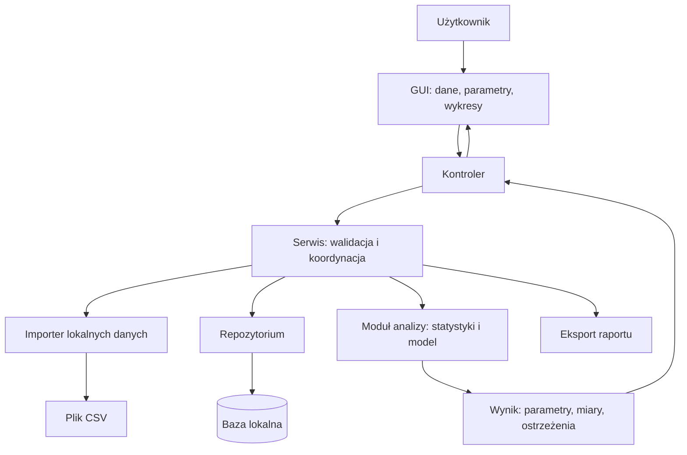
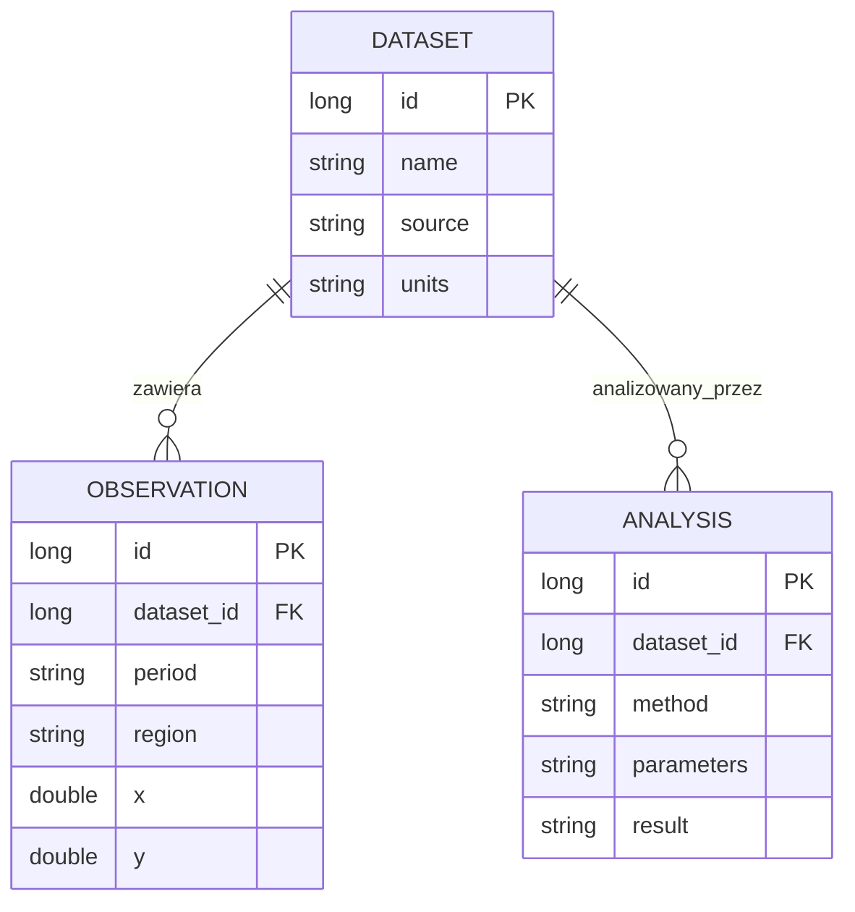
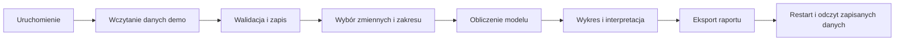

# Lab 6 - Integracja aplikacji desktopowej i dystrybucja

## Integracja aplikacji laboratoryjnej

Należy rozbudować aplikację desktopową w języku Java przygotowaną podczas
poprzednich laboratoriów, łącząc GUI, relacyjną bazę danych oraz analizę danych
ekonomicznych lub ekonometrycznych. Aplikację należy uruchamiać i budować
w [IntelliJ IDEA](../../srodowisko.html).
Projekt semestralny należy wykonać samodzielnie, niezależnie od tej aplikacji.

Należy połączyć rozwijany interfejs Swing z Lab 1 albo JavaFX z Lab 2 z warstwą
JDBC/DAO z Lab 3 albo Hibernate z Lab 4. Integracja wymaga dostosowania wspólnego
modelu domeny i serwisów, a następnie dodania analizy i wykresów zgodnych
z wybranym tematem. Nie trzeba stosować obu bibliotek GUI ani obu metod persystencji.
Dane demonstracyjne i skrypt inicjalizacji należy dołączyć do repozytorium,
np. w `src/main/resources/db/` lub `data/`. Po przygotowaniu zależności pełny
scenariusz sprawdzenia aplikacji musi działać bez Internetu i bez wywołań zewnętrznego API.

## Integracja funkcji aplikacji

1. Zdefiniować problem ekonomiczny, użytkownika i pytanie analityczne.
2. Przygotować lokalny plik danych demonstracyjnych albo skrypt inicjalizujący bazę.
3. Połączyć widoki GUI z serwisem, repozytorium JDBC/Hibernate i bazą.
4. Dodać statystyki opisowe, wybraną metodę analizy i wykres.
5. Obsłużyć błędne dane, pusty wynik i brak połączenia z bazą.
6. Przygotować ERD, instrukcję uruchomienia, opis metody i interpretację wyników.
7. Zademonstrować pełny przepływ od importu danych do wyniku analizy.

## Lista kontrolna wykonania laboratorium

- [ ] układ adaptuje się do małego i dużego okna, a wszystkie podstawowe akcje pozostają dostępne;
- [ ] domyślny tryb automatycznie dopasowuje się do motywu systemu i reaguje na jego zmianę;
- [ ] ręczny wybór jasnego lub ciemnego motywu obejmuje formularze, menu, dialogi, tabele oraz wykresy;
- [ ] zmiana motywu nie gubi danych, a wybrany tryb jest odtwarzany po restarcie;
- [ ] wykonano [macierz testów 100%, 150%, 200%](../../jakosc-gui.html) i opisano wyniki;
- [ ] tekst, ikony, fokus i zaznaczenie są czytelne; większa czcionka nie ucina treści;

- [ ] aplikacja uruchamia się na czystym środowisku zgodnie z README;
- [ ] projekt działa bez dostępu do Internetu;
- [ ] dane demonstracyjne są dołączone do repozytorium;
- [ ] baza ma klucze, relacje i ograniczenia integralności;
- [ ] GUI nie zawiera zapytań SQL ani obliczeń biznesowych;
- [ ] analiza ma opis zmiennych, wzór/założenia i interpretację;
- [ ] wykresy mają podpisane osie i jednostki;
- [ ] dokumentacja zawiera ERD, instrukcję użytkownika i ograniczenia;
- [ ] publiczne i chronione klasy oraz metody API mają komentarze JavaDoc w kodzie;
- [ ] wygenerowano HTML API i dołączono je w `docs/javadoc/` poza katalogiem `target`;
- [ ] przygotowano obraz `jpackage app-image` albo instalator Windows `.exe` z runtime’em;
- [ ] pakiet uruchomiono na czystym Windows bez JDK i Internetu; sprawdzono zapis bazy w katalogu użytkownika;
- [ ] student potrafi wyjaśnić przepływ danych i uruchomić testowy scenariusz.

## Analiza przepływu danych w aplikacji

Na podstawie kodu aplikacji laboratoryjnej należy odpowiedzieć na poniższe pytania.

1. Dlaczego wybrano ten model danych i metodę analizy?
2. Jak aplikacja reaguje na brak lub błędną wartość?
3. Które klasy pokazują hermetyzację, polimorfizm i separację warstw?
4. Jakie zapytania wykonuje aplikacja i gdzie są otwierane transakcje?
5. Jak zinterpretować najważniejszy wynik ekonomiczny?

## Podział aplikacji analitycznej na warstwy

Obliczenia przyjmują dane i konfigurację, a zwracają wynik; nie powinny odczytywać wartości bezpośrednio z pól GUI. Pozwala to sprawdzać metodę analityczną bez uruchamiania okna.

## Model danych — przykład do dostosowania

To minimalny przykład szerokiego modelu. W aplikacji laboratoryjnej nazwy `x` i `y` należy
zastąpić zmiennymi o znaczeniu ekonomicznym, zapisać ich jednostki i dostosować
liczbę do analizowanego zbioru. Trzeba zapewnić unikalność identyfikującą obserwację.
Analiza powinna zapamiętywać filtr i wersję danych albo ich migawkę, aby późniejsza
edycja zbioru nie zmieniała znaczenia zapisanego wyniku.

## Sprawdzenie pełnego przepływu danych

Należy wykonać kolejno czynności przedstawione na diagramie i sprawdzić pełny
przepływ danych od importu do ponownego odczytu po restarcie aplikacji.
Następnie trzeba wywołać błąd danych i sprawdzić jego obsługę. W IntelliJ należy
prześledzić wywołania między klasami kontrolera, serwisu, repozytorium i analizy.

## Weryfikacja poprawności obliczeń

Przykład kontrolny OLS z jedną zmienną: `x = [1, 2, 3, 4]`, `y = [3, 5, 7, 9]`. Oczekiwany model to `y = 1 + 2x`, średnia `y = 6`, suma kwadratów reszt `SSE = 0` i `R² = 1`. Dla obliczeń zmiennoprzecinkowych porównuj z tolerancją, np. `1e-9`.

Ten mały sztuczny zbiór służy sprawdzeniu implementacji, ale nie zastępuje danych
ekonomicznych. Przy regresji wielorakiej należy dodać test znanych parametrów
dla pełnorządowej macierzy oraz test współliniowości. Macierzy nie należy
odwracać bez kontroli osobliwości.

| Przypadek | Oczekiwane zachowanie |
|---|---|
| brak obserwacji po filtrowaniu | brak próby dopasowania, komunikat |
| wszystkie wartości `x` jednakowe | informacja o niemożności oszacowania nachylenia |
| stałe `y` | jawna obsługa nieokreślonego standardowego `R²`, bez prezentacji `NaN` jako wyniku |
| brak wartości lub duplikat | ustalona polityka, raport i liczba pominiętych rekordów |
| błąd w połowie importu | wycofanie importu albo jawnie opisany tryb częściowy |
| dłuższa analiza | GUI reaguje, przycisk nie uruchamia wielu analiz równolegle |
| błąd eksportu | komunikat z możliwością wyboru innej lokalizacji |

Interpretacja powinna odróżniać zależność statystyczną od przyczynowości.
Przy prognozie należy zachować kolejność czasu i oceniać wynik na danych
niewykorzystanych do dopasowania. Trzeba opisać jednostki błędu i ograniczenia
małego zbioru.

## Przygotowanie pakietu aplikacji laboratoryjnej

Do materiałów GUI dołącz także [raport HiDPI i motywów](../../jakosc-gui.html):
12 kombinacji ze wskazanej macierzy, próbę zmiany motywu systemu podczas pracy
aplikacji, cztery zrzuty obu układów i motywów oraz opis ograniczeń sprzętowych,
jeżeli wystąpiły. Należy sprawdzić zmianę szerokości okna i motywu przy
załadowanych danych. Stan aplikacji i wynik analizy muszą zostać zachowane.

- projekt Maven z kodem i zasobami; `clean verify` w IntelliJ kończy się poprawnie;
- dokumentacja JavaDoc w kodzie oraz wygenerowany katalog HTML API w `docs/javadoc/`;
- samodzielny obraz aplikacji `app-image` albo instalator `.exe`, dołączony jako osobne archiwum dystrybucyjne;
- lokalne dane demonstracyjne, opis źródła i sposobu odtworzenia bazy;
- README z JDK, uruchomieniem, ścieżkami danych i scenariuszem demonstracji;
- diagram architektury i ERD w blokach Mermaid;
- wyniki testów obliczeń i testu wycofania transakcji;
- zrzuty rzeczywistej aplikacji: tabela z filtrem, wybór analizy, wynik z wykresem, obsłużony błąd;
- przykładowy wyeksportowany raport z interpretacją i ograniczeniami.

Przed oddaniem należy otworzyć kopię projektu z `pom.xml` w IntelliJ, przygotować
zależności i uruchomić scenariusz offline. Katalogów `target`, `.idea`, haseł
ani przypadkowych danych prywatnych nie należy dołączać. Zrzuty ekranu
dokumentują działanie, ale nie zastępują uruchamialnego projektu.
