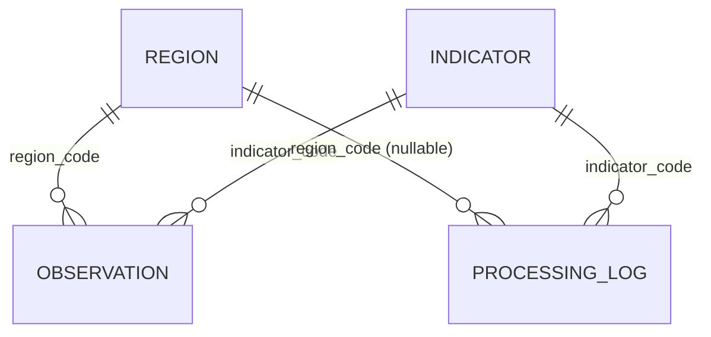
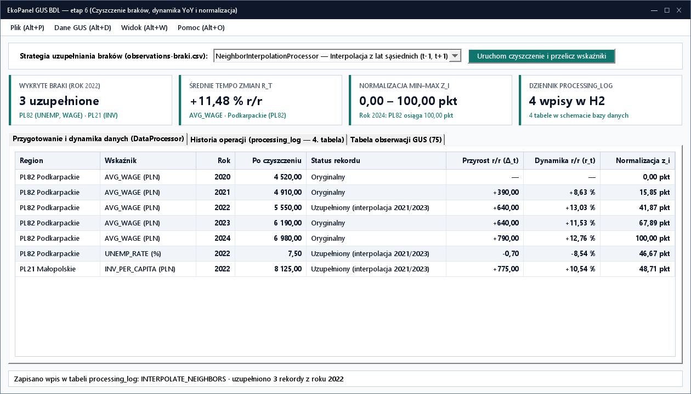

# Lab 6. Czyszczenie i przetwarzanie danych GUS BDL (4 tabele), JavaDoc i dystrybucja


[Etap 4: Hibernate ORM](../../lab4/v2/README.html) · [Etap 5: JSP](../../lab5/v2/README.html) · [Interaktywny poradnik animowany](poradnik.html)

Należy kontynuować aplikację laboratoryjną `ekopanel-orm`. Projekt semestralny należy wykonać samodzielnie, niezależnie od tej aplikacji.

Należy wykonywać zadania w podanej kolejności. Wszystkie zadania są wymagane. W końcowym etapie aplikacja desktopowa z bazą Hibernate/H2 zostaje rozbudowana o **czwartą tabelę relacyjną `processing_log` (historię przetwarzania i raportów)**, polimorficzną hierarchię klas przygotowania i analizy danych ekonomicznych (**usuwanie braków danych, uzupełnianie braków średnią lub sąsiednimi latami, proste zmiany rok do roku oraz normalizacja min–max**), eksport raportów Markdown, dokumentację API JavaDoc oraz samodzielny obraz wykonawczy `jpackage`.

## Zadanie 6.1. Przygotowanie aplikacji laboratoryjnej `ekopanel-final` i pliku z brakami danych

1. Skopiować `ekopanel-orm` jako `PO2-EkoPanel/ekopanel-final`. W `pom.xml` ustawić `artifactId=ekopanel-final`, `version=1.0.0` oraz `build/finalName=ekopanel-final-1.0.0`.
2. Upewnić się, że w katalogu `data/` znajduje się plik [observations-braki.csv](../../dane/observations-braki.csv) (wchodzący również w skład [gus-bdl-dane.zip](../../dane/gus-bdl-dane.zip)), który zawiera **3 puste wartości (braki danych)** w roku `2022`:
   - `2022;PL82;UNEMP_RATE;;true`
   - `2022;PL82;AVG_WAGE;;true`
   - `2022;PL21;INV_PER_CAPITA;;true`
3. Rozszerzyć `GusCsvPackageReader`: dodać tryb importu z dopuszczeniem braków (`allowMissing = true`), w którym pusta kolumna `value` jest wczytywana jako `value = null` (brak wartości `BigDecimal`) z flagą `included = false` (zamiast przerywania importu wyjątkiem).
4. Utworzyć plik `docs/README.md` opisujący cel narzędzia: wykrywanie i obsługa brakujących obserwacji w szeregach GUS BDL na typie `BigDecimal` oraz zestawianie średniej ważonej, zmian rok do roku (r/r) i znormalizowanego rankingu województw.

**Wynik:** aplikacja potrafi wczytać surowy zbiór z brakującymi wartościami i oznaczyć niekompletne rekordy (`value() == null`) w tabeli jako `BRAK`.

## Zadanie 6.2. Polimorficzna hierarchia czyszczenia i przetwarzania danych na `BigDecimal` (`AbstractDataProcessor`)

🎬 **[Otwórz animowaną miniinstrukcję: Polimorficzne czyszczenie braków danych — Usuwanie, Średnia, Sąsiednie lata](poradnik.html#cleaning)**

<details>
<summary><strong>Wzory imputacji braków, średniej ważonej i normalizacji</strong></summary>

Każdy z poniższych wzorów matematycznych należy zaimplementować samodzielnie jako pętlę `for` operującą na `BigDecimal` (`RoundingMode.HALF_UP`):

1. **Uzupełnianie braku średnią grupową (`MeanImputationProcessor`)** dla województwa $r$ i wskaźnika $k$ po zbiorze lat $T_{r,k}$ posiadających niepustą wartość:
   $$\hat{x}_{r,k} = \frac{1}{|T_{r,k}|} \sum_{t \in T_{r,k}} x_{r,k,t}$$
2. **Interpolacja liniowa z sąsiednich lat (`NeighborInterpolationProcessor`)** dla brakującego roku $t$ (gdy brakuje jednego z sąsiadów, czyli na krańcu szeregu $t = t_{\min}$ lub $t = t_{\max}$, przyjąć wartość najbliższego dostępnego sąsiada):
   $$\hat{x}_{r,k,t} = \frac{x_{r,k,t-1} + x_{r,k,t+1}}{2}$$
3. **Średnia ważona $\bar{x}_w$** (dla wag dodatnich $w_1, w_2, \dots, w_n$, np. $w = (1, 1, 2, 2, 3)$ dla kolejnych lat 2020–2024):
   $$\bar{x}_w = \frac{\sum_{i=1}^{n} w_i \cdot x_i}{\sum_{i=1}^{n} w_i}$$
4. **Przyrost rok do roku $\Delta_t$, dynamika względna $r_t$ oraz normalizacja min–max $z_i \in [0, 1]$:**
   $$\Delta_t = x_t - x_{t-1}, \qquad r_t = \frac{x_t - x_{t-1}}{x_{t-1}} \cdot 100\%, \qquad z_i = \frac{x_i - x_{\min}}{x_{\max} - x_{\min}}$$
</details>

1. Utworzyć pakiet `pl.uczelnia.ekopanel.analysis` oraz rekordy wynikowe `SeriesRow(int year, String regionCode, String indicatorCode, BigDecimal value, BigDecimal yoyDiff, BigDecimal yoyPercent, BigDecimal normalizedMinMax, boolean imputed)` i `ProcessingResult(String strategyName, int inputCount, int missingCount, int outputCount, BigDecimal arithmeticMean, BigDecimal weightedMean, List<Observation> cleanedObservations, List<SeriesRow> seriesRows, String summaryText)`.
2. Utworzyć abstrakcyjną klasę bazową `AbstractDataProcessor`:
   - Publiczna finalna metoda szablonowa `public final ProcessingResult process(List<Observation> input)` weryfikuje wejście, tworzy kopię `List.copyOf(input)`, zlicza braki (`row.value() == null`), wywołuje `protected abstract List<Observation> handleMissing(List<Observation> rows)`, a następnie wspólne pomocnicze `buildSeriesRows(...)` wyliczające na `BigDecimal` średnią zwykłą $\bar{x}$, średnią ważoną $\bar{x}_w$ (wagi $w_t = t - t_{\min} + 1$ lub przekazana lista wag), zmiany r/r (`yoyDiff`, `yoyPercent`) oraz normalizację min–max (`normalizedMinMax` ze skalą `4`).
3. Samodzielnie zaimplementować trzy podklasy dziedziczące po `AbstractDataProcessor`: `DropMissingProcessor`, `MeanImputationProcessor` oraz `NeighborInterpolationProcessor`.
4. **Weryfikacja i testy warunków brzegowych (`analysis/ProcessorCheck.java`):** w metodzie `main()` wywołać wszystkie trzy procesory dla poniższych przypadków brzegowych oraz dla pliku `data/observations-braki.csv`:

   | Przypadek testowy / Warunek brzegowy | Oczekiwane zachowanie / wynik (`BigDecimal`, `HALF_UP`) |
   |---|---|
   | Wejście `null` lub pusta lista `List.of()` | `IllegalArgumentException("Brak danych wejściowych do przetworzenia.")` |
   | Wszystkie obserwacje danej pary `(region, indicator)` mają `value == null` w `MeanImputationProcessor` | `IllegalArgumentException("Brak wartości odniesienia dla PL82 / UNEMP_RATE.")` (dzielnik $|T_{r,k}| = 0$) |
   | Brak na początku szeregu (`2020 = null`, `2021 = 8.20`) w `NeighborInterpolationProcessor` | Uzupełnienie wartością najbliższego sąsiada `8,20` bez `IndexOutOfBoundsException` |
   | Szereg stały (`5.00, 5.00, 5.00`) podczas normalizacji min–max ($x_{\max} = x_{\min}$) | `normalizedMinMax = 0.0000` (brak dzielenia przez zero!), `yoyDiff = 0.00`, `yoyPercent = 0.00` |
   | `DropMissingProcessor` na `observations-braki.csv` | `inputCount = 75`, `missingCount = 3`, `outputCount = 72` |
   | `MeanImputationProcessor` na `observations-braki.csv` | Uzupełnione braki w roku 2022: `PL82 / UNEMP_RATE` = **`7,55 %`**, `PL82 / AVG_WAGE` = **`5650,00 PLN`**, `PL21 / INV_PER_CAPITA` = **`8162,50 PLN`** |
   | `NeighborInterpolationProcessor` na `observations-braki.csv` | Uzupełnione braki w roku 2022: `PL82 / UNEMP_RATE` = **`7,50 %`**, `PL82 / AVG_WAGE` = **`5550,00 PLN`**, `PL21 / INV_PER_CAPITA` = **`8125,00 PLN`**; średnia ważona `PL82 / AVG_WAGE` dla wag $(1,1,2,2,3)$ przy pełnych danych = **`5966,67 PLN`** |

**Wynik:** hierarchia klas demonstruje klasę abstrakcyjną, dziedziczenie i polimorfizm na prostych, praktycznych operacjach czyszczenia danych i obliczania zmian r/r.

## Zadanie 6.3. Rozbudowa bazy do 4 tabel (`processing_log`), zakładka czyszczenia danych i eksport raportów

<details>
<summary><strong>Pełny schemat ERD 4 tabel w bazie H2</strong></summary>

Czwarta tabela `processing_log` przechowuje historię wykonanych operacji czyszczenia/przetwarzania danych wraz z kluczami obcymi do wybranego regionu i wskaźnika GUS oraz migawką przetworzonych danych (`snapshot_csv`):


</details>

1. Dopisać do `src/main/resources/db/schema-h2.sql` czwartą tabelę:

   <figure class="code-example" markdown="1">
   <figcaption>ekopanel-final/src/main/resources/db/schema-h2.sql</figcaption>

   ```sql
   CREATE TABLE IF NOT EXISTS processing_log (
       id BIGINT GENERATED BY DEFAULT AS IDENTITY PRIMARY KEY,
       created_at VARCHAR(40) NOT NULL,
       strategy_name VARCHAR(40) NOT NULL,
       region_code VARCHAR(4) REFERENCES region(code),
       indicator_code VARCHAR(30) NOT NULL REFERENCES indicator(code),
       input_count INTEGER NOT NULL,
       missing_count INTEGER NOT NULL,
       output_count INTEGER NOT NULL,
       summary_text CLOB NOT NULL,
       snapshot_csv CLOB NOT NULL
   );
   ```

   </figure>

2. Utworzyć encję `orm/entity/ProcessingLogEntity.java` (`@Entity`, `@Table(name = "processing_log")`) z relacjami `@ManyToOne(fetch = FetchType.LAZY)` do `RegionEntity` oraz `IndicatorEntity`, zarejestrować ją w `HibernateBootstrap` i utworzyć `orm/ProcessingLogRepository.java`.
3. Dodać w `main-view.fxml` zakładki:
   - `Przygotowanie i dynamika danych`: wybór strategii (`Usuń braki`, `Uzupełnij średnią wojewódzką`, `Interpoluj z sąsiednich lat`), wybór województwa i wskaźnika GUS, przycisk `Przetwórz i oblicz dynamikę r/r`, przycisk `Zastosuj oczyszczone dane w bazie`, przycisk `Zapisz do historii` oraz `Eksportuj raport (.md)`, a poniżej 4 reużywalne karty `<MetricCard>` (`Wiersze wejściowe`, `Wykryte braki`, `Średnia po czyszczeniu`, `Zmiana 2020→2024`), tabela `TableView<SeriesRow>` (`Rok`, `Wartość`, `Zmiana r/r`, `Dynamika r/r [%]`, `Min–Max [0..1]`, `Uzupełniono?`) i wykres `LineChart` zaznaczający uzupełnione punkty.
   - `Historia operacji`: tabela zapisanych wpisów z `processing_log` i pole `TextArea` z podglądem raportu oraz migawki CSV.
4. Utworzyć `io/ReportExporter.java` zapisujący raport z przeprowadzonego czyszczenia i tabeli zmian r/r do pliku Markdown (`*.md`).

**Wynik:** baza H2 składa się z 4 powiązanych tabel, a użytkownik może jednym kliknięciem oczyścić braki danych, obejrzeć zmiany r/r i zapisać migawkę w bazie.

<figure class="image-example" markdown="1">
  
  <figcaption>Uzupełnione braki danych, zmiany rok do roku i normalizacja min–max.</figcaption>
</figure>

## Zadanie 6.4. Test wydajności dla 15 000 obserwacji, dokumentacja JavaDoc i obraz `jpackage`

🎬 **[Otwórz animowaną miniinstrukcję: Od kodu i JavaDoc do obrazu aplikacji jpackage](poradnik.html#packaging)** · 📚 [Instrukcja JavaDoc i dystrybucji](../../javadoc.html)

1. Utworzyć generator `io/LargeGusGenerator.java` zapisujący `data/observations-15k.csv` (1000 jednostek × 5 lat × 3 wskaźniki = **15 000 obserwacji**, w tym co setny wiersz z pustą wartością). W `HibernateObservationRepository.replaceDataset(...)` stosować wsadowe `session.flush()` i `session.clear()` co 100 encji. Zmierzyć czas odczytu, czyszczenia braków i zapisu do H2 przez `System.nanoTime()` i zapisać w `docs/sprawdzenie.md`.
2. Przenieść domyślną ścieżkę bazy produkcyjnej w `HibernateBootstrap` do katalogu domowego użytkownika: `Path.of(System.getProperty("user.home"), "EkoPanel", "data", "ekopanel_orm")`. Skopiować pakiet startowy GUS do zasobów `src/main/resources/demo/` i dodać w menu `Plik` pozycję `Wczytaj wbudowane dane GUS BDL`.
3. Opatrzyć publiczne i chronione klasy oraz metody pakietów `model`, `repository`, `service`, `analysis`, `io` komentarzami **JavaDoc** (`@param`, `@return`, `@throws`) i wygenerować dokumentację HTML do katalogu `docs/javadoc/` zgodnie z [instrukcją JavaDoc](../../javadoc.html).
4. Utworzyć klasę `fx/Launcher.java`, skonfigurować `maven-shade-plugin:3.6.2` w `pom.xml`, zbudować `target/ekopanel-final-1.0.0.jar`, a następnie utworzyć samodzielny obraz aplikacji Windows z własnym środowiskiem uruchomieniowym:

   ```powershell
   New-Item -ItemType Directory -Force target/package-input | Out-Null
   Copy-Item target/ekopanel-final-1.0.0.jar target/package-input/
   jpackage --type app-image --name EkoPanel --app-version 1.0.0 --input target/package-input --main-jar ekopanel-final-1.0.0.jar --main-class pl.uczelnia.ekopanel.fx.Launcher --java-options "--enable-native-access=ALL-UNNAMED" --dest target/dist
   ```

5. Uruchomić `target/dist/EkoPanel/EkoPanel.exe`, sprawdzić wczytanie pliku `observations-braki.csv`, uzupełnienie 3 braków z roku 2022, zapis do 4. tabeli `processing_log`, eksport raportu `.md` oraz pełną [macierz 12 prób HiDPI i motywów](../../jakosc-gui.html).

**Do oddania:** projekt `ekopanel-final`, dokumentacja w `docs/` wraz z wygenerowanym `docs/javadoc/`, przykładowy wyeksportowany raport `.md` oraz spakowany obraz aplikacji `EkoPanel` z `jpackage`.
