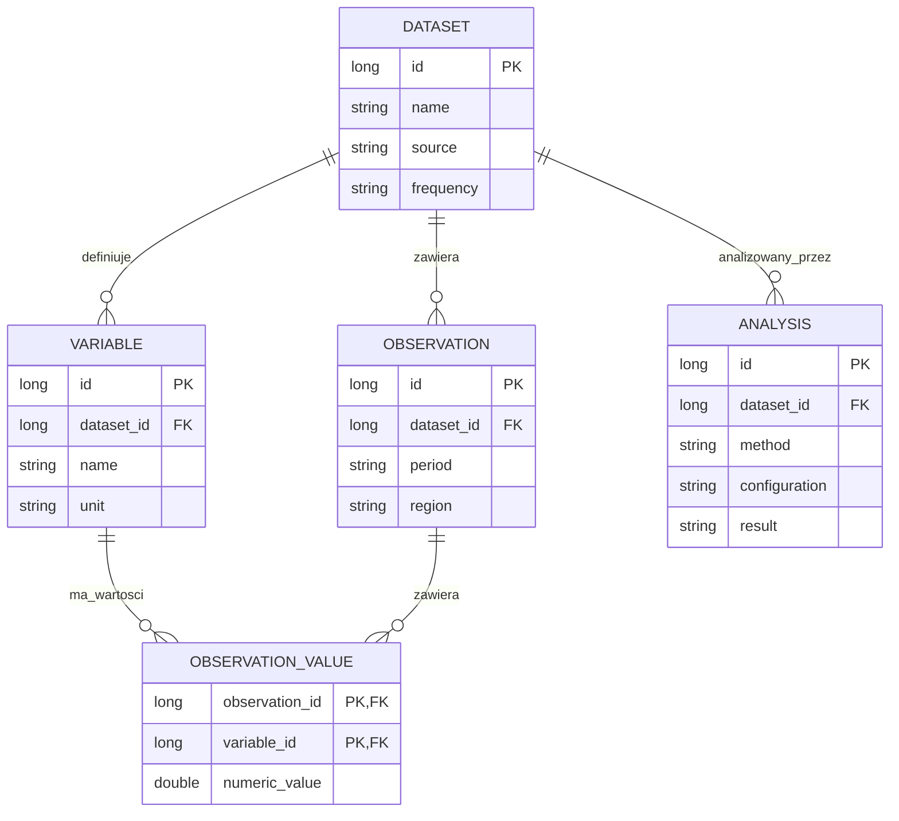

# Wymagania projektu - Programowanie obiektowe w języku Java

Projekt jest praktycznym podsumowaniem przedmiotu **Programowanie obiektowe**. Tematem projektu ma być **desktopowa aplikacja Java** wspierająca pracę z danymi ekonomicznymi lub ekonometrycznymi, a nie ogólny system CRUD bez uzasadnienia merytorycznego.

Projekt powinien pokazać, że student potrafi zaprojektować i wykonać aplikację w języku Java, wykorzystać programowanie obiektowe, zbudować graficzny interfejs użytkownika, połączyć go z relacyjną bazą danych oraz udokumentować rozwiązanie. Kontekst ekonometryczny powinien być widoczny w danych, zmiennych, modelu analizy i interpretacji wyników.

## 1. Powiązanie z efektami kształcenia

Projekt należy wykonać samodzielnie, niezależnie od aplikacji rozwijanej
podczas laboratoriów. Należy wykorzystać poznane technologie: Swing albo
JavaFX oraz JDBC/DAO albo Hibernate. Model danych, serwisy i analizę należy
zaprojektować dla własnego problemu ekonomicznego. Wykonanie zadań
laboratoryjnych nie zastępuje realizacji projektu semestralnego.

| Efekt | Jak jest demonstrowany w projekcie |
|---|---|
| **EK_01** | Poprawne użycie składni Javy, typów, struktur danych, kolekcji, strumieni, wyjątków i standardowych bibliotek. |
| **EK_02** | Świadome użycie klas, obiektów, hermetyzacji, dziedziczenia, polimorfizmu, klas abstrakcyjnych i interfejsów. |
| **EK_03** | Utworzenie GUI oraz interfejsu komunikującego się z relacyjną bazą danych. |
| **EK_04** | Zaprojektowanie i wykonanie działającej aplikacji Java, analiza jej poprawności oraz wykorzystanie bibliotek standardowych i zewnętrznych. |
| **EK_05** | Aplikacja GUI korzystająca z relacyjnej bazy danych, użycie narzędzi Java oraz kompletna dokumentacja projektu. |

Zaliczenie projektu w semestrze III weryfikuje przede wszystkim **EK_05**, ale podczas obrony student powinien również wykazać znajomość EK_01–EK_04.

## 2. Tematyka ekonometryczna

Projekt należy sformułować jako desktopowe narzędzie do analizy określonego problemu ekonomicznego. Użytkownik uruchamia program na swoim komputerze, wybiera lokalny plik danych albo korzysta z danych demonstracyjnych dołączonych do projektu, a następnie wykonuje analizę w GUI.

Nie jest wymagane tworzenie aplikacji webowej, API ani bezpośrednie łączenie z serwisem GUS, Eurostatem lub innym zewnętrznym serwisem. GUS, Eurostat, NBP czy World Bank mogą być jedynie źródłem pochodzenia danych, które wcześniej przygotowano i dostarczono aplikacji jako CSV, SQLite albo dane demonstracyjne.

Przykładowe pytania ekonomiczne:

- jak wykształcenie, doświadczenie i region wpływają na wynagrodzenie;
- jak inflacja, bezrobocie i stopy procentowe zmieniają się w czasie;
- jakie czynniki wpływają na ceny mieszkań;
- jak prognozować popyt, zużycie energii albo liczbę bezrobotnych;
- czy różnią się wybrane wskaźniki ekonomiczne między województwami;
- które czynniki najlepiej wyjaśniają frekwencję, sprzedaż lub koszty;
- jak zbudować ranking regionów na podstawie wielu wskaźników.

Źródłem danych może być między innymi GUS/Bank Danych Lokalnych, Eurostat, NBP, World Bank, dane samorządowe albo inny uzasadniony zbiór publiczny. Dane należy dostarczyć razem z projektem w postaci pliku lub skryptu inicjalizującego bazę. W dokumentacji trzeba opisać źródło, jednostkę obserwacji, okres, częstotliwość, jednostki miary i sposób przygotowania.

Nie wystarczy zapisać rekordów w tabeli. Aplikacja musi umożliwiać wykonanie analizy i interpretację jej wyników.

## 3. Wymagany zakres przetwarzania i analizy danych

Każdy projekt musi zawierać:

- obsługę i czyszczenie danych wejściowych, np. wykrywanie i usuwanie braków wartości, uzupełnianie braków średnią lub interpolacją z sąsiednich okresów albo filtrowanie wartości odstających;
- statystyki opisowe: minimum, maksimum, średnia, mediana, odchylenie standardowe;
- co najmniej jedną prostą operację analityczną na danych ekonomicznych, np. obliczenie zmian i dynamiki rok do roku (r/r), normalizację wskaźników (min–max), budowę prostego rankingu regionów lub porównanie podgrup;
- prezentację wyników na wykresie i w tabeli;
- krótki opis zastosowanego sposobu przygotowania danych, jednostek miary i ograniczeń zbioru;
- możliwość powtórzenia operacji dla wybranego zakresu czasu, regionu lub grupy obserwacji.

## 4. Minimalna funkcjonalność aplikacji

Aplikacja powinna zapewniać:

1. import lokalnych danych z CSV, pliku tekstowego albo wczytanie danych demonstracyjnych dołączonych do aplikacji;
2. walidację typów, braków danych, duplikatów i wartości odstających;
3. zapis danych w relacyjnej bazie danych;
4. przeglądanie, filtrowanie, sortowanie i wyszukiwanie danych;
5. wybór zmiennych i zakresu obserwacji do analizy;
6. wykonanie obliczeń statystycznych lub ekonometrycznych;
7. wyświetlenie wyników w tabeli i na wykresie;
8. zapis lub eksport wyników analizy;
9. komunikaty o błędach, pustych wynikach i niepoprawnych danych;
10. instrukcję uruchomienia oraz przykładowy scenariusz użycia;
11. samodzielny pakiet uruchomieniowy do demonstracji offline: obraz aplikacji
    `app-image` albo instalator Windows `.exe`, zawierający wymagane biblioteki
    i środowisko Java.

Operacje CRUD mogą być częścią aplikacji, ale nie mogą być jej jedynym celem. Formularz do ręcznego dodawania rekordów bez analizy nie spełnia wymagań projektu.

### Standard GUI

Wszystkie projekty, również na ocenę podstawową, spełniają [wymagania responsywności,
HiDPI i motywów](../jakosc-gui.html):

- adaptacyjny układ dla wąskiego i szerokiego okna, bez utraty podstawowych akcji;
- czytelny interfejs przy skali systemowej 100%, 150% i 200%, także z większą czcionką;
- domyślny tryb automatycznie dopasowujący się do motywu systemu, także po jego zmianie podczas pracy; ręczny wybór jasnego lub ciemnego wariantu obejmujący również dialogi i wykresy;
- zachowanie danych, filtrów i wyniku przy zmianie układu lub motywu oraz zapis preferencji;
- spójne odstępy, wyrównanie, ostre ikony, czytelne stany zaznaczenia i fokusu;
- nieblokujące GUI podczas importu, zapytań i obliczeń;
- raport z macierzy testów i zrzuty rzeczywistej aplikacji.

Wybrany tryb należy zapamiętać: przy ustawieniu ręcznym aplikacja wraca do niego
po restarcie, a tryb systemowy ponownie odczytuje preferencję systemu. Kontrolki
systemowe, takie jak natywny wybór pliku, mogą zachować wygląd systemowy; należy
opisać to w dokumentacji.

## 5. Model danych

Model musi być przedstawiony na diagramie ERD. Minimalnie powinien obejmować trzy powiązane tabele, np.:



W modelu długim dopilnuj, aby obserwacja i zmienna w jednym rekordzie wartości
należały do tego samego zbioru danych. Samo istnienie dwóch niezależnych kluczy
obcych tego nie gwarantuje; należy zastosować odpowiednie klucze złożone lub kontrolę
integralności w schemacie. Diagram jest punktem wyjścia do projektu, a nie kompletnym DDL.

Dokładny model zależy od tematu. Można zastosować model szeroki, w którym zmienne są kolumnami, albo model długi, w którym wartości zmiennych są przechowywane w osobnej tabeli. W obu przypadkach należy uzasadnić wybór.

Wymagane są:

- klucze główne i obce;
- co najmniej jedna relacja 1:N;
- ograniczenia integralności, np. `NOT NULL`, `UNIQUE`, `CHECK`;
- opis jednostek miary i typów danych;
- skrypt utworzenia bazy oraz dane demonstracyjne;
- zapytania odpowiadające rzeczywistym funkcjom aplikacji;
- rozdzielenie dostępu do danych od logiki analizy i GUI.

## 6. Wymagania dotyczące Javy i architektury

Projekt musi być wykonany w języku Java z użyciem Mavena i **JDK 27 GA**, z `maven.compiler.release=27`. Dla interfejsu JavaFX używaj **JavaFX 27**. Wersje i ustawienia IntelliJ określa [konfiguracja środowiska](../srodowisko.html); nie używamy wydań prerelease ani funkcji preview. Można wykorzystać Swing, JDBC, Hibernate i biblioteki pomocnicze, o ile ich użycie jest uzasadnione. Aplikacja desktopowa powinna działać po instalacji bez dostępu do Internetu; zewnętrzne źródło danych nie może być wymagane do demonstracji.

Zalecany podział:

```text
src/main/java/pl/uczelnia/projekt/
├── model/          # encje i obiekty domenowe
├── repository/     # JDBC DAO albo repozytoria Hibernate
├── service/        # reguły biznesowe i walidacja
├── analysis/       # statystyki, modele i raporty ekonometryczne
├── controller/     # obsługa zdarzeń GUI
└── view/           # widoki JavaFX/Swing
src/main/resources/
├── db/             # skrypty SQL i dane demonstracyjne
├── fxml/           # widoki JavaFX, jeżeli są używane
└── application.properties
```

W szczególności:

- widok nie może zawierać zapytań SQL ani implementacji modelu ekonometrycznego;
- klasy domenowe muszą mieć określoną odpowiedzialność i hermetyzację;
- należy wykorzystać kolekcje generyczne, wyjątki i standardowe biblioteki Javy;
- operacje wieloetapowe na bazie muszą być wykonywane w transakcjach;
- parametry zapytań muszą być przekazywane bezpiecznie, bez sklejania SQL;
- połączenie z bazą i dane konfiguracyjne nie mogą być zaszyte w kodzie;
- aplikacja musi zawierać dane demonstracyjne lub skrypt inicjalizujący, aby można było uruchomić pełny scenariusz offline;
- biblioteka zewnętrzna nie zastępuje wyjaśnienia metody i interpretacji wyniku.

## 7. Poziomy wykonania

### Poziom podstawowy - ocena 3.0

Projekt posiada działające GUI, bazę relacyjną, import danych, podstawowe statystyki, jedną metodę analizy ekonometrycznej oraz dokumentację uruchomienia. Student potrafi wyjaśnić klasy, kolekcje, przepływ danych i podstawowe zapytania.

### Poziom dobry - ocena 4.0

Projekt ma czytelny podział na warstwy, co najmniej cztery sensownie powiązane tabele, filtrowanie danych, kilka widoków, wykresy, analizę dla różnych podzbiorów danych, walidację, obsługę wyjątków i testy najważniejszych reguł. Wyniki są interpretowane ekonomicznie, a nie tylko wyświetlane.

### Poziom bardzo dobry - ocena 5.0

Projekt jest spójnym narzędziem analitycznym. Obsługuje rozbudowany model danych, zapis konfiguracji analiz, porównanie modeli lub okresów, eksport raportu, dopracowany interfejs i testy. Student potrafi uzasadnić dobór danych, zmiennych, metody, architektury i technologii oraz samodzielnie zmodyfikować aplikację podczas obrony.

## 8. Punktacja zgodna z sylabusem

| Obszar | Kryteria oceny | Maks. pkt. |
|---|---|---:|
| Baza danych | Poprawność i złożoność schematu, relacje, integralność, dane ekonometryczne i zapytania | 10 |
| Struktura i jakość kodu | OOP, podział na pakiety, biblioteki, logika analizy, walidacja, wyjątki i poprawność działania | 20 |
| Użyte technologie | JavaFX - 10 pkt., Hibernate - 10 pkt., Swing - 5 pkt., JDBC - 5 pkt.; maksymalnie 20 pkt. | 20 |
| Interfejs użytkownika | Adaptacyjny układ i dostępność akcji — 5; HiDPI i skalowanie tekstu — 4; automatyczne dopasowanie motywu systemu i pełne warianty jasny/ciemny — 4; spójność wizualna i czytelność tabel/wykresów — 4; płynność działania i komunikaty — 3 | 20 |
| Dokumentacja | Problem ekonomiczny, źródła danych, opis zmiennych, model i metoda; instrukcja użytkownika i uruchomienia; komentarze JavaDoc w kodzie i wygenerowana dokumentacja API; opis pakietu uruchomieniowego | 10 |
| Obrona projektu | Prezentacja działania, wyjaśnienie kodu, bazy, metody i interpretacji wyników | 20 |
| **Razem** |  | **100** |

## 9. Dokumentacja

Instrukcję uruchomienia należy przygotować w IntelliJ IDEA zgodnie
z [konfiguracją środowiska](../srodowisko.html).
Diagramy należy zapisywać w blokach `mermaid`, a zrzuty GUI wykonywać
w działającej aplikacji.
Scenariusz sprawdzenia należy przygotować dla własnego projektu, uwzględniając
jego dane, funkcje i oczekiwane wyniki.

Dokumentacja powinna zawierać:

1. opis problemu ekonomicznego i użytkownika aplikacji;
2. pytanie badawcze lub decyzyjne;
3. źródło danych, opis obserwacji, zmiennych i jednostek;
4. sposób importu, czyszczenia i walidacji danych;
5. diagram ERD oraz opis architektury aplikacji;
6. opis metody ekonometrycznej i wzorów lub założeń;
7. przykładowe wyniki z interpretacją ekonomiczną;
8. instrukcję instalacji i uruchomienia;
9. instrukcję użytkownika z opisem ekranów;
10. ograniczenia rozwiązania i możliwe rozszerzenia;
11. dokumentację kodu źródłowego w komentarzach JavaDoc dla publicznych
    i chronionych klas oraz metod pakietów modelu, serwisów, repozytoriów
    i analizy; opis ma wyjaśniać kontrakt API, parametry, wynik i wyjątki;
12. wygenerowaną dokumentację HTML API, dostarczoną w katalogu
    `docs/javadoc/` albo jako osobny katalog w pakiecie projektu;
13. opis sposobu utworzenia obrazu aplikacji lub instalatora, wymaganej wersji
    JDK podczas budowania oraz lokalizacji danych użytkownika.

## 10. Obrona

Podczas obrony student powinien:

1. uruchomić aplikację i przejść od importu danych do wyniku analizy;
2. wyjaśnić znaczenie zmiennej objaśnianej i zmiennych objaśniających;
3. zinterpretować co najmniej jeden parametr, wykres i miernik jakości;
4. wskazać w kodzie wykorzystanie hermetyzacji, polimorfizmu, kolekcji i wyjątków;
5. pokazać przepływ danych od GUI przez serwis/repozytorium do bazy;
6. wyjaśnić wybrane zapytanie SQL albo mapowanie Hibernate;
7. odpowiedzieć, co stanie się przy braku danych, duplikacie i błędnym typie;
8. wykonać drobną zmianę, np. dodać filtr, zmienną, statystykę albo kolumnę raportu;
9. wskazać komentarze JavaDoc w kodzie i otworzyć wygenerowaną stronę API;
10. uruchomić pakiet aplikacji na komputerze bez JDK oraz bez Internetu.

Brak orientacji we własnym kodzie, brak możliwości uruchomienia projektu albo brak interpretacji wyników może znacząco obniżyć ocenę z obrony.

## 11. Tematy niewystarczające

Poniższe tematy nie spełniają wymagań bez wyraźnego komponentu ekonometrycznego:

- zwykły katalog produktów;
- lista zakupów lub lista zadań;
- książka adresowa;
- prosty system logowania;
- formularz rejestracyjny;
- sklep internetowy bez analizy sprzedaży, popytu lub kosztów;
- ewidencja rekordów bez modelu, statystyk i interpretacji.

## 12. Skala ocen

| Punkty | Ocena |
|---:|---:|
| 0-50 | 2.0 |
| 51-60 | 3.0 |
| 61-70 | 3.5 |
| 71-80 | 4.0 |
| 81-90 | 4.5 |
| 91-100 | 5.0 |
